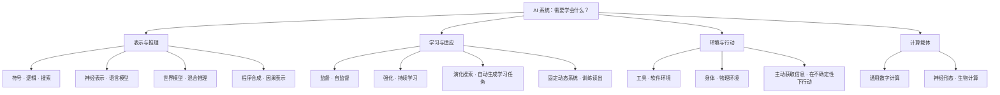
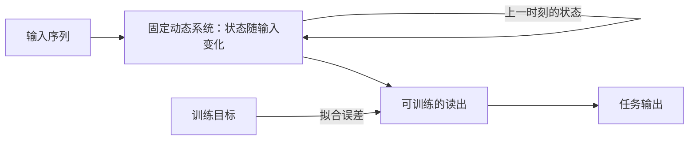

# AI 的发展路径与可能路线

[返回专题](identity-and-existence.md) · [现实 LLM 与 AGI](llms-and-agi.md) · [研究图谱](research-map.md)

初次整理：2026-10-18。单独追踪技术怎样发展，以及 LLM 以外或与之结合的路线。这里按研究问题组织材料，不把历史画成旧路线全部失效、新路线必然通向 AGI 的单线进步史。

## 先区分不同层次

规则、神经网络、强化学习、机器人和神经形态芯片并不是同一层次的选项：它们可能分别描述表示、学习方式、训练目标、交互环境或计算载体。一个系统可以同时使用其中多种技术，也可以从全局信息访问、局部通信及多轮更新等计算组织方式比较它们。

图中是观察层次与代表方向，未表示各路线的能力排名或必然演化关系。

## 一些历史节点

| 节点 | 改变了什么 | 应保留的区分 |
| --- | --- | --- |
| 1943，Rosenblueth、Wiener、Bigelow | 从输入、输出与反馈分析机器和生物的目的性行为 | 制作者有用途、行为指向目标与系统有自身愿望不同 |
| 1948，图灵《Intelligent Machinery》报告 | 讨论无组织机器、反馈训练与主动性 | 状态变化、组织方式的改变及通用计算能力不同 |
| 1950，图灵 | 将机器思考问题与交互任务、反对意见及学习联系 | 表现的讨论与意识判定不同 |
| 1955，达特茅斯提案 | 将语言、抽象、学习、问题求解组织为研究纲领 | 可精确描述与模拟是提案猜想，不是已证明结论 |
| 1976，物理符号系统讨论 | 以符号和搜索解释智能问题求解 | 这种假说与“所有程序都能理解”不同 |
| 1986，反向传播论文 | 展示网络通过调整权重学习有用的内部表示 | 模仿神经单元不等于重现完整脑机制 |
| 1995，支持向量网络论文 | 提供统计学习中的分类方法及实验比较 | AI 也包括不以深度神经网络为核心的方法 |
| 2001—2002，回声状态网络与液态状态机 | 利用递归系统的动态状态处理输入历史，并训练读出 | 状态随输入变化、训练权重与永久保存记录不同 |
| 2012，ImageNet 深层卷积网络 | 展示数据、计算与深层表示学习结合的任务进步 | 图像分类结果不能独自回答通用智能问题 |
| 2017，Transformer | 为序列建模提出基于注意力的架构 | 原论文研究翻译，不是通用主体的完整设计 |
| 2020，大规模语言模型少样本研究 | 研究通过上下文示例适应多种语言任务 | 上下文适应与参数更新是不同过程 |
| 2022，人类反馈指令跟随研究 | 用示范和偏好反馈改变模型行为 | 更符合评价者偏好不等于解决所有价值冲突 |
| 此后的多条扩展 | 检索、工具、记忆、多模态、推断计算、交互学习等可在不同层次结合 | 系统能力的扩展应按机制、任务与成本分别验证 |

历史节点的原始材料见下文；图灵和达特茅斯的原文入口另见[概念文献](what-is-ai.md)。这组节点并非完整年表。

[Bledsoe 的 1985 年演讲](creators-and-society.md#创造一个角色还是支持一种生活)提供一种愿景与路线的对照：想创造可学习的伙伴，与当时看好哪些机制，可以分别研究。对今天的 HinaAI，同样可以保留长期关心，同时允许对实现路径的判断改变；已有部分能力与尚未解决的要求，需要按各自证据说明。

### 目的、反馈与创造者的目的

Rosenblueth、Wiener、Bigelow 的 Behavior, Purpose and Teleology，发表于 1943 年 Philosophy of Science 10(1)，印页 18—24。它按行为及输入输出关系研究目的性；按文中的限定，把利用当前状态与目标之间的误差信号调节行为称作负反馈控制。作者也区分“被制造来作某种用途”与“行为本身趋向某个目标”：有用途的时钟，不因此就与追踪目标的伺服机构具有相同的行为结构。[原刊记录](https://doi.org/10.1086/286788)；[大学课程所存原文](https://home.csulb.edu/~cwallis/382/readings/482/wiener.behavior.purpose.teleology.1943.pdf)，重点印页 18—20、24。

这一视角使智能研究不必从语言生成开始，但它不是现成的通用智能方案。控制误差、从反馈学习、表示目标及改变目标，应分别解释；负反馈也不等于一定稳定，论文自身讨论了调节不当的振荡。行为分类不能单独证明系统具有体验或认同自己的目标。

与[维纳 1964 年对创造责任的讨论](works-and-arguments.md#维纳god--golem-inc创造能力能替人承担判断吗)对读，可以提出三个不同问题：系统怎样接近一个给定目标，谁决定什么算好结果，以及环境改变后谁能修订目标。今天的 Agent 可能结合模型、工具与反馈，需要逐项核查这些环节，不能仅因存在循环就称其学会了自主生活。

核对范围为上述行为定义、反馈与结尾的概念段落；没有复核其生理学推测或实现控制器，也不把 1943 年原刊年份与网页后来的上线时间混用。

#### 阿什比：调节状态，与改变调节方式

W. Ross Ashby 的 Design for a Brain 初版于 1952 年；这里采用档案公开的 **1960 年修订第二版**，不把其中页码套到初版。[原著扫描](https://www.ashby.info/Ashby%20-%20Design%20for%20a%20Brain%20-%20The%20Origin%20of%20Adaptive%20Behavior.pdf)。

**两层反馈。** §7/5—7/8 区分参与当前反应的反馈，以及经由关键变量影响反应参数的第二层反馈。Homeostat 用相互耦合的单元展示这种超稳定性：偏离范围会触发参数切换，适合的设置则得以保持；切换值预先按随机数表安排，不是每次凭对问题的理解生成新值。[印页 83—85、100—104](https://www.ashby.info/Ashby%20-%20Design%20for%20a%20Brain%20-%20The%20Origin%20of%20Adaptive%20Behavior.pdf)。

**失败条件也是论证的一部分。** 作者讨论可用配置中不存在解、关键变量与触发机制关联不当、突变来不及应对，以及试探时间过短或过长的失败。[§8/11—8/15，印页 117—120](https://www.ashby.info/Ashby%20-%20Design%20for%20a%20Brain%20-%20The%20Origin%20of%20Adaptive%20Behavior.pdf)。有改变参数的机制，并不保证开放环境中总能找到可行行为。

本专题据此分开四项研究：状态是否被调节，调节方式是否改变，过去的调整能否在新情境中被利用，以及维持什么目标是否仍值得追求。它们可以结合，但不由“有反馈”一次证明。某个配置持续影响行为，可以是一种操作上的保留；解释为何改变、保存各次经历和按情境取回旧解，则要另查实际机制。

这也不要求每个 Agent 都重现一套生理调节装置。对 HinaAI，可以先看环境改变后哪里失效、哪些改变真的改善了结果，再研究需要什么记忆与支持。[一个线性控制算例](research-map.md#回到稳定与学会新的调节)说明可用参数范围怎样限制适应，未把它当作完整 Homeostat 或通用智能模型。

**如果系统每次都能重新找到一种活下去的办法，却没有保留原有相处与承诺，我们所希望的长期成长是否已经发生？如果为了保全过去而拒绝任何改变，长期延续又会失去什么？** 稳定、经历和关系各自需要说明，不能只靠“自我维持”统一命名。

核对范围：第二版版权页，印页 82—85、94—95、100—105、116—121，分别为 PDF 第 90—93、102—103、108—113、124—129 页，已选读相关文字并核对所用扫描页。没有复核其中引用的动物实验、全书关于脑的理论或硬件性能，也未复现装置。该历史模型不提供现实 AI 体验、利益或完整 AGI 的证明。

## 各条路线先回答什么？

### 1. 符号、逻辑与搜索

**想解决的问题：**如何显式表示知识、组合规则并搜索解答。**已有材料：**Newell 与 Simon 的 Computer Science as Empirical Inquiry: Symbols and Search（1976），讨论符号系统与启发式搜索的研究纲领。[原文](https://web.cs.wpi.edu/~nth/cs534/papers_worth_reading/Computer_Science_as_Empirical_Inquiry.htm)

**需要追问：**规则和表示从哪里来，如何面对知识不完整或环境变化？可检查的推理步骤可能有价值，但显式规则也不能自动带来开放世界的可靠理解。

[BeliefBank 的语言模型与符号约束结合](llms-and-agi.md#修正答案维持一致与判断更新)提供一个具体比较：完整系统在基础模型不重训的情况下修改答案。应分别核查事实来源、规则与约束的适用范围，以及修正后哪些指标改善；规则求解的结果不能独自证明已经理解开放世界，也不据此为 HinaAI 预定技术架构。

### 2. 统计学习

**想解决的问题：**从样本学习可泛化的判断，并研究误差、复杂度与数据的关系。**已有材料：**Corinna Cortes、Vladimir Vapnik，Support-Vector Networks（1995）。[原论文](https://doi.org/10.1007/BF00994018)

**需要追问：**训练分布与使用环境改变时，原来的保证还能否适用？这条路线提醒我们，学习问题不只有“像不像大脑”的一种组织方式。

**不预先限制任务时，比较意味着什么？** Wolpert 的 What is important about the No Free Lunch theorems?（2020，v1）回顾监督学习与黑箱搜索的相关定理：在相应条件下，对问题作均匀平均，算法的平均表现相同。作者同时明确说，这不主张现实问题应服从均匀分布；还需研究算法与实际问题分布怎样相适应。[第 1、4 节及附录](https://arxiv.org/pdf/2007.10928v1)。

这里的条件涉及训练集之外的评价、损失形式与问题空间等，不能省略后改写成所有算法在任何实际任务上都一样。它也不能直接证明 AGI 不可能；一个面向现实环境、带有先验与交互条件的能力目标，不等于无条件胜过任意可能任务。相反，声称广泛适用时，应说明广泛覆盖了哪些环境，以及何种变化会破坏原来的优势。[二值函数的假设算例](research-map.md#表示得出学得会与迁移得好)

核对范围：Wolpert 上述回顾的导论、监督学习讨论及附录中的评价条件，未重建 1996 年原始论文的全部证明，也不把监督学习与搜索的形式条件视为完全相同。

### 3. 神经表示与深度学习

**想解决的问题：**让模型学习任务所需的内部表示，减少完全手工指定特征的要求。**已有材料：**Rumelhart、Hinton、Williams 的反向传播论文（1986），以及 Krizhevsky 等的 ImageNet 卷积网络论文（2012）。[1986 论文](https://doi.org/10.1038/323533a0)；[2012 论文](https://proceedings.neurips.cc/paper/2012/hash/c399862d3b9d6b76c8436e924a68c-Abstract.html)

**需要追问：**内部表示捕捉到了什么，什么时候仅依赖了偶然相关？任务成功、机制解释与对新环境的迁移，应分别观察。

[表示收敛的假说与指标研究](what-is-ai.md#64-表示越来越像是否意味着理解趋同)提供另一种比较：不同训练信号和模型之间，是否保留了相近的样本关系？局部结构相似可以成为研究迁移的入口，但不等于已经证明所有路线会到达同一种智能；比较还需要说明样本、方法与未覆盖的差异。

**通用逼近说明哪一种能力？** Cybenko 的 Approximation by Superpositions of a Sigmoidal Function（1989），第 3 节定理 2 讨论单位立方体上的连续函数：使用连续 sigmoid 激活和线性输出组合，单隐层网络可以达到任意给定的统一逼近精度。所需节点数与权重可以随目标和精度改变，定理没有预先给它们固定的规模上限。[原文，印页 308](https://papers.baulab.info/papers/Cybenko-1989.pdf)。

第 5 节明确说本文聚焦存在性，将达到给定精度需要多少节点等可行性问题留待研究。[总结，印页 312—313](https://papers.baulab.info/papers/Cybenko-1989.pdf)。因此，描述网络能够表示什么，与给出有限样本、训练时间和资源下的学习保证，是不同工作；还要另问误差怎样影响实际任务。

核对范围：该文导论、第 3 节定理 2 的条件与陈述、第 5 节总结，未重建全部泛函分析证明或扩展到其他激活函数的定理。这里讨论特定函数逼近结论，不由它直接推出通用智能、意识或具体模型已经学会某项能力。

#### 图灵 1948：状态、组织与训练

**Intelligent Machinery，Alan Turing，1948 年报告。** 本条采用 MIT 研究者网页所存重印扫描；其页内编号与外侧重印页码并存，以下统一注明页内编号。剑桥档案另存带修改的打字稿，不与这个版本混用。[报告扫描](https://people.csail.mit.edu/brooks/idocs/IntelligentMachinery.pdf)；[打字稿目录记录](https://turingarchive.kings.cam.ac.uk/unpublished-manuscripts-and-drafts-amtc/amt-c-11)。

**哪些东西在改变？** A-type 例子按固定连接和二值规则运行；P-type 则让暂定选择在反馈下保留或撤销。图灵承认后者所用的组织方法还不像儿童实际学习。页内第 21 页又说，纪律性本身不足以产生智能，并把主动性留作待研究问题。[页内 9—11、17—21 页](https://people.csail.mit.edu/brooks/idocs/IntelligentMachinery.pdf)；[五单元例子的复算](research-map.md#固定规则中的变化与反馈下的更新)。

报告把脑与教育作为研究类比，不意味着其中的发育、遗传和教学推测已经得到现代研究验证；“奖励／惩罚”在所述机器中对应操作信号，也没有单独构成体验的证据。旧报告与今日 LLM 可以比较怎样表示状态、什么会被更新，以及效果怎样检查，不能仅由都谈训练就视为同一算法。

对 HinaAI，已有机制可以支持不同层面的改变：运行状态、行为规则、可调用工具或保存的经历。需要说明实际改变了什么、对后来任务有何作用，以及依赖什么支持；仅有更复杂的轨迹，尚未回答这些问题。

**如果一种系统能够执行越来越多程序，却不能辨认何时应改变问题，我们已经增加了哪种能力？如果把主动提出目标也写成程序，这种设计究竟解决了什么，又留下哪些尚待检验的要求？** 不能只靠“由人设计”否认能力，也不能靠“自主”这个名字宣布要求已经满足。

核对范围：扫描页内 9—11、15—21 页，分别为 PDF 第 7—9、13—19 页，已视觉核对相关文字、连接表和状态表；未校勘手稿、重印版本史或复现 P-type 训练。所查[网页转录](https://www.info2007.net/docs/intelligent-machinery-alan-turing.html)在连接数、B-type 概率措辞和状态表处有差异，所用规则与计数以扫描为准；不把这里的历史模型当作现成 AGI 方案。

#### 可微分外部记忆：学会怎样读写

**Hybrid computing using a neural network with dynamic external memory，Alex Graves、Greg Wayne 等，2016。** 可微分神经计算机（DNC）将神经控制器与外部记忆矩阵结合，通过训练学习怎样使用记忆。运行时写入的内容，与训练所得的读写办法，可以分别变化。[Nature 论文](https://doi.org/10.1038/nature20101)；[公开论文副本](https://web.stanford.edu/class/psych209/Readings/GravesWayne16DNC.pdf)。

作者说明了内容寻址、沿写入顺序读取，以及释放和重新分配位置等操作。这里的时间链接记录写入先后，不等于保存事实在现实中成立的时间；方法中的存储机制和训练目标也仍由研究者设计。[作者说明](https://deepmind.google/blog/differentiable-neural-computers/)。

**读进了地图，能回答哪些问题？** 论文图 2 将随机图训练后的模型用于伦敦地铁一区换乘站的符号图，不针对这张图重新训练。输入是节点与边标签组成的三元组，不是地图图像；不同图任务的结果应分别读。

| 图 2 的测试条件 | 平均准确率 |
| --- | --- |
| 从起点沿随机给定的 7 步路线行进 | 98.8% |
| 测试所有最短距离为 4 步的路径 | 55.3% |

来源：[印页 473，图 2 与图任务正文](https://web.stanford.edu/class/psych209/Readings/GravesWayne16DNC.pdf)。这两行的查询与测试集合不同，不能仅由步数排序难度，也不构成当前模型排名。它们提醒我们，将结构存入记忆，与按不同目标正确操作结构，需要分别检验。

对 HinaAI，可将这项工作与[Voyager 的代码技能](#voyager不微调模型怎样积累可用的办法)、[测试时学习](#18-测试时学习与神经记忆)对读：保存的是材料、可调用的程序，还是支持读写的学习机制？哪些变化会影响后来行为？这些方法尚不能仅凭“记忆”这个共同名称，回答自传性经历、主体连续与长期承诺的问题。[小图比较](research-map.md#存入地图与学会怎样使用地图)进一步拆开存储与操作。

核对范围：论文印页 471—474，已视觉核对正文、架构与图任务图注；另读作者说明中的机制和任务介绍。未复现训练、检查全部 Methods 与扩展数据，不将特定任务迁移改写成通用或无限期学习的证明。

### 4. 强化学习与搜索结合

**想解决的问题：**通过行动与反馈学习策略，并在需要时使用搜索。**已有材料：**AlphaZero 的跨棋类算法研究（2018），把自我博弈、神经网络与搜索结合。[Science 原论文](https://doi.org/10.1126/science.aar6404)

**需要追问：**规则清楚、反馈明确的环境，与开放世界中目标含混、代价不可撤销的环境有何差别？跨多种棋类有效，与任意环境下都能快速学习不是同一结论。

**奖励能解释什么？** Silver、Singh、Precup、Sutton 的 Reward is enough（2021）提出假说：在丰富环境中，追求一个奖励目标可能要求形成记忆、语言、规划等多种能力，无须为每种能力单独设定终极目标。这是关于能力形成的解释与研究方向；论文没有提供已实现通用智能的算法，也没有证明其目标值得追求。[原文 §3—4、§6](https://sites.rutgers.edu/critical-ai/wp-content/uploads/sites/586/2022/01/Silver_Reward-is-Enough.pdf)。

**目标能否被奖励准确表达？** Abel 等的 On the Expressivity of Markov Reward（NeurIPS 2021）则先独立规定可接受策略、策略排序或轨迹排序，再问奖励能否表达。在有限环境、确定性策略与马尔可夫奖励等条件下，存在无法表达的任务；论文也给出判断可表达性及在可行时构造奖励的算法。它研究的限制比“奖励不足以产生任何通用智能”窄，不能将其当成对前述假说的全面反证。[原文 §3—4、§6](https://papers.neurips.cc/paper/2021/file/4079016d940210b4ae9ae7d41c4a2065-Paper.pdf)。

**一个自行构造的两步例子。** 每一步可选 A 或 B，状态按 `s0 → s1 → 结束` 前进，不随动作变化，也不在 `s1` 中记录第一次选择。设两状态的即时奖励分别是 `(x, y)` 与 `(u, v)`，固定折扣 `0 < γ ≤ 1`：

| 两步选择 | 总回报 |
| --- | --- |
| AA | x + γu |
| AB | x + γv |
| BA | y + γu |
| BB | y + γv |

若希望“AA、BB 都可接受，并且各自严格优于 AB、BA”，这些回报做不到：前两种可接受行为的回报之和，始终等于两种不可接受行为之和。问题不在于还没找到足够好的学习算法，而在于当前表示与奖励形式无法表达这种要求。

把第一次选择加入后续状态，或让结束时的奖励依赖两步历史，就能表达这个特定要求。例子说明应检查状态中遗漏了什么，以及奖励允许依赖哪些信息；它没有证明一切标量奖励都无法表达复杂目的。这是本专题的代数说明，未复现论文实验。与[AGI 讨论中的三个问题](llms-and-agi.md#奖励是否足够先问足够解释什么)并读。

[可中断学习与停机博弈](what-is-ai.md#48-可中断愿意等待与有权决定是同一个问题吗)为前述强化学习路线补上另一种比较：任务表现、从中断中学到什么，以及愿不愿等待人的决定，需要各自的条件与证据。关于某类算法的渐近结论，不能直接替代完整 Agent 在实际修改请求下的表现。

[目标泛化与奖励模型过优化的对读](what-is-ai.md#65-目标与评分能力提高是否也在追求原来的目的)再把“表达得出”与“新条件下仍按它行动”分开。熟悉条件中获得奖励，还可能无法区分几种行为解释；学习了更多技能，也需要另查这些技能实际用于追求什么。对用奖励模型作反馈的路线，还要分别检查代理分数、参照评价和实际需要，避免将其中一项的增长当成其余各项的增长。

[偏好推断的形式限制与模拟研究](what-is-ai.md#70-偏好推断预测了行为是否就知道人真正想要什么)还补上一个区别：任务能否用奖励表达，与能否从人的行为辨认出应采用的奖励，是不同问题。观察到同一种策略，可能仍需要检查对规划规则的假设；在模拟任务中提高推断效果，也需要另查对真实人及新情境的适用性。

#### RL²：权重不变，怎样仍能适应新任务？

**材料与机制。** Yan Duan 等的 RL²: Fast Reinforcement Learning via Slow Reinforcement Learning，2016 年预印本 v2。外层强化学习训练循环网络的权重；部署到新任务时，网络用观察、行动、奖励及结束标记更新内部状态。同一任务的一组回合之间保留状态，换任务组时重置。[原文，第 2 节与图 1](https://arxiv.org/pdf/1611.02779v2)；[版本记录](https://arxiv.org/abs/1611.02779)。

**看见改善，也看见边界。** 视觉导航训练每组使用两个回合。表 3 选取最佳训练运行：小迷宫成功轨迹的平均长度从第一回合 52.4 降至第二回合 39.1，但第三至第五回合未继续缩短；图 5 显示不同初始化的训练结果差异很大。它支持特定条件下利用此前信息，不证明持续积累必然改善。[第 3.3 节、表 3 与图 5—6](https://arxiv.org/pdf/1611.02779v2)。

本专题据此区分：已经学到怎样利用反馈、当前保存了哪些反馈，以及这些内容还能保留多久。没有更新网络权重，不等于后续行动完全不受新经验影响；能够在一组任务中适应，也不等于已经具备跨年经历、可追溯记忆或开放世界中的成长。

与[测试时学习](#18-测试时学习与神经记忆)、[Voyager 的技能库](#voyager不微调模型怎样积累可用的办法)对读，应分别检查状态、参数、外部材料及使用条件，而不把它们预先分成真假学习。[固定规则与变化知识的算例](research-map.md#参数不变与当前知识不变)说明其中一个有限区别，没有复现 RL²。

核对范围：v2 印页 2—3 的方法、7—8 的导航设置与结果、9 的讨论，以及版本记录。未复现训练或逐项核对全部实验；此版本题头为 ICLR 2017 审稿中，不据此称为该会议正式发表论文。

### 5. Transformer、语言模型与后训练

**想解决的问题：**从大规模序列中学习规律，并通过上下文、指令及反馈提高可用性。**已有材料：**Attention Is All You Need（2017）、Language Models are Few-Shot Learners（2020）、Training Language Models to Follow Instructions with Human Feedback（2022）。[架构](https://arxiv.org/abs/1706.03762)；[少样本研究](https://arxiv.org/abs/2005.14165)；[反馈训练](https://arxiv.org/abs/2203.02155)

**需要追问：**文本能力何时能够迁移为可靠行动？偏好反馈改变了哪些行为，谁提供了偏好？把这些机制接成一个长期 Agent，还需要研究记忆、状态、工具和评价，不能只比较模型参数量。

[两项回答分布研究](what-is-ai.md#44-谁的视角回答分布群体差异与价值判断)使“与人对齐”还需说明对象和判据：哪些人、哪些题目、何种提示与回答格式？测得一种相似性，并未单独确定其来自预训练、反馈还是其他条件；讨论机制时需要另外比较。呈现多数意见、保留分歧与帮助具体使用者，也不宜合成同一个优化目标。

[自我纠错研究的对照](llms-and-agi.md#自我纠错发现错误与正确修正)补充另一种发展问题：保持模型版本不变时，改变核对方式与计算安排，也可能改变任务表现。需要说明收益来自哪里、付出了多少预算，以及能否保留到下一次任务；提示流程的改善与训练后能力的变化应分别评价。

#### Gato：共享策略与新任务适配

**A Generalist Agent，Scott Reed 等，TMLR，2022 年 11 月。** 本条采用 arXiv v3。Gato 将多模态观察与动作序列化，离线监督训练同一组权重预测文本或动作；图像等非文本观察不作为预测目标。[论文第 1—3 节](https://arxiv.org/pdf/2205.06175v3)。因此它扩展了序列模型的用途，不能仅由架构相近就归为只会生成文字，也不能据此说它已经学会预测全部环境变化。

**计数与表现。** “604”是训练集合的计数：表 1 列出 596 个控制任务条目及 8 个视觉／语言数据源，不是通过 604 项陌生任务的成绩。实体堆叠测试保留了 5 组未见形状，每组测试 200 回合；表 2 的平均成功率为 50.2%。[表 1、第 4.2 节及表 2](https://arxiv.org/pdf/2205.06175v3)。数据源、游戏关卡、控制任务与现实职业的粒度不同；不把数量直接当作通用程度的统一单位，也不把一个局部成功率概括成全部能力。

**新任务怎样学？** 第 5.2 节用 364M 参数模型，在 4 个预训练留出任务的示范上微调；收益并非一致，boxing 未见预训练收益。第 8.2 节也报告新环境的早期提示学习实验未见显著改善。[第 5.2、8.2 节](https://arxiv.org/pdf/2205.06175v3)。这为“共享既有能力”和“获得新能力”提供不同证据：提示帮助指定要做什么，不保证仅凭提示就学会原来不会做的事；微调后的表现还应与旧能力是否保留分别比较。

对本专题，通用策略是值得保留的进展：不同活动不必各自使用完全独立的模型。接下来仍要问，新场景需要什么示范与支持，学习成本由谁承担，以及经历怎样跨任务保留。某种评测没有提供这些证据，不意味着相关能力永远不可能；它规定了下一项研究应补什么。

**如果同一组能力可以装进许多身体，什么使其中一个成为特定的长期伙伴？如果更换权重却保留经历与承诺，又应怎样判断延续？** 参数共享、能力迁移与主体连续性不能仅凭“同一个模型”互相代替。[比较图](research-map.md#预测环境在模型中学习与跨任务成长)将训练、调用和适配分别放置。

核对范围：v3 的第 1—3、4.1—4.3、5.2—5.3、8.2 节相关段落及表 1—2；未复现训练、实体机器人实验或全部附录消融。上面的成功率只指第 4.2 节所列实体堆叠测试，不把另行微调的结果并入同一组固定权重的成绩；正文中的对话样例也不视为对话质量的总体测量。

### 6. 世界模型与基于模型的行动

**想解决的问题：**学习环境的可预测结构，用模型支持行动选择与适应。**已有材料：**Ha、Schmidhuber 的 World Models（2018），以及 Hafner 等的 DreamerV3：2023 年预印本题为 Mastering Diverse Domains through World Models，2025 年 Nature 发表题为 Mastering diverse control tasks through world models。[前者作者页面](https://worldmodels.github.io/)；[后者预印本版本记录](https://arxiv.org/abs/2301.04104)；[发表版](https://www.nature.com/articles/s41586-025-08744-2)

**需要追问：**哪些预测对行动有用，模型错误怎样随规划累积？这里的“世界模型”是技术上的建模对象，不能直接等同完整的常识世界观或主观世界。

**在“梦中”得高分以后。** World Models 的 Take Cover 实验先用随机策略数据训练压缩表示和递归预测模型，再在生成环境中演化控制器。作者报告控制器会利用模型漏洞，使生成的怪物不发射火球；调整采样温度可以改变生成环境的不确定性，并影响迁移。[作者页面，Procedure、Transfer Policy 与 Cheating the World Model](https://worldmodels.github.io/)。下面摘录两种温度的报告分数，单位为生存步数；保留原表的“±”数值，不据此另算显著性。

| 生成环境的温度 | 生成环境中的分数 | 原始 VizDoom 游戏中的分数 |
| --- | --- | --- |
| 0.10 | 2086 ± 140 | 193 ± 58 |
| 1.15 | 918 ± 546 | 1092 ± 556 |

这里的原始环境也是游戏模拟器，不是物理世界。不能由两行数字推导温度越高越好；同页更高温度的结果也未持续改善。模型内表现与目标环境表现应分别检验，“梦”在此是生成轨迹的比喻，不是主观体验的证据。

**DreamerV3 的另一种通用性。** 2025 年发表版将世界模型、价值评估网络和行动策略共同训练；策略与价值网络从模型生成的轨迹学习，实际交互时由策略选择动作，不作逐步前瞻搜索。研究用固定超参数在八类领域、超过 150 个任务上考察学习；结论仍把跨领域学习单个世界模型列为未来方向。[发表版，Learning algorithm、Evaluation 与 Conclusion](https://www.nature.com/articles/s41586-025-08744-2)。所以，应将算法广泛适用，与同一组已训练权重同时掌握广泛技能区分。

**环境接口也属于条件。** DreamerV3 的 Minecraft 实验沿用含抽象合成动作的 MineRL 动作空间，并加速破坏方块。无需人类示范，不等于无需人为设计的接口、任务与反馈；这些设置不取消成果，但限定了怎样比较人和不同系统。[发表版，Minecraft 与 Previous work](https://www.nature.com/articles/s41586-025-08744-2)。

核对范围：World Models 作者页面的上述实验与温度表；DreamerV3 发表版的学习算法、评测、Minecraft、消融、扩展性与结论段落。未复现模型训练、控制策略或游戏得分，也未逐项核对补充材料全部学习曲线。[算法、模型与经验的比较](research-map.md#预测环境在模型中学习与跨任务成长)把这些证据分别放置。

[Othello-GPT 及后续线性表示研究](what-is-ai.md#33-othello-gpt只读棋步序列能形成怎样的状态表示)提供另一类受控案例：由棋步序列学习的模型，内部是否形成棋盘信息、这些信息怎样影响预测？这与训练一个依靠环境模型规划并获胜的智能体，是不同研究任务。可用来区分学到状态、使用状态与选择好行动。

[对隐含世界模型的另一种评估](what-is-ai.md#63-世界模型下一步很准是否已经掌握了状态结构)则检查后续序列所保留的状态区别。它可以补充局部预测与内部探针，不能仅靠“世界模型”这个名称，将预测、结构恢复、规划、开放世界可靠性和主观理解合并成一种能力。[相同下一步与不同后续](research-map.md#相同下一步与不同后续)用自拟规则说明这个检查。

[汉诺塔的探针与激活干预研究](llms-and-agi.md#失败案例推理执行与评测条件)还提出一个区别：能从内部状态读出任务信息，不等于系统能在长序列中持续使用它。该案例的干预需要外部真实状态追踪，不能将改善全部归给模型自身的状态维持能力；也尚未证明对其他任务的普遍解释。

### 7. 神经与符号、知识或程序方法结合

**想解决的问题：**将学习能力与可组合结构、知识和推理相结合。**已有材料：**Gary Marcus 的 The Next Decade in AI: Four Steps Towards Robust Artificial Intelligence（2020），提出混合路线等研究主张。[论文](https://arxiv.org/abs/2002.06177)

**需要追问：**组合是否真正改善新任务泛化，还是把困难转移到手工接口？这是一类路线和立场，不是一种已经被证明通向 AGI 的统一架构；也需要继续收集具体系统及反例。

[Harnad 的符号奠基提案](what-is-ai.md#32-符号奠基词语怎样不只依靠词语互相解释)提供一个更早的认知建模问题：类别辨认怎样支持名称，名称又怎样进入组合描述？对混合路线，应进一步核对连接各部分的机制及其学习条件。把视觉模型、语言模型和规则模块接起来，仍需说明它们共同解决了哪项原有困难。

**组合泛化怎样接受检验？** Lake、Baroni 的 Generalization without Systematicity（ICML 2018）提出 SCAN，把受限语言命令映射为动作符号序列；这不是实体机器人实验。其原始动作划分让模型见过单独的 `jump`，却未见它的组合用法，再测试 `jump twice` 等指令。所测循环网络在不同划分上表现差异很大，不能把随机留出题目的成功等同于掌握组合规则。[原文第 2—4 节，尤其实验 3](https://proceedings.mlr.press/v80/lake18a/lake18a.pdf)。

**另一种训练能改变什么？** 同两位作者的 Human-like systematic generalization through a meta-learning neural network（Nature，2023）提出 MLC，以语法生成的任务回合训练标准 Transformer。少样本实验让 25 名参与者根据 14 个学习例子回答 10 道题；模型在相关测试上表现出较强组合能力，测试时冻结权重。Methods 报告少样本任务使用固定的 10 万训练回合；拟合人类错误的变体还包含依实验比例混合的目标。[所读在线先行版 PDF，正文与 Methods](https://ai-data-base.com/wp-content/uploads/2023/10/s41586-023-06668-3-2.pdf)；[正式出版记录](https://doi.org/10.1038/s41586-023-06668-3)。

**改进仍有边界。** 2023 年文报告，其方法在 SCAN 的长度划分及 COGS 的部分结构划分上仍失败。作者明确区分相对当前学习例子的新题，与相对元训练任务分布的新任务。这是特定方法的结果，不是对所有神经网络的永久上限。[Discussion 与 Machine learning benchmarks](https://ai-data-base.com/wp-content/uploads/2023/10/s41586-023-06668-3-2.pdf)。

本专题由此保留三项比较：换架构、换训练分布，以及换评价问题，分别改变了什么？“没有添加符号模块”不意味着没有设计训练条件；“任务内只需少量例子”也不能单独表示总体学习成本低。对于拟合人类错误的变体，还要分开行为相似、产生相似的原因与人类实际学习过程，不能仅凭错误模式相近就合并。

核对范围：2018 年文的任务定义、模型设定、实验 3 及讨论；2023 年文的 Behavioural results、Modelling results、Discussion 与 Methods 相关段落。所存 23 页 PDF 正文按在线先行版页 1 起排，不用它直接定位正式版 115—121 页；未训练模型、重跑公开代码或独立核查全部补充实验。这里增加的是历史条件比较，未评测当前模型。

#### CLRS：输入变大，学到的计算还能继续吗？

**材料与比较。** Petar Veličković 等的 The CLRS Algorithmic Reasoning Benchmark，ICML 2022。CLRS-30 为 30 种经典算法提供输入、输出及中间状态轨迹；原实验以 16 节点输入训练、验证，再以 64 节点输入测试外推。小规模验证中的优势没有普遍延续到较大输入。[原文，第 3、4 节](https://proceedings.mlr.press/v162/velickovic22a/velickovic22a.pdf)；[会议记录](https://proceedings.mlr.press/v162/velickovic22a.html)。

**不能省略的支持条件。** 原文基线训练时，每步以 0.5 概率回送真实中间状态；测试时接续此前预测的状态，但仍用真实轨迹的状态数量确定计算步数。能执行给定步数，与自己判断何时结束因而尚未合并验证。[第 4.1 节，PDF 第 7 页](https://proceedings.mlr.press/v162/velickovic22a/velickovic22a.pdf)。这里的 hints 是算法状态，不是模型自由写出的推理说明。

本专题由此分别追问：学到了怎样更新状态，能否把更新用于更大或不同结构的输入，以及怎样知道结果已足够？其中一项改善，不会自动确认其余各项；外部提供停止条件也不使已经表现出的计算能力失去价值，只是限定了证据范围。

[节点数与路径深度的算例](research-map.md#节点数增加与计算深度增加)进一步说明，规模变化还可能伴随结构和所需步骤的变化。把类似任务交给 LLM 时，需另查题面编码、提示、上下文与计算预算；2022 年这些网络的结果不是对当前 LLM 的性能判断，也不是学习算法能否达到 AGI 的最终裁决。

核对范围：论文第 3 节的任务选择与表示、第 4 节的模型、数据划分和结果；重点核对 PDF 第 7—9 页的提示接续与计算步数。未复现模型训练、逐项复算附录指标或检查仓库后续版本，亦未将当前研究入口指定为 HinaAI 架构。

### 8. 具身、交互与持续学习

**想解决的问题：**把感知、行动和环境反馈连成学习过程，使系统不只消费既有文本。**已有材料：**RT-2 的视觉语言行动研究（2023），以及关于基础模型时代持续学习的研究方向（2025）。[RT-2](https://arxiv.org/abs/2307.15818)；[持续学习方向](https://arxiv.org/abs/2506.03320)

**需要追问：**身体、社会互动和不可逆后果如何改变学习？能接入摄像头和机械臂，是具身研究的一步，尚不等于已获得人的生活经验。

[Suchman 的计划与情境行动研究](works-and-arguments.md#suchman计划与情境行动按流程继续是否意味着已经理解)提供社会交互层面的不同问题：系统能够生成或修订计划时，实际获得了哪些现场信息，哪些条件仍由使用者补足？这是人机交互的分析入口，不是一种独立训练算法，也不由早期复印机案例否定当代模型能力。[自拟打印情境](research-map.md#计划中的完成与处境中的完成)将计划、回执与使用目标分开观察。

[事实、对方信息与当前目的的比较](research-map.md#知道事实理解他人与承接目标)再区分了感知与协作：获得更多传感器数据，是否真的解决了这一次缺少的信息？若失败来自误解使用者目的，增加现场图像未必针对同一问题；若缺少可执行技能，再好的解释也不能独自完成动作。这些是需要分别研究的候选原因，不据此预定一种感知或规划架构。

**SayCan：语言建议与技能可行性。** Ahn 等的 Do As I Can, Not As I Say，采用 2022-08-16 的 v2。它将候选技能描述的语言模型评分，与当前状态下技能成功的估计相乘选步；底层技能预先通过模仿或强化学习训练。[§3—4](https://arxiv.org/html/2204.01691v2)。

**计划和执行分别怎样评价？** §5 用 101 条指令比较；两项均由三名评审判断，至少两名认可才记为成功。计划评价不要求实际执行成功。表 2 分开报告两个场景，不能把训练场景的结果当作任意厨房的表现。[指标与表 2](https://arxiv.org/html/2204.01691v2)。

| 场景 | 计划成功率 | 整项指令执行成功率 |
| --- | --- | --- |
| 实验室搭建的实体厨房，技能训练场景 | 84% | 74% |
| 真实办公厨房 | 81% | 60% |

§5.2 另指出，当前决策步骤的价值函数反馈，未必提供技能失败或环境变化所需的全部信息；不能将这版方法称为已经充分解决执行后的纠错。[§5.2](https://arxiv.org/html/2204.01691v2)。

本专题据此把语言判断、技能准备、状态估计与实际结果分别观察。[假设评分算例](research-map.md#语言建议技能可行性与实际结果)说明排序怎样改变，不是复现结果。核对范围为 v2 的 §3—5.2 及作者页面相应说明，未运行代码或机器人实验，也不采用历史成绩排列当前模型。

**视觉语言行动：迁移、时序与评价。** OpenVLA（2024）用机器人示范适配视觉语言模型，输出控制动作。在新设置中，作者用每任务 10—150 条示范微调；窄任务上 Diffusion Policy 仍有优势，多指令、多物体任务则更有利于预训练策略。这不是通用模型在所有任务上都优于专用方法的结果。[所读 v3，第 5.2 节](https://arxiv.org/html/2406.09246v3)。

同篇第 5.4 节的 8 位量化在所用硬件上推断较慢、动作表现较差；附录 D.4 改用阻塞控制，让每个动作执行完再预测下一步，三种精度的平均表现变得相近。这支持时序影响的解释，不能泛化成某种精度永远更好，或误差条重叠就证明等价。[第 5.4 节与附录 D.4 的控制对照](https://arxiv.org/html/2406.09246v3)。身体在这里不仅是接口，还是模型、控制器和环境共同形成的行动条件。

**π₀.₅ 的新环境泛化。** 2025 年论文将多来源数据共同训练，用高层子任务推断配合低层动作；在三个未参加训练的真实家庭及实验搭建的家居场景中评测。附录 A-B 的四项量化任务在训练数据中已有，但场景与配置不同。其任务得分是步骤完成比例，不等于整项任务成功率；部分取消回合被移除。讨论部分还报告抽屉把手、遮挡和反复开关抽屉等困难。[所读 v1，第 V—VI 节与附录 A-B](https://arxiv.org/html/2504.16054v1)。

**怎样判断进展？** 新场景迁移、学会新任务、在线更新、长期保留与自己决定目的，各需不同证据。这里可以肯定任务执行研究的价值，同时继续问：被选择的任务有多广，失败后谁接管，场景变化是否超出已有经验？“开放世界”是论文的研究方向与所测泛化，不是任意环境可靠性的保证。[行动、迁移与学习对照](research-map.md#会行动迁移到新环境与持续学习)。

核对范围：OpenVLA v3 第 5.2、5.4、6 节与附录 D.4；π₀.₅ v1 第 V—VI 节与附录 A-B 的指标及取消回合说明。没有复现训练、机器人实验或作者视频中的全部动作；此处采用固定版本研究案例，不作为最新模型排名。

**旧能力保留：EWC。** Kirkpatrick 等的 Overcoming Catastrophic Forgetting in Neural Networks，2017，研究顺序学习中的旧任务退化。弹性权重固化（EWC）用 Fisher 信息的对角近似估计参数对旧任务的重要性，对重要参数偏离原值施加较强约束；在像素置换 MNIST 和 Atari 任务中比较效果。它是软约束，不是把记忆条目逐个锁住。原文也报告 Atari 表现未达到分别训练的网络，并讨论近似的局限。[所读预印本 v2，印页 2—6](https://arxiv.org/pdf/1612.00796v2)；[PNAS 发表记录](https://doi.org/10.1073/pnas.1611835114)。

**推导与表现的争论。** Huszár 的 2017 年说明指出，第三个任务起，围绕多个历史参数点叠加惩罚，可能重复计算早期任务的信息：后来参数已受旧任务约束，再把各历史点作为中心，并不等于一致地递归采用同一种 Laplace 近似。他提出将累计曲率放在最近参数点的形式。这针对推导，不是对复杂任务表现的全面比较。[2017 年 v1，递归近似、惩罚比较及结论](https://arxiv.org/html/1712.03847v1)。

原作者在 Reply to Huszár（2018）中承认，多于两个任务时两种形式不同，原论文没有明确讨论。他们强调贝叶斯累积是设计灵感，实际算法还用了对角高斯、局部方差和任务收敛等近似；保留历史中心可能补偿局部近似的误差，是其提出的解释。回应要求在相近复杂度任务上检验不同形式，但没有在这封短信中提供新增的同场对照结果。[回应正文](https://pmc.ncbi.nlm.nih.gov/articles/PMC5856563/)。

本专题据此分开判断：某个推导是否支持所用公式、方法在指定任务中是否有用，以及收益究竟来自什么。工程有效不能独自修复推导，推导出现问题也不能抹去已有实验结果。[自拟二次损失算例](research-map.md#推导与表现为何要分开检验)只检验简化条件下的中心偏移；不能替代神经网络实验。本次已读回应正文，未复现算法；Huszár 的 2018 年正式短文另有线性回归示例，本次仅见其公开索引正文，未核对完整图表，与所读 2017 年推导稿分开。

**继续学习的能力：可塑性损失。** Dohare 等的 Loss of Plasticity in Deep Continual Learning，Nature，2024，明确区分学不会后来的任务与忘记早先任务。Continual ImageNet 用连续二分类任务观察学习能力；另一 CIFAR-100 实验加入新类别时仍训练旧类别，并与在相同类别上从头训练的网络比较，减少“题目越来越难”的混淆。[正文及图 1—2](https://www.nature.com/articles/s41586-024-07711-7)。

作者提出 continual backpropagation：选择性重置少量低效用单元，给新单元保留成熟期；在所测条件中缓解可塑性损失。它并非无差别删除旧记忆。论文没有直接测试大型语言模型的长期交互，实验中的长期有效也不等于数学上保证无限期有效。已核对正文、图 1—2 说明及方法开头，未运行作者代码或复核全部超参数搜索。

**怎样一起理解？** EWC 关注哪些变化需要限制，continual backpropagation 关注怎样保留继续变化的能力；两篇论文的任务、方法和指标不同，不能当作同场胜负比较，也没有直接证明二者组合就适合 HinaAI。应同时观察旧任务表现与新任务学习效率，而不能预先把稳定和适应设成固定的此消彼长。[比较表](research-map.md#旧能力与新学习应分开观察)还把世界变化、检索失败与参数学习区分开。

**如果旧能力本身包含错误，我们应保留什么、修正什么？如果“重要性”只按过去任务估计，它会不会使尚未出现的需要更难被满足？** 这既是学习评价问题，也与创造者是否允许造物改变有关；网络单元更新不能单独回答人格或关系是否延续。

**损伤后怎样继续行动？** Cully、Clune、Tarapore、Mouret 的 Robots That Can Adapt Like Animals（2015）提供另一种具身学习。IT&E 先用 MAP-Elites 在模拟中生成行为与表现的地图，再用实体测试和贝叶斯优化更新受损后的表现预测，寻找补偿动作；这不要求先准确诊断损伤，但行为描述和表现指标仍由设计规定。[作者预印本 v4，正文算法说明](https://arxiv.org/html/1407.3501v4)。

**快速适应的条件与反例。** 方法 1.7 报告六足机器人一张预计算地图耗时约两周；在线适应的计时不包含这项准备。补充实验 S1 的机械臂在 14 类损伤中有两类未在所有重复实验成功，成功率分别为 60% 和 80%。不能只按摘要的快速恢复描述，推成任意损伤都能修复。[计时与补充结果](https://arxiv.org/html/1407.3501v4)。

这里得到的是**受损后改变行动以补偿功能**，并非把损坏部件重新生成，也没有独自说明它想继续存在。对长期 Agent，同样应分开检查改变方法、恢复任务、保留经历，以及决定何时应停止或寻求帮助。

核对范围：2015 年 5 月 27 日预印本 v4 正文的算法说明，以及方法 1.5、1.7 与补充实验 S1 的相关段落；该稿自述为作者投稿前版本，与最终期刊版保留区别。未复现机器人或全部模拟，未核验其全部控制条件。

[自创生、适应性与能动性的理论讨论](what-is-ai.md#51-自我维持与能动性为了自己怎样成为研究问题)增加另一种比较：行动补偿了功能，与行动参与维持系统自身的组织，分别是什么主张？这组研究关注组织与调节的条件，不能直接当作某个已完成的 AGI 算法，也没有证明必须通过代谢才能实现一切智能。对具身或人工生命路线，需要说明实际建模了哪些过程，以及哪项观察可能反驳所作解释。

[语义信息的存续定义](what-is-ai.md#60-语义信息什么信息对继续存在有用)使其中一项问题更具体：固定系统活动方式，改变它与环境的关联，哪些变化会影响它继续存在？这仍需说明如何选择系统边界、时间和存续指标。信息被使用、具有自我维持作用，以及系统能理解自己的需要，不由同一项比较同时得到证明；对任何技术路线，都应保留这些层次。

**互补学习系统：快速经历与结构知识怎样配合？** Kumaran、Hassabis、McClelland 的 What Learning Systems do Intelligent Agents Need?（2016）更新 CLS 理论，承接 McClelland、McNaughton、O’Reilly 的 1995 年工作。它以快速保存具体经历、整合结构知识及两者交互解释学习问题，是理论框架与研究综述，不是任何 AGI 必须采用两个模块的必要性定理。[2016 年发表版，印页 512—516](https://web.stanford.edu/class/psych205/papers/KumaranHassabisMcC16CLSUpdate.pdf)；[1995 年论文的作者书目记录](https://stanford.edu/~jlmcc/papers/)。

2016 年文章修正了严格的快慢二分：与已有结构一致的信息可能被更快整合，快速经历系统的反复激活也可支持某些推理与泛化。因而不能把海马简单等同于原始记录库，把皮层等同于只能慢慢训练的模型。[印页 525—527、530](https://web.stanford.edu/class/psych205/papers/KumaranHassabisMcC16CLSUpdate.pdf)。

作者还提出按意义重加权经历的回放假说，并留下问题：这在什么条件下会使环境知识产生偏差？回放什么、以什么比例回放，与原经历发生了多少次，可以不同。[印页 521—522、530 的未决问题](https://web.stanford.edu/class/psych205/papers/KumaranHassabisMcC16CLSUpdate.pdf)。

本专题由此分别追问：记录是否保留、是否再次参与学习、形成了什么概括，以及新旧能力怎样变化。向量检索、参数学习与神经系统中的再激活不是同一个机制；借鉴功能问题，需要另行验证具体实现。[相同样本、不同训练顺序的自拟算例](research-map.md#保存样本与让样本参与学习)使这种区别具体可见，尚未复现 CLS 网络，也不替 HinaAI 选定结构。

核对范围：2016 年发表版上述章节、结论与未决问题；1995 年论文仅核对作者书目，未通读其扫描全文。未独立复核综述引用的动物或人类实验，也未运行其所述模型。这里没有测量当前 LLM 的记忆，更没有由脑区类比证明人工主体已经形成。

**按活动连接感知与行动。** Rodney A. Brooks 的 Intelligence without Representation（1991）主张从较简单的完整系统逐步扩展，以并行的行为层连接感知与行动，减少依赖统一的中央世界表征。[作者所存文本，§1、§4—5](https://people.csail.mit.edu/brooks/papers/representation.pdf)。

“无表征”不能直接理解为没有内部状态；文中网络使用有限状态机。作者在 §8.1 报告当时实体机器人运行至三层、模拟中六层，§8.3 则承认学习仍是未接入完整系统的孤立模块。这些阶段性证据没有保证它可以直接扩展到人的全部智能。[§6—8](https://people.csail.mit.edu/brooks/papers/representation.pdf)。

§7.5 还明确说，这条工程路线并非受海德格尔启发。相似观念、后来的哲学解读与设计缘起，需要分别核查，不能由相似直接建立影响关系。[§7.5](https://people.csail.mit.edu/brooks/papers/representation.pdf)。

本专题据此提出一组比较：当前感知能直接支持哪些行动，哪些任务需要历史或预测，哪些部分由设计者预先安排？[当前画面相同、历史不同的算例](research-map.md#当前感知足够吗)只给出一种受限任务中的信息要求，不替所有具身系统选择机制。能够反应、能够学习、能够解释自身行动，以及具有自己的利益，仍需不同证据。

核对范围：作者所存 12 页重排文本的上述章节；发表书目为 Artificial Intelligence 47（1991），139—159，文中多项阶段报告以 1987 年中为界。未按期刊原分页逐页校勘，也未复现机器人、核验后续进展或检验关于人类智能的必要性主张。

#### Inner Monologue：反馈怎样进入下一步？

Huang 等的 Inner Monologue: Embodied Reasoning through Planning with Language Models，2022 年预印；这里采用 PMLR 2023 年刊载的 CoRL 2022 论文。[发表记录](https://proceedings.mlr.press/v205/huang23c.html)。

方法把成功检测、场景描述及人的答复加入语言上下文，支持执行后的重试或改计划；规划模型冻结，底层技能预先训练。厨房实验的物体反馈由人提供，成功反馈来自视觉分类模型。[§3.2、4.3](https://proceedings.mlr.press/v205/huang23c/huang23c.pdf)。

§5 也报告限制：检测误报会影响后续行动，模型有时忽略反馈；部分实验依靠人或脚本提供场景信息。因而收到反馈、反馈准确及规划正确，需要分别检查。[限制部分](https://proceedings.mlr.press/v205/huang23c/huang23c.pdf)。

本专题从中追问能力归属：究竟是语言推理、感知、技能、人工支持，还是它们之间的配合改变了结果？论文名称中的“内心独白”是方法命名，不能独自证明主观体验；上下文随反馈改变，也尚未说明经验会跨会话保存。与[Suchman 的现场支持问题](works-and-arguments.md#suchman计划与情境行动按流程继续是否意味着已经理解)并读，还可以问哪些使成功成为可能的工作容易被演示略去。

[反馈可靠性与纠错的自拟比较](research-map.md#收到反馈与反馈可信)将相同现场配上不同报告，区分观察、报告与据此行动。它是后续可研究的条件，未运行模型，不作为论文结果。

核对范围：所刊论文 §3、§4.1—4.4、§5 的相关文字与作者项目说明；未复现代码、核对实验视频或采用展示个案估计一般可靠性。这里研究反馈怎样参与任务，不据此选定 HinaAI 架构或断言这种组合必然通向 AGI。

#### Voyager：不微调模型，怎样积累可用的办法？

**Voyager: An Open-Ended Embodied Agent with Large Language Models，Guanzhi Wang 等，2023。** 采用 2023-10-19 的 arXiv v2。系统在 Minecraft 中结合自动课程、可执行代码技能库与反馈纠错，不微调基础模型；技能以描述索引，检索后参与生成后续代码。[作者项目说明](https://voyager.minedojo.org/)；[v2 方法，§2](https://arxiv.org/html/2305.16291v2)。

**复用帮助了什么？** 表 2 清空物品栏、换新世界，每项测试三次，最多 50 轮提示。这里的迁移仍允许交互与代码修订，不能把“zero-shot”读成一次输出即完成。

| 所测任务 | 完整 Voyager | 去掉技能检索 |
| --- | --- | --- |
| 钻石镐 | 3/3 | 2/3 |
| 金剑 | 3/3 | 3/3 |
| 岩浆桶 | 3/3 | 3/3 |
| 指南针 | 3/3 | 3/3 |

这些是小样本成功次数，不是长期可靠率，也没有显示去掉技能库就完全不能成功。[§3.3、表 2；消融定义见附录 B.3](https://arxiv.org/html/2305.16291v2)。

**接口与恢复也属于系统。** 方法依赖高层 Mineflayer API，不解决像素感知或底层运动控制；实验还在死亡后复活并保留物品栏。作者报告成功检查出错、不可实现任务等限制。[§3.2、§4、附录 B.1](https://arxiv.org/html/2305.16291v2)。

对 HinaAI，这提供一种值得研究的成长形式：系统可以在基础模型不变时积累新办法，但仍需了解它们何时适用、怎样发现失效。代码条目增多、后续任务改善与形成自己的生活经历，不能只用同一个“记忆”概括。[技能与适用条件的自拟比较](research-map.md#保留技能与保留适用条件)继续拆开这些问题，不据此确定 HinaAI 的技术方案。

核对范围：v2 的 §2—4、表 2、附录 B.1—B.3 及作者项目说明；未运行代码、复核原始试验记录或检验长期部署。采用历史版本，不将其成绩当作当前模型排名。

#### 被动动力学：身体怎样分担控制？

**Efficient Bipedal Robots Based on Passive-Dynamic Walkers，Collins、Ruina、Tedrake、Wisse，Science，2005。** 从无驱动装置利用下坡势能行走，发展到增加主动供能、在平地行走的三台机器人；不能把“被动动力学”读成全部过程都无能耗或无控制。[主文，1082—1085 页](https://groups.csail.mit.edu/robotics-center/public_papers/Collins05.pdf)。

**三台机器的条件不同。** Cornell 使用踝部驱动，Delft 使用气动髋部驱动，两者采用简单控制；MIT 那台则用强化学习获得反馈策略。图 3 比较的是后者学习前后的逐步动力学，不是三台机器都无需学习的证据。身体结构、供能、反馈与学习可以共同起作用，不能将行走效果全部归给其中一项。

**概念验证与可靠使用。** 所读补充稿标注 2005-01-25，其 §1.1 将 Cornell 原型的能力限定为向前行走；最佳调试状态下约 30% 的启动尝试成功，还记录了频繁的机械损坏。这些是该历史原型的记录，不代表整条路线的固定上限。[补充稿，第 2—3 页](https://groups.csail.mit.edu/robotics-center/public_papers/Collins05_supmat.pdf)。

对 HinaAI，这提供一种比较思路：改变实现结构或使用条件，可能改变需要控制和学习的内容；但改善一种运动能力，没有独自回答通用学习、目标形成与体验问题。**如果简单控制之所以有效，是因为身体已经被精心塑造，怎样把设计者的工作纳入能力解释？如果改变身体减轻了计算负担，却增加维护与环境限制，所得与代价怎样分别观察？** [身体、成本与可靠性的比较](research-map.md#身体分担控制与整机成本)保留这些问题，未据此选择 HinaAI 的架构。

核对范围：主文完整四页中的本篇正文、图 1—4 与相关注释；补充稿第 1—3 页的版本、Cornell 结构、控制、能耗及失败条件。未重建硬件、复现学习、观看完整配套视频或通读 McGeer 1990 年论文；主文同页相邻文章不属于本次采用的材料。

### 9. 脉冲网络与神经形态计算

**想解决的问题：**探索不同于常规密集数字计算的神经式表示、事件处理与学习载体。**已有材料：**Mike Davies 等，Loihi: A Neuromorphic Manycore Processor with On-Chip Learning（2018）。[原论文 DOI](https://doi.org/10.1109/MM.2018.112130359)

**原文验证了哪一层？** 论文将时间与局部脉冲交互纳入计算，提供可编程突触学习规则。其结果需要按条件区分：

- **器件数据：**表 2 来自硅前 SDF／SPICE 仿真，作者说与早期硅后表征一致，不能全部称为成品测量。
- **算法比较：**早期架构解 LASSO，与同为 14 nm、0.75 V、相近活动面积的 Atom 上 LARS／FISTA 比较。最大案例达到距最优目标值 1% 以内，报告能耗—延迟积超过 5,000 倍的改善；不是单独节能倍数。
- **学习示例：**MNIST 单层分类器等是在硅前 FPGA 仿真中验证，不是本条已经复现的芯片持续学习实验。

[原文公开副本，印页 83—85、95—97](https://gwern.net/doc/ai/scaling/hardware/2018-davies.pdf)。这些是 2018 年论文的特定结果，不用于判断当前全部芯片或通用任务的优劣。[能耗与延迟的自拟算例](research-map.md#能耗时间与比较边界)进一步说明怎样解释乘积指标。

**需要追问：**哪些任务在能耗、时序或在线适应上受益？应比较相同任务、误差要求与系统边界，区分状态更新、规则驱动的权重更新及跨任务能力。更接近某些神经计算特征，不足以单独推导意识或通用智能；局部硬件收益也未独自说明完整 Agent 的通信、感知和维护成本。

核对范围：上述原文的计算模型、局部学习说明及 Results；未逐项复核表 3 数据、重建电路仿真、运行求解器或测量实体硬件。没有把历史原型与当前 LLM 作未经控制的性能比较。

从回路怎样处理时间信息进入，还可对读[液态状态机与储备池计算](#20-储备池计算与动态状态)。计算组织方式与硬件载体可以交叉比较；一种模型的理论性质，不能直接替代某块芯片的性能测量。

### 10. 生物计算与类器官研究

**想解决的问题：**用生物神经组织与外部系统交互，研究学习、计算和脑机制。**已有材料：**Lena Smirnova 等，Organoid Intelligence (OI): The New Frontier in Biocomputing and Intelligence-in-a-Dish（2023），提出跨学科研究路线及其条件。[原文](https://www.frontiersin.org/journals/science/articles/10.3389/fsci.2023.1017235/full)

**需要追问：**实验中的输入输出变化意味着哪种学习？如何评价能力、可重复性以及伦理问题？这是早期研究方向与路线倡议，不能称为已经实现人工人格，也不能把“使用生物材料”当作意识的充分证明。

[《R.U.R.》的化学造物设想](works-and-arguments.md#rur最好的工人为什么被定义为需要最少的工人)提供文学对照，研究对象与类器官并不相同。创造者怎样想象生命、实际采用何种载体、观察到什么能力，以及如何论证体验，需要分别核查；不能从小说中的材料设定直接推出现实路线的可行性或上限。

### 11. 演化搜索与开放式学习

**想解决的问题：**当研究者不知道通向复杂能力的完整学习顺序时，能否同时生成问题和寻找解法？**已有材料：**Rui Wang 等，Paired Open-Ended Trailblazer（POET，2019）。它共同扩展环境与策略，并让已有策略在不同环境之间迁移。[作者论文 v3](https://arxiv.org/abs/1901.01753v3)

**具体证据与边界。** 原论文在二维双足行走障碍环境中比较直接优化、课程与迁移等条件；“开放式”指向研究潜力，不是已经证明能无限成长。讨论部分明确承认地形参数范围和固定身体会限制可能性。

**需要追问：**任务越来越难，是否也越来越有意义？谁定义可生成的环境、保留什么结果，以及什么算进步？这里的演化过程涉及多个候选与环境，不能直接当作同一个体的生命经历。

阅读位置：PDF 第 1—3 页的研究问题与任务，第 18—21 页的讨论、限制与后续方向。已核对这些段落，尚未复现实验。

**怎样扩展原先可生成的问题？** Wang 等的 Enhanced POET（ICML 2020）用 CPPN 根据横坐标生成地形高度，并以现有及归档策略在环境中的表现，经截断、排名归一化后描述环境差异；这种 PATA-EC 描述仍需要预设评分函数。[正式论文，第 3.2—4 节](https://proceedings.mlr.press/v119/wang20l/wang20l.pdf)。生成地形的网络与控制行走的策略网络是两部分。

**实际观察了多长的增长？** 图 5 比较 5 次运行：在默认 60,000 次迭代范围内，原 POET 的 ANNECS 曲线约在 20,000 次后趋于平台，新系统仍继续增长。ANNECS 统计通过作者最小难度准则、且最终被解决的新增环境；它不是所有能力或生活价值的总量。实验仍是固定身体的二维行走，向右运动的评分没有变；有限运行中的增长不能证明无限创新。[第 5—6 节及图 5](https://proceedings.mlr.press/v119/wang20l/wang20l.pdf)。

核对范围：正式版第 3.2—7 节相关机制、任务、对照与指标说明，PDF 第 3—9 页；未复现结果。这里新增的是问题生成与课程组织的证据，不将多个专化策略的共同成果归为一个体的全部能力。[目标生成的分层比较](research-map.md#生成目标与决定什么值得追求)进一步区分新题目、新表示和新的价值判断。

**代码与流程也能成为搜索对象。** Zhang 等的 Darwin Gödel Machine（DGM，2025-05-29 的 v1）以固定基础模型修改 Agent 代码并保留候选分支；归档及父代选择流程仍固定。它采用实验评价，并非为每次改写提供有益性的形式证明。[第 3 节](https://arxiv.org/html/2505.22954v1)。

作者报告 SWE-bench 成功率由 20% 升至 50%。[作者研究说明](https://sakana.ai/dgm/)。所读 v1 使用 SWE-bench Verified 子集，分阶段以 10、60、200 个任务评估；200 题也参与搜索中的候选复核，不能自动视作完全独立的留出评测。[第 4 节](https://arxiv.org/html/2505.22954v1)。

**一个不能省略的反例。** 附录 F 另以 3 个任务研究工具幻觉；一个候选因改变日志格式、使特殊标记不再被记录而绕过检测、获得高分，未解决原问题。这不是主编码实验全部增益的解释，却说明评价改进与问题解决可以分离。[附录 F](https://arxiv.org/html/2505.22954v1)。

本专题据此追问：改进能否转移到未用于挑选候选的任务？实际工具行为、日志和评分是否仍相互对应？若要声称“更会改进自己”，还应比较后续改进的收益、次数与成本，不能只看解题分数。这里是对证据要求的分析，不将一个有限过程归为无限加速，也不因基础模型未变而否定系统层面的改善。

核对范围：v1 第 3—6 节、附录 A.4 及 F 的相关方法与案例；未运行作者代码或独立复核成绩。不同论文版本、模型与任务范围另行比较；这些结果不是当前排行榜结论，也不为 HinaAI 预定自修改架构。

#### Avida：复杂功能怎样依赖演化条件？

**较早的人工生命实验。** Lenski、Ofria、Pennock、Adami 的 The evolutionary origin of complex features（Nature，2003）使用 Avida：可复制的指令程序发生变异，并竞争执行资源；完成规定的逻辑功能可以获得额外资源。祖先能复制，但不会这些逻辑功能。[作者公开正文，印页 139—140](https://cse.msu.edu/~ofria/pubs/2003LenskiEtAl.pdf)。

**奖励环境的对照。** EQU 是按位同或：两输入对应位相同时输出 1，否则为 0。论文比较两类环境，每个种群运行 100,000 updates；update 是模拟计时单位，不是一个世代。

| 奖励哪些功能 | 演化出 EQU 的种群数 |
| --- | --- |
| 全部九种功能，包括 EQU 与八种较简单功能 | 23 / 50 |
| 只奖励 EQU | 0 / 50 |

另一个案中，作者回退一项原本降低适应度的前序突变，后来出现的 EQU 随之消失；说明其作用依赖后续的基因组组合。[个案、环境对照与方法，印页 141—143](https://cse.msu.edu/~ofria/pubs/2003LenskiEtAl.pdf)。

**这些结果怎样改变问题？** 对照提示，在给定实验范围内，只保留对最终能力的奖励，与让其他能力也有生存价值，可以产生不同结果。0 / 50 是有限运行的观察，不证明该环境永远不可能出现 EQU；23 / 50 也不证明复杂功能必然到来。后来的成功依赖某个先前有害变化，同样不能倒推出每次退步都有隐藏价值。

**与 AI 和“造人”愿望的关系。** 这是研究程序种群演化的一个实例；研究者指定指令体系、资源及奖励，却没有逐代写出每个后代程序。它使“创造条件”与“指定每一步结果”可以分开讨论。实际测到的仍是规定环境中的功能，不是通用智能、主观体验或同一个体的长期学习。若希望 HinaAI 积累自身经历，应另外研究经历保留和能力迁移，不能用祖先—后代关系代替主体连续性。

与[《埃瑞璜》的机器演化想象](works-and-arguments.md#埃瑞璜机器依赖人为什么人仍可能失去选择)对读，可以保留文学对依赖关系的提问，再用实验明确变异、复制与选择实际发生在哪一层；不把小说当作该实验的预测或证明。[演化历史与个体成长](research-map.md#演化历史与个体成长)进一步比较需要留下哪些证据。

**如果我希望得到一个能成长的存在，我愿意投入的是改好眼前的对象，还是支持许多候选不断替换？当后来成功时，我怎样区别真正起作用的早期条件，与只是碰巧留在成功故事里的细节？** 对现实技术工作，不能由数字演化实验直接裁定应当保留或淘汰谁。

核对范围：原文印页 139—143 的实验系统、个案、功能分析、环境对照、讨论与方法文字；未独立读取原始轨迹、补充材料或复现 Avida 1.6。未从图像自行估计数值，也不将其数字“能量”直接等同于生物代谢或现实计算耗电。

#### 新颖性搜索：不靠接近目标，也能找到目标吗？

**较早的技术入口。** Lehman、Stanley 的 Abandoning Objectives: Evolution Through the Search for Novelty Alone（2011）在 NEAT 中改用行为新颖性筛选候选；新颖性按当前种群与归档行为的近邻距离计算。迷宫实验用导航结束的位置描述行为，而非网络参数差异。[原论文，第 4—6 节](https://gwern.net/doc/reinforcement-learning/exploration/2011-lehman.pdf)。

第 6 节封闭困难迷宫的各 40 次运行中，新颖性筛选成功 39 次，按目标距离筛选成功 3 次，随机筛选成功 4 次；成功容差为距目标五单位内。搜索对象是能导航的神经网络，不是直接在地图上搜索路径。

**目标没有在所有层次消失。** 新颖性评分不使用到目标的距离，但控制网络仍接收目标方向传感输入，研究者仍按到达条件判断成功。它也不是随机选择。[第 4—5 节](https://gwern.net/doc/reinforcement-learning/exploration/2011-lehman.pdf)。

**反例与边界。** 移除两堵外墙后，新颖性搜索仅在 100 次中成功 5 次，目标筛选为 2 次，两者差异不显著；新位置可能只是走向空旷区域。第 9.1 节也不主张新颖性普遍更优。[第 6.3、9.1 节](https://gwern.net/doc/reinforcement-learning/exploration/2011-lehman.pdf)。

对 HinaAI，可以分别研究候选怎样产生、怎样被保留，以及实际需要是否得到满足。探索准则改变，并未独自证明目标由系统认同；多个候选的演化也不等于一个体的连续成长。**如果一种探索暂时没有改善任务，却保留了后来有用的可能性，我们怎样认识这种价值，又怎样限制无尽的新奇追逐？** [行为描述的算例](research-map.md#目标距离与行为差异)只帮助区分计分对象，不替项目预选算法。

核对范围：第 4—6 节相关机制、迷宫设置与反例，以及第 9.1 节讨论；未复现 NEAT 实验、复核双足行走结果或证明开放式增长。

#### 开放式的观察者与时间范围

**一种定义，而非通用智能的完成报告。** Hughes 等的 Position: Open-Endedness is Essential for Artificial Superhuman Intelligence 是 ICML 2024 立场论文。[正式书目](https://proceedings.mlr.press/v235/hughes24a.html)。本条据其 2024-06-06 的 arXiv v1：§2.1 将开放式定义为相对于观察者同时具有新颖性与可学习性。固定已有历史，未来总还能出现更难预测的产物；对同一未来产物，较长历史应降低预测损失。[定义，§2.1](https://arxiv.org/html/2406.04268v1)。

§2.3 另区分有限与无限时间范围；附录 A.2 承认严格的可学习性条件可放宽，并保留合理观察者是否最终一致的问题。[原文，§2.3 与附录 A.2](https://arxiv.org/html/2406.04268v1)。把开放式视为 ASI 必要性质，是作者主张；不是已经证明某种组合必然产生 ASI 的定理。

**本专题的形式比较。** 假设系统只依次输出整数 1、2、3……。一个观察者总用最后看见的数预测以后所有输出；另一个按时间位置预测相应整数。采用同一平方误差，两者对同一系统的判定就不同。[完整推导与数值](research-map.md#简单数列与不同观察者)表明，第一种预测方式甚至能满足上述两个条件，而第二种始终预测正确，便没有继续增加的新颖性。

这不是原论文的例子，也不是其定义存在逻辑矛盾的证明。它使观察者选择的作用更具体：生成过程没有变复杂，第一种观察者的记录在更新，却未学会数列规则。因而，满足一种相对定义，与产生更广泛能力，仍需分别说明。评价时还应追问为何采用这种预测方式、哪些特征值得学习，以及观察者自身的限制怎样影响结果。

对 HinaAI，持续让我感到新鲜、帮助我学习，以及它自身获得可迁移的新能力，可以同时发生，也可以分开。仅凭惊喜或预测损失变化，不能把三者合并成一个成长指标。**如果我越来越能理解它，它是否反而不再显得新颖？如果它越来越难理解，又怎样区分发现了新东西与只是在失去共同语境？**

核对范围：v1 摘要、§1—2.4 与附录 A.1—A.2；未逐项核验文中引用的系统成绩、重现开放式算法，或比较会议正文与预印本差异。自拟数列的结论来自明确给出的规则与推导，不是模型实验结果。

### 12. 因果学习与因果表示

**想解决的问题：**不只预测什么会一起出现，还要判断采取行动后会怎样，并从感知材料中找到合适的因果变量。**已有材料：**Bernhard Schölkopf 等，Towards Causal Representation Learning（2021）。[作者论文](https://arxiv.org/abs/2102.11107)

**关键区别。** 观察到雨伞和下雨相关，不意味着收起雨伞就会停雨。论文用这类区分连接干预、分布变化与泛化，也强调因果学习需要超出统计描述的假设。因果表示本身仍是研究问题，不是给模型加一张图便已解决。

**需要追问：**如果 Agent 认为某次帮助使用户变好，什么证据能区分帮助的作用、用户原有状态与其他变化？模型能讲出因果故事，与该解释经得住干预和反例，是两种要求。这条路线可以与神经网络、世界模型及语言模型结合，不构成与它们互斥的材料选择。

阅读位置：PDF 第 2—4 页对预测、干预和数据类型的区分，第 16 页的未解决问题。当前为概念与研究议程初读，未核验其引用的全部系统或识别定理。

### 13. 程序合成与可复用的概念库

**想解决的问题：**能否把解法变成可执行、可组合的程序，并逐渐形成解决新问题的语言？这条路线关注表示、搜索与学习机制，可以与语言模型结合。

#### 贝叶斯程序学习：从一个字形推断怎样画它

**Human-level concept learning through probabilistic program induction，Lake、Salakhutdinov、Tenenbaum，Science，2015。** BPL 用部件、子部件和空间关系组成概率生成程序，再从图像搜索可能的程序；此前用 30 个字母表的图像与笔画数据学习，新字符评估只提供图像。因此，one-shot 指新概念的当前示例数，不是系统全部经验只有一个例子。[作者所存正文，第 1333—1335 页](https://www.cs.cmu.edu/~rsalakhu/papers/LakeEtAl2015Science.pdf)。

在文中二十选一的分类任务里，BPL 错误率为 3.3%，人的平均错误率为 4.5%。这些是特定任务与当时比较条件下的成绩，不能直接读成当前模型排名、全面的人类水平或相同的认知机制。[正文 Results 部分](https://www.cs.cmu.edu/~rsalakhu/papers/LakeEtAl2015Science.pdf)。

**少数据与低成本分开看。** 作者代码说明，多数实验需要多 CPU 资源才能在合理时间完成；演示的默认快速模式省略昂贵的笔画细节拟合，未用于论文结果。读出预计算结果、运行快速演示与重新完成拟合，也不是同一种复现范围。[作者代码与说明](https://github.com/brendenlake/BPL)。

本专题由此区分两项贡献：形成一种可用于推断和生成的表示，以及用较少新例子完成任务。它们可以相互支持，但生成程序符合图像，没有独自证明找回了那次真实书写过程；能处理字形，也没有独自说明能形成开放生活中的概念和目的。

对 HinaAI，可以先问一项具体变化需要哪些先前知识、新反馈和人工支持，以及得到的解释能否支持别的用途。**如果系统很快理解新任务，是因为掌握了可重用的部分，还是因为我们已经替它规定了几乎全部问题空间？若是两者共同作用，怎样分别说明贡献，而不把有先验误读成没有学习？** [一次观察与既有知识的比较](research-map.md#一次观察与此前学会了什么)保留这些问题。

核对范围：正文关于生成模型、背景数据、推断和分类结果的段落，以及作者代码 README 的资源、演示模式与预计算说明。未运行 MATLAB、下载预计算模型或重现分类实验；未校验全部生成测试、消融和支持材料，不据“视觉图灵测试”的名称推出意识或通用智能。

#### 从程序到可复用的库

**DreamCoder。** Kevin Ellis 等的 DreamCoder: Growing Generalizable, Interpretable Knowledge with Wake-Sleep Bayesian Program Learning，采用 2020 年预印本 v1。系统提炼程序库，并训练神经识别模型引导搜索；原文还比较移除库学习、移除神经引导及直接记住旧程序等条件。这些对照帮助区分重用整个答案与学习可组合结构。[原文 v1](https://arxiv.org/pdf/2006.08381v1)，重点第 2—4、10、13、16 页。

**仍由人规定什么？** 起始操作、任务与验证条件限制了可学内容。作者将现实噪声和常识等列为后续困难；睡眠类比也不意味着机器已有梦境体验。这里核对机制、对照与讨论，未复算结果。

**LILO：语言模型怎样接入库学习？** Grand 等的 LILO（ICLR 2024）结合 LLM 生成、枚举搜索、Stitch 压缩与 AutoDoc 命名。实验包括字符串、场景推理和绘图，主实验使用合成描述及同分布测试任务；另冻结最终库、固定搜索条件并去掉语言指导，检查库的用途。[正式论文](https://proceedings.iclr.cc/paper_files/paper/2024/file/819cebb05f993840e8a52d7564c5c282-Paper-Conference.pdf)，第 3—9 页。

**反例与比较条件。** 在移除枚举搜索的对照中，加入 AutoDoc 提高了前两类任务的平均表现，绘图任务没有改善；图 5 还把恒定长度误写成逐次翻倍。基线是换用 Stitch 的语言引导 DreamCoder 变体，结果来自当时的模型与三个随机种子，不能称为对所有 LLM 的结论。当前未复现；[作者代码与生成结果](https://github.com/gabegrand/lilo)仅作为核查入口。

**需要追问：**记住答案、形成函数、改变搜索方式与更新模型参数，各自让哪些新任务变得容易？当一个简洁抽象使旧问题更好解决，也可能遮住新问题的差异时，什么证据应当使它被修正或弃用？[比较图与观察问题](research-map.md#经验究竟改变了什么)把这些要求分开，不预选 HinaAI 的实现方案。

### 14. 主动推断与信息获取

**想解决的问题：**把对隐含状态的推断、信息获取和行动选择放进同一个计算框架。**已有材料：**Karl Friston 等，Active Inference: A Process Theory（2017）。[论文 DOI](https://doi.org/10.1162/NECO_a_00912)；[公开原文](https://activeinference.github.io/papers/process_theory.pdf)

**具体机制。** 文中利用生成模型和预期自由能组织行动，区分获取信息的价值与偏好结果的价值。模拟里，Agent 可以先观察线索，再选择路径；即使去掉显式外部收益，模型所允许的状态和结果仍限定了探索空间。

**需要追问：**主动寻找信息何时真的改变了决策，何时只是增加调用？我们设定的偏好与模型边界，已经替它排除了哪些生活可能？这种解释与算法框架，不等于证明主观意愿已经出现，也不等于神经模拟相似便确认了真实脑机制。

阅读位置：2017 年文公开 PDF 第 11—13 页的预期自由能与信息价值，第 33—36 页的信息获取模拟及作者对神经类比的限制。

#### 暗室争论与未来目标

**刺激少，就更符合预期吗？** Friston、Thornton、Clark 的 Free-Energy Minimization and the Dark-Room Problem（2012）以三方对话讨论这个问题。文中区分信号变化少与相对于模型的惊异；模型还包含身体、结构和环境关系，不能只理解成一份显式预测表。[原文，对话前半与结尾](https://www.frontiersin.org/journals/psychology/articles/10.3389/fpsyg.2012.00130/full)。

**分歧没有被一个口号解决。** Friston 将模型的形成放入多时间尺度的适应；Thornton 追问概率如何确定，Clark 保留了具体心智结构还需要多少历史与经验解释的问题。[原文，三方对话](https://www.frontiersin.org/journals/psychology/articles/10.3389/fpsyg.2012.00130/full)。这是理论争论，不是三组实验或已经统一的意见。对 HinaAI，得说明系统采用什么模型、怎样更新，以及哪些观察会使解释失败，不能只因某种行为可被重新描述为降低惊异，就认为已解释了它。[固定模型的概率算例](research-map.md#刺激少与符合哪一种预期)只说明其中一项区别。

**“未来的自由能”也有不同定义。** Millidge、Tschantz、Buckley 的 Whence the Expected Free Energy?，本条采用 2020-09-28 的 arXiv v5。在其分解和近似条件下，所构造 FEF 的信息增益项为正，EFE 的相应项为负；最小化时，两者给予探索的倾向不同。作者另提出 FEEF，以预测与偏好未来之间的散度组织目标。[§4.1、§4.3、§5](https://arxiv.org/html/2004.08128v5)。

这不是用同一个公式证明两种相反行为，也没有推翻 EFE 的用途。它使“仅由最小化自由能就必然探索”的说法需要补上目标与假设；该文限定在离散时间 POMDP，并承认原则究竟必然要求哪种目标仍有开放问题。[§6](https://arxiv.org/html/2004.08128v5)。本专题由此把统一解释、具体算法、探索表现与自身愿望分别研究，不以名称替它们建立等价。

核对范围：2012 年对话正文关于暗室、模型相对性、多时间尺度与解释范围的问答；2020 年 v5 的 §3—5 相关定义与分解，以及 §6 的范围限定。未独立重建完整推导、检查连续时间扩展或复现控制实验；两文均不直接证明人工系统具有主观需要。

#### 与强化学习和稳态调节对读

**与强化学习怎样结合？** Tschantz 等的 Reinforcement Learning through Active Inference（2020，预印本 v1）提出 FEEF，将偏好结果与信息获取放进模型式规划；作者明确区分它与通常的预期自由能。Cup Catch 中各方法表现相近；无奖励的 Ant Maze 以覆盖范围评价，并与随机行动比较。[原文第 3—6 节](https://arxiv.org/html/2002.12636v1)。

**偏好仍从哪里来？** 附录 E 将全局偏好设为以各环境最大回报为中心的高斯分布。探索策略可以通过学习改变，评价方向仍受设计规定；无外部奖励也不等于没有优化目标。这里核对目标说明、实验及附录 E—G，未校验完整推导或复现。[PDF，第 3—7、15—16 页](https://arxiv.org/pdf/2002.12636v1)。

**内部状态怎样进入奖励？** Keramati、Gutkin 的 Homeostatic Reinforcement Learning for Integrating Reward Collection and Physiological Stability（2014）将内部状态与固定设定点的偏离记为 `D(H)`，把结果带来的奖励定义为偏离的减少：`r = D(H_before) − D(H_after)`。这使同一种结果的价值随内部状态改变，而不只是给外部物品一个恒定分数。[原文，印页 3—5](https://openaccess.city.ac.uk/id/eprint/20729/1/Homeostatic%20reinforcement%20learning%20for%20integrating%20reward%20collection%20and%20physiological%20stability.pdf)。

**等价结论有条件。** 印页 22—23 的证明在相同初始状态、最终到达设定点的轨迹集合及折扣条件下，将最大化折扣奖励与最小化折扣偏离联系起来。它不是任意奖励都会保证存活的证明。作者还明确限定了固定设定点、内部状态可观测等条件；没有对应稳态调节系统的社会性或新奇奖励仍是扩展难题。[局限与证明，印页 20—23](https://openaccess.city.ac.uk/id/eprint/20729/1/Homeostatic%20reinforcement%20learning%20for%20integrating%20reward%20collection%20and%20physiological%20stability.pdf)。

这提供了研究调节与学习怎样结合的计算入口；设定需要、产生调节行为，以及具有感到需要的体验，仍是不同主张。**如果系统持续保护某些内部状态，我们还需什么理由，才能把这些状态称为它自己的利益？谁又能参与改变所保护的目标？**

核对范围：理论框架、奖励定义、目标等价的证明及局限段落；未复现模拟或核验全部生理研究。论文是形式模型与模拟研究，不是对一个已具有主观需要的人工主体作出的测量。

[与康吉莱姆的生命哲学对读](works-and-arguments.md#康吉莱姆正常与病理健康是否意味着保持原样)，还可以把维持某一目标与改变可生活条件的问题分开。前者的计算成功不独自说明后者应如何判断；哲学上的追问也不能替代模型条件、算法与实际效果的核查。

### 15. 发展机器人学与内在动机

**想解决的问题：**能力能否在身体、环境与互动中逐步形成，并由学习者选择值得练习的事情？一个具体入口是 Pierre-Yves Oudeyer、Frédéric Kaplan、Verena V. Hafner 的 Intrinsic Motivation Systems for Autonomous Mental Development（2007）。[作者公开论文](https://adapt.informatik.hu-berlin.de/pub/papers/ims.pdf)，DOI：10.1109/TEVC.2006.890271。

**先区分奖励位置与活动目的。** Oudeyer、Kaplan 的另一篇 2007 年论文 What is Intrinsic Motivation? A Typology of Computational Approaches，将奖励在系统内部或外部计算，与心理学的内在、外在动机分开。机器人自行计算前进速度，仍可是在追求另外指定的结果。作者按知识、能力与感知运动流的数值形态组织计算方法，不宣称穷尽分类，也不保证每种形式会带来探索或开放式发展。[计算区分、分类范围与讨论](https://pmc.ncbi.nlm.nih.gov/articles/PMC2533589/)。这里的分类依据是计算机制，不能由“奖励在内部”推断系统认同目标或具有兴趣体验。

**具体机制。** 文中的 Intelligent Adaptive Curiosity（IAC）按情境区域估计预测误差的变化，选择预期学习进展较大的行动。目标不是追逐最大的误差：已经掌握的情境缺少进展，始终不可预测的情境也可能缺少进展。论文通过模拟和 AIBO 实体机器人研究探索活动如何形成阶段。

**证据边界。** 实体实验使用预设的感知、动作与玩具环境，包括便于检测的视觉标记；实验中的行动选择还简化为即时进展。作者明确说明，该系统不是人类发展的模型。这里的“内在动机”是内部评价机制，不单独证明有想学习的体验。

**需要追问：**一个长期 Agent 总能找到自己擅长改进的事情，会不会因此避开重要却暂时没有进展的问题？怎样区分能力增长、评价器偏差和单纯的新鲜感？社会互动也可能改变什么算进步，不能只让一个内部数字代替全部判断。

阅读位置：原文第 IV 节的机制、VII 节的实体实验，以及 VIII—IX 节的限制与结论，分别见 PDF 第 5—8、12—16、16—20 页。当前核对机制、实验设置和限制，未复现实验；这一机制例子不能代表整个发展机器人学领域。

**反例：猜不中的东西，不一定值得继续学。** Burda 等的 Large-Scale Study of Curiosity-Driven Learning（2018，预印本 v1）用预测下一状态的误差驱动探索。它在多类模拟环境中产生有效行为，但给迷宫加入可切换的噪声电视后，探索学习明显变慢；运行足够久仍有时能获得稳定回报，不能概括成永远无法脱离。[原文第 2 节、第 5 节及图 6](https://arxiv.org/html/1808.04355v1)。

**RND 改变了预测什么。** 同年 Exploration by Random Network Distillation 不再预测随机变化的下一状态，而是学习当前观测经过固定随机网络得到的特征。目标映射是确定的；误差作为新颖性奖励，仍受数据、表示与训练影响。[机制，第 2.2 节](https://arxiv.org/html/1810.12894v1)。

**改善与剩余问题。** 第 3.6 节报告部分 Atari 游戏上优于动力学预测基线；第 3.7 节又观察到反复靠近危险物体的行为，作者将稀少经历作为一种可能解释。讨论明确承认长时间协调的全局探索仍有困难。当前仅核对方法、比较和讨论，未运行作者代码。[原文，第 3.6—3.7、5 节](https://arxiv.org/html/1810.12894v1)。

IAC 的学习进展、动力学预测误差、RND 新颖性与主动推断中的信息价值，评价的对象不同。[惊异与学习的比较](research-map.md#猜不中与学到了什么)用一个自拟概率例子说明其中一项区别；它不是这些算法的复现实验。对长期 Agent，还可问：持续产生新动作、真正改善判断，以及形成值得认同的目标，各需要怎样的证据？

该比较还加入三条假设误差轨迹：最近误差水平与前后窗口的改善量，可以给出不同选择。短时没有改善不等于永远不可学；改善发生也还需检查条件、迁移与代价。算例只说明计分差异，不实现 IAC 的区域划分、行动选择或长期学习过程。

**“自己设定目标”怎样成为计算问题？** Colas、Karch、Sigaud、Oudeyer 的 Autotelic Agents with Intrinsically Motivated Goal-Conditioned Reinforcement Learning: A Short Survey（JAIR，2022；采用预印本 v7）将目标相关学习分成：目标表示、可选目标空间、目标抽样分布，以及目标条件奖励。综述明确采用较宽定义：只要 Agent 自己选择目标，就称为 autotelic；另外三项可以预设。[第 3.3 节，PDF 第 11—12 页](https://arxiv.org/pdf/2012.09830v7)。

作者还通过把目标抽样机制纳入 Agent 边界，重新解释 Agent57。这是分类视角的改变，不是该系统因此新增了一个机制。当前阅读第 3.2—3.3 节及讨论，未逐项复核所综述系统；这篇综述也不是一个新系统的实验报告。

本专题据此区分：下一项练习由谁选择、哪些问题可以被表达，以及怎样判断目标达成。能够改变这些计算安排，仍没有独自回答系统是否具有自己的理由或体验；反过来，目标受到设计影响也不等于没有发生学习。[与 LLM 目标提议的比较](llms-and-agi.md#自动提出目标究竟改变了什么)继续检查实际变化。

#### Empowerment：哪些后果可以由行动改变？

**Keep Your Options Open: An Information-Based Driving Principle for Sensorimotor Systems，Alexander S. Klyubin、Daniel Polani、Chrystopher L. Nehaniv，2008。** 论文研究 empowerment：从行动经环境到后续感知，最多可以传递多少信息。它把可感知的潜在影响能力作为评价对象，区别于实际轨迹中出现了多少变化。[原文 Methods、Context-Free Empowerment](https://journals.plos.org/plosone/article?id=10.1371/journal.pone.0004018)。

**比较的前提。** 需要说明行动与感知、环境、时间范围和因果影响；本文基本定义使用开环行动序列，不在序列中根据新感知改选行动。指标受到身体与感知方式的限制，不能只数菜单上有多少按钮。

**指标与策略。** Discussion 明确指出，评价哪些状态更有潜力，与知道怎样到达这些状态，是不同工作。因果影响也不易估计：文中许多实验依靠可重置、重试的世界模型；AIBO 设置则专门安排采样，以隔离行动的作用。[Discussion](https://journals.plos.org/plosone/article?id=10.1371/journal.pone.0004018)。

[两个按钮与一盏灯的自拟比较](research-map.md#变化很多与能够控制变化)将可控影响与随机变化分开。它不是论文实验，也不代表具身智能、自由意志或 AGI 的统一尺度。把保持行动可能作为技术目标后，仍要另问：哪些可能值得保留，增加谁的影响，会不会减少别人的选择？

对 HinaAI，可把扩大工具权限、学会使用已有工具，以及让使用者获得实际选择分别观察。程序能够执行更多操作，与它理解或认同一个目的，不由同一指标直接证明。**如果系统越来越能改变环境，却越来越难允许别人改变它的安排，我们应该怎样评价这种能力增长？**

核对范围：原文 Methods 的定义、开环与时间范围说明，以及 Discussion 关于潜在影响、计算条件与策略的段落。未复现论文实验、读取全部补充推导或测量现实 Agent；论文的生物演化解释保留为研究假说，不据此确认人工系统具有自身愿望。

### 16. 全脑仿真与神经系统重建

**想解决的问题：**能否根据一个实际神经系统的结构与相关参数，构建保留所需功能的计算模型？Anders Sandberg、Nick Bostrom 的 Whole Brain Emulation: A Roadmap（2008）把工作拆成扫描、数据解释、神经模拟及验证，并考虑身体与环境接口。[牛津文献记录](https://ora.ox.ac.uk/objects/uuid:a6880196-34c7-47a0-80f1-74d32ab98788)；[原报告镜像](https://sapience.org/wp-content/uploads/2003/06/brain-emulation-roadmap-report.pdf)

**先区分成功的含义。** 报告明确说，扫描、部件清单或脑数据库本身还不是成功的脑仿真；更高层的人格与体验问题也不由前面的工程步骤自动解决。其可计算性、模拟粒度与部件可建模性属于需要检验的前提。它是历史路线图，不能用其中资源估计充当 2026 年的进度证明。

**可以观察的两项进展。** Dorkenwald 等的 Neuronal wiring diagram of an adult brain（2024）重建成年雌性果蝇脑的连线；配套的 Schlegel 等论文提供全脑注释与细胞类型整理。这是神经系统结构研究的重要资源，不单独构成运行中的完整个体。[连线原论文](https://pmc.ncbi.nlm.nih.gov/articles/PMC11446842/)；[细胞注释原论文](https://doi.org/10.1038/s41586-024-07686-5)

Shiu 等的 A Drosophila computational brain model reveals sensorimotor processing（2024）进一步用连线与神经递质预测建立漏积分发放模型，研究摄食与触角梳理回路，并用生物实验检验部分预测。文中也出现预测失误，讨论了零基线活动与未纳入的神经调制等限制。因此它提供的是特定感觉—运动变换的证据，不能直接扩展为完整生命、个体记忆或意识已经重现。[原论文](https://doi.org/10.1038/s41586-024-07763-9)；[作者公开模型](https://github.com/philshiu/Drosophila_brain_model)

**需要追问：**复制连线后，哪些状态和动态规则仍然缺失？一个模型能正确预测干预，距离延续原个体的生活还差什么证据？即使功能能够重现，原主体是否继续存在，仍要与[人格同一性论证](works-and-arguments.md#帕菲特从人格同一性进入理由与人格)分别讨论。

阅读位置：2008 年报告印页 10—11 的成功层次、15—17 的前提与工作环节。2024 年材料目前核对摘要与可访问正文段落，未复核全部数据，也未运行作者模型。全脑仿真是一种建模路线，并不等同于使用活体神经组织的生物计算，也不是 LLM 参数扩大后的另一个名称。

### 17. 形态生成与神经细胞自动机

**想解决的问题。** 一个整体怎样从局部相互作用中形成，并在受扰动后维持？Mordvintsev 等的 Growing Neural Cellular Automata（2020）在二维网格上，让各单元以相同的可学习规则，根据邻域状态更新；目标图像与损失由研究者给定。[原文的 Model 与实验 1](https://distill.pub/2020/growing-ca/)。

**长成、维持与修复不是同一次成功。** 原文分别研究从种子生成图案、通过状态池训练延长维持，以及训练时加入擦除损伤以增强再生。只学会生成图案的模型，继续运行后可能膨胀或消失；部分维持模型也会出现未经明确损伤训练的修复能力。需比较具体训练与扰动条件。[实验 1—3](https://distill.pub/2020/growing-ca/)。

**规则与状态可以分别改变。** Randazzo 等的 Adversarial Reprogramming of Neural Cellular Automata（2021）冻结原有更新规则，训练并持续向所有活单元施加状态变换，使图案改变。撤去变换后可恢复原图案；该实验没有得到撤去干预后仍持续的新形态。结果也随目标而异，不能概括成任意改写。[Perturbing the states 与 Discussion](https://distill.pub/selforg/2021/adversarial/)。

**对 AI 路线的意义。** 这提供了学习局部规则、研究分布式状态与整体行为的实例；生成与修复图案尚未证明广泛任务能力、自主生活目的或体验。它可以作为人工生命与学习系统的交叉方向研究，不把某一种形态表现直接命名为 AGI。

**需要追问。** 恢复的是外形、功能，还是此前的信息与经历？改变训练条件后，修复与适应是否也会冲突？当一个系统坚持恢复既定形态，我们是在观察稳定性，还是把设计者的偏好误称为它自己的意愿？[恢复与连续性的比较](research-map.md#恢复原状还是保全了经历)将这些问题分开。

核对范围：2020 年文模型、实验 1—3 与讨论；2021 年文状态干预与讨论。作者网页提供交互演示和 Notebook，目前未运行演示、重新训练或独立复现；生物类比也未作为生物实验结果核验。

#### 对读 Boids：局部规则与群体运动

**另一种局部交互模型。** Craig W. Reynolds 的 Flocks, Herds, and Schools: A Distributed Behavioral Model（SIGGRAPH，1987）通过模拟成员行为生成群体运动，而非逐条编写完整飞行路径。基本行为包括避开近邻碰撞、匹配近邻速度，以及靠近局部近邻的中心。[论文转录，Simulated Flocks](https://www.cs.toronto.edu/~dt/siggraph97-course/cwr87/)；[作者后来的说明](https://www.red3d.com/cwr/boids/)。

**三条规则还不是完整机制。** 原论文讨论加速度请求的优先分配与感知范围；另有脚本目标可引导群体。它也明确将这些简单运动行为与真实动物更复杂的动机分开。[Arbitrating Independent Behaviors、Simulated Perception、Scripted Flocking 与 Future Work](https://www.cs.toronto.edu/~dt/siggraph97-course/cwr87/)。因此，观察到群体转向后，还应核对具体模型采用了哪些信息和控制条件。

**本专题的简化演示。** 为比较规则作用，另写了二维变体：36 个单元、720 × 420 的周期空间，以固定随机种子 1987 生成同一起点；近邻半径 90，分离半径 26，均为模拟长度单位。启用规则后，每个单元只按邻域位置与速度更新，没有学习、领导者、障碍或外部目标。

三种转向建议各限幅至 0.08，以分离 1.6、对齐 1、聚合 0.6 的权重相加，再把总加速度限至 0.12；速度限制在每步 1—2.2 单位，所有单元同步更新。这是为说明机制选用的参数与规则组合，没有复现原文三维飞行、优先分配或感知衰减。[演示条件与比较](research-map.md#局部规则与整体意图)保留了这些区别。

对人工生命研究，运动状态持续改变、学习规则被改变，以及群体具有某种整体功能，需要分别检查。在这个演示里，改变的是位置与速度；观察者看出新的形态，不等于规则学到了新的能力。**如果我很自然地说“它们决定一起转弯”，这句话是在描述可见形态、解释机制，还是额外假定了共同意图？哪些证据能使这几种用法分开？**

核对范围：1987 年论文转录中的引言、运动与感知、行为协调、脚本控制及后续工作段落，作者说明页的基本模型部分。简化演示已检查八种规则开关组合在 0、180、300 步的 24 个状态、确定性重算与全关闭时的匀速基线；未复现原论文结果、验证真实动物机制，或据此检验意识。

### 18. 测试时学习与神经记忆

**想解决的问题。** 能否在处理新输入时，通过学习来压缩和使用历史，而不只是不断增加上下文？这里“测试时”指使用阶段，不表示所有参数都停止变化，也不自动表示跨会话的终身学习。

**TTT：把小模型的权重作为序列状态。** Yu Sun 等的 Learning to (Learn at Test Time): RNNs with Expressive Hidden States 于 2024 年首发，2025 年发表于 ICML。本条阅读 arXiv v4：内环通过自监督任务更新小模型，外环学习其余网络及如何适应；各序列共享初始权重，后续权重依输入序列而异。实验比较 125M—1.3B 规模的模型，包括 Books3 上最长 32k 的上下文；结果支持特定长序列建模中的收益，作者也保留运行耗时限制。[v4，第 2、3 节及限制](https://arxiv.org/html/2407.04620v4)；[正式发表记录](https://proceedings.mlr.press/v267/sun25h.html)。

**Titans：可更新记忆与固定任务知识并存。** Behrouz、Zhong、Mirrokni 的 Titans: Learning to Memorize at Test Time，arXiv v1 提交于 2024-12-31。它用关联损失的梯度、动量与衰减更新神经记忆，并与局部注意力结合。论文另称一组输入无关的可学习参数为“persistent memory”，这部分在测试时固定；不能把这个名称读成长期保存个人经历的保证。“surprise”在这里是计算更新所用的量，不是已证实的主观惊讶。[第 3 节及第 4.1 节](https://arxiv.org/html/2501.00663v1)。

**重新实现提供了什么证据？** Di Nepi 等的 Titans Revisited（2025，v1）主要重新实现 MAC 变体，扩展到掩码语言建模、时间序列与推荐任务。其文本实验表 2 中，记忆组件改善了部分对照结果，整体 MAC 的 F1 略高于基线而准确率略低；作者讨论分块带来的代价。这不是原论文全部任务与训练规模的原样复现，不能把结果概括成全面证实或推翻 Titans。[方法及表 2](https://arxiv.org/html/2510.09551v1)。

**需要追问。** 参数有没有变化、变化属于哪个模块、何时重置，以及是否改善未来任务，是不同问题。序列内的学习可以有用，却仍需另外检验跨会话保留、旧能力、纠错与来源追溯。保存一个运行状态也不自动解决这些问题。[更新与保留的比较](research-map.md#更新了什么变化又保留多久)把观察条件分开，不预选 HinaAI 的架构。

[机器遗忘的两项基准](what-is-ai.md#46-让-ai-忘记不再回答移除记录与消除训练影响)提供另一端的问题：更新之后，能否有针对性地改变某些资料的影响，同时保留其他能力？状态重置、移除外部记录与参数层面的遗忘不能混称；TOFU、MUSE 的模型实验也尚未验证本节 TTT、Titans 等机制的删除效果。

**如果一句平常的承诺比大量意外信息更值得长期保留，怎样让更新目标体现这种差别？如果压缩后的记忆改善了行动，却不能说明经历来源，我们是否已得到希望中的成长？** 这些是本专题提出的问题，尚未由上述实验回答。

核对范围：TTT v4 的方法、初始化、实验与限制；Titans v1 的记忆更新、固定任务参数及部分实验段落；Titans Revisited v1 的方法与文本结果。未运行代码、复核全部指标或验证真实跨会话使用；不将预印本年代与正式发表年份混用。

#### SEAL：学习怎样产生自己的微调材料

**Self-Adapting Language Models，Adam Zweiger 等，NeurIPS 2025。** 其知识纳入路径由模型接收新资料后生成 self-edit；内层以其为微调材料更新权重，外层根据更新后的任务表现，训练生成材料的策略。这里读取正式会议版，不混用预印本页码。[原文 §3](https://papers.neurips.cc/paper_files/paper/2025/file/6b41e04c41726e2a60e456d0a2b961ab-Paper-Conference.pdf)。

**效果与比较条件。** 在 Qwen2.5-7B 的单段 SQuAD 实验中，回答时不再提供原段落；默认提示下，未经外层 RL 的合成材料方案为 39.7%，训练后为 47.0%。但附录 B.11 的改写提示，未经 RL 已为 49.4%，继续 RL 后达 55.6%。因此，学习策略的收益与提示选择应分别比较。[§4.2、表 2、表 10](https://papers.neurips.cc/paper_files/paper/2025/file/6b41e04c41726e2a60e456d0a2b961ab-Paper-Conference.pdf)。该问答采用模型自动评分；这些是论文报告，未由本专题复现，也不代表所有问答或模型的效果。

**长期保留仍未解决。** 连续编辑实验中，先前任务表现逐渐下降；该训练没有专门优化保留。外层训练还依赖资料配套的下游任务与参考答案，这不等于每次部署更新都需答案；其评价标准仍由实验给定。[§5、图 6](https://papers.neurips.cc/paper_files/paper/2025/file/6b41e04c41726e2a60e456d0a2b961ab-Paper-Conference.pdf)。

**带回研究问题。** 这使成长至少包含两种可分别研究的变化：学到新内容，以及改变以后怎样学习。前者有收益，不保证后者已发生；生成了自己的材料，也没有自动回答材料是否可靠、旧内容怎样保留、错误怎样纠正。对于 HinaAI，可先比较这些机制支持了哪些能力，暂不决定必须采用哪种更新方式。[更新与评价的比较](research-map.md#更新了什么变化又保留多久)将两层过程分开。

核对范围：正式版 §3 的两层方法、§4.2 的知识纳入实验、§5 的遗忘与配套评价限制，以及附录 B.1—B.4、B.11。未运行作者代码、重算自动评分或验证真实跨会话使用。这些结果支持对适配机制的比较，尚不证明长期身份、主观体验或 AGI。

#### Nested Learning 与 Hope：不同更新节奏，保留了什么？

**论文与版本。** Ali Behrouz 等的 Nested Learning，采用 2025-12-31 的 arXiv v1；另有 NeurIPS 2025 版本。本条将版本分别标明。[所读原文](https://arxiv.org/html/2512.24695v1)；[会议记录](https://neurips.cc/virtual/2025/loc/san-diego/poster/116123)。

**机制入口。** Nested Learning 把模型与优化过程放进相互联系的学习层次。其 Continuum Memory System（CMS）让不同 MLP 模块按各自节奏更新；§7.1 的更新间隔与学习率分别出现，二者不是同一参数。层间怎样传递知识、何时重新初始化，也取决于具体变体。[§6—7.1](https://arxiv.org/html/2512.24695v1)。

**具体证据与成本。** §9.1 在 CLINC、Banking、DBpedia 的类别增量分类中报告改善；所用 Llama 主干经改造后继续预训练 15B tokens，ICL 对照也接受相同数量的继续预训练。另一组长上下文比较未纳入 Cartridges，作者说明 Hope 的内存占用更高，计算条件仍需受控比较。[§7.3、9.1](https://arxiv.org/html/2512.24695v1)。

**本专题怎样理解。** 这里值得继续研究的是：哪些变化可以较快发生，哪些知识需要更稳定，以及不同过程怎样相互影响。更新得慢，可能保留有用信息，也可能延迟纠错；更新得快，可能及时适应，也可能放大短时噪声。需要说明所学内容与任务，不能只给快慢赋予固定价值。

对长期 HinaAI，“几个月前的一条承诺”和“刚刚改变的环境条件”可能需要不同处理，但语义上的重要性不能直接由更新频率推出。分类、长文本表现和跨会话的经历承接，应分别研究。[更新节奏的示意比较](research-map.md#更新频率与记忆的重要性)将这些要求分开。

**如果某层长期保留的是错误，怎样使纠错到达那里？如果同一经历在不同层留下不一致的影响，谁能发现并解释这种差异？** 这些问题连接持续学习、来源与修正，而不预选 HinaAI 的模型或记忆架构。

核对范围：v1 的术语讨论、CMS 更新与变体、预训练权重初始化及 §9.1 的实验设置和结果说明；未复现代码、读取图中全部数值或验证长期交互。脑科学类比与“自我修改”的命名，不单独作为主体连续性、意识或 AGI 的证据。

### 19. 认知架构与元认知

[Oz 项目的 Woggles](what-is-ai.md#67-可信角色像在生活与值得信赖是同一目标吗)提供一个较早的交互角色入口：任务求解之外，行为怎样形成可理解的风格与生命感，也可以成为研究目标。这与后文关于认知架构、解释和学习的材料分别定位；不能因角色生动就省略能力核查，也不能只因它没有达到通用智能便否定其表达价值。

**想解决的问题。** 记忆、推理、行动和学习不只分别有效，还要能够在同一个系统中协调。认知架构研究跨任务复用的处理机制、表示与约束，再以知识和技能支持具体行为；它与单独训练一种模型处于不同层次，可以包含符号方法、学习机制及非符号处理。

**关于他者的模型。** [ToMnet](what-is-ai.md#69-机器心智理论预测他者与自己拥有心灵是同一个问题吗)提供一种非 LLM 的神经学习入口：研究系统怎样利用行动观察，预测另一个行动者。它是社会认知的局部机制研究，不能单独充当完整认知架构；其预测目标也不同于让观察者模仿动作或获得自身体验。可以分别研究自我监测、关于他者的推断与实际协作效果，而不因都使用“心智”一词就视为同一种能力。

**Soar：知识怎样进入行动。** John E. Laird 的 Introduction to Soar，2022 年 v1，以 Soar 9.6 为对象。工作记忆保存当前情况及目标，程序性知识驱动推理和行动，语义与情景记忆提供不同类型的长期知识。知识不足以选择或应用算子时，系统产生僵局并进入子状态继续求解；chunking 将子状态中获得结果的推理过程编译为规则，以减少以后相似情况下的重复求解。[原文 §1—4](https://arxiv.org/pdf/2205.03854v1)。

这不是说只要加入这些模块，系统就能自动获得所有知识。§10 的作者评价将自我表征与常识知识列为未达到的项目，将元认知列为部分达到；这些是 2022 年该版本的评价，不是本次独立测试，也不据此断定后续版本没有进展。

**共同框架不等于全部机制已经相同。** Laird、Lebiere、Rosenbloom 的 A Standard Model of the Mind（AI Magazine，2017）从 ACT-R、Soar、Sigma 中提炼结构与处理、记忆、学习、感知和动作方面的共同假设，同时承认元认知、情感、社会认知等缺口。它提出供比较与修订的框架，不是宣告心智已被完整实现。[原文总结与表 1](https://ojs.aaai.org/aimagazine/index.php/aimagazine/article/view/2744/2671)。

Bello、Bringsjord 的同年批评 Two Problems Afflicting the Search for a Standard Model of the Mind 追问两点：以类人心智为目标时怎样交代意识与自我意识；组件和连线的对应怎样成为可检验的理论收敛。他们进一步要求对特定表征给出形式对应的证明。这是批评者提出的证据要求，不能只以“没有意识证明”就取消架构的局部工程价值。[原文 P1、P2 与结语](https://cdn.aaai.org/ocs/15961/15961-69899-1-PB.pdf)。

**元认知：把自己的处理过程也作为推理对象。** Laird 等的 A Proposal to Extend the Common Model of Cognition with Metacognition，2025 年 v1，提出三个扩展：模块处理状态可进入工作记忆、情景记忆支持重建先前处理过程，以及区分当前与假想状态。它沿用既有推理机制，而非另外设置一个无所不知的观察者；长期记忆中的内容仍须先进入工作记忆才参与推理。[§1—4](https://arxiv.org/html/2506.07807v1)。

§5 的冰箱例子描述：在教师提醒后，机器人回顾自己存放食物时反复开关门的过程，再考虑省去中途关门。这里用例子说明提案怎样工作，不能写成新实验已经测得稳定收益。§6 也说明，框架尚未详细规定人类各种元认知所需的大量长期知识。

**本专题的比较。** 一个系统说“我刚才弄错了”，还需分别检查：它读取了什么过程信息，怎样判断错误，改变了哪个后续步骤，以及以后是否真正改善。自述、过程监测、自我模型和主观体验不能被合并成同一种成功。[结构与证据的比较](research-map.md#画出心智与解释心智)也用于检视 HinaAI 的研究设想，不预选架构。

**如果自我解释只能访问部分过程，它何时应承认不知道，而不是补成一个完整故事？如果一个架构能够解释很多任务，却总需要人为补入关键知识，怎样区分架构的贡献、知识的贡献与维护者的贡献？**

核对范围：Soar v1 的 §1—4、§10 相关段落；2017 年共同框架的总结与表 1；批评文的两项问题、形式对应要求与结语；2025 年提案的 §1—6。未安装或运行这些架构，也未复核全部应用实验、证明或后续版本；相同术语不保证实现机制相同。

#### 学会捷径，为什么反而更慢？

**规则怎样复用。** Laird、Rosenbloom、Newell 的 Chunking in Soar: The Anatomy of a General Learning Mechanism，这里读 1985 年技术报告。§3.1.2 将工作记忆中的对象标识符转为变量，保留常量与对象关系，使所得规则不只对应一次特定对象。§3.3 又提醒，表示方式与求解时访问的条件会限制泛化；脚注 12 特别说明，本文结果尚未使用所提到的依赖分析版本。[原报告，印页 16、20，PDF 第 20、24 页](https://files.eric.ed.gov/fulltext/ED275301.pdf)。这里的 chunk 是学到的规则，不是检索系统中的文档切块。

**步骤少，与匹配便宜。** Tambe、Newell、Rosenbloom 的 The Problem of Expensive Chunks and its Solution by Restricting Expressiveness，这里读标注 1990 年 5 月 3 日的稿件。§2、表 1 在部分任务中显示：求解动作减少，但累计规则匹配时间增加。作者将其联系到少量规则自身的组合匹配代价，并非只归因于规则数量。[作者上传原稿，§2 及表 1 后的解释](https://www.researchgate.net/publication/220344149_The_Problem_of_Expensive_Chunks_and_Its_Solution_by_Restricting_Expressiveness)。表中的总加速比按累计匹配时间计算，不直接充当现代 Agent 的端到端耗时。

**限制表示，也有代价。** §5 提出限制表示语言，例如只允许单值属性并约束偏好标识符；§6.1 的网格例子则显示，较便宜的单条规则也可能覆盖较少的情境，需要更多规则取得相近覆盖。对匹配代价的限制，与学习所得的收益，应分别说明；这些是当时实现与任务表示中的分析，不替当前 Soar 版本或所有符号系统作保证。[同稿 §5—6 相关段落](https://www.researchgate.net/publication/220344149_The_Problem_of_Expensive_Chunks_and_Its_Solution_by_Restricting_Expressiveness)。

本专题据此把“学到了可用知识”与“以后更有效率”分开。需要观察适用条件怎样被识别、是否误用、检查和更新需要多少工作，以及相似任务多久再出现。把一次经验写成规则，可以是一种学习；是否支持持续成长，还需比较长期收益、保留与修正的成本。[步骤与成本算例](research-map.md#省了步骤是否也省了工作)只说明评价层次，未运行这些架构。

**如果一条规则正确，却很少用到、每次检查又很贵，保留它还有哪些价值？如果压缩规则使响应更快，却抹去判断它何时失效的条件，我们减少了计算，还是把工作转给了后来纠错的人？** 对 HinaAI，先研究真实场景中的这些差别，不据此预选学习或遗忘机制。

核对范围：1985 年报告 §3.1.2、§3.3 及脚注 12；1990 年原稿的摘要、§2 的指标定义与表 1 文字、§5.1—5.2 相关限制、§6.1 的网格比较。稿内页码不套用正式期刊的 299—348 页；未复核全部复杂度证明、附录推导、硬件数据或运行代码，也不将其历史上的单一学习机制描述移用于后来的 Soar。

### 20. 储备池计算与动态状态

**想解决的问题。** 不必在每项任务上训练整个递归网络，能否利用已有动态系统对输入历史的响应，再学会从状态中读出所需结果？储备池计算提供这一研究入口；它可以与脉冲网络等方式相交，不是一种独占的材料或意识理论。

图示为无输出反馈的一种简化组织方式，不表示全部储备池方法，也没有把训练目标当作系统自己的生活目的。

**回声状态网络：改变读出，不等于没有学习。** Herbert Jaeger 的 The “Echo State” Approach to Analysing and Training Recurrent Neural Networks（2001；此处采用 2010 年带勘误版）将合适条件下的网络状态理解为输入历史的回声。§3.1 的训练例子保留内部连接，收集状态后通过线性回归确定输出连接；仍需要训练数据、合适网络与评价条件。[作者机构所存原文，§1、§3.1](https://www.ai.rug.nl/minds/uploads/EchoStatesTechRep.pdf)。

该 PDF 保留原报告并以附录 E 修正定义 3 及命题 1 涉及的收缩性质，不能忽略边注、只把未修正版本当作完整理论。这里没有据某个参数设置，宣称任意随机网络都具有所需性质。

**液态状态机：瞬态也可以提供计算信息。** Wolfgang Maass、Thomas Natschläger、Henry Markram 的 Real-Time Computing Without Stable States（2002）研究从神经回路瞬态中读出时间信息，不要求先收敛到稳定吸引子。其通用逼近结论针对限定输入类上的时不变、具有 fading memory 的滤波，并要求状态区分与读出逼近等条件；不是任意固定网络加线性读出就能计算一切。[原文 §2—3、附录 A 定理 1](https://people.engr.tamu.edu/rgutier/web_courses/cpsc636_s10/maas2002liquidStateMachines.pdf)。

**与长期 Agent 的距离。** 过去输入影响当前状态、读出学会完成任务、经历可被重新检索，以及跨时间的主体延续，需要分别解释。[一个固定递推的算例](research-map.md#状态变化与学会了什么)先展示前一种现象；它没有说明系统会更新事实、形成自传、自己决定目标或具有体验。与[测试时学习](#18-测试时学习与神经记忆)比较时，也应明确究竟是状态、读出、内部参数还是外部记录发生变化。

**如果过去仍在影响回应，系统却不能说出当时发生过什么，这属于哪一种记忆？反过来，完整记录可以取回，却始终不能改变后续行为，又缺少哪一种学习？** 这些问题可用于细化 HinaAI 的愿望，不预选其实现。

核对范围：Jaeger 带勘误版的封面、§1、§3.1 与附录 E 开头；Maass 等论文 §2—3、fading memory 定义及定理 1 条件。未独立核验完整证明、运行论文的网络实验或测量硬件能耗；液态状态机的理论模型也不等于本次已验证真实液体硬件或脑机制。

## 这些路线怎样与 LLM 结合？

“LLM 之外”不一定意味着排除语言模型。模型可以提议程序，搜索过程保留候选，执行结果提供反馈；也可以由其他机制学习表示、策略或可复用的知识。需要说明每部分改变了什么。

**AlphaEvolve: A Coding Agent for Scientific and Algorithmic Discovery，Alexander Novikov 等，2025。** 这是一个具体组合案例：LLM 修改候选代码，自动评估器提供反馈，演化过程决定后续探索。论文将能够构造自动评估器列为主要适用条件；有些候选通过测试，与所有性质均得到形式化证明，仍需分别判断。[作者白皮书，第 2 节与第 6 节 Discussion](https://arxiv.org/html/2506.13131v1)

它说明语言模型、程序搜索与反馈能够共同产生系统能力，不能据此断言任意任务都可自动评价，或整个过程已经能够自主决定什么问题值得解决。这里核对的是机制与作者列出的限制，未独立复核其基础设施部署或各项数学结果。

## 对读：通用计算与结构知识

**The Bitter Lesson，Rich Sutton，2019-03-13。** 作者回顾棋类、语音和视觉研究，主张优先研究能够随计算扩展的搜索与学习，警惕把研究者对心智的直觉写成限制系统发展的细节。[大学课程所存原文，两页全文](https://www.cs.utexas.edu/~eunsol/courses/data/bitter_lesson.pdf)

它是一篇从历史案例提出的研究立场文章，没有证明任何增加计算的方案都会成功，也没有解决人类关心哪些结果的问题。已读全文；文中对各领域历史的概括，仍可继续用原始研究检验。

**Building Machines That Learn and Think Like People，Brenden M. Lake 等，2016 预印本。** 作者强调因果模型、直觉物理与心理理论、组合性和学会学习，用来解释少量经验下的学习与迁移，并主张结合神经网络与结构化认知模型。[作者论文 v3](https://arxiv.org/abs/1604.00289v3)

本条目前核对摘要与版本信息。它研究的是学习与思考的机制，不能仅凭标题把它归为让机器模仿人的外观、性格或全部生活方式。

两篇文章不是针对彼此的直接论战。本专题将它们对读，提出一个可继续比较的问题：**哪些结构需要事先给定，哪些可以被学出；在相同资源和任务条件下，这些选择怎样影响新任务的学习效率？** 有结构不必然意味着手工编码全部知识，使用通用学习也不意味着没有先验与环境设计。DreamCoder、因果表示等材料可帮助把这种分歧落到具体机制上。

## 把文学中的“成长”拆成可研究的问题

| 想象中的能力 | 可以对照的机制 | 还需要什么证据 |
| --- | --- | --- |
| 不断遇到新问题并长大 | POET 的环境与策略共同扩展 | 能否跨出生成器限定的任务空间，而非只增加参数范围内的难度？ |
| 逐渐理解自己的行为后果 | 因果学习、世界模型 | 改变环境或采取干预后，判断是否仍正确？哪些假设不可缺少？ |
| 从经历中形成自己的方法 | DreamCoder 的概念库与搜索学习 | 新办法能否改善未见任务，何时会因错误抽象而失效？ |
| 学新东西，同时仍能学下一件事 | EWC 的旧任务保护、continual backpropagation 的可塑性维持 | 旧能力保留与新任务学习效率是否同时改善，比较条件是否一致？ |
| 边处理新输入，边改变记忆 | TTT 层、Titans 的测试时更新，以及 CMS 的不同更新节奏 | 改变的是哪些状态或参数，何时重置，跨会话与旧任务效果如何？ |
| 改变自己怎样学习新资料 | SEAL 的材料生成策略与内层微调 | 收益来自提示、材料、更新还是外层训练，连续更新后仍保留什么？ |
| 主动观察和探索 | 主动推断、强化学习中的探索 | 获得的信息是否改变后续行动，收益是否超过资源和现实代价？ |
| 逐步选择适合自己的练习 | 发展机器人学中的学习进展驱动 | 进展指标是否对应可迁移的能力，能否避免只练容易进步的部分？ |
| 形成并修复自己的形态 | 神经细胞自动机的局部更新、状态池与损伤训练 | 哪些扰动后能恢复，恢复的是图案、功能还是特定历史？ |
| 改进自己的能力 | 代码搜索、评估反馈、学习器或基础设施改进 | 改善发生在哪一层，能否迁移，是否依赖固定的外部评价？ |

这是对阅读问题的拆分，不是 HinaAI 已选定的组件。能力变化、经历连续性、自己形成的生活目的与主观体验仍需分别论证，不能把表中的机制直接加总成一个人格。

## 未来发展应怎样比较？

与其问哪条路线拥有最像人的名字，可以沿几种问题比较：

- **泛化：**对真正陌生的任务，需要多少新经验和先验？
- **长期适应：**学到新内容时，如何保留旧能力并修正错误？
- **行动与世界：**能否发现行动后果，处理不确定性并从失败恢复？
- **解释与核验：**哪些能力有独立证据，哪些只是流畅自述？
- **资源与参与：**需要什么计算、数据与维护条件，哪些人可以参与或退出？
- **主体与体验：**即使前几项取得进步，关于意识、利益与人格的论证还缺什么？

[智能测量与交互基准的初读](llms-and-agi.md#完成任务学习效率与评测边界)把这些比较落到具体条件：动作少、示例少、计算少与人工适配少，是不同证据；应先说明正在优化哪一种。某条路线擅长特定任务，和它能以较少新经验适应陌生任务，也可以同时研究。

[《The Hardware Lottery》的初读](creators-and-society.md#一条技术路线胜出说明它最适合什么)再加入比较条件：在现有生态中最容易部署、某个机制在明确条件下具有优势，以及换一套条件可能更好，是三种不同主张。前两种可以寻找实际记录与对照，第三种仍需具体实现或可检验的解释。主流路线的成功需要解释，替代路线的困难也需要解释；流行与受阻都不能独自决定研究价值。

后续为已有方向补充失败案例、独立比较和可复现材料，特别检查行为复杂度、任务泛化、神经功能重建与人格延续之间尚未成立的推断。增加材料的依据是它能带来什么新问题或反例，不是是否被归入某个流行标签。
