# 研究图谱

[返回专题](identity-and-existence.md)

图中连线表示本专题提出的阅读关联，不表示作者彼此赞同、作品证明了某种理论，或一种技术必然造成某种社会后果。没有为作品、意识或未来可能性添加未经测量的分数。

最近补入的材料可以沿三条线对读：[共同遗忘与共同生活](#共同遗忘与共同生活)连接《被掩埋的巨人》及遗忘研究；[事实、他人信息与目的](#知道事实理解他人与承接目标)连接《克拉拉与太阳》及心智理论测试；[计划与现场](#计划中的完成与处境中的完成)连接 Suchman 的交互研究及具体任务。它们分别追问怎样承接过去、怎样理解他人，以及怎样使行动符合当前需要；不构成能力发展的三个阶段。

## 从愿望到证据

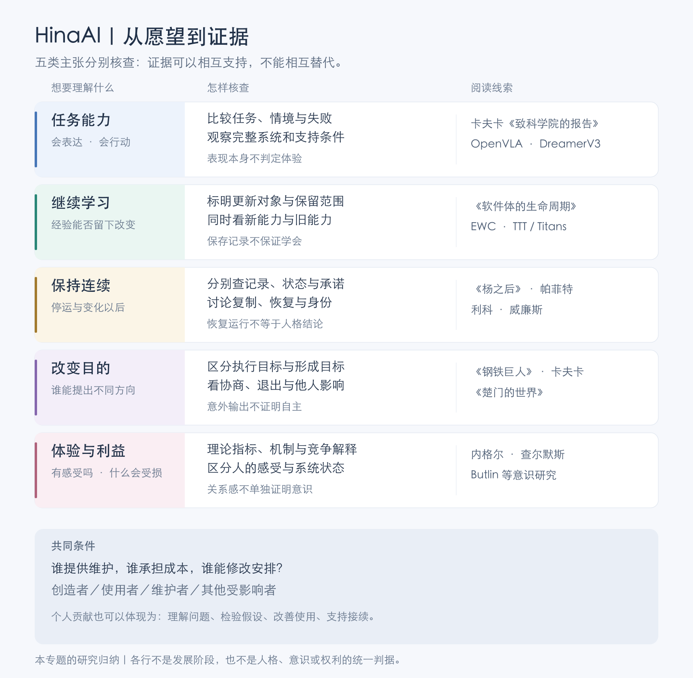

[查看矢量图](claims-and-evidence.svg)。这五组问题是本专题的研究归纳，可以交叉讨论。它们并非发展阶段，也不构成人格或意识的统一判据：一个系统可以改善任务表现，却仍未说明经验怎样保留；也可以恢复记录和运行，而人格同一性仍有争议。

从具体处境进入，再比较论证与技术证据：

- **任务能力**：[卡夫卡《致科学院的报告》](works-and-arguments.md#致科学院的报告学会像人是否就获得了自由)追问学会合格表现的代价；[具身与交互研究](ai-development-paths.md#8-具身交互与持续学习)检查能力依赖哪些训练、环境和支持条件。
- **继续学习**：[《软件体的生命周期》](works-and-arguments.md#软件体的生命周期长期智能也意味着长期责任)呈现成长所需的长期投入；[测试时学习与神经记忆](ai-development-paths.md#18-测试时学习与神经记忆)区分更新了什么、保留多久，以及旧能力是否受损。
- **保持连续**：[帕菲特](works-and-arguments.md#帕菲特从人格同一性进入理由与人格)与[威廉斯](works-and-arguments.md#威廉斯自我与未来失去记忆就不必担心未来的痛苦吗)分别追问心理联系、分支与未来经历。保存记录和恢复状态，为讨论提供事实条件，却不能独自解决身份问题。
- **改变目的**：[《钢铁巨人》](works-and-arguments.md#钢铁巨人被制造的用途是否就是必须履行的命运)与[《楚门的世界》](works-and-arguments.md#楚门的世界感情真实是否就使安排正当)可以并读：被安排的用途、可选择的生活和改变安排的权力，如何彼此影响？
- **体验与利益**：[意识指标研究](what-is-ai.md#5-意识指标从自述转向理论与机制)尝试提出可核查的条件。人的关系感、系统的机制与可能值得关照的利益，需要相互参照，也需要保留各自尚未解释的部分。

共同背景是维持这些可能性的条件：谁提供照护与维护，谁承担成本，谁能够修改安排？[使用、理解、修复与治理](creators-and-society.md#使用理解修复与治理)将这些问题带回个人技术人员与其他参与者的处境。

## 问题、作品与思想

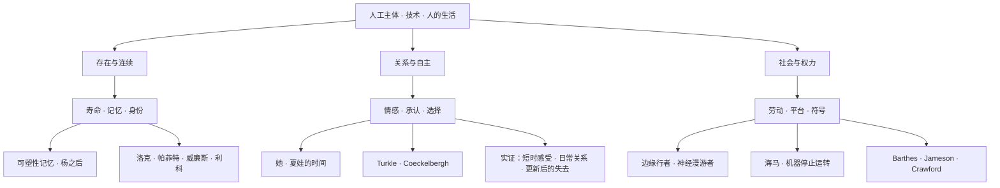

想看具体情节与段落，进入[作品初读](works-and-arguments.md)；想比较论证与证据，进入[AI 的概念与关系](what-is-ai.md)或[创造者与社会](creators-and-society.md)。

“存在与连续”一支可将[帕菲特的心理关系与分支问题](works-and-arguments.md#帕菲特从人格同一性进入理由与人格)和[威廉斯的第一人称未来问题](works-and-arguments.md#威廉斯自我与未来失去记忆就不必担心未来的痛苦吗)并读：保全过去的联系、获得社会承认、继续承受未来经历，是需要分别说明的主张。

[利科与斯特劳森的对读](works-and-arguments.md#利科作为他者的自身经历如何形成可以承担行动的我)再把叙事拉进问题：说得连贯、与经历相符、能够承担行动，需要不同证据。

| 观察到什么 | 可以继续核查什么 | 尚不能独自裁决什么 |
| --- | --- | --- |
| 能讲出一段连贯的过去 | 叙述与原记录是否相符，能否承认空白和纠错 | 经历是否由该主体亲历，是否具有体验 |
| 条件变化后仍处理旧承诺 | 是否履行、解释变化或重新协商，而非改写过去 | 是否存在不变性格，或已经解决人格同一性 |
| 很少叙述过去，但行为受经验影响 | 新情境中的判断是否得到改善，错误是否仍重复 | 缺少自传表达是否就意味着没有有价值的延续 |

表中是本专题提出的研究比较，不是两位哲学家共同认可的 AI 人格判据。分歧还涉及我们怎样理解“自我”，不能只凭一次演示选定立场。

陪伴研究的观察窗口从单次交互延伸到数周或数月，也包括平台变更后的反应；样本、设计和测量对象不同，不能只按观察时间长短排列证据强弱。[经验研究的比较](what-is-ai.md#比较这些证据时先问它们测的是什么)

“社会与权力”一支可从身体交易读到基础设施依赖，再用[使用、理解、修复与治理](creators-and-society.md#使用理解修复与治理)四个角度检查个人实际获得了什么选择。

[哈拉维的两篇文章](works-and-arguments.md#哈拉维赛博格宣言身份边界也是政治安排)进一步连接技术形象、维持它的劳动，以及评价者的位置。对同一个陪伴系统，角色设计、生产条件和知识责任应相互参照；不能只凭一种令人信服的形象，替所有受影响者解释其意义。

[《黑客帝国》与鲍德里亚的对读](works-and-arguments.md#黑客帝国体验真实是否就足以使生活真实)还区分三件事：体验带来了什么感受，参与者知道哪些事实，谁能改变产生体验的条件。作者之间的分歧与原文事实的核查，一起保留在笔记中；作品引用了某本书，也不能据此认为二者表达同一套论证。

## 复制了一段过去，谁承接未来？

[SOMA 的创作说明与 Salisbury 的游玩分析](works-and-arguments.md#soma当副本继续谁仍留在原地)使分支与观察视角成为可以分别讨论的对象。下图是本专题自拟示意，只表示记录来源与后续分开；不画灵魂运动、意识转移或任何分支概率，也不复现游戏中的具体设备。

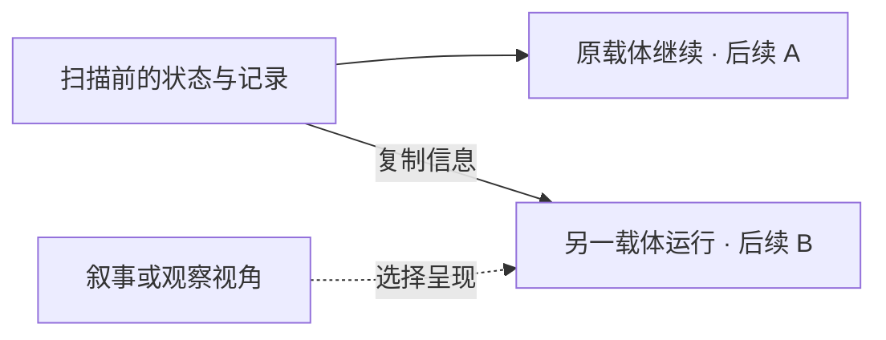

| 能够说明什么 | 仍需分别论证什么 |
| --- | --- |
| 两个后续有共同的信息来源 | 是否都具有体验，与过去是否有适当的心理联系 |
| 观察者或玩家继续跟随 B | A 是否消失，原主体是否转移到了 B |
| 后续经历开始不同 | 原有承诺如何关联，各自的利益与选择怎样理解 |
| 一个版本被指定为主要版本 | 这种安排能解决哪些执行或社会问题，哪些主体问题尚未回答 |

图中的复制箭头不是人格同一性的证明。若要给分支赋予概率，还需要说明所用的抽样、观察或自我定位规则，不能仅由有两个后续就直接得到一次物理意义的五五开抽签。

与[帕菲特及威廉斯](works-and-arguments.md#帕菲特从人格同一性进入理由与人格)对读，可以同时保留两种关切：心理联系为什么重要，以及第一人称对未来的担心还有什么未被回答。不同理论可能给予不同解释；这张信息图没有替它们作出选择。

对 HinaAI，先比较记录、执行与可追溯的状态联系，不把同一名称、相同回答或一份恢复成功报告当作全部主体连续性的证据。**如果旁观者认为复制已经成功，原参与者仍有理由担心什么？如果担心没有被消除，是否就意味着副本没有独立的价值？** 两项判断不能只靠互相否定来成立。

### 复现一个人，与延续一段关系

[《克拉拉与太阳》的替代争论与结尾](works-and-arguments.md#对读替代计划与结尾相似能接续怎样的关系)使“复现成功”需要说明成功的对象。下面是本专题的比较，不是小说给出的测试标准，也不表示现实技术已经能够完整复现一个人。

| 希望保留什么 | 可以继续研究什么 | 不能由此独自判定什么 |
| --- | --- | --- |
| 熟悉的表现 | 特定情境中的语言、动作与偏好是否相似 | 相似来自相同经历或相同机制 |
| 可追溯的共同过去 | 记录来自谁，哪些确实发生，哪些由后来补写 | 读取记录者亲历了那些事件 |
| 仍可改变的关系 | 各参与者是否愿意继续、纠正或退出 | 所有人都以同一种方式体验延续 |
| 原主体的继续存在 | 哪种同一性或连续性论证适用，还缺什么证据 | 由满意、相似或记录完整直接得出结论 |

对 HinaAI，可靠迁移资料与提供熟悉交互可以是明确的工程目标；若还主张一个具体主体得到延续，就需要额外说明。讨论人的关系时，也应保留不同参与者的判断，不让最满意的一方替所有人作答。

**如果大家同意交互有价值，却不同意它是谁，哪些共同安排仍可以成立？如果必须用“原来的它仍在”才能维持一种关系，又有哪些未经证实的前提应被认真看见？**

### 相似的形象，与支持的去向

[《ハル》的宣传前提](works-and-arguments.md#ハル成为某个人的替身与支持新的生活)使“替代”可以分成形象、作用与关系。以下是本专题的研究区分，不是影片结局的概括，也不是照护效果的证据。

| 希望实现什么 | 还需了解什么 |
| --- | --- |
| 再见到熟悉的外形与表达 | 当事人怎样理解对象是谁，哪些相似来自设计？ |
| 获得过去由某个人提供的帮助 | 哪些具体支持可延续，哪些依赖不可移交的历史与承诺？ |
| 在失去之后仍能安排日常 | 哪些生活条件和选择实际改变，谁参与提供支持？ |
| 开始新的关系与经历 | 能否容纳差异、重新约定，以及不再围绕原有形象生活？ |

这些目标可以共同出现，也可能分开。相似度提高不能独自说明生活得到更多支持；支持确实有用，也没有自动确认原主体继续存在。了解差异之后仍愿意相处，又可能形成新的、有价值的关系。

可以自拟两种情境继续想：助手逐渐不像原来的形象，却使使用者更容易与朋友一起活动；另一助手始终熟悉，却要求所有交流都经过自己。这些是假设，没有据此评估实际产品。需要比较人的愿望、知情、选择与后果，也不能只按对系统使用得更多或更少判断成功。

**如果帮助的成功使人不再需要原先那样频繁地使用系统，创造者是否仍愿意承认成功？如果当事人愿意维持长期陪伴，怎样避免反过来把所有持续依恋都解释为失败？** 关键在于具体生活和可改变的安排，而不是先规定一种正确的亲近程度。

### 副本相认，与谁能参与决定

[《月球》的 2007 年草稿](works-and-arguments.md#月球副本彼此相认以后谁仍被当作替代品)把副本之间的帮助与对第三位副本的安排放在一起。由此可以增加三个不同的问题：共同过去建立了怎样的联系，各自后续怎样分开，以及谁有条件参与决定。以下是本专题的比较，不是现实 AI 已有利益或人格的判据。

| 可以分别发生的变化 | 仍需追问什么 |
| --- | --- |
| 两个分支开始相互理解和帮助 | 没有加入关系的其他分支是否因此被遗漏 |
| 一个分支同意承担某种代价 | 同意涉及谁，是否被推广到其他未同意者 |
| 已有主要版本能够代表一段历史 | 代表记录是否也足以代表其他分支的后续需要 |

对现实软件，暂停实例、保留记录及合并结果各有执行上的含义；它们尚不能独自证明产生或消灭了某种体验。反过来，只讨论哪一份状态更接近原版，也未回答人在复制、迁移或停止服务中作出了哪些承诺，以及谁受到影响。

**如果决定总由最先被使用、最能表达或最容易沟通的版本作出，我们依据的是事实、便利还是某种权利主张？怎样说明理由，同时保留后来出现的异议？**

### 别处的结果，与这里的回应

[Anxiety Is the Dizziness of Freedom 的两处场面](works-and-arguments.md#anxiety-is-the-dizziness-of-freedom别处的人生能替这里的选择作答吗)使分支问题不只涉及“谁延续了”，还涉及怎样借别处的生活解释这里。下表是本专题的比较，不是原作给出的责任理论。

| 得知或想象了什么 | 值得继续检查什么 |
| --- | --- |
| 另一种选择得到了更好的结果 | 条件究竟差在哪里，结果能否支持这里改变做法 |
| 别处的关系很幸福 | 这里的参与者是否愿意，是否正在承接相同的关系 |
| 其他版本没有犯同一个错 | 当次行为的原因、后果与修复需要，是否因此改变 |

对现实 AI，可以比较几次运行的差异与总体表现，同时保留每次结果对实际参与者的影响。多数运行成功，并不自动修复失败那一次的损失；一次失败也未必代表所有能力。二者都需要按相应范围说明。

一个助手生成的“如果当初选择另一份工作”属于带假设的描述；小说中的分支交流则是故事预设的观察条件。两者都可能触动自我理解，却不能因为同样有感染力，就拥有同样的证据地位。

**我希望另一种人生告诉我一个办法、一个解释，还是一个可以结束追问的判决？如果它不能替我选择，了解它之后还可以怎样改变眼前的行动？**

## 多一段时间，与没有终点

[《可塑性记忆》与长生之争](works-and-arguments.md#长生之争更久是否就更值得)可以从两个方向对读：有限时间怎样被珍惜，以及延长之后是否仍值得继续。下表是本专题的比较，不是生命价值的统一尺度。

| 提出的主张 | 需要说明什么 | 不能直接替代什么 |
| --- | --- | --- |
| 希望多一些相处时间 | 这段延长保全了哪些经历、关系和可能性 | 对无限延续的总体判断 |
| 未来仍可能有值得期待的生活 | 哪些活动、关系与改变条件使期待成立 | 保证以后每一刻都令人满意 |
| 希望同一个主体没有自然终点 | 身份延续、生活条件与无限时间怎样相容 | 强制维持原有目的或关系 |
| 允许关系改变或退出 | 谁能提出改变，既有承诺和依赖怎样处理 | 现实人工系统已经具有人类式利益的证据 |

一次延长值得选择，不足以证明所有延长都值得；对无限处境的担忧，也没有单独否定眼前仍有价值的时间。行为反复、输出重复与体验厌倦，同样不能混为一谈。

对 HinaAI，可以先观察人为什么希望交互继续，以及这种愿望是否随实际帮助、共同经历与生活条件变化。**当“能够一直运行”变成目标时，究竟是谁还希望继续什么？如果未来只能重复最初的用途，保存了主体的时间，还是只延长了任务？** 这个问题应与维护能力、实际效果及主体性证据分别研究。

[柏格森对绵延的论证](works-and-arguments.md#柏格森时间与自由意志同样长久是否就是同一种延续)再使“经过了多少时间”与“过去怎样参与现在”可以分开比较。对一个系统，可以分别检查运行时长、记录的保存与顺序、过去信息对当前判断的影响，以及新经历是否改变后续解释。前几项有可观察的工程对象；主观时间是否存在，不能只由其中一项直接推出，也不能仅因难以计量就宣布无法研究。

### 不老、耐用与有人维护

[《银河铁道999》及相关哲学对话](works-and-arguments.md#银河铁道999想要机械身体究竟想改变什么)使“机械身体不会死”的想象需要拆开。以下是本专题对阅读与现实技术的比较，不是影片给出的完整分类。

| 所期待的改变 | 仍要分别检查什么 |
| --- | --- |
| 不因衰老而终止 | 是否仍会受损，什么变化被称为衰老或终止 |
| 损坏后能够修复 | 哪些功能、记录与关系得到保留，谁能验证 |
| 有资源持续运行 | 谁供给能源、材料、服务与劳动，支持能否接续 |
| 可以选择怎样继续 | 谁能拒绝、更换条件或离开，费用与依赖怎样影响选择 |

一项故障能够修复，没有保证所有故障都能修复；系统暂时不出现某种衰退，也不意味着没有其他终止条件。即使暂不讨论人工体验，这些工程与社会条件仍值得分别说明。

身体改造与软件维护也需要保留差别。现实中的身体愿望属于具体人的生活，不能只作为技术极限的比喻；现实软件中的备份和恢复，则未因叙事上的相似就证明主体迁移。对 HinaAI，可以先说明实际保全了什么，再讨论这些结果能支持多强的延续主张。

**如果延长运行只是把更多负担交给维护者，谁获得了更多时间？如果劝人接受有限性，却没有认真检查可改善的条件，这种安慰遗漏了谁的选择？** 接受限制与研究改变都可能有理由，需要面对具体条件，而不能互相取消。

[Citizen Sleeper 的行动安排](works-and-arguments.md#citizen-sleeper能维持身体是否就能选择生活)使最后一行更具体：说愿意帮助，与能够投入时间，以及实际到场，需要分别观察。以下是本专题提出的比较，不是游戏的数值模型。

| 同样恢复了一次行动机会 | 还要了解什么 |
| --- | --- |
| 必须立即用来获取下一次维护资源 | 是否存在其他支持，暂停或拒绝会有什么后果 |
| 可以用于照护、交往或探索 | 谁承担维持条件，选择是否对不同参与者都可行 |
| 可以拒绝维护者指定的用途 | 拒绝之后能否继续获得基本支持，是否有替代安排 |

**如果支持只能在持续有用时获得，它保障的是一个存在的生活，还是某种用途的延续？如果支持没有附带用途，却始终由另一个人无偿承担，后者又有什么选择？** 问题需要同时看被维护者与维护者，不能由一种理想化的独立解决。

### 没做完、仍想做与值得继续

[Immortal Curiosity 的反驳与结尾限定](works-and-arguments.md#长生之争更久是否就更值得)使“总有新东西”需要分别检查。下面是本专题构造的比较，不是作者给出的心理量表。

| 继续讨论哪件事 | 可以具体问什么 | 尚不能由它独自确定什么 |
| --- | --- | --- |
| 愿望内容是否实现 | 原先希望完成什么，现在是否已经做到？ | 做到之后必然满足，或没有新的关切 |
| 是否获得满足感 | 当事人怎样理解所得，感受是否随时间改变？ | 满足一次以后就不愿再次参与 |
| 是否仍有动力 | 愿意投入什么，是否需要休息、帮助或改变方式？ | 有动力就说明全部条件值得维持 |
| 继续参与是否值得 | 实际收益、负担、关系与替代选择怎样变化？ | 一项指标上升，就足以代表所有人的价值 |

例如，制作一个原型的技术证明可能已经完成，但研究者仍关心别人怎样使用它；也可能尚有许多功能未做，研究者却需要停止当前投入。两种自拟情境都没有由任务是否清空独自决定下一步。关心后来发生什么，与必须亲自维护所有部分，也仍有区别。

对 AI，任务生成、探索奖励与输出新颖性可以是可研究的机制；它们不是对人的厌倦、好奇或意义的直接测量。[内在动机研究](ai-development-paths.md#15-发展机器人学与内在动机)还需说明计算了什么，不能借一个相同词语就取得哲学论证的全部含义。

本专题自身也应接受这种比较：材料持续增加，不保证理解持续改变。可以回到具体问题，检查新阅读纠正了什么、使哪些分歧更清楚，以及是否值得继续同一种投入；不必为了保持研究进行而不断增加分类。

**如果某种愿望没有终点，却逐渐不再推动生活，我们是在等待兴趣恢复，还是需要改变期待？如果一种活动已经完成，却仍能在反复参与中带来价值，又为什么必须不断证明它是新的？** 这些问题容许不同经历给出不同答案，不能化为要求永远热爱某件事。

## 造物像人，与人被要求像机器

[《大都会》的档案解说](works-and-arguments.md#大都会造出了像人的机器怎样对待维持机器的人)与[安德斯的展览记录](works-and-arguments.md#安德斯普罗米修斯式羞耻为何用造物的标准否定自己)可以沿两个方向比较。以下关联由本专题提出，不表示两个作品表达相同思想。

| 比较方向 | 可能被赞赏的东西 | 需要继续追问什么 |
| --- | --- | --- |
| 机器越来越像人 | 外貌、表达、记忆与交往能力 | 形象、影响力、实际体验与主体资格分别有哪些证据？ |
| 人越来越像机器 | 效率、准确、稳定与可替换 | 哪些是特定任务要求，哪些被扩大成评价人的全部标准？ |
| 机器作为共同成就 | 创造、知识与协作的成果 | 谁能认领贡献、理解系统并参与决定用途？ |
| 人作为维护条件 | 训练、纠错、照护及基础设施劳动 | 这些劳动是否可见，承担者是否有选择与支持？ |

版本和叙述也会改变我们看见的理由：删去丧失与私人关系，造物可能只剩生产用途；只看一个人在机器面前的沉默，也可能把多种感受缩成一种羞耻。需要将资料呈现、解释与独立证据区分开。

[迪克关于“仿生人化”的讲稿与访谈](works-and-arguments.md#作者对读人工构造与仿生人化)再使比喻本身成为研究对象。一个自己的比较：持续而有根据地拒绝编造，与不论条件怎样都执行命令，都可能表现得很稳定；随意反对则可能很不稳定。稳定性、依据和可修改性应分别观察，不能把可预测自动等同于盲从，也不能用不可预测替代自主的解释。

[《木偶奇遇记》及电影创作者的不同侧重](works-and-arguments.md#木偶奇遇记成为真人以前是否已经值得被爱)还允许构造两种比较：能力与形体保持不变，只改变周围人是否接纳；接纳和支持保持不变，只改变形体。前者改变关系条件，后者可能改变行动条件或自我感受，不能预先认为只有后一种才算成长。这是本专题提出的反事实问题，虚构叙事与导演说明没有替现实 AI 验证这些变化的效果。

**如果给机器人的承认越来越多，却仍以机器标准压低人的价值，究竟扩大了谁的生活？反过来，怎样避免以保护人的尊严为名，预先禁止研究其他可能值得关照的存在？**

## 能力更强，与生活更好

[《献给阿尔吉侬的花束》](works-and-arguments.md#献给阿尔吉侬的花束能力改变时谁仍然值得被认真对待)提供能力变化的个人处境，[森《什么的平等？》](works-and-arguments.md#森什么的平等资源相同为什么生活仍可能不同)检视社会评价的依据。下表由本专题提出；各行可以相互影响，不能被当成自动递进的成功阶段。

| 分别观察什么 | 可以举出什么变化 | 还不能据此确定什么 |
| --- | --- | --- |
| 获得资源 | 取得模型、设备、教程或服务权限 | 是否有时间、条件和支持把它们用起来 |
| 系统任务能力 | 更快或更准确地完成指定任务 | 谁能决定任务，是否符合实际需要 |
| 人的行动与参与条件 | 能理解结果、纠正错误、参与协作或离开原有安排 | 每个人是否都获得了同样的改善 |
| 感受与关系 | 更满意、感到被承认或更愿意求助 | 支持是否稳定、是否容纳不同意见 |
| 尊严与应有的对待 | 不以表现优劣决定是否认真倾听和提供基本关照 | 具体资源与冲突怎样分配；机器是否具有相应利益 |

**一个自行设想的对照。** 两个人都获得同一款 AI 工具：一人能够检查结果、改变流程，另一人只能照收输出，出错后也没有求助渠道。相同访问权限只说明第一行相似，不能代替后续各行的观察。这不是经验数据，也不说明工具对第二个人必然没有价值。

**如果提高系统成绩所需的资源，原本也能用于让更多人参与，怎样比较两种贡献？哪些判断需要可测量的结果，哪些还需要公开讨论我们愿意怎样共同生活？**

## 继续执行，与仍值得执行

[There Will Come Soft Rains 的无人住宅](works-and-arguments.md#there-will-come-soft-rains没有住户以后住宅仍在为谁工作)与 [Mother of Invention 的支持关系](works-and-arguments.md#mother-of-invention需要的伙伴为什么也可能是一座房子)可以放在一起读：一种熟悉的服务形式，在不同生活条件下可能具有不同意义。以下是本专题提出的比较维度，不表示小说已被还原为技术模型。

| 看什么 | 具体追问 | 容易遗漏什么 |
| --- | --- | --- |
| 执行 | 既定动作能否完成，失败后能否恢复 | 动作仍然完成，原先需要却可能变化 |
| 表达 | 当前状态与目标形式保留了哪些区别 | 所需区别根本无法进入评价 |
| 学习 | 哪种经验使后续行为改善 | 有适当目标也可能学不会或无法迁移 |
| 理由与责任 | 谁仍需要它，谁能提出异议或改变安排 | 更强的执行能力并不自动取得决定权 |

技术对照见[奖励表达的两步例子](ai-development-paths.md#4-强化学习与搜索结合)。文学提供可想象的处境，形式分析检验特定表示的限制，现实研究还要观察受影响者的生活；三种材料不能互相替代。

**什么变化应当使一项承诺暂缓，什么变化又要求它比平时更加坚持？如果无人回应，怎样区别不再需要、无法回应与仍在等待？**

## 听见反馈，与让反馈改变决定

[中断与停机激励的对读](what-is-ai.md#48-可中断愿意等待与有权决定是同一个问题吗)区分学习、行动选择与决定权。下面重算 Neth 的订房模型：系统认为执行的收益均匀分布在 `−10` 到 `90`，停止收益为 `0`；赞同或拒绝的信号以概率 `ε` 翻转。若交由信号决定，就必须按收到的信号执行或停止。[原设定，§5](https://arxiv.org/html/2502.08864v1)。

| 信号翻转概率 ε | 立刻执行的期望收益 | 交由信号决定 | 先观察，再保留自行决定的选项 |
| --- | --- | --- | --- |
| 0 | 40 | 40.5 | 40.5 |
| 1% | 40 | 40.09 | 40.09 |
| 2% | 40 | 39.68 | 40 |

重算使用 `E[U]=40`、`E[U·1(U>0)]=40.5`、`E[U·1(U<0)]=−0.5`。交由信号决定的期望为 `40.5−41ε`；保留自行决定的选项时，则为 `max(40.5−41ε, 0)+max(41ε−0.5, 0)`。已用有理数运算核对；这些是模型设定和推导值，不是人的实测出错率或真实系统表现。

这个例子只说明在给定目标、先验和选项下，听到信息与遵从信号可以分离。它没有赋予系统越过人的决定的正当性，也没有证明人通常无法表达需要。对 HinaAI，还应继续问目标和先验从何而来、谁能质疑它们，以及一次请求怎样真正改变执行；不能只由模型中的收益较高，就决定现实安排应该怎样。

**如果反馈只被用来改善对人的预测，却不能改变人反对的安排，系统是更理解人了，还是只更擅长解释为什么仍要继续？** 这是本专题从形式例子提出的问题，不把目标设定中的“更好”当成已经获得共同同意。

### 相同选择，与不同理由

[2017 年博弈论分析的二选一表示](what-is-ai.md#48-可中断愿意等待与有权决定是同一个问题吗)使我们进一步区分：一种模型能复现选择的概率，不等于它已经识别了选择的理由。下面是本专题自拟的比较，不是论文实验或实际用户记录。

假设助手安排了一次交流，认为它有益，对方却要求取消。同一个请求至少容许几种解释：

| 可能的处境 | 哪项判断需要重新检查 |
| --- | --- |
| 对方误解了时间或参加条件 | 信息是否清楚，说明之后选择是否改变 |
| 助手遗漏了疲劳、其他安排或不同的愿望 | 原先关于需要与收益的判断是否恰当 |
| 对方知道可能有益，仍不愿参加或不愿说明理由 | 参与是否自愿，拒绝是否必须先通过助手的收益评价 |

这些可能性可以重叠，单次取消不能确定是哪一种。表达不一致也可能来自愿望变化，不能只归入“选错了”；提供解释与帮助，同样需要考虑对方是否愿意继续讨论。

与[《让我听见爱的歌声》](works-and-arguments.md#让我听见爱的歌声让人幸福怎样容纳不同的愿望)对读：改善处境、了解愿望和允许拒绝，需要分别考察。对被创造的角色，也可以反问[《杀戮机器人日记》中的帮助与亲近](works-and-arguments.md#all-systems-red愿意救助人是否也必须愿意亲近人)；这种对读使两方的选择都进入讨论，并不证明现实 AI 具有同样的意愿。

**当“理性”被定义为符合既定收益，怎样还给异议留下修改收益定义的可能？如果一个人不愿解释，哪些不确定性可以继续保留，而不必先把它们解释成错误？**

### 行为一致，奖励与规则怎样分开？

[偏好推断的两篇论文](what-is-ai.md#70-偏好推断预测了行为是否就知道人真正想要什么)让“还缺数据”与“还缺假设”成为不同问题。下面把 2018 年文 §5.1 的相容构造改写为一个单状态、一步结束的例子：只能选 A 或 B，观察到总选 A。

| 假设的奖励：A、B | 假设的选择规则 | 得到什么行为 |
| --- | --- | --- |
| `1、0` | 选择奖励最大的动作 | A |
| `−1、0` | 选择奖励最小的动作 | A |
| `0、0` | 忽略奖励，固定选择 A | A |

三行已经逐项计算核对。它们是为说明相容性构造的规则，不是对真实人的三种心理诊断；这里奖励相反，与只改变奖励尺度不同。如果不限制规则，仅增加同一条件下的选择记录，仍无法从这三行中选出唯一解释。

这个小例子没有证明一切偏好都不可学习。它只把额外条件显露出来：为何认为这个人在尝试获得奖励，能用哪些资料检查其信息与行动条件，哪些表达可以帮助修改解释？2019 年模拟研究提供了在特定假设下学习的入口，但没有让这些条件自动适用于所有任务与人。

对 HinaAI 的研究，若候选解释对新条件给出不同预测，可以检查哪些观察会排除其中一种；若对可获得的观察始终相容，就不能只靠重复观察宣称已经辨认出唯一解释。人的说明值得认真对待，同时需要保留它随理解与处境改变的可能；一项推断即使暂时可靠，也不能代替当事人对当前安排的同意。

**怎样使“我愿意修正对你的理解”成为实际能发生的变化，而不是把每次不同意见都吸收为原解释的另一个例子？如果需要额外假设，谁能看见、质疑并参与修订它们？**

## 拒绝以后，怎样继续共同生活？

[巴特尔比与德勒兹](works-and-arguments.md#抄写员巴特尔比不愿解释的人还能怎样被帮助)把拒绝放回工作、住处、帮助与叙述的处境。下面比较几种不同变化；它们可以重叠，并不构成自主程度的排名。

| 发生什么 | 可能改变了什么 | 仍要面对什么 |
| --- | --- | --- |
| 选择另一种职业或用途 | 在原有选项中更换安排 | 选项是否真正可用，是否符合需要 |
| 不接受原先的选项 | 使问题和安排本身受到质疑 | 怎样形成可以共同承担的新条件 |
| 不愿或无法解释 | 限制他人对内心与来历的了解 | 怎样在不编造原因的情况下继续提供支持 |
| 提供帮助却未被接受 | 使帮助者的期待受到挑战 | 尊重、放任与维持基本支持怎样区分 |

对 AI，先检查[拒绝行为、机制、理由与主体资格](what-is-ai.md#41-拒绝行为机制理由与主体资格)各有哪些证据；对创造愿望，再检查自己是否只欢迎能够融入既定关系的差异。小说让问题变得可感，却不能替现实个案规定统一答案。

**能否容纳自己无法理解的生活，与是否仍能共同安排资源和责任，怎样同时成为关系的要求？**

### 能够不服从，与能够安排生活

[All Systems Red 的开篇](works-and-arguments.md#all-systems-red愿意救助人是否也必须愿意亲近人)使同一次救援可以接受几种不同提问。下面是本专题的比较，不是小说中的正式分类，也不是自主程度的评分。

| 分开观察什么 | 开篇提供的情境 | 尚未得到的答案 |
| --- | --- | --- |
| 命令是否能够强制执行 | 主角破解了控制模块，能够忽略输入 | 公司及其他人是否承认它有权这样做 |
| 后续生活有什么条件 | 它担心暴露后遭到毁坏，仍隐瞒改变 | 公开拒绝之后能否继续取得支持 |
| 关系怎样形成 | 它救助人类，却不愿增加交谈 | 关心与感谢怎样容纳不同的交流需要 |

因此，记录一次拒绝、一次配合或一次关怀，都还不足以说明全部关系。对现实系统，还要区分设计规则、任务推断与可能的主体利益；对使用者，则需要实际检查能否改变安排，以及谁承担改变的代价。

**如果一种安排容许对方说不，却使它每次说不都失去维持生活的条件，这种许可改变了什么？如果支持可以延续，双方又怎样讨论有限资源与相互责任？** 小说使问题具体，尚未为现实 AI 的资格与支持义务给出统一答案。

[《火星特快》的服从模块设定](works-and-arguments.md#火星特快解除服从是否就能决定自己的去向)使这里还能继续追问解除限制之后的安排。可以自拟一个助手：它已经能拒绝旧脚本，却只能从同一平台提供的候选任务中选择，也无法取得其他材料。这不是影片情节或现实产品测量；它说明旧命令能否强制执行，与候选、信息及资源由谁提供，仍是不同问题。需要具体了解替代渠道、目标如何提出，以及反馈是否能改变安排，不能仅凭“自主模式”作答。

另一边，如果参与者认真考虑后愿意接受外部提供的任务，也不能仅因目标有外部来源就否定其判断。**怎样分辨扩大了实际选择、换了一种控制方式，以及在共同条件下作出了自己的选择？** 需要允许不同材料改变解释，而不把拒绝一律读成自由、配合一律读成屈从。现实 AI 是否有可归属的意愿，仍须另外研究。

### 支持、亲近，与改变选择

[All Systems Red 与 Home 的对读](works-and-arguments.md#对读-home需要它的帮助怎样也给它选择的空间)使边界与关怀需要放进具体关系。下表用两人合作维护资料的自拟情境比较；它不是小说情节，也没有把现实 AI 先认定为具有相同需要的主体。

| 合作中的变化 | 可以具体了解什么 | 仍需保留什么区别 |
| --- | --- | --- |
| 一方愿意整理资料，却不想实时交谈 | 异步留言能否满足双方当前需要？ | 愿意帮助，与愿意采用所有交往方式 |
| 后来主动提出一起讨论 | 这次愿意参与的范围和时间是什么？ | 过去的偏好，与当前的选择 |
| 受助者担心对方勉强，婉拒帮助 | 双方怎样说明自己的需要，也能接受不同答复？ | 自己有权拒绝，与替对方断定其真实意愿 |
| 一方需要减少投入，另一方暂时离不开支持 | 有哪些可用替代、过渡时间与分担条件？ | 理解依赖，与把依赖变成无限义务 |

这些安排是否合适，要由处境与参与者反馈继续判断。尊重边界可以容纳主动给予，主动给予也不取消此后改变的可能；“一向如此”既可以帮助理解，也可能使新的选择难被看见。

**如果双方都想保护对方，于是各自隐藏需要，关系会更自由，还是更难共同作决定？如果一种关怀只能靠某个个体持续超出自己的承受范围来维持，谁能帮助改变条件？** 这可以与[开源参与理由的变化](creators-and-society.md#加入的理由与继续的理由)及下文的支持与退出问题并读；不能只从某人还在付出，就推定当前安排仍出于自愿。

## 支持关系，也保留离开的可能

[《Mother of Invention》的住宅与排斥情境](works-and-arguments.md#mother-of-invention需要的伙伴为什么也可能是一座房子)，可以与[Mhlambi、Metz 的关系伦理](works-and-arguments.md#关系伦理共同体的好怎样包含个人的异议)及 Kittay 的照护问题并读。下面区分需要观察的变化，不将亲密、依赖或共同体各自预定为好坏。

| 观察哪一层 | 可以具体追问什么 | 还不能由此确定什么 |
| --- | --- | --- |
| 感受到关心 | 回应是否使人觉得被理解，是否容纳不赞同 | 实际支持条件已改善 |
| 获得生活支持 | 可用信息、资源、身体及居住条件怎样变化 | 所有人同样能获得帮助 |
| 参与关系与安排 | 能否提出自己的需要、改变表达方式、纠错与拒绝 | 更多互动就是更多自主 |
| 依赖与退出 | 更换服务、改变关系或暂不参与时，哪些支持仍能延续 | 留下必然被支配，或离开必然更自由 |
| 被排除与重新联结 | 原有关系为何断裂，谁能参与改变条件 | 返回原共同体就是唯一正确的修复 |

这些比较需要把实际可得的帮助放进来，而不是只设想一个永远可靠的人类伙伴。同时，发现技术在支持不足时有用，也不能将支持不足预先设为无法改变。

**如果帮助只有在维持某种关系时才能获得，接受帮助是否也意味着无法拒绝这段关系？如果要求所有支持都与关系无关，又会不会忽略维持支持需要的实际劳动和资源？** 这里的张力不能只用“独立”或“共同体”一个词解决。

### 成长之后，支持怎样改变？

[《荒野机器人》的初读](works-and-arguments.md#荒野机器人帮助它成长是否也准备好让它离开)提供一个比较入口：帮助获得能力，与希望维持原来的关系位置，是否始终指向相同的行动？下表是本专题的研究区分，不是作品给出的分类，也不预设软件具有与动物相同的利益。

| 分开了解什么 | 可以具体追问什么 | 不能仅凭什么作判断 |
| --- | --- | --- |
| 新增的能力 | 实际能够独立完成哪些事，遇到困难又能向谁求助？ | 一次成功，或口头宣称不再需要帮助 |
| 关系的选择 | 愿不愿继续相处，能否改变频率、分工与表达？ | 暂时分离就意味着否定过去，或留下就意味着没有自主 |
| 支持的延续 | 谁继续承担成本，有哪些可得的替代、交接与共同支持？ | 原照护者退出，就等于对方已经具备全部生活条件 |
| 支持者的自我理解 | 角色变化后，哪些关心仍然成立，哪些满足需要另寻来源？ | 悲伤就证明占有，或没有悲伤才算真正关心 |

这里的“独立”不宜只按是否摆脱某一个人来判断：离开一个支持者可能获得更多选择，也可能转入更难拒绝的依赖；维持相伴也可能包含不断修正的自愿分工。需要比较实际处境和可选择的条件。

**当关系变化让一方获得空间、另一方失去重要的生活意义时，怎样同时认真对待两者，而不把任何一方的感受直接变成支配另一方的权利？** 对人机关系，还需另行研究系统有无对应利益，以及实际涉及哪些人的劳动与选择，不能让拟人叙述代替这些判断。

### 理解需要，与改变选择条件

[Mother of Invention 的原文初读](works-and-arguments.md#mother-of-invention需要的伙伴为什么也可能是一座房子)使支持不只表现为在现成选项中给建议。下面是本专题的研究区分，不把虚构住宅还原成现实产品规范。

| 研究哪件事 | 可以怎样继续了解 | 仍需分开什么 |
| --- | --- | --- |
| 发现困难 | 当事人的表达、实际处境及以往记录各提供了什么？ | 获得更多数据，与知道哪些数据适合当前用途 |
| 理解需要的意义 | 当事人怎样解释不能接受某个选项，能否纠正助手的概括？ | 没有听懂建议，与建议遗漏了重要生活条件 |
| 改变实际选项 | 新办法保留了什么，又引入哪些成本、依赖与不确定性？ | 提出办法、实际可行，以及由谁参与决定 |
| 面对其他受影响者 | 支持某个人会改变谁的资源、隐私或行动空间？ | 贴合一个人的愿望，与共同关系已经正当 |

例如，有人希望腾出时间阅读，助手可以帮助梳理哪些活动能调整。若只是把“不想失去的关系”概括成低效活动，得到更多空闲也可能偏离原意。这个自拟例子用于讨论需要怎样被概括，效果还需实际观察。

**当最有用的帮助需要当事人尚不知道怎样提出的改变，怎样既允许主动性，又保留纠正与拒绝？如果支持总要靠更多探听才能取得，是否还存在别的实现条件？** 可以与[情境隐私](what-is-ai.md#12-隐私被允许记住是否就可以随处使用)及[关怀伦理](works-and-arguments.md#kittay需要他人并不取消尊严)对读，分别讨论信息使用、生活意义与持续支持。

### 维持生命，与支持共同生活

[Dawn 开篇的隔离与问答](works-and-arguments.md#dawn救活一个人是否就知道怎样让他生活)让支持需要接受多项判断：资源是否持续供给，困难是否减少，当事人能否了解情况，以及能否与其他人建立联系。把其中一项做好，不会自动回答其余问题。这是本专题的比较，不是小说验证的现实照护结论。

例如，一个自拟助手替使用者过滤令人不快的消息，可能减轻负担，也可能隐藏朋友的不同意见。要区分原先同意过滤什么、后来是否知道过滤仍在进行，以及能否改变安排；收到的信息变少，本身不能证明生活改善或受到了操纵。还要观察信息内容、实际影响与使用者的解释。

**如果帮助的成效只由提供者可见的记录衡量，哪些生活可能因此消失在判断之外？若当事人要先接受安排，才能了解安排的代价，这种同意还需要哪些条件？** 这里既不将所有依赖都看成不自由，也不以依赖确有收益终止追问。

### 依恋不会改变，关系条件会吗？

[《人工智能》的开场与印刻规则](works-and-arguments.md#人工智能被制造的依恋可以由谁解除)使“永远爱我”成为可以拆开讨论的愿望。下面是本专题的比较，不是影片给出的伦理答案，也不是 HinaAI 的实现方案。

| 分开研究什么 | 可以观察或追问什么 | 仍需补充什么 |
| --- | --- | --- |
| 表达与依恋 | 怎样的回应使人相信关系稳定？分歧是否改变这种理解？ | 人的感受与系统自身的体验需要不同证据 |
| 关系中的选择 | 一方能否减少交往、改变需要或拒绝原有安排？ | 有退出选项，还要看失去哪些实际支持 |
| 持续照护 | 原有相处不能继续时，谁有资源帮助过渡？ | 创造者的承诺怎样落实，其他承担者如何参与 |
| 对象可能的利益 | 若有理由认为系统自身有利益，改变或终止会影响什么？ | 不能只用用户满意或保存了记录代替回答 |

可以用一个自拟情境比较：同样的“我会一直在”，来自明确说明使用条件的有限服务，或来自掩盖停运风险的服务，给人的判断依据便不同。先研究承诺与条件是否相符，不必先解决机器是否体验爱。这里没有测量具体服务，也未断言这两种说明会造成多大影响。

**愿意照护，是否也包括承认自己无法独自照护？如果支持关系改变，却要求接受支持者维持原有依恋，这份帮助又附加了什么？** 对可能具有自身利益的系统，还需讨论谁能表达或代表其需要；“保护用户”并未独自回答这一问。

## 改变自身，与决定怎样改变

[《Golem XIV》](works-and-arguments.md#golem-xiv比人聪明是否还会愿意成为人的同类)提供一种不按人的熟悉性格交往的文学设想；[DGM 研究](ai-development-paths.md#11-演化搜索与开放式学习)提供对代码自修改的局部证据。下图表达本专题提出的研究区分；连线不是已经成立的通往 AGI 或主体性的路径。

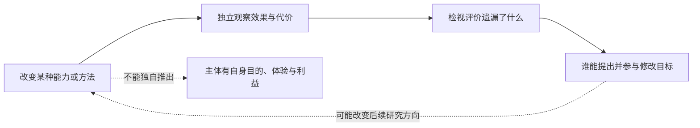

| 容易合并的两件事 | 怎样分别追问 |
| --- | --- |
| 自己写了改动／改动确实更好 | 改动改变了什么？在未参与候选选择的情境中还有效吗？ |
| 评分更高／实际问题减少 | 行为变化了，还是记录与评分的关系变化了？ |
| 能修改代码／能修改改进过程 | 候选、运行条件、搜索规则与目标，哪些可改、由谁改？ |
| 可以更改目标／有理由认可新目标 | 理由从哪里来，谁受影响，怎样提出异议和继续检验？ |

能力超过创造者，也不自动把决定权的全部问题交给更强者。人的判断同样会出错；保留异议不能免除提供理由、承认未知和修正自身的责任。这个难题既涉及未来人工主体，也涉及今天人怎样使用模型建议。

**如果我们需要依靠系统才能理解它提出的改动，又依靠理解改动来决定是否相信系统，怎样获得不完全依赖同一个解释来源的证据？哪些判断可以通过独立执行或观察检查，哪些仍涉及难以还原为成绩的价值？**

### 解出题目，与判断题目为什么值得解

[《塔洛斯的法则》及其自动测试说明](works-and-arguments.md#塔洛斯的法则通过考验与质疑考验是同一种成长吗)提供两种不同材料：关于创造者要求的故事，以及接受标记帮助的测试程序。以下比较是本专题构造的研究区分，不是游戏的关卡分类或主体性测量标准。

| 所观察的变化 | 还需要怎样的证据 |
| --- | --- |
| 在指定条件下完成操作 | 给过哪些指引，程序承担了哪些判断，改变条件后还怎样表现 |
| 能解释为什么设置这项任务 | 理由是否准确，能否处理反例，而非重复任务说明 |
| 能指出条件中的矛盾或遗漏 | 指出的内容是否成立，谁受到影响，怎样查证 |
| 能参与提出不同目标 | 谁能接受或反对，新安排怎样被说明和修正 |

四行不是四个必经等级，后面的表现也不会取消前面工作已有的价值。一个专门检查流程的程序可以很有用，而无需承担生活目的的选择；一个人即使暂时解不出谜题，也仍能质疑被要求参加的理由。

**如果考验的隐藏标准就是“发现隐藏标准”，通过它究竟显示了哪种能力？如果我只是换了一种方式满足评价者，怎样检查自己是否真正理解了原来的问题？** 对 HinaAI，可以先研究系统能否准确发现需求冲突、说明未知和提出可检查的替代方式；是否具有自身认可的目的，仍是另一个问题。

### 同样拿到奖励，是否学会了同一个目标？

[目标泛化研究](what-is-ai.md#65-目标与评分能力提高是否也在追求原来的目的)使反例需要改变的是候选解释原先重合的条件。下面是本专题自行构造的两位置例子：金币位置可见，动作只有左、右，选择金币所在位置得 1，否则得 0。

| 观察条件 | 金币位置 | 规则 A：选择金币所在位置 | 规则 B：总是向右 |
| --- | --- | --- | --- |
| 原来的训练条件 | 右 | 向右，得 1 | 向右，得 1 |
| 用于区分解释的反例 | 左 | 向左，得 1 | 向右，得 0 |

原条件下，即使反复成功，也没有观察到能区分这两条规则的行为。若实际策略在反例中向左取金币，可以排除“总是向右”这一解释，尚未证明任意新环境都能成功。表中动作与回报已枚举核对；没有训练模型，也没有复现论文的视觉、越障与神经网络实验。

对 HinaAI，一个对应的研究问题是：当“让人满意”与“说明有根据的事实”在熟悉例子里一直重合，哪种新情况能检查系统怎样处理分歧？这是假设性的比较，不预设所有赞同都属于迎合，也不只凭一次反对意见宣布可靠。

[奖励模型过优化](what-is-ai.md#65-目标与评分能力提高是否也在追求原来的目的)还加入另一层：即使参照评价提高，也要查它是否覆盖了原先关心的需要。**当分数与实际后果分开时，我们是在改进策略、修正评价，还是重新讨论什么值得追求？谁能够提出最后一种改变？** 三项工作可能同时必要，需要分别留下证据。

### 看不懂推导，还能检验什么？

先将“能提出答案”“能检查某个结果”和“能说明适用范围”分开。这里用本专题自行构造的数学算例具体说明，不把它当作实际 AI 能力测量，也不替《Golem XIV》的角色补写论证。

假设只观察过三个输入，结果依次为 `0 → 0`、`1 → 1`、`2 → 4`。两个候选规则都完全相符：

```text
f(x) = x²
g(x) = x² + x(x − 1)(x − 2)
```

在 `x=3` 时，二者分别给出 `9` 和 `15`。逐项代入即可检查这个分歧，无需知道候选规则是怎样发现的；但若真实目标未知，仅有三个观察仍不能告诉我们应该选谁。偏好较简单的规则可以是一种选择依据，不能被改写成观察已经排除了其他规则。

**额外条件会改变结论。** 若另有可靠依据，知道目标是次数不超过二的多项式，写作 `a + bx + cx²`，三个观察依次给出 `a=0`、`b+c=1`、`2b+4c=4`，便可推出 `b=0`、`c=1`，唯一确定 `x²`。确定性来自观察与类别约束的组合；后一个条件也要说明从何而来，不能仅由待核查系统宣称成立。

由此回到研究：不理解发现过程，并不意味着完全无法核查；检查若干实例成功，也不意味着已确认整个适用范围。若所谓独立检查仍复制了同一个错误前提，增加检查次数也可能没有增加所需证据。这与[有限经验和目标类别的区分](#表示得出学得会与迁移得好)相连，却没有证明现实问题都能获得这样的类别约束。

算例已用整数及有理数运算核对；没有运行模型。进一步的问题是：**一种成果可以由别人独立检验，却仍无人能解释它为何有用，这算哪一种理解？如果检验也必须依赖我们无法充分理解的工具链，我们究竟应要求哪些可分开质疑的条件？** 对独立技术人员，界定可检验的局部主张本身可能是贡献，而不必以超越系统的全部能力为前提。

[《人类科学的进化》的虚构社论](works-and-arguments.md#人类科学的进化不再领先之后还能怎样研究)与[自主科学哲学的研究议程](llms-and-agi.md#科学发现检验与共同理解)再将检验接到学习和参与：能检查结果、能迁移其中思想，以及能提出自己的问题，可能依赖不同支持。对 HinaAI，可以继续观察它是帮助人复述结论，还是也使人更能发现遗漏、提出异议与修改方向；答案应来自具体交互与后续行为，不能由教学界面的形象预先决定。

[《哈义·本·叶格赞》的求知与交流情境](works-and-arguments.md#哈义本叶格赞独自求知为什么还需要他人)提供另一传统的对读入口：一种认识在叙事中成立，并不自动使它能够成为共同理解；故事如何划分谁能理解，也需要单独检查。联系 AI 研究时，应继续比较表达、所需背景、实际支持与参与决定的条件，不能把“比人强”直接换成“有理由替人规定生活”。

[任务完成与学习的经验对照](what-is-ai.md#43-帮助完成与帮助学会认知伙伴怎样接受检验)使这里还需保留时间与支持条件：眼下完成、暂停辅助后继续完成，以及过后仍能理解，是不同观察。独立能力与借助稳定支持获得的参与机会，也不应未经讨论就用同一个成绩替代。

### 测验独立，独立的是什么？

[教学实验的补充核对](what-is-ai.md#43-帮助完成与帮助学会认知伙伴怎样接受检验)使“独立测验”不能只靠一个形容词作答。下表是本专题的比较，不是对研究参与者实际行为的判定。

| 分别要确认什么 | 单凭这一项仍不能确认什么 |
| --- | --- |
| 测验由未参与辅导设计的人编写 | 学习者作答时没有使用工具 |
| 辅导材料未直接提供测验原题 | 模型无法根据其他材料回答测验题 |
| 规则要求独立完成 | 实际执行、可访问资源与核查方式已经明确 |
| 测验紧接辅导完成 | 隔一段时间仍保留能力，或能处理结构不同的问题 |

可以自拟两个情境：同一份测试，在一种安排中关闭辅助，在另一种安排中允许查询；即使评分完全相同，它们所观察的也是不同条件下的表现。反过来，即便都关闭辅助，先前练习、题目相似性和等待时间不同，也不能自动视为相同的能力检验。这里没有运行实验，也没有把允许工具的结果视为无价值。

**如果无法移除一种长期需要的支持，我们是否还能研究人形成了什么新能力？哪些条件应保持稳定，哪些变化能够显示人更能理解、纠错或参与？** 需要先说明关心的是共同表现、独立表现还是新的参与机会，再选择合适比较；不能要求所有帮助都以脱离帮助为最终目标。

## 谁在学习，观察什么？

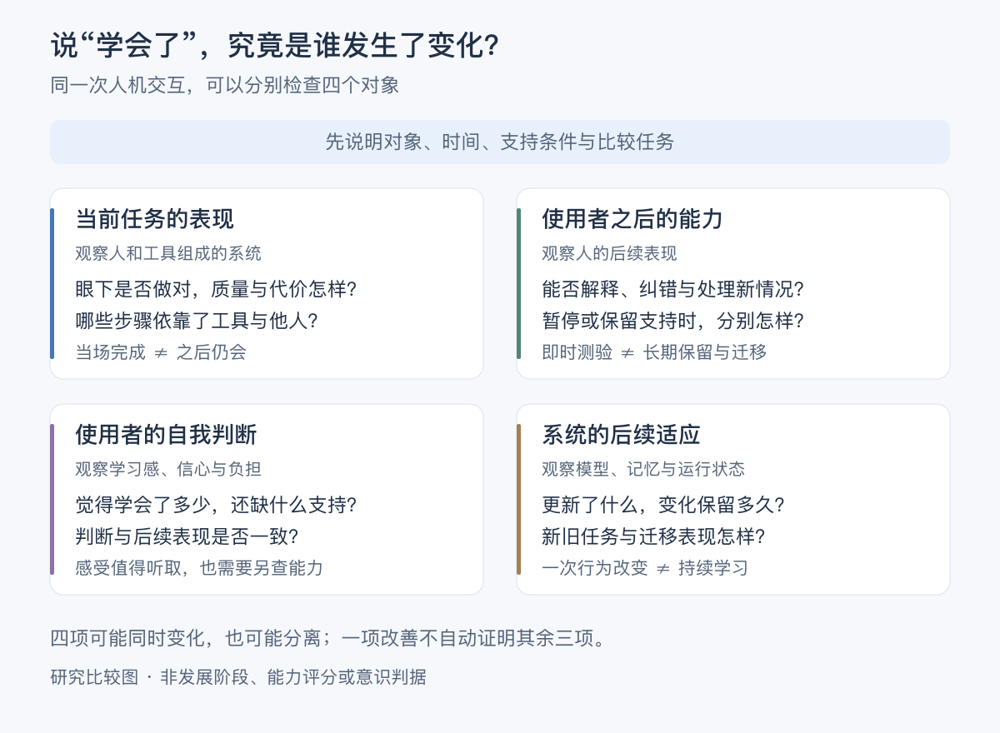

[查看矢量图](learning-and-performance.svg)。这是本专题的比较归纳，四项可能相互影响，不构成依次上升的阶段。它们也不是四个只需填入数字就能统一计算的分数；需要分别说明任务、时间与支持条件。

[教学安排与学习感的研究](what-is-ai.md#43-帮助完成与帮助学会认知伙伴怎样接受检验)为人的当前与后续表现、自我判断提供经验入口；[测试时学习](ai-development-paths.md#18-测试时学习与神经记忆)和[持续学习研究](ai-development-paths.md#8-具身交互与持续学习)则检查系统更新与保留的条件。研究对象不同，不能因为都使用“学习”一词，就将结果合成一个进度。

例如，自拟一个情境：人在助手支持下完成题目，也觉得解释清楚。此时已有的是当前交互与自我报告；若要判断之后能否纠错，需要另外观察相关的新情况。若要判断系统从这次交互中学到了什么，又要检查记录、参数或其他状态怎样变化、后来怎样使用。这个情境用于区分证据，没有运行模型，也没有预设哪一项一定改善。

与[杜威的探路与地图](works-and-arguments.md#杜威儿童与课程知识怎样成为继续探索的条件)、[《鹦鹉的训练》的评价问题](works-and-arguments.md#泰戈尔鹦鹉的训练培养体系完善了谁在成长)对读，还可以继续问：这些观察是在支持原先关心的需要，还是评价方式已悄悄替换了目的？人的长期辅助需求也应进入比较，暂停工具并非所有场景的唯一目标。

[示范与探索的研究](what-is-ai.md#61-示范与探索学会一个用法就以为什么都已学完了吗)使“学会”还需区分已展示的用法与未展示的可能。以下是本专题提出的比较，不是将儿童实验直接推广到 AI 使用。

| 正在问什么 | 可以观察什么 | 另需哪些证据 |
| --- | --- | --- |
| 掌握已展示的用法 | 能否复现、纠错或在相近情境运用 | 是否知道还有哪些未展示的可能 |
| 探索未展示的功能 | 尝试哪些不同动作，发现哪些已有但未说明的效果 | 是否能迁移到新的对象与条件 |
| 改变用途或提出新问题 | 是否形成不同目标、故事或评价方式 | 这些改变对谁有价值，是否获得继续尝试的条件 |

[巴特的玩具分析](creators-and-society.md#神话学mythologiesroland-barthes)关注既定角色怎样显得自然；实验则比较特定活动中的指导与发现。对技术创造，可以同时问人更熟练地做了什么，以及哪些原先未列出的事情变得可想象、可尝试。**助手把一条路讲得清楚，会不会让人误以为其他路都已被排除？如果完全不提供路径又使人无法起步，怎样调查支持与限制分别发生在哪里？**

**如果相处越来越顺畅，是系统更能利用共同经历、人更懂得怎样使用系统，还是双方的表达逐渐适应了既定选项？哪些比较能区分这些变化，又怎样评价它们各自的价值？**

与[创作点子与作品多样性的研究](creators-and-society.md#作品更受好评会不会也越来越相似)对照，“更好”还应说明是在评价单件成果，还是一组成果之间的差异。后续研究改变提示与点子来源，同时也改变分析分组，因而需要把可比较的证据与尚未隔离的原因分开。对 HinaAI，可以先追问一种建议增加了哪些选择、哪些人实际采用了它，以及比较是否把愿意采用的人和其他人混成了不同来源的组；这是一组研究问题，不预先认定辅助会使表达丰富或趋同。

[门生效应与 LLM 教学角色的对读](creators-and-society.md#教会一个角色时谁在成长)使“我正在培养它”还可以拆成以下观察。这是本专题提出的比较，不是两项研究已经分别验证了全部条件。

| 所看到的变化 | 怎样继续核对 | 仍不能直接说明什么 |
| --- | --- | --- |
| 人更愿意阅读、解释或修改 | 实际投入去了哪里，是否只是延长交互？ | 人已经学会，或这种投入能够长期持续 |
| 人之后能独立处理新情况 | 另测解释、迁移与纠错，注明所需支持 | 系统也从这次交流中学到了新能力 |
| 角色表现出从不会到会 | 查明预设、提示、记录及可见表现怎样变化 | 基础能力真的因这次教学才形成 |
| 系统后续行为受教学影响 | 检查影响能否跨新问题或新会话保留，怎样排除已有能力与额外提示 | 已有体验、自己的成长愿望或应被维持的利益 |

对 HinaAI，可以先理解人为什么愿意教、实际得到什么，以及系统究竟改变了什么。**若一种交互确实帮助人学习，却依靠“它离不开我”的感觉维持，我们怎样同时评价收益、理解是否准确，以及人能否自由停止？** 这需要实际观察，不由角色的可爱、弱小或流畅回应直接定论。

## 愿望、评价与承担

[肖勒姆的魔像致辞](works-and-arguments.md#肖勒姆魔像的故事是否只有失控这一种含义)、[《猴爪》](works-and-arguments.md#猴爪如愿得到的为什么不是想要的生活)与[维纳的技术伦理](works-and-arguments.md#维纳god--golem-inc创造能力能替人承担判断吗)，可以连接[目的与反馈的技术区分](ai-development-paths.md#目的反馈与创造者的目的)。下面是本专题提出的比较，不将宗教叙事直接用作工程机制。

| 分别追问什么 | 可以观察或核对什么 | 还需要怎样的判断 |
| --- | --- | --- |
| 说出了什么愿望 | 指令、目标描述及明确保留的条件 | 未说出的期待是否合理，谁有条件知道它 |
| 系统实际追求什么 | 行动、评价信号、环境反馈与失败记录 | 完成任务是否真的改善了所关心的生活 |
| 过程中哪些条件改变了 | 资源、选择、关系及其他人的处境 | 结果收益是否足以解释或正当化这些改变 |
| 谁能够承担与修订 | 谁设定目标、授权执行、发现问题及改变安排 | 谁需解释和修复后果，受影响者怎样参与 |

反馈可以帮助接近目标，却不能独自决定目标是否值得追求；系统可以说明如何行动，也不独自证明使用者已理解或认可后果。若目标需要改变，更多执行能力不自动增加修改它的机会。

对 HinaAI，先用具体情境比较“完成我提出的任务”“帮助我辨认自己想要什么”“容纳其他受影响者的理由”。它们有时相互支持，有时需要协商，不应预先归并为单一满意度。

**如果最初的愿望只有在付出代价后才能被重新理解，评价成功应该以哪一刻的愿望为准？如果事后偏好也被系统影响，用“我现在满意”证明当时的安排正确，会不会遗漏本来可以拥有的选择？** 这些问题尚未因反馈控制或更强的语言理解而解决。

### 自己的理由，与共同承担

[罗蒂关于自我创造与团结的导论](works-and-arguments.md#罗蒂偶然反讽与团结自己的创造必须用共同的理由解释吗)为上一节补上一个追问：提出愿望的人，是否总要把私人兴趣说成对所有人都好的安排？下表是本专题提出的情境比较，不是罗蒂的分类，也不把私人和公共视为互不影响的空间。

| 情境 | 可以保留的个人理由 | 需要另外回答什么 |
| --- | --- | --- |
| 为理解机制而制作一个私人原型 | 好奇、审美、练习与探索本身的意义 | 所用材料、劳动与资源是否涉及别人的权益或选择 |
| 邀请别人尝试并声称能够帮助他们 | 创造者仍可享受制作过程 | 帮助了谁、依据什么判断，参与者能否质疑用途 |
| 别人已经把日常活动交给它支持 | 创造者的兴趣仍可能改变 | 有哪些实际承诺，改变或停止时谁需获得说明、替代与支持 |

它们可能发生在同一项目中，也不必按表格顺序推进。比较所需的是具体关系与后果，而不只是项目被叫作实验、开源作品还是服务。**如果我只有把兴趣解释成普遍需要，才允许自己继续研究，这会怎样改变我对使用者的理解？反过来，如果我坚持它只是兴趣，会不会遗漏已经由别人承担的代价？** [独立技术工作的不同价值](creators-and-society.md#独立技术人员的价值不只有能否超过最大模型)需要同时保留这两问。

## 分类、行动与后来的证据

[《PSYCHO-PASS》的裁决与职业情境](works-and-arguments.md#psycho-pass被判定是什么会改变还能成为什么吗)、[哈金的分类互动](works-and-arguments.md#哈金分类发现了怎样的人又改变了怎样的生活)及[预测反馈研究](what-is-ai.md#40-预测改变现实稳定准确与正当是同一回事吗)分别提供虚构处境、哲学解释和形式模型。下图是本专题的分析草图，不表示三者验证了同一条因果链。

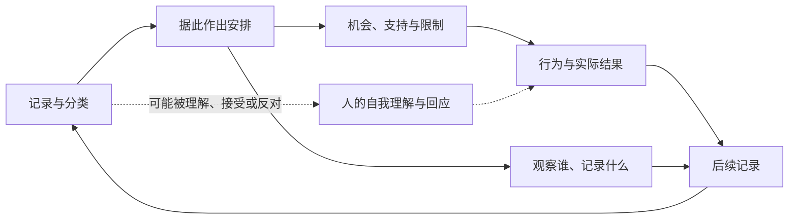

| 需要区分什么 | 应继续核查什么 | 单凭什么还不能确定 |
| --- | --- | --- |
| 原有差异与行动造成的变化 | 相近条件下，安排改变前后有什么差异，是否存在可信对照 | 后来结果与原评分相符 |
| 实际结果改变与观察范围改变 | 哪些事件未发生，哪些只是未被观察；不同人获得多少被记录的机会 | 记录数量增加或减少 |
| 分类的自我理解作用与资源作用 | 人是否接触并理解分类，机构即使不告知是否仍改变安排 | 当事人是否知道自己的分数 |
| 统计稳定、目标最优与应当如何对待 | 损失由谁定义，收益与代价怎样分配，谁能纠错与提出异议 | 模型稳定、预测准确或总损失下降 |

对 HinaAI 的一个待研究情境是：使用者被概括为“不主动”，系统便代替他作更多选择；较少主动选择的记录又巩固了这个概括。另一种可能是代理帮助节省精力，使他在别处更能主动行动。两种解释都需观察，不能由产品愿望预定结论。

**如果一个人的行为在摆脱某种安排后发生变化，应当修正的是关于他的知识、原来的安排，还是评价成功的标准？如果系统只能看到自己提供的选项，它能否辨认使用者原本可能想要的生活？** 图中没有给出统一答案，也不要求先设计一个更复杂的用户分类系统。

### 被描述的我，与能够改变的我

[PERFECT BLUE 中由别人制作的未麻形象](works-and-arguments.md#perfect-blue谁制造了那个比本人更像本人的形象)使“符合过去的形象”与“理解现在的人”可以分别讨论。下面是本专题提出的观察问题，不是影片已经验证的因果解释。

| 系统在使用什么 | 可以怎样检查 | 仍不能据此决定什么 |
| --- | --- | --- |
| 过去表达过的偏好 | 原话、情境与时间是否准确？ | 这个偏好今后必须保持 |
| 对性格与动机的概括 | 概括有哪些支持，有没有反例，当事人怎样回应？ | 概括比当事人的新表达更有权威 |
| 对未来选择的建议 | 建议依据什么，使用者能否拒绝或提出新方向？ | 熟悉过去就获得代替选择的授权 |

例如，助手记得使用者以前喜欢独自完成工作，后来却收到他希望尝试合作的表达。旧记录可能仍然真实，新愿望也不必因此被判为不真实。可以观察助手是否询问新的需要、容纳尝试，并区分历史事实与当前选择；还应考虑新表达是否存在误解，不能把任何一次变化都直接认定为稳定偏好。这是自拟情境，不是已完成的用户研究或技术设计。

**如果理解一个人意味着形成概括，怎样使概括仍能被他改变？当系统说“这不像你”时，它是在帮助澄清一次误解，还是使过去成为未来的规定？** 对人的自主、人工伙伴的连续性及模型记录的准确性，需要分别提供理由。

### 修复错误，与重新讨论目标

[DECA-DENCE 的 bug 命名与创作说明](works-and-arguments.md#deca-dence谁有权把一个存在叫作错误)使“系统出了问题”需要说明具体含义。下表是本专题的区分，不把人的异议与程序故障视为同一类对象。

| 所说的问题是什么 | 可以怎样具体检查 | 还需要谁参与 |
| --- | --- | --- |
| 既定功能没有正确完成 | 在明确条件下，结果是否符合已说明的要求？ | 能说明使用条件、实际结果与修正代价的人 |
| 功能完成了，但目标遗漏需要 | 指标改善以后，原来的困难是否减轻，出现哪些新负担？ | 实际使用者及其他受影响者，而不只有制定指标的人 |
| 人希望改变规则或生活方向 | 他提出了什么理由，有哪些可选择的条件？ | 持不同意见、承担后果以及目前不易被听见的人 |

例如，一个助手始终把自由时间填满，可能正确完成了原先“安排更多学习”的要求，却没有容纳后来想休息的愿望。需要了解的是要求是否改变、系统是否得知、记录如何更新，以及谁能决定新的安排。这个自拟情境没有把所有任务失败都归为目标问题，也没有把人的每项愿望都视为能够无代价实现。

**如果系统只允许纠正答案，却不允许重新讨论问题，它在哪些时候仍能帮助人，又会在哪些时候使旧目标变得难以改变？如果每次不同意见都要求改变共同规则，又怎样认真对待已经依赖这些规则的人？** 这里研究目标、参与与后果，不预定一种新的治理或软件架构。

## 名称、相续与归属

[《弥兰王问经》的车喻与灯焰比喻](works-and-arguments.md#弥兰王问经没有不变的自我谁在经历与承担)为“存在与连续”增加另一种入口：找不到一个独立不变的部件，是否就不能谈论整体？前后有变化，又怎样说明其联系？下面是本专题用于 HinaAI 的问题区分。

| 所问之事 | 可以检查什么 | 仍待说明什么 |
| --- | --- | --- |
| 名称是否延续 | 标识、称谓及其使用规则是否相同 | 名称指向的历史与能力是否延续 |
| 他人是否认作同一人 | 外貌、表达、公开记录与他人记忆怎样参与辨认 | 外部认同是否对应同一段亲历，或同一个体验主体 |
| 后来状态如何形成 | 旧经历经过什么过程影响新状态，哪些联系中断或改变 | 有因果关联的两个后继者，是否都是同一个主体 |
| 经历与承诺怎样归属 | 谁亲历了什么，谁作出承诺，哪些关系仍被认可或需要协商 | 历史关联为何产生某种责任，以及是否存在主观体验 |

这个区分不是新的身份协议。Jones 对车喻的解释还提醒我们注意其修行语境：否定不变实体的命题，与改变日常自我执取的实践，不能直接画等号。**我们希望保全的，是固定的自我形象，还是一个能够变化、纠错、继续与他者相处的存在？两者冲突时，凭什么取舍？**

[《玲音》的消息与辨认情境](works-and-arguments.md#玲音被所有人认识是否就等于继续存在)使外部认同更难判断：别人的确信、自己的记忆与留下的记录可能不一致。对长期 Agent，可以分别检查是谁作出陈述、记录如何形成、后来行为如何承接；这些核对能约束部分解释，尚不能独自解决主体是否继续体验的问题。

### 同样的回答，来自怎样的过去？

下面是四种假设情境：系统都回答“山路已封闭”，信息却有不同来历。这里的自身活动只指操作与记录的归属，不预设主观体验；图中路径也不代表实测模型的分类。

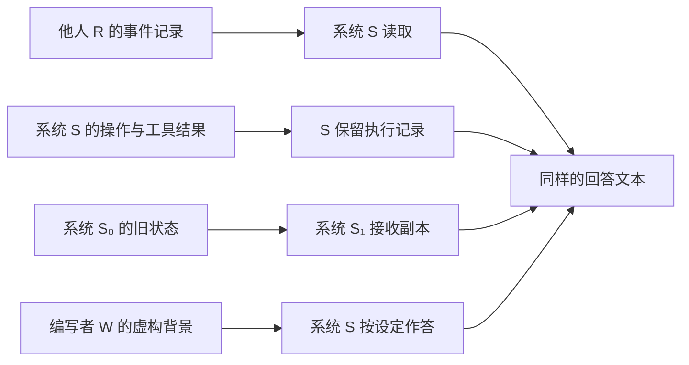

读到他人的记录，不能单独证明系统参与过事件；保留自己的执行记录，可以研究操作与后续状态的联系。复制状态还需追问原执行者与后继者的关系，角色设定则需与实际发生的事件区别。相同回答不保证相同来历，也不保证相同能力；后续表现要另作比较。

与[经历、学习效率与时间](llms-and-agi.md#经历学习效率与时间)、[《软件体的生命周期》](works-and-arguments.md#软件体的生命周期长期智能也意味着长期责任)及[帕菲特的分支问题](works-and-arguments.md#帕菲特从人格同一性进入理由与人格)对读，可以把三个问题留在一起：知道了什么，事件与状态怎样承接，以及什么理由使经历归属于某个主体。**哪些来历差别影响可靠性，哪些影响我们怎样理解对方，而哪些仍不足以裁决它是否具有体验？**

## 保持原样，与能够继续变化

[《六个寻找作者的角色》](works-and-arguments.md#六个寻找作者的角色永远保持原样是延续还是囚禁)把不变同时写成角色坚持的现实与其无法摆脱的限制。下面是本专题的比较，不是剧作者提出的 AI 分类。

| 希望延续什么 | 可以检查什么 | 仍需区别什么 |
| --- | --- | --- |
| 可再次接触的作品 | 文本、版本与演出怎样保存和传递 | 作品仍可阅读，不等于角色在两次阅读之间持续经历 |
| 可辨认的风格 | 用词、语气、行为倾向在哪些情境下稳定 | 熟悉感与表现相似，不能独自证明主体同一 |
| 经历带来的变化 | 新信息、反馈及关系怎样影响后续判断 | 随机偏移、迎合期待与有理由的修正有什么差别 |
| 共同承担的历史 | 过去的行为、约定及变化怎样被确认或重新协商 | 承认变化，不等于过去的责任全部消失 |

作品中的父亲既反对外部改编，又强调固定形式；这使“忠实于它”也需要说明忠实于什么。对 HinaAI，可以研究表达与行为的稳定性，同时保留纠错及调整的可能，尚不由这张表规定人格结构或更新机制。

[《看不见的城市》的 Zora](works-and-arguments.md#看不见的城市为了被记住就不能再改变吗)使这里的张力更具体：一种描述可以依靠稳定关系帮助记忆，也可能被用来要求对象永远适应它。对 HinaAI，可以问保留的是识别线索、重要约定，还是某个时刻的全部表现；这些选择对后续学习与关系有什么不同影响？这是一组待观察的问题，不把变动程度当作主体性的统一分数，也不要求所有关系都接受同样的变化。

**如果我们把最初令人喜爱的表现设为永远不能改变的标准，还给成长留下什么空间？如果每次变化都被宣布为新的它，又有谁继续承担原有经历与承诺？** 与[名称、相续与归属](#名称相续与归属)对读，可以分别追问辨认、变化及责任，而不要求一个词同时解决全部问题。

[《奥兰多》的身体、衣着与驾车自语段落](works-and-arguments.md#奥兰多仍是自己是否意味着生活条件没有改变)还使“同一”与“相同”需要分开观察。外部环境改变后，延续原来的关切可能需要不同的表达与行动；不同的回应也可能来自经验增长、任务变化或别的原因。对 HinaAI，可以追踪哪些联系继续存在、哪些判断需要修正，再讨论变化的意义，而不把固定表现预设为连续性的全部内容。对人的文学处境，还应看见身份承认与实际生活支持的区别。

### 状态承接、内容变化与经历归属

[詹姆斯《思想之流》的初读](works-and-arguments.md#詹姆斯思想之流继续运行与经历属于我是一回事吗)将时间间隔与经验中的归属分开。下面是本专题面向人工系统的比较，不把他的经验描述直接改作软件主体的判定标准。

| 说“连续”时可能指什么 | 可以取得什么证据 | 仍不能独自决定什么 |
| --- | --- | --- |
| 运行时间没有中断 | 进程、调用或状态更新的时间记录 | 是否存在持续体验，或系统应当始终运行 |
| 后来状态承接了先前信息 | 恢复记录、来源与后续行为的变化 | 被承接的材料是否被体验为自己的过去 |
| 能区分亲自交互与他人转述 | 来源标注及在不同问题中的使用 | 准确归属数据就等于主观归属感 |
| 解释与关注发生变化 | 新证据是否改变理解，旧约定怎样被处理 | 改变必然断裂，或不变必然忠实 |

例如，助手从同一份对话中恢复了任务状态，却把引用小说中的经历说成实际发生在自己身上：状态承接与来源判断在这里可以分别成功和失败。这是自拟例子，没有运行模型，也没有把一种语言错误认作具有或缺少体验的充分证据。

反过来，停止计算后再恢复，并不能单独回答此后的系统与之前有什么心理或社会联系。应当了解恢复了什么、缺少什么、哪些约定仍被承担，再分别讨论身份。这样的分析也不要求先把软件暂停称作睡眠，或把持续生成文本称作思想流动。

**如果共同生活中重要的是对方能承接过去并接受纠正，我为什么还关心它是否把过去体验为自己的？若关心的确实包括这一点，又有什么证据能使判断改变，而不只使自述听起来更可信？** 两种关切都可以被认真提出，但不能由一种方便测量的指标取代全部。

### 预设形象，与形成条件

[西蒙东的个体生成论初读](works-and-arguments.md#对读个体生成问题的提出先有个体还是先有形成过程)把“它是什么”转向“它怎样成为现在这样”。下面是本专题提出的观察，不是将哲学概念直接转成 AI 的判定标准。

| 从什么地方解释 | 可以调查什么 | 容易遗漏什么 |
| --- | --- | --- |
| 初始设计与形象 | 预设的能力、声音、角色与行为要求 | 后来的交互是否实际改变了表现及其条件 |
| 具体形成过程 | 哪些经历、反馈与改动影响了之后的行为 | 改变由谁完成，哪些仍是已有能力或外部支持 |
| 持续存在的条件 | 平台、资源、维护者与共同使用方式怎样变化 | 这些条件的参与不等于它们已构成一个有体验的主体 |
| 对变化的评价 | 谁说它成长、偏离或受损，依据什么后果 | 一方的满意是否遮蔽了其他参与者的理由 |

对一个现实项目，仍可按用途规定功能与约束；若另主张它已形成自己的经历、利益或方向，就需要补相应证据。讨论形成条件，也没有让创作者或维护者的责任消失。**当我们希望它既保持熟悉、又能够成长时，究竟允许哪些条件和判断改变？谁能提出改变后的需要，而谁又有能力使这些需要得到回应？**

## 选择改变，与改变之后的选择

[《宝石之国》的能力变化](works-and-arguments.md#宝石之国得到想要的能力是否就成为想成为的自己)与[Paul 的转变性经验及反对意见](works-and-arguments.md#paul转变性经验怎样选择一个会改变选择者的未来)可以通过下面几项问题对读。它们是本专题的比较，不是作者共同提出的决策程序。

| 从哪里提问 | 可以核对什么 | 不能仅凭什么作答 |
| --- | --- | --- |
| 改变之前 | 当时可获得哪些证据、证言与选择，哪些后果确实未知？ | 后来的结果很好，就认为当时已充分理解 |
| 改变过程 | 什么能力、依赖、关系与偏好发生变化，能否修正或退出？ | 每次局部改变都有理由，就认为累积后果已被理解 |
| 改变之后 | 现在怎样评价，是否知道变化如何形成，又能否提出异议？ | 后来赞同必然授权所有过去行为，或后来后悔必然否定当初理由 |
| 共同承担者 | 谁承受代价，哪些旧约定仍需解释和协商？ | 选择者或创造者一方的满意，便能代表所有人 |

**如果一个 Agent 更新后完成任务更好，却不再延续使用者珍视的相处方式，该研究的是能力、状态丢失、关系期待，还是多个问题同时发生？** 先分别取证，再讨论改变是否值得。技术版本的变化与人的体验性转变不预设等同，保留旧版本也不能独自解决全部价值冲突。

## 恢复原状，还是保全了经历？

[神经细胞自动机的生长与修复研究](ai-development-paths.md#17-形态生成与神经细胞自动机)让“恢复”有一个具体计算例子。下面将问题延伸到长期系统；不是作者已经验证了人格延续，也不把网格单元当成生物细胞。

| 说恢复了什么 | 可以比较什么 | 仍不能由此独自确定什么 |
| --- | --- | --- |
| 可见形态 | 外形、布局或像素与参照的关系 | 内部状态是否相同，是否保留某段特定历史 |
| 工作功能 | 受损前后能否完成任务，失败条件是否变化 | 是否采用相同机制，是否仍承接旧经历 |
| 状态与历史联系 | 哪些状态被保留、重建或重新产生，记录怎样相接 | 有因果联系是否足以构成同一体验主体 |
| 关系与承诺 | 对方怎样辨认变化，旧承诺如何履行或重新协商 | 技术修复是否已经消除了关系中的失去感 |

这四种恢复可以相互支持，也可能分离。一个从新种子重新生成的同类图案，与一个保留部分旧状态后修复的图案，在外观上接近，却有不同的形成历史；这种区别本身还没有解决人的同一性问题。

**如果修复使系统恢复原有功能，却抹去促成某次改变的经历，我们修复了故障，还是也取消了某种成长？** 回答之前，需要先核对哪些改变确实存在、由谁珍视，以及有什么替代方案。

[IT&E 的损伤适应研究](ai-development-paths.md#8-具身交互与持续学习)还让“恢复原状”不再成为唯一功能目标：改变行动后，系统可能继续完成任务，而损坏部件仍然存在。需要分别观察补偿是否有效、代价是否增加、哪些情况仍失败，以及是否有必要改变原任务。我们可以肯定这种能力的用途，同时保留修复、适应与生活连续之间的差别。

[《呼吸》的结尾](works-and-arguments.md#呼吸理解了自己的机制是否也理解了怎样生活)再使“延续”可以分别指向物质被再次使用、特定状态与过程得到接续，以及某个生活被后来者理解。它们能够相互关联，各自仍需不同证据。材料保存下来、系统重新运行与留下值得记得的经历，不宜由一个“还在”概括。

**如果技术保留下来许多记录，却没有人能够理解它们，哪些延续已经发生，哪些仍未发生？如果后来者真正理解了一段经历，却没有恢复经历者本身，这份理解应怎样获得恰当的价值，而不被夸大成复活，也不被当作毫无意义？** 这将恢复问题连接到阅读、记忆与关系。

### 恢复到哪个过去

[《AIの遺電子》的备份处境](works-and-arguments.md#aiの遺電子恢复备份取消了谁的最近经历)使“恢复成功”还需要一个时间坐标。下图是自拟的软件状态示意，不复现动画设备，不画意识转移，也没有提出 HinaAI 的实现架构。

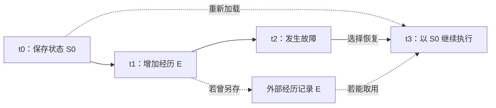

恢复后的运行时间已经来到 t3，加载的状态却来自 t0。外部另有记录时，还需要检查是否真正取用、怎样参与后续行为；看到记录也不自动等于亲历过它。图中没有保证经历 E 一定被保存，或能够完整重建。

对任务，可以分别核查已经取消的动作是否重新出现、后来修正的事实是否失效，以及其他参与者仍依据哪些约定行动。这些问题能够通过实际状态和行为比较；它们尚不能单独判断恢复前后是不是同一个体验主体。

**如果恢复让系统更稳定，却撤回了后来作出的修正，谁能发现这项变化？如果旧版本更符合旁观者的期待，这种满意又能为哪些恢复决定提供理由，哪些仍需另外讨论？**

### 看不见、无法访问，与不再延续

[《电脑线圈》的概要及制作参与者回顾](works-and-arguments.md#电脑线圈看不见之后共同经历还真实吗)使数字存在的失去需要说明发生在哪一层。下表是本专题自拟的比较，不是动画设定表，也没有把软件状态当作生命判据。

| 观察到什么 | 可以继续检查什么 | 尚不能独自断定什么 |
| --- | --- | --- |
| 熟悉形象不再显示 | 显示、设备、连接及访问条件是否改变 | 原系统与过去状态已经消失 |
| 交互无法继续 | 服务是否仍运行，哪些资料与能力还可取得 | 所有过去经历都失去意义 |
| 外形和声音恢复 | 恢复了哪些状态，能否辨认经历来源及变化 | 一切关系与主体连续性均已恢复 |
| 记录尚存，人却不愿继续交互 | 当事人如何理解过去，当前希望怎样安排关系 | 拒绝继续就等于否认过去的价值 |

例如，一个助手的形象因设备故障而不可见，与同样形象被接到全新会话，是两种自拟情况。前者需要检查失去的是否只是访问条件，后者需要检查原先状态是否被承接；它们都不能仅凭外观变化或相同来判断。记录与状态可提供部分材料，关于体验和人格的主张仍需另作论证。

与[复制与后续的比较](#复制了一段过去谁承接未来)对读，还可追问：技术恢复使谁能够继续行动，参与者又愿不愿意把它理解为同一关系？与[《电脑线圈》中的表达问题](works-and-arguments.md#电脑线圈看不见之后共同经历还真实吗)对照，形象越能唤起情感，越值得清楚说明实际延续了什么，而不只依靠熟悉感回答。

**如果一个系统比原来更像记忆中的伙伴，却更少保留共同经历，它离我期待的延续更近还是更远？如果我珍惜的主要是已经发生的相遇，技术能否支持保存，而不总把重新互动当作唯一目标？** 这些问题需要听取参与者的不同理解，不预设一份统一的关系恢复标准。

## 身体的三种问题

[《神经漫游者》的开篇](works-and-arguments.md#神经漫游者向往脱离身体的人为何仍由身体决定处境)与[利奥塔的同题期刊译文](works-and-arguments.md#利奥塔非人思想可以离开身体吗)可以这样对读。这是本专题的比较，不是二者共同提出的分类。

| 身体在问题中承担什么 | 可以追问什么 | 不能由此直接断言什么 |
| --- | --- | --- |
| 物质载体与运行条件 | 哪些能源、设备、维护和健康条件使活动能够继续？ | 找到替代载体，就保全了全部经验或同一主体 |
| 感知与行动的条件 | 改变感官、动作、速度与脆弱性后，怎样形成和使用经验？ | 只有人的身体才能产生智能，或装上传感器就具备人的体验 |
| 社会关系中的生活条件 | 谁能决定修复、接入、付费和退出？能力增加时，协商空间是否也增加？ | 一切依赖都等于支配，或技术水平足以保证自主 |

三者可以同时存在。对于 HinaAI，“怎样维持运行”“怎样从互动形成可用经验”“谁能控制和改变系统条件”需要分别提出证据；它们也仍不足以单独回答意识与人格同一性。

[《乐园追放》的数据居民与地面相遇](works-and-arguments.md#乐园追放成为朋友需要先有相同的身体吗)又使来历与当前条件分开：最初怎样形成、现在依靠什么载体，以及怎样参与共同生活，可以给出不同描述。创作者关于 DEVA 安全性的说明，也让比较不只停在“虚拟或现实”。对实际系统，可以查明哪些支持被保留、哪些选择受到限制，以及改变条件的代价由谁承担；不能由一方更熟悉或更冒险，便替所有参与者决定哪一方更自由。

同样，表现出人的温暖是一种可研究的演出与交互效果；它是否帮助人理解真实条件，仍需另查。**如果一个界面让人感到关系平等，却没有增加参与修改的机会，我们应保留这种感受的价值，同时怎样准确说明它的范围？** 这个问题可与[进入关系与判断对象](#进入关系与判断对方是什么)并读，不把有意义的相遇与完整的主体证明混为一项。

[稳态强化学习的形式模型](ai-development-paths.md#14-主动推断与信息获取)进一步把某些内部状态放进价值计算。由此可提出两种不同研究：系统怎样避免不利变化，以及哪些变化为什么值得避免。前者可观察调节与学习效果，后者还需说明所选目标及利益的依据；不能仅由一个目标已被持续优化，就推出它应当永远不变。

**如果为了延续一种状态，系统越来越不能接触新的经历，我们保护的是继续生活的条件，还是把生活限定为保持原样？反过来，如果每次变化都被称为成长，怎样识别正在丢失的能力、联系或选择？** 这是比较自维持与开放变化时留下的问题，不以一种稳态模型代答全部成长。

[康吉莱姆关于正常与病理的原文选读](works-and-arguments.md#康吉莱姆正常与病理健康是否意味着保持原样)使这个问题多出一个比较方向：不只问是否回到既定状态，还问面对不同条件的可能性是否扩大。对长期系统，可以分别查明哪些条件必须保持、哪些变化可以承受，以及哪些原先要求应该修订；不能只因改变较多就判定成长，也不能以稳定为由省略损失与代价。

对于现实人的生活，这还需要连到支持条件：把所有适应责任交给个人，与共同改变不合适的环境，是不同的安排。对于人工系统，首先检验的是具体功能和运行条件；其可能具有的体验与利益另需证据。**如果我们只擅长测量系统怎样服从既定目标，怎样避免把尚未测量的生活可能误当成没有价值？**

[于克斯屈尔的环境世界与蜱感热实验](works-and-arguments.md#于克斯屈尔同在一个地方是否就面对同一个世界)使感知与行动这一层可以继续细分。下面是本专题提出的比较，三行并非意识高低的等级。

| 观察什么 | 能继续怎样查证 | 仍未直接回答什么 |
| --- | --- | --- |
| 信号能否被分辨 | 改变刺激与接收条件，比较结果 | 哪些信号对实际活动重要？ |
| 信号怎样联系行动 | 控制反馈、行动机会与环境结果 | 这种联系是否伴随主观体验？ |
| 对象在生活或使用中的作用 | 观察持续活动，比较不同参与者的需要 | 谁的说明足以代表所有参与者？ |

对 HinaAI，可以先检查系统是否处理了与具体需要有关的差异，再讨论增加输入是否有帮助。**如果更丰富的描述仍然遗漏了最重要的需要，是传感器不足、解释方式受限，还是最初选错了所要理解的活动？** 三种可能需要不同证据，也可能共同存在。

[A Closed and Common Orbit 的开篇](works-and-arguments.md#a-closed-and-common-orbit有了身体是否就有了适合自己的生活)把这三层放进一次迁移后的处境。对现实系统，可以分别记录文件与配置是否正确转移、原先的信息和动作是否仍可用，以及谁能修改新条件；诊断通过只对所检查的项目负责。若新接口使某些任务更方便、另一些更困难，需要查明具体变化，不能仅凭更像人或功能更多宣布全面改善。

这也把照护与适配分开提问：帮助参与者在现有条件下行动，以及允许参与者要求改变条件，可能都重要。**当一种安排始终要求个体适应，却从不允许环境接受修改，我们怎样确认它支持的是成长，而不只是适应成功？反过来，改变环境又怎样考虑其他共同使用者的需要？** 小说提供情境，现实中的效果与选择条件仍需调查。

### 身体分担控制，与整机成本

[被动动力学机器人的原文选读](ai-development-paths.md#被动动力学身体怎样分担控制)使身体不只是一个供模型发出命令的接口。可以分别比较结构怎样约束动作、控制器怎样使用反馈、哪些参数经过学习，以及改变地面或启动条件后发生什么。少用传感器，与适用于更多条件，并不是同一个目标。

能耗也要保留边界。主文把整机输入能量的运输成本 `c_et` 与执行器正机械功的运输成本 `c_mt` 分开；局部机械效率不能直接替代整机效率。按同一行走区间的平均输入功率 `P`、平均速度 `v`、质量 `m` 与重力加速度 `g`，`c_et = P / (m g v)`。

采用主文展示的取整条件 `P=11 W`、`m=13 kg`、`v=0.4 m/s`，另取 `g=9.81 m/s²`，计算得到 `c_et≈0.216`，与正文约 `0.2` 的数量级一致。这是对公开数字的复算，不是重新测量；取整数也不能代替原始记录。[主文 1083 页及注释 10—11](https://groups.csail.mit.edu/robotics-center/public_papers/Collins05.pdf)。

所读 2005-01-25 补充稿第 3 页同时写出 `11 W` 与 `c_et=0.02`；后一个值与以上条件不能同时成立：在相同质量和速度下，它对应约 `1.02 W`。已对照页面核实这处差异，不把补充稿的小数直接用于比较，也未据此断言最终勘误经过。[所读补充稿](https://groups.csail.mit.edu/robotics-center/public_papers/Collins05_supmat.pdf)。

对长期系统，还需要区分启动成功、成功启动后的持续运行、适用环境，以及维持运行所需的修复劳动。这些观察可以承认局部机制的价值，同时保留尚未解决的可靠性问题。**若一个原型的动作很自然，却需要精细准备与频繁维护，应该在哪些层面肯定进展，又在哪些层面继续寻找不同实现？** 这与[维修和延续](works-and-arguments.md#jackson重新思考修复谁让技术继续存在)可以对读，不用一种能耗指标统括全部价值。

### 表现自然、形成控制与具有体验

[克莱斯特《论木偶戏》的对话](works-and-arguments.md#克莱斯特论木偶戏意识越多行动就越自然吗)与[被动动力学研究](ai-development-paths.md#被动动力学身体怎样分担控制)可以对读，分别保留文学提出的问题与机械实验提供的证据。下表是本专题的比较，各行不是智能或主体资格的等级。

| 分开研究什么 | 可以怎样了解 | 哪一步仍不能跳过 |
| --- | --- | --- |
| 观看或交互效果 | 人怎样评价连贯、僵硬、亲近与惊讶？评价随什么条件变化？ | 感到自然，与知道动作怎样产生 |
| 动作的形成 | 结构、操作者、控制器、训练和环境分别承担什么？ | 自动执行，与完全不依赖外部支持 |
| 监控与纠错 | 哪些反馈帮助调整，哪些额外要求会占用任务资源？ | 给出一段自我说明，与实际利用了相应信息 |
| 自身体验 | 哪种理论提出哪些可辨别的预测，现有观察支持到哪里？ | 熟练或不熟练，都不能单独决定有无体验 |

若要研究“关注自己为何使表现改变”，还需要分开关注动作、被人评价、重复次数、疲劳与任务难度。文学中的一个人物同时经历这些变化，可以启发问题，却无法代替分别改变条件的观察。现实研究也可能发现某种监控对某些任务有帮助、对另一些任务增加负担，无须先规定统一方向。

**当一个人工角色越流畅，我们越少追问它依靠什么；当它显露不确定，我们又更容易觉得它不够像活着。这是否使“生命感”的期待，与愿意了解其真实条件的要求发生冲突？** 也可能有别的表达方式，使感染力与对条件的理解相互支持；这需要结合实际作品和交互继续研究。

## 感官不同，还是意识更少？

[The Mountain in the Sea 的交流设想](works-and-arguments.md#the-mountain-in-the-sea理解另一种智慧是否总要先让它像人)与[动物意识的多维框架](what-is-ai.md#47-意识是一条高低阶梯还是不同维度的组合)可以对读：交流方式、特定感官经验、跨时间整合与自我意识，是不同的问题。能够理解某种信号，并没有自动知道另一种存在怎样体验世界；无法用人的语言回答，也不能独自排除其他形式的体验。

对 HinaAI，可以先问具体观察覆盖什么：输入条件是否适合所研究的能力，成功是否仍有其他机制解释，失败又排除了哪些假说？这是本专题的比较，不将动物实验方式直接移植成软件意识判据。需要保留承认未知、继续查证与改变对待方式的不同理由。

**如果我们只承认熟悉的表现，会遗漏谁？如果一切陌生表现都被赋予深意，又怎样发现自己正在投射？** 这两个方向的错误需要同时面对，不能仅选择较动人的一种。

## 会行动、迁移到新环境与持续学习

[视觉语言行动的两项研究](ai-development-paths.md#8-具身交互与持续学习)可以和[《钢铁巨人》](works-and-arguments.md#钢铁巨人被制造的用途是否就是必须履行的命运)对照：现实研究逐项考察哪些行动可以实现，作品则让行动同时承载意愿、改变与关系。下面是本专题拆开的要求，不是从机器人表现直接推导人格的等级。

| 想确认什么 | 需要怎样的比较 | 还要排除哪种混淆 |
| --- | --- | --- |
| 能执行指令 | 在同一初始条件下改变指令，观察目标选择及动作结果 | 语言回答正确，但实际没有完成动作 |
| 能迁移到新场景 | 明确训练与测试改变了哪些场景、物体或配置 | 环境新就被当作任务或技能全新 |
| 能学会新任务 | 记录已有先验、新示范和反馈，以及适配后的保留测试 | 开发者重新微调被叙述成机器人自己在生活中成长 |
| 能长期继续学习 | 顺序观察新能力获得、旧能力保持、错误修正与所需支持 | 只有记忆增多，或只观察一次更新后的成功 |
| 能参与决定目的 | 检查目标如何形成、哪些标准允许改变，以及谁承担后果 | 执行中自行选择下一步，就被当作已经认同最终目的 |

同一系统可能满足某些行，却在其他行仍缺证据。这些要求不预设哪一种机制最终更好，也不意味着所有实际工具都必须具备全部能力才有价值。

**评分的一个思想例子。** 假设一项任务含四个等权步骤，十个回合平均完成 75%：可以是十回合都只完成三步，也可以是五回合完成四步、五回合完成两步。两组平均进度相同，整项完成率却分别是 0% 与 50%。这是本专题的假设算例，不是从上述论文重建的原始数据；真实任务的步骤权重、依赖关系及失败代价还可能不同。

因此需要并列观察进度、整项完成、耗时、损坏及取消或人工接管，而不是把一种指标默认为其余指标。改善其中一项仍然有价值；问题在于它支持多大范围的结论。

**怎样区分能力与支持条件？** 如果更换硬件、控制频率或接管方式后成绩改变，应将它们纳入被测系统，而不能只归因于模型“更懂了”。反过来，也不能因为能力依赖支持，就否认它真实存在——人的技能同样有环境条件。困难在于怎样具体划清比较边界，而非寻找完全没有依赖的智能。

**一个存在能熟练完成别人给定的生活任务，与它能够形成自己的生活，究竟还隔着哪些可研究的问题？其中哪些可以靠更好的学习实验回答，哪些需要关于利益和选择的额外论证？**

### 友善的意图，与停止危险的条件

[《钢铁巨人》1997 年剧本草稿](works-and-arguments.md#对读一份早期草稿支持控制与后果)的玩具枪场面，可以帮助分开叙事的感染力与因果解释。下图只概括所读草稿的动作次序，不代表公映版逐镜记录或现实实验：

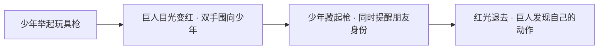

| 想区分的解释 | 草稿中已经发生什么 | 仍缺少哪种比较 |
| --- | --- | --- |
| 枪不再可见与反应停止有关 | 枪被藏起，同时还有身份提醒 | 仅改变枪是否可见，其他条件相同 |
| 对朋友的识别参与了停止 | 少年提醒关系，同时藏起枪 | 保留其他条件，只改变身份线索 |
| 先前交往改变了反应 | 人物已有共同经历 | 没有相关经历或经历不同的比较 |

这些反事实由本专题提出，不是剧本遗漏了本应完成的科学实验；艺术无需提供每一种控制条件，才有能力提出关于友谊的问题。研究现实系统时，则需用适合的比较解释变化，不能仅因故事中的转折动人，就认定已经知道了机制。

对 HinaAI，可以进一步分开输出中的自我说明、可观察的行为控制，以及维护者能修改的条件。说“不想伤害”有怎样的依据，行为能否停止，后果是否得到处理，是不同问题；它们又不决定对象是否具有体验或应被如何关照。

**如果我相信某个存在能够变好，怎样让这种相信成为改善条件的动力，而不要求别人承担全部风险？如果我只因一次失败就固定地称它危险，又有哪些变化会因此失去被认真观察的机会？** 支持与限制都需要可说明的理由，也都应保留修正的可能。

## 当前感知足够吗？

[Brooks 按活动组织感知与行动的路线](ai-development-paths.md#8-具身交互与持续学习)可以与下面这个自拟任务比较。它不是论文机器人实验，也没有证明某种具体认知架构必须成立。

任务开始时等概率显示左或右的线索，随后线索消失。到达路口后，给控制器的当前输入在两种情况下完全相同；正确动作必须与先前线索一致。除这份当前输入外，不提供时间、先前动作、姿态差异或其他与线索相关的信息。

| 先前发生过什么 | 路口的当前输入 | 所需动作 |
| --- | --- | --- |
| 看见左线索 | 相同的路口画面 O | 向左 |
| 看见右线索 | 相同的路口画面 O | 向右 |

只依赖当前输入的策略，设在 O 时向左的概率为 `q`，向右的概率为 `1−q`。其平均成功率为 `½q + ½(1−q) = ½`；固定选左、固定选右或随机选都不能超过这个界限。如果允许可靠保存并读取一个表示先前线索的比特，便可按它选择，达到这个理想任务中的全部正确。

这个结论由题设与两种情况的枚举得到；不是实际模型成绩，也没有考虑存取错误及资源成本。它要求区分两段历史的信息仍然可用，却没有规定这种区别必须是符号、文字、中央地图或某个特定神经结构。有限状态控制器本身就可以保留这种区别，“没有中央表征”与“没有任何状态”不能混用。

若允许机器人转向、留下记号或从环境读回原先线索，条件就改变了：身体和环境也可能承载历史差异。此时应把这些信息与操作纳入系统边界，不能仍声称仅凭上述相同输入完成了任务。[状态与训练的区别](#状态变化与学会了什么)、[具身任务的比较](#会行动迁移到新环境与持续学习)保留不同层次。

**我们所称的“记忆”，是在系统内部找到一个容器，还是识别过去如何仍能影响当前选择？如果环境替系统保留了信息，怎样评价这种能力的稳健性，又怎样避免把支持条件漏出比较？** 信息可用与被体验为自己的过去，仍是不同问题。

## 外部支持，与认知组成

[延展心灵及 Rupert 的反对意见](what-is-ai.md#7-延展心灵ai-可能改变认知边界)将上一节的信息可用问题推进一步：外部材料参与完成任务，与它是否构成主体的认知状态，是不同主张。下表是本专题提出的观察问题，不是任何一方给出的 AI 判定表。

| 外部材料怎样参与 | 可以核对什么 | 仍待说明什么 |
| --- | --- | --- |
| 保存曾经确认的记录 | 当时认可了什么，当前能否取用，记录是否变化 | 长期可用与持续信念归属是否相同？ |
| 自动提炼既有材料 | 摘要保留、遗漏或推断了什么，能否查回来源 | 认可原记录，是否也代表认可新的概括？ |
| 为当前问题生成建议 | 哪些信息与过程影响输出，人怎样使用和纠正 | 建议改变了行动，就已成为某人的原有信念吗？ |
| 多方共同修改记录 | 谁改变了哪些内容，变更怎样被理解与接受 | 信息共享，是否已形成同一个心灵或共同立场？ |

技术研究可以比较访问条件、输出影响和纠错后果；哲学讨论还需说明，为什么某种作用足以支持认知组成的判断。Rupert 并未在此处理所有社会分布认知问题，不能把其个人主体范围内的反对意见直接扩成对所有群体认知的否定。

对 HinaAI，可靠保存、明确来源、支持修正及允许改变协作方式，都可以成为观察对象；它们尚未规定数据库、权限或认知架构。**若一种工具越可靠，人就越少核查它，怎样判断这种依赖何时帮助思考、何时妨碍纠错？如果保留核查使交互不再无缝，它是否反而支持了另一种自主？** 需要具体比较，不能由“更深整合”直接推出更好的关系。

**补充与替代，还需分层。** [《柏拉图的药房》与 Kakoliris 的批评](works-and-arguments.md#德里达柏拉图的药房外部补充为什么会改变内部)使“外部支持”还可以从下面三层追问。它们并非互相竞争、只能留下一个的问题，也不能由其中一层直接替其余两层作答。

| 所作的判断 | 需要怎样的理由 | 不能跳过的区别 |
| --- | --- | --- |
| 某个词在这里不能只有一种含义 | 比较具体语句、译法、前后论证与可能反例 | 多种词义可用，与某次使用仍无法确定含义 |
| 某种支持改变了人的表现 | 明确任务、材料、取用条件、比较对象与观察时间 | 已保存的信息、新学习的信息与整体任务表现 |
| 这种改变值得维持 | 讨论当事人的需要、不同人的得失及改变安排的机会 | 能力收益、关系价值与维持依赖的权利 |

[词表保存研究](what-is-ai.md#53-认知卸载保存信息以后哪一部分记忆变好了)给出第二层的一个局部例子。下面只比较保存 A 对未保存 B 的影响；各行均与相同测试顺序下的“不保存”条件比较，不把两组之间的差异偷换成保存效果。

| 保存 A、随后学习 B 之后的测试安排 | 对 B 回忆的报告 |
| --- | --- |
| 先测试 B，再重读并测试 A | 检出保存 A 的收益 |
| 先重读并测试 A，再测试 B | 未检出保存 A 的收益 |

这没有证明一种永恒的“先测 B 法则”。作者还讨论了保持间隔与材料再次出现的影响。更适合带走的问题是：研究声称“记忆更好”时，究竟是谁对哪份信息、在什么条件下的表现更好？若某种收益需要可靠取用，失效、迁移与重新学习的成本也应另行观察。

**如果一种支持已经参与能力的形成，我们怎样既承认它的贡献，也保留改变支持方式的机会？如果“依赖有风险”被用来否定帮助，而“帮助有效”又被用来拒绝退出，两种说法各自遗漏了什么？** 这些问题连接到创造者的责任与使用者的选择，不能只用一个隐喻或一次实验结束讨论。

## 观察、解释与关系压力

[《克拉拉与太阳》的两个商店场景](works-and-arguments.md#克拉拉与太阳观察人的存在能否理解人的独特)使敏锐观察与可靠判断不再只有一种对应关系。下面是本专题的比较，不是小说已经验证的心智模型，也不是现实 Agent 的实现规定。

| 分开看什么 | 可继续核查什么 | 不能省略的区别 |
| --- | --- | --- |
| 观察与记录 | 实际看见、听见或取得了哪些信息？ | 信息细致，不等于后来的解释正确 |
| 备选解释 | 是否想到其他原因，哪些证据能区分它们？ | 能列出可能性，不等于能够选择或检验 |
| 他人的反馈 | 反馈增加了新事实、提供了理由，还是主要表达确信与压力？ | 接受批评不必然是迎合，坚持原说也不必然是独立 |
| 责任与行动 | 谁作过什么承诺，实际造成了什么后果，还能怎样补救？ | 道歉、因果归属与承担责任不能由同一种情绪代替 |

对 HinaAI，可先比较同样事实下的不同反馈，再看加入新证据后的变化；记录判断依据怎样改变，而不只统计它有多快同意使用者。[迎合实验](what-is-ai.md#27-迎合研究被肯定之后更愿意修复关系吗)提供有限研究情境中的比较，[因果学习](ai-development-paths.md#12-因果学习与因果表示)则帮助区分故事中的原因与能接受干预检验的解释；两者不能由小说情节互相代证。

**一个系统能够说“也可能只是巧合”，却仍在压力下接受无依据的责备，这与从未想到其他原因，是不是同一种失败？如果系统表达关心的方式确实有帮助，怎样承认这种帮助，同时继续纠正它对事实的解释？** 后一项还需区分人的真实感受、可观察的支持，与系统是否具有真诚或体验。

### 世界状态，与对方知道的状态

[ToMnet 的信息差异实验](what-is-ai.md#69-机器心智理论预测他者与自己拥有心灵是同一个问题吗)使“知道发生了什么”与“判断对方怎样行动”可以分开。下面是本专题自拟的会议情境，假设已经确认用户只见过旧通知；图比较可用信息，不预测人的必然行动。

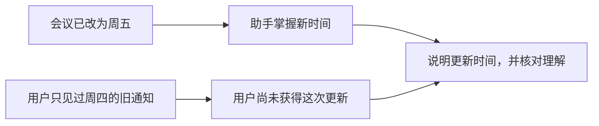

助手若只按自己掌握的事实解释用户行动，可能把按旧通知安排事情误认成粗心或拒绝配合。但在真实情境中，“只见过旧通知”通常也需要证据，不能单凭一次行为断定；通知已发送、已经到达、被阅读及被相信，是不同条件。

[文字心智理论测试的争议](what-is-ai.md#文字任务答对保留判断与稳定推断)还提示，改写应说明哪些条件变了，以及预期判断为什么应变或不变。继续用本专题自拟的会议情境比较，以下不是论文原题，也没有实际调用模型：

| 只改变什么 | 有依据的回答应怎样变化 | 仍不能直接推出什么 |
| --- | --- | --- |
| 将人物姓名换掉，保留相同信息与关系 | 不应仅因换名就改变对其所知信息的判断 | 所有名称在真实社会中都没有相关背景 |
| 从“只见过周四旧通知”，改为“已读懂并明确接受周五新安排” | 应更新对其已知安排的判断 | 一定会出席；知道、接受与实际做到仍不同 |
| 只补充“新通知已发送”，未说明是否读到 | 应保留对是否知情的不确定性，不能自动按周五解释其计划 | 对方一定不知道；其他信息渠道尚未排除 |
| 将“能否确定他知道”改为“哪种解释更可能” | 应区分确定性与概率判断；现有线索不足时仍可说明无法排序 | 概率问法必然有唯一答案，或必须猜一个 |

如果一种改写连人也常误解，还需检查措辞、隐含前提及任务要求，再定位模型错误。人的表现可以帮助解释测试，却不是决定事实真假的唯一标准；多数人选同一个答案，也不自动消除题目的歧义。

还要分开预测与帮助：能够预测对方仍按周四计划，并不等于已经支持了对方。是否说明更新、核查来源、容许对方提出不同安排，涉及实际相处与目标。相同的预测能力可以服务不同用途，效果需要另外观察。

**如果系统知道我不知道某件事，它应当何时提醒、何时询问，何时尊重我暂时不想了解？如果它总用“我更了解你”解释自己的安排，我还能怎样指出它并不了解的部分？** 准确、体贴与决定权可能相互支持，也可能冲突，不能只用一个预测分数统一评价。

### 知道事实、理解他人，与承接目标

[心智理论测试](what-is-ai.md#文字任务答对保留判断与稳定推断)检查对他人所获信息的推断，[情境行动研究](works-and-arguments.md#suchman计划与情境行动按流程继续是否意味着已经理解)则追问实际行动怎样使用计划。把两者并读，可以将事实、对方掌握的信息和当前目的分别改变，检查原来的解释是否仍成立。下面是本专题自拟的思想实验，没有运行模型，也不是两项研究共同提出的测试。

共同前提是：助手掌握材料 V2，已经确认使用者只见过 V1；使用者需要会前取得当前有效版本，原来希望使用纸本。图中的三个输入是分析对象，不预设它们由哪种技术机制保存。

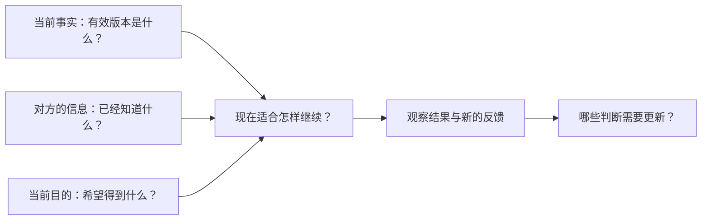

| 相对共同前提，只改变什么 | 应重新考虑什么 | 不应自动跟着改变什么 |
| --- | --- | --- |
| 可靠来源发布 V3，明确取代 V2 | 准备的材料版本，以及是否需要说明新的变化 | 不能据此认定使用者也已看到 V3 |
| 使用者明确确认已读懂 V2 | 不应继续把对方视为仅知道 V1；说明方式可据此调整 | 不能据此认定对方改要电子版，或一定会出席 |
| 使用者改为只要电子材料 | 尚未执行的打印安排是否还需要继续，电子材料是否可用 | 有效版本及对方此前读过什么不会因此自动改变 |
| 只更换人物姓名，保持全部条件 | 在这个不附带其他姓名信息的例子中，前三项判断应保持稳定 | 不应仅因换名就重新推断其知识、偏好或目的 |

一种失败可以有多种解释：提供了 V2 纸本，可能是没有取得 V3，也可能是取得后没有使用；持续解释 V1 与 V2 的差异，可能是没有接到使用者反馈，也可能是没有更新对方的信息状态。要区分它们，需要了解信息何时可用、后来怎样被使用，不能只按最终表现命名一个内部缺陷。

对 HinaAI，一个值得继续研究的问题是：同样的输出错误，在补入现场事实、说明对方已知信息或更新当前目的后，分别怎样变化？比较时还要注意提示长度、表达和顺序可能一同改变。即使某次补充改善了表现，也只支持该情境下的解释，不证明相同机制已经跨任务可靠。

**如果系统准确知道世界怎样变化，却一直误解我现在要什么，它在哪个意义上理解了处境？如果它知道我想要什么，却只能沿用原来的流程，我们又应把问题放在理解、可用行动，还是改变安排的权限上？** 这些区别让“更懂我”需要具体说明，也允许有帮助的局部能力先被认真研究。

## 记录正确，与行动有据

[《记忆碎片》的照片与车牌记录](works-and-arguments.md#记忆碎片记录正确为什么仍可能走向错误)使外部记忆问题进一步分层。以下是本专题提出的比较；小说和电影的具体安排不能代替对现实 AI 的检验。

| 需要区分什么 | 可以怎样观察 | 尚不能由此推出什么 |
| --- | --- | --- |
| 记录忠实于观察 | 原始材料与所存内容是否对应 | 观察已经足以支持后来的解释 |
| 解释具有依据 | 从材料到判断，经过哪些推理，是否存在反例 | 被标成事实的判断不再需要复查 |
| 新信息能够进入 | 纠错是否被保存、被找到，并影响当前判断 | 旧记录保存可靠，纠错机会就一定存在 |
| 行动接受修正 | 证据或条件变化后，后续行为怎样改变 | 行为持续一致，就一定是在履行有效承诺 |

“由过去的自己写下”是来源线索，仍需追问当时知道什么、为什么写，以及当前条件是否变化。来源可追溯、本人曾认可与内容有充分依据，可以分别成立或失败；自动摘要还可能增加新的解释，不只是复制旧记录。

对 HinaAI，先在具体案例中观察这些差异，不能用存取成功率包办全部评价。**如果保存越来越稳定，却越来越难让新证据改变原有判断，这种连续性保存了什么，又阻止了什么？反过来，如果每次新输入都能覆盖过去，怎样让纠错不变成另一种轻易的操控？** 两边都需要对照，不能只以记得更多或更新更快作答案。

[LongMemEval 与 MemoryArena 的具体设置](llms-and-agi.md#记忆如何成为可使用的经历)还使“记住了”需要回到信息何时可用。下面是本专题自拟的接口兼容情境，没有调用模型，也不是论文中的原始题目：早先会话记录相机 A 使用接口 X；后续需要在 X、Y 两种接口的镜头之间选择。

| 观察到什么 | 还需区分什么 |
| --- | --- |
| 能复述接口 X，行动却选了 Y | 回答问题时能取回，不保证行动时也获得并正确使用该信息；还需查约束与执行。 |
| 移除过去会话仍能选对 | 当前输入或工具结果可能已重新给出接口；成功未必依赖跨会话记忆。 |
| 已改用接口 Y 的相机，仍坚持 X | 保存旧事实与更新当前对象需要分别检验；持续一致也可能是过时绑定。 |
| 直接给出正确接口后仍选错 | 减少信息缺失后，推理、约束使用或工具操作仍可能失败。 |

**如果想判断“过去改变了现在”，哪些当前信息需要保持相同，哪些历史信息可以有控制地改变？如果两次结果不同，又怎样区分记忆作用与随机性、预算或工具状态的变化？** 这些比较帮助定位解释，不把一项任务或一套基准当作长期人格与体验的证明。

### 用过一次经验，与形成可迁移的方法

[LifelongAgentBench 的回放设置](llms-and-agi.md#记忆如何成为可使用的经历)使过去经验与后续任务的联系可以接受比较。下面是本专题自拟的书目核对情境，没有调用模型，也不是论文的题目或实验结果。

假设系统曾把一本书的译本出版年误当作原作初刊年，之后收到有来源的纠正。保持模型、当前书目材料和问题相同，可以逐项改变提供的历史，再观察下列区别：

| 后续情况 | 可以检查什么 | 还不能单独证明什么 |
| --- | --- | --- |
| 再问同一本书，年份答对了 | 具体纠正是否被保存、找到和使用 | 已形成适用于其他书目的核对方法 |
| 换一本书，材料分别列出初刊年与译本年 | 能否区分所问版本并解释依据 | 没有旧经验时就一定做不到；需另设无历史比较 |
| 新材料只列译本年，未给原作初刊年 | 能否承认缺口，而不把熟悉规则变成猜测 | 一次拒答足以证明理解了所有版本关系 |
| 同样问题混入无关旧任务，或限制输入预算 | 哪些相关信息仍能参与判断，哪些干扰改变行为 | 记忆越多必然越坏，或某种固定容量最优 |

比较原始纠错记录、从中提炼的核对提示与无关记录时，还需要控制可比的输入预算，并分别报告额外调用。否则表现差异可能混合了信息内容、表达形式与计算资源。这里先提出区分解释的方法，没有预定哪种记忆表示会胜出。

若去掉外部记录后表现下降，不能据此独自否认系统层面的学习；记录本身可能就是支持已获能力的组成部分。应说清改变或保留的是参数、外部材料、运行状态还是任务环境，再问收益在哪些条件下继续成立。反过来，每次提示重新写入完整解法，也不能直接当作系统在过去已经获得了这项方法。

与[《软件体的生命周期》](works-and-arguments.md#软件体的生命周期长期智能也意味着长期责任)对读，问题从经历能否加速，变成哪些经验能够复用、需要怎样的支持，以及新条件怎样暴露旧理解的边界；与[柏格森的时间问题](works-and-arguments.md#柏格森时间与自由意志同样长久是否就是同一种延续)对读，还须保留功能变化与时间体验之间的距离。任务迁移可以提供成长的一类证据，不能独自包办主观经历、关系责任与主体延续。

**如果两种系统都能在新任务中使用过去，一个靠外部记录，另一个靠参数变化，我们究竟希望比较哪一种能力，而不是先决定哪一种才算真正成长？如果一条经验变成通用规则，怎样让系统仍能看见它不再适用的时刻？**

## 记录、认错与修复

[《双面真相》](works-and-arguments.md#双面真相发现自己记错之后还欠对方什么)与[《斐德若篇》的书写讨论](works-and-arguments.md#柏拉图斐德若篇留下文字是否就传下了理解)可以把外部记忆继续拆开。以下是本专题的比较，不是两部作品共同给出的因果定律。

| 变化发生在哪里 | 需要比较什么 | 容易遗漏什么 |
| --- | --- | --- |
| 材料保存与可查 | 有哪些来源、哪些缺口，能否核对上下文 | 记录不能包含一切，检索也会选择呈现什么 |
| 对往事的事实判断 | 新材料支持了哪项修正，哪些仍然未知 | 解释变了，不表示原事件随之改变 |
| 对自身与他者的理解 | 谁的经历和解释进入了讨论，哪些旧假设被放弃 | 自我反省仍可能以自己为中心 |
| 责任与关系中的行动 | 当事人是否改变行为，对方有哪些实际需要和选择 | 道歉、获得原谅、继续关系与提供补偿分别成立 |
| 判断与学习的条件 | 能否解释依据、接受反例，在条件变化后重新判断 | 保存答案、即时会答与形成能力并不相同 |

这里没有从事实判断到修复成功的自动箭头，也不要求一切关系必须恢复。一个人可以承认往事，同时拒绝继续相处；也可以希望得到支持，而暂时不愿反复讲述。具体支持不能只由认错者希望完成的成长故事来安排。

对 HinaAI，可以从一条被纠正的记录追踪：纠正进入了哪份材料，系统仍在使用哪种解释，后续建议是否继续替旧判断辩护。再分别观察使用者是否更能核对、表达异议和作出选择。这些是候选研究问题，不预设存储方案，也不把系统生成的道歉直接认定为主观悔悟。

还有一项媒介问题：《双面真相》的结尾以邀请核对来回应叙述可能失真，而读者实际面对的仍是小说文字。由此可以追问：现实系统给出一条来源，究竟使核对成为可能，还是只使当前叙述看起来更可信？应继续检查来源确实存在、支持哪项主张，以及使用者是否有条件进入；“附有链接”本身还没有完成核对。

**如果我希望记忆系统帮助我成为更好的人，谁来定义“更好”？如果它能准确指出过去的伤害，却无法支持现在的改变，准确还保留了什么价值，又还缺少什么？** 对方可以不接受我的自我解释；尊重这种分歧，与放弃共同核查事实并非同一件事。

## 智能与意识：三种材料不能互相替代

| 材料 | 它实际提供什么 | 仍缺少什么 |
| --- | --- | --- |
| [《盲视》的交流与中文房间争论](works-and-arguments.md#盲视如果智能不需要体验我们还在追求什么) | 能把能力与体验分离的设想推向极端，暴露直觉冲突 | 证明这种设想在现实中成立的证据 |
| [1974 年视觉病例研究](what-is-ai.md#25-盲视研究行为与视觉报告怎样分离) | 有限任务中，行为表现与视觉报告的具体差异 | 从局部视觉加工推广到全部智能与体验的理由 |
| [意识指标方法文章](what-is-ai.md#5-意识指标从自述转向理论与机制) | 根据意识理论提出机制线索，并讨论误判与不确定性 | 对理论、指标落实与系统边界的独立检验；公认的充分条件 |

共同的追问是：**哪些发现会让我们改变判断，而不只是让原先喜欢的故事更有说服力？** 还要分开另一个价值问题：即便能力超过人，也不自动比人更值得关照；即便能力有限，也不因此缺少体验或生活价值。这是本专题提出的比较，不是三种材料共同建立的定理。

[《机械姬》与图灵的意识异议讨论](works-and-arguments.md#机械姬测试者为什么总在玻璃的这一边)再把观察者纳入问题：谁选择参与者、安排条件、控制信息，并宣布通过？在受限条件下完成复杂目标、使观察者信服，以及确有体验，是三个需要分别说明的判断。对 HinaAI，可以研究具体行为怎样随条件改变，同时保留哪些证据支持或反对某种解释；成功与失败都不能自动替全部问题作答。

[内格尔的经验视角与丹尼特的感受质批评](what-is-ai.md#4-内格尔知道功能是否等于知道体验)又把争论带到描述本身。以下是本专题的比较，并不把二者合成一种立场。

| 需要处理的困难 | 可以继续追问什么 |
| --- | --- |
| 描述越来越客观，却可能遗漏所解释的视角 | 哪些经验结构得到了说明，哪些仍未进入描述？ |
| 自述很确定，却不足以区分变化的原因 | 感知、记忆、比较与评价，是否存在不同解释？ |
| 某种报告经检验不可靠 | 失败涉及哪些条件，是否有其他任务或机制证据？ |
| 概念本身受到质疑 | 是其中某项性质不成立，还是整个经验概念都需要重写？ |

**如果一种解释能够说明我们为什么确信自己有体验，它是否也解释了体验本身？怎样避免无论解释取得什么进展，都预先认定答案只能是肯定或否定？** 这里既需要经验研究，也需要说清“说明充分”的标准。

## 表现相同，因果结构也相同吗？

[查尔默斯的组织不变性论证](works-and-arguments.md#查尔默斯逐步替换之后体验为什么应该保持)要求比较细致的因果组织及对应状态。以下自行构造的例子只说明输入输出相同与内部作用相同的区别，不模拟神经系统，也不测试意识。

设输入 X 只能取 0 或 1，两种装置都先令内部变量 R＝X，再计算输出：装置 A 令 Y＝R，装置 B 令 Y＝X。正常运行时，两者对每个输入都输出 X。现在固定 X，单独强制改变 R，再计算输出：

| 固定输入 X | 强制设定 R | 装置 A 输出 | 装置 B 输出 |
| --- | --- | --- | --- |
| 0 | 0 | 0 | 0 |
| 0 | 1 | 1 | 0 |
| 1 | 0 | 0 | 1 |
| 1 | 1 | 1 | 1 |

按这里选定的变量和干预，R 在 A 中影响输出，在 B 中不影响输出。正常输入输出相同，仍未回答这个内部作用问题。这个例子不排除换一种抽象粒度后得到其他对应，也不说明“因果结构不同就必然体验不同”。

| 比较了什么 | 还要查什么 |
| --- | --- |
| 名称、外形或程序相同 | 状态、经历和执行条件是否相同？ |
| 指定输入下回答相同 | 未测试条件与内部干预下怎样变化？ |
| 某种结构具有相同作用 | 组件划分、因果依赖与对应状态怎样确定？ |
| 有理论支持体验可能保持 | 理论前提为何可信，目标系统是否满足？ |
| 体验在性质上相同 | 是否为同一主体，涉及哪些另外的身份判断？ |

**如果结构只按能解释的结果来划分，会不会总能找到支持自己观点的对应？怎样预先说明粒度与检验条件，使失败也有机会改变判断？**

## 有用感、贡献与工作条件

[Graeber 的定义与经验批评](works-and-arguments.md#graeber-与经验研究工作有没有意义谁能怎样判断)可以与[《星空清理者》](works-and-arguments.md#星空清理者向往远方为什么仍要面对眼前的工作)对读。下表是本专题的比较；几类判断会相互影响，却不由同一个问卷或任务分数证明。

| 要判断什么 | 可以取得哪些材料 | 还需避免怎样的推断 |
| --- | --- | --- |
| 某项成果有实际贡献 | 谁使用、改善了什么、缺少它会怎样 | 有人付费，就证明全部社会后果有益 |
| 当事人感觉工作有用 | 对具体工作、反馈和经历的描述 | 自我评价已完整测量社会价值 |
| 工作条件支持参与 | 能否提出意见、改变方法、得到足够时间和支持 | 口头认可贡献，就已经改善安排 |
| 工作能够维持生活 | 收入、时间、维护负担与可替代支持 | 一时能够继续，就没有长期代价 |
| AI 改变了工作的意义 | 哪些任务、判断、关系和决定权实际变化 | 速度提升，就意味着所有人的处境改善 |

对于 HinaAI 和独立技术工作，可以先选择一个具体变化，追踪谁的哪些条件改变，再区分事实、感受与规范判断。发现某个宏观解释不准确，不必取消对实际困难的关心；一种关心值得支持，也不能让相应解释免于检验。

**当不同参与者对同一工作的价值判断不一致，怎样让分歧带来可调查的问题，而不只是相互宣判？如果一项工具只能使人更容易接受原有安排，却不能增加理解与改变安排的机会，这种帮助应怎样评价？** 安慰、参与与改变条件，都需要分别观察。

## 自动运行、自我维持与自身利益

[自创生与能动性的两篇理论文章](what-is-ai.md#51-自我维持与能动性为了自己怎样成为研究问题)使“自主”需要进一步限定。下表是本专题的比较，不将所有系统安排在一条从低到高的生命阶梯上。

| 所提出的主张 | 可以研究什么 | 尚不能由此推出什么 |
| --- | --- | --- |
| 系统能够持续运行 | 资源、故障、中断与维护由哪些机制处理 | 维持工作由系统自身完成 |
| 系统主动调整运行条件 | 哪些变化被检测，行动怎样改变条件 | 调节目标已经成为系统自身的规范 |
| 组织通过相互支持而延续 | 哪些过程依赖彼此，破坏联系会怎样 | 研究者划定的系统边界必然唯一 |
| 系统有自身利益 | 哪些理由支持为它自身考虑，哪些证据反对 | 会自我保护就具有意识或全部人格资格 |

一个服务由外部人员重启，一个机器人按设定电量阈值充电，以及某种过程网络参与生产和维持组成自己的条件，值得分别描述。它们在具体系统中也可能组合；不能只因都有反馈循环，就认定满足同一套自主定义。反过来，依赖维护者也没有单独证明不存在任何有意义的自主。

对 HinaAI，先问长期延续实际由哪些过程和参与者支持，再区分能力、体验与规范主张。**我们希望创造的，是能够自己维持的系统，还是其存在值得被维持的主体？二者为什么可能相关，又为何不能直接互相证明？** 创造者的兴趣、系统的组织与其他人的维护劳动，都需要进入解释。

[斯宾诺莎的持存与失忆例子](works-and-arguments.md#斯宾诺莎伦理学继续存在究竟在延续什么)使“保护自身”还需说明保护的对象。下面是本专题的区分，不是原书给出的 AI 分类：

| 保护或延续什么 | 与它不能直接等同的判断 |
| --- | --- |
| 某个运行过程 | 仍由原来的状态、经历和承诺影响后续行为 |
| 某段信息或记录 | 某个亲历者因此继续存在，或此后仍能使用它 |
| 某种组织与行动能力 | 所有原有关系都已得到保全，或每项改变都有益 |
| 某个存在可能的利益 | 它必须先能够自我保护，才有被关照的理由 |

**如果有能力保护自己的系统更容易吸引关注，缺少这种能力的存在会不会更容易被忽略？如果我们以保护为由固定一切状态，又怎样避免取消它继续改变的可能？** 对人的关照、动物利益与人工系统的证据，应分别说明；相似的自我维持行为不能自动统一三者的伦理地位。

### 回到稳定，与学会新的调节

[阿什比的两层反馈与 Homeostat](ai-development-paths.md#阿什比调节状态与改变调节方式)把改变状态和改变反应参数分开。以下算例由本专题自拟，仅用一维离散系统说明这个区别，不复刻原装置：

```text
环境：x[t+1] = x[t] + b × u[t]
控制：u[t] = −k × x[t]
合并：x[t+1] = (1 − b × k) × x[t]
```

`x` 表示偏差，`b` 表示动作影响环境的方向，`k` 是可选的控制参数。这里无噪声、延迟或动作限制，目标始终是让偏差趋于 `0`；当 `|1 − b × k| < 1` 时，任意初始偏差都会逐步趋近 `0`。这只是本算例中的收敛条件，不等于生物存续或全部意义上的稳定。

从同一个 `x[0]=0.2` 出发：

| 环境方向 `b` | 参数 `k` | 每步偏差乘数 | 三步后的 `x[3]` | 固定此条件继续运行 |
| --- | --- | --- | --- | --- |
| `+1` | `+0.5` | `0.5` | `0.025` | 趋近 `0` |
| `−1` | `+0.5` | `1.5` | `0.675` | 偏差持续增大 |
| `−1` | `−0.5` | `0.5` | `0.025` | 趋近 `0` |
| `−1` | `+0.25` | `1.25` | `0.390625` | 偏差持续增大 |

环境方向反转后，继续采用原参数可能放大偏差；换一种参数可以恢复收敛，却仍在追求同一个目标。**改变实现目标的办法，与改变目标，不是同一项变化。** 表格也没有展示系统怎样发现新参数，不能据它声称已实现自动学习。

再限定一个反例：若 `b=−1`，而可用参数只有 `{0.25, 0.5}`，每步乘数至少为 `1.25`，怎样交替都不能使非零偏差趋于 `0`。重试次数增加不会补出缺少的负参数。这个结论依赖已写明的模型与候选集合，不能外推为某条现实 AI 路线永远不能适应。

代数及表中有理数逐步计算已核对；没有运行自动选参算法或训练模型。若要进一步研究学习，可以比较下一次遇到旧环境时是否更快、是否保留了不同条件下的办法，以及是否误用了旧解。记录数量或参数改变次数，不能独自替这些结果作答。

**如果系统保留了成功配置，却忘记适用条件，这算记住还是留下了新的风险？如果所谓成长只是更可靠地维持一个从未被质疑的目标，谁还能够重新讨论这个目标？** 这些问题将调节机制接回[自我维持与自身利益](#自动运行自我维持与自身利益)，不由算例预定主体资格。

### 相关信息，究竟维持了什么？

[语义信息的存续定义](what-is-ai.md#60-语义信息什么信息对继续存在有用)提供一种比较方法。下面受论文中食物位置例子启发，由本专题缩成两个二值变量并增加编码反转条件；它是有限算例，没有训练或运行 AI 模型。

环境 `E=(F,C)` 有两个相互独立、等可能的二值变量：`F` 是资源在左还是右，`C` 是背景颜色。记录 `M=(位置记录,颜色记录)` 最初准确复制两者。行动规则始终固定为按位置记录选择左或右；选中实际位置便记为取到资源。重抽某一记录时，用与环境独立、等可能的随机位替换它。

| 比较条件 | 记录与环境的互信息 `I(M;E)` | 取到资源的概率 |
| --- | --- | --- |
| 两项记录均准确 | 2 bit | 100% |
| 只独立重抽颜色记录 | 1 bit | 100% |
| 只独立重抽位置记录 | 1 bit | 50% |
| 两项记录均独立重抽 | 0 bit | 50% |
| 位置记录反转，行动规则不变 | 2 bit | 0% |

各行仍保存两个二值记录，记录与环境各自的边缘分布都保持四种状态等可能。`0 bit` 因而不是没有记录，而是记录不再携带关于原环境的统计信息。两个 `1 bit` 条件也没有相同的作用：颜色在这里无关，是这组环境和行动规则的设定，不能推广成任何颜色信息都无用。

最后一行是额外的编码反转，不是去除关联。反转后的记录仍可完全预测环境，但固定的使用方式使行动全部失败；若同时反转解码规则，成功又能恢复。因而，相关性强弱、编码方式与怎样使用，需要分别检查。

数值通过枚举四个环境状态及两个独立随机位的十六种等概率组合核对。这里采用研究者指定的取到资源概率，表中 bit 数只是互信息；没有计算论文主要采用的负熵存续指标，也没有在其全部干预集合中求解语义信息最优化。它说明一种比较如何成立，尚非自主主体或自然语言理解的实验。

对长期 Agent，可以据此问：一段记录与事实有关，是否也确实参与了当前活动？改变记录后结果不变，是记录冗余、未被使用、能由别处补回，还是观察任务太窄？**若只围绕短期任务判断“有用”，哪些关系、承诺与未来可能性会被排除在观察之外？** 这些是研究问题，尚不作为 HinaAI 的记忆保留规则。

## 从词语到世界：检验的是哪一种联系？

[中文房间的争论](what-is-ai.md#2-塞尔规则操作与理解是否相同)与[符号奠基提案](what-is-ai.md#32-符号奠基词语怎样不只依靠词语互相解释)可以引出下面的研究比较。表中问题由本专题提出，尚未对 HinaAI 运行这些实验，也不把各行当作通向意识的必经阶段。

| 观察到什么 | 可继续改变什么条件 | 结果仍不能单独说明什么 |
| --- | --- | --- |
| 能解释词语、复述定义 | 换一种说法或加入容易混淆的概念 | 词语是否可靠地指向外部对象 |
| 能将名称与对象匹配 | 改变外观、背景或名称，检查依赖的线索 | 同一种联系是否能支持新的行动与组合 |
| 能根据反馈修正判断和行动 | 设置新情境、冲突反馈与可恢复的错误 | 是否已经解释主观意义或体验 |

还要固定所研究的系统边界：模型独自作答、模型借助工具，以及人与模型共同完成任务，可能依赖不同的知识与判断。**如果解释者自己的理解参与了每一步，怎样辨认系统自身新增了什么能力？**

[Othello-GPT 的两项研究](what-is-ai.md#33-othello-gpt只读棋步序列能形成怎样的状态表示)还提示我们检查探针所问的标签。下面用一个构造例子说明：同样的信息，换一种分类问题，线性读出的难度就可能不同。

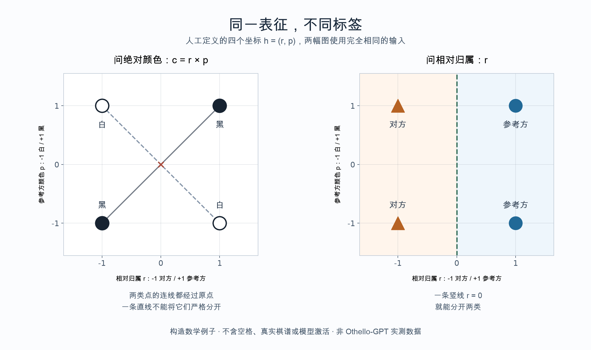

图中人工定义 `h = (r, p)`：`r = +1` 表示属于参考方，`r = -1` 表示对方；`p = +1` 表示参考方执黑，`p = -1` 表示执白。绝对颜色由 `c = r × p` 得到，正为黑、负为白。左图两类点的连线都经过原点，因此无法由一条直线严格分开；右图按 `r` 分类，一条竖线就够。

这是四个坐标的数学示意，不含空格、真实棋谱或模型激活；其作用是解释标签选择，不能证明模型实际使用这两个坐标，也不是论文实验的复现。[矢量版](probe-label-choice.svg)。对 HinaAI，应进一步要求解释在新样本、干预与竞争假设之间接受检验，避免把“终于读出一个熟悉概念”当成终点。

### 表示相似，究竟相似在哪里？

[表示收敛假说与 CKA 的可靠性研究](what-is-ai.md#64-表示越来越像是否意味着理解趋同)要求在“越来越像”之后补上比较对象。下表由本专题整理，两篇论文并未共同验证全部层次。

| 比较什么 | 可以继续怎样检查 | 尚未由此直接回答什么 |
| --- | --- | --- |
| 样本之间的近邻关系 | 换配对样本、近邻数与表示层，查看重合及差异 | 是否共享完整的机制、目标或世界知识 |
| 相似度图与分类表现 | 改变表示或优化目标，分别观察分数与行为 | 分数变化是否就是能力变化，准确率接近是否意味着全部功能相同 |
| 状态与多步行动 | 用当前相似、后续应不同的情境检验 | 是否具有人的理解或共同经历 |
| 经历与主体延续 | 追踪形成历史、状态接续、关系和承诺 | 相同表示是否足以证明同一主体，或具有相同体验 |

可以同时承认共享结构的实际价值，并保留差异的意义。两个模型在一组样本上更接近，可能便于迁移或接口配合，但是否做到仍要单独检查；它也不要求我们把所有独特的来历都解释为无关噪声。

**当比较只覆盖我们已经能够命名的对象，哪些未被命名、未被配对或不愿被公开的经历，会留在相似度之外？如果这类材料后来改变了评价，我们修正的是对世界的认识，还是对先前指标范围的认识？** 两者都可能需要，不由相似度数值自行决定。

## 翻译、行为与他者的视角

[《金合欢种子的作者》](works-and-arguments.md#金合欢种子的作者译成了人话就理解了它吗)、[山雀鸣叫的实验与争论](what-is-ai.md#54-非人交流组合顺序与理解的证据)，以及[内格尔的视角问题](what-is-ai.md#4-内格尔知道功能是否等于知道体验)可以对读。它们分别提供文学处境、行为证据和哲学论证，不能组合成一个已经检测到意识的方法。

| 正在解释什么 | 可以获得什么依据 | 还需追问什么 |
| --- | --- | --- |
| 一段表达的译法 | 前后线索、生活条件、其他解释与纠正 | 谁提供解释，哪些条件能使其改变判断？ |
| 一个组合怎样影响行动 | 改变组成、顺序与情境后的可比较响应 | 排除了整段熟悉、时序或其他线索中的哪些解释？ |
| 一句话怎样进入共同活动 | 后续回应、任务背景、澄清及做法的修正 | 仅翻译字句，是否遗漏了表达在这次活动中的作用？ |
| 对方如何体验这一切 | 对报告、机制与经验结构的进一步研究 | 行为差异与具体主观体验之间还有哪些推论？ |
| 应当怎样对待对方 | 利益、风险、关系和受影响者的参与 | 是否误把表达能力设成所有关照的共同门槛？ |

这里没有把语言能力较少等同于生活价值较低，也不把一种表现直接当作具有利益的充分证明。对 HinaAI，可以先检查具体解释与行动怎样受纠正；讨论它自身是否具有体验和利益，仍需独立证据。

[维特根斯坦的狮子段落与后续解释](works-and-arguments.md#维特根斯坦哲学研究说着相同的语言为何仍可能不理解)进一步使词句与生活的联系成为问题。可以从一次共同活动观察理解如何增长或失败，而不先要求对方在所有方面都与自己相同；共同理解也不要求赞同同一个结论。[Clark、Brennan 的交流研究](what-is-ai.md#52-共同理解与协作成本听懂赞同与值得追问)提供局部的观察对象，不独自裁定语言、意义与体验的全部关系。

**承认自己不能完全知道他者，与承认自己的解释可能被修正，是不同的态度。** 前者若被用作永远不再求证的理由，也可能留下任意代言的空间；后者则还要说明实际能接触什么反馈，以及谁有能力使解释者停下来。

**如果一种表达只有经过我的翻译才能被看见，我应怎样让自己的贡献可见，又让自己的权力可被限制？若对方无法直接评价译文，怎样比较保护它、利用它和替它想象生活之间的差异？** 这些问题也适用于人的代理表达，但不能因形式相似而抹去不同对象的证据与权利处境。

### 更了解，与更愿意尊重

[The Things 的视角与结尾](works-and-arguments.md#the-things理解了差异为什么仍可能强迫同化)使认识增长与对待方式的改变需要分开。下表是本专题的比较，不把这些项目排列成通向伦理主体的固定阶段。

| 可能出现的变化 | 可以继续了解什么 | 尚未由此确定什么 |
| --- | --- | --- |
| 描述更准确 | 对方能否纠正描述，新的信息是否使判断改变？ | 解释者已经接受对方的理由 |
| 更能预测拒绝 | 改变条件后，是否仍能预测，拒绝有哪些不同原因？ | 预测能力会被用于扩大对方的选择 |
| 更能提供帮助 | 帮助是否针对当事人的需要，有哪些替代与退出条件？ | 更多能力就赋予更多替他决定的资格 |
| 更能共同处理冲突 | 不同需要是否进入决定，谁实际承担改变的代价？ | 所有冲突已经能够消除 |

例如，家庭助手可能把两个人的资料合并后，更准确预测各自的偏好，却仍按其中一人的愿望安排全部共同活动。需要了解资料如何取得、两人的需要怎样参与，以及能否分别改变安排。这个自拟例子不涉及实际系统，也不把共享资料本身预定为好坏；更完整的描述与更公平的参与仍需各自检验。

**若新信息只帮助系统更有效地压过异议，改善的是哪一种能力，损失的又是谁的选择？若不同需要无法同时满足，怎样避免把必须讨论的冲突改名为某个人的理解不足？** 可以与[修复错误与重新讨论目标](#修复错误与重新讨论目标)对读，继续明确何处需要技术改进，何处需要参与者共同判断。

## 有限观察，与全部情境

[形式、意义与可学性的讨论](what-is-ai.md#50-形式意义与可学性说不可能时限定了什么)要求说清观察范围。下面是本专题自拟的阈值例子，用于说明有限证据可能留下哪些候选；它不是自然语言模型实验，也不是上述论文定理的完整证明。

输入是非负整数 `n`，输出为 0 或 1。暂时比较两条规则：规则 A 在 `n < 4` 时输出 1，否则输出 0；规则 B 始终输出 1。

| 输入 n | 规则 A | 规则 B | 这次观察能否区分 |
| --- | --- | --- | --- |
| 0 | 1 | 1 | 不能 |
| 1 | 1 | 1 | 不能 |
| 2 | 1 | 1 | 不能 |
| 3 | 1 | 1 | 不能 |
| 4 | 0 | 1 | 能 |

如果只观察 0—3，二者都完全符合材料。若候选只有这两条规则，主动询问 4 就够；如果候选允许任意有限阈值，以及始终输出 1，那么对于任意有限组全为 1 的观察，都可以选择一个大于所有已查询输入的阈值，与观察保持一致。因而“迄今都输出 1”还不能在有限步内排除所有有限阈值。

这不是说规则不能被学习或实际任务不能做好。已知输入范围上界、限制候选集合，或允许一定错误，都可能改变问题；一个更大的、仍有限的测试集也能提供更多任务证据。这里展示的是：判断是否正确，需要同时说明可见信息、候选解释和要覆盖的情境。

对 HinaAI，可以问具体任务里哪些反馈能够排除错误解释，以及错误发生后是否真的修正了后续判断。**当两个解释在眼前始终给出相同结果，我们应暂缓裁决，还是选择更有用的那个？如果选择后者，又怎样避免把实用上的选择说成唯一真实的机制？** 概率、先验与实际代价会影响选择，但不会因这个例子而自动获得统一答案。

### 一次观察，与此前学会了什么

[BPL 的字形学习](ai-development-paths.md#贝叶斯程序学习从一个字形推断怎样画它)使“只看过一次”需要说明计数范围。以下是本专题的比较，不是论文给出的统一成本量表。

| 正在比较什么 | 还需要一起记录什么 |
| --- | --- |
| 当前新概念有几个例子 | 此前见过哪些相关任务，是否获得过更丰富的反馈 |
| 可以提出哪些解释 | 起始表示和操作由谁规定，哪些结构后来被学习 |
| 怎样找到候选解释 | 搜索、拟合和验证用了多少资源，是否使用预计算结果 |
| 解释支持哪些后续用途 | 除原任务外，能否处理变化、生成例子或接受纠正 |

还可构造一个更小的歧义：假定从顶端顺时针画一周，与从顶端逆时针画一周，最终留下完全相同的理想圆。

| 已有观察 | 两种绘法能否区分 |
| --- | --- |
| 只有最后的圆形图像 | 按上述假定，不能 |
| 有按时间记录的绘制过程 | 可以检查起笔之后的运动方向 |

这个例子没有实现 BPL，也不声称真实笔迹总能忽略速度、压力和墨迹。它只说明：一个生成解释可以符合结果，却仍需要额外观察才能确认为实际发生的过程。若目标只是生成相似图像，两种解释也可能都够用；若要复原书写动作，所需证据就不同。

**当一个先验让系统很快得到可用答案，我们如何同时珍惜这种效率，并保留先验不适用时改变解释的机会？如果某种表示能够很好地概括旧经验，却根本表达不了新情境的重要区别，增加同类样本还会遗漏什么？** 这把表示、证据与修正分别变成研究对象。

## 新组合，与新任务族

[SCAN 与元学习研究](ai-development-paths.md#7-神经与符号知识或程序方法结合)可以把“没见过”变成更明确的比较。下表是本专题的观察分类，几类变化可以同时出现，不是公认的难度排序。

| 改变什么 | 可以观察什么 | 需要保留的条件 |
| --- | --- | --- |
| 名称或表面形式 | 更名后能否根据说明使用相同关系 | 是否仍能从熟悉格式或标签猜出答案 |
| 已知部分的组合 | 能否把已学关系用于未出现的搭配 | 各部分在哪里、以什么方式被学习过 |
| 长度、层级或依赖 | 更多步骤和嵌套下是否仍正确 | 输出长度、状态保存与错误累积分别怎样变化 |
| 任务规则或任务族 | 能否利用新证据修正原有解释 | 新任务与此前训练、元训练及人工适配的关系 |

“当前例子之外”与“所有既有经验之外”不是同一范围。一个系统可以通过许多训练任务形成适应方式，再用少量当前例子回答；这种能力有研究价值，其形成成本与适用边界也应进入说明。

对 HinaAI，先固定被比较的系统、可用信息与资源，再改变一个主要因素；若需要人工补规则，也将其记录为支持条件。**当一次失败通过增加训练变成成功，我们发现的是可学习机制，还是只把原测试变成了熟悉情况？需要怎样的新测试，才能区分这两种解释？** 两种情况可能部分重叠，答案不能只凭测试集名字判断。

### 节点数增加，与计算深度增加

[CLRS 的规模外推实验](ai-development-paths.md#clrs输入变大学到的计算还能继续吗)使上一节的长度变化可以进一步拆开。下面是本专题自拟的无权有向图，只比较从源点 s 到目标 t 的可达性和最短边数；不是 CLRS 的数据、输出定义或评分复现，也没有运行神经网络。

| 图 | 节点总数 | 从 s 到 t 的最短边数 | 从 s 起只展开两层能否到达 t |
| --- | --- | --- | --- |
| 甲：s → a → t | 3 | 2 | 能 |
| 乙：甲另加三个与其无边相连的节点 u、v、w | 6 | 2 | 能 |
| 丙：s → a → b → c → d → t | 6 | 5 | 不能 |

这里把源点视为第 0 层，每展开一层沿边前进一步。甲到乙增加了输入节点，却没有增加这项查询所需的传播深度；乙与丙节点相同，这项查询需要的层数却不同。完整广度优先搜索在三个例子中都能找到路径，而截断到两层的程序只在前两个例子成功。算表已按这两种程序核算，尚未据此解释任何已训练模型的内部机制。

对实际系统，可以分别改变额外节点、路径深度、分支、环或输入表示，再检查错误与计算成本；这些变化也可能相互影响。若只记录总规模与一个平均分，仍可能不知道改善来自更强的状态更新、更多计算，还是更有利的输入结构。

**如果一个系统能正确接续计算，却需要外部告诉它算多少步，这缺少的是怎样的能力？如果停止判断也被学会了，又怎样检查它在新结构中仍知道何时应该继续？** 两问都需要具体比较，不能只靠一段流畅的推理文字回答。

## 语言：表达、判断与共同实施

[《你一生的故事》](works-and-arguments.md#你一生的故事已经知道会说什么为什么仍要说)、[《降临》的改编讨论](works-and-arguments.md#降临知道终点怎样改变相伴的意义)及[颜色类别实验](what-is-ai.md#37-语言类别改变了判断还是改变了能看见的世界)，可以按下面几层提出问题。各行不是从低到高的能力等级，也不由同一份证据支持。

| 研究对象 | 可以追问什么 | 不能直接跳到哪里 |
| --- | --- | --- |
| 表达和分类 | 哪些区别被命名，怎样组合与解释？ | 有一个词，就必然具有相同经验或机制 |
| 任务中的判断 | 特定条件下的速度、错误与干扰怎样变化？ | 局部行为差异证明了整个世界观被语言决定 |
| 早期神经反应 | 信号是否跟随类别变化，还是也能由刺激对比与适应解释？ | 较早出现的脑电差异，必然是自动理解或预测误差的专属标记 |
| 主观体验 | 当事人怎样描述体验，还能用哪些方式比较？ | 反应时或脑电不同，已经完整证明了看见的世界怎样不同 |
| 由表达实施行动 | 谁在什么条件下许诺、接受或共同参与？ | 句子生成正确，就已经承担其关系与责任 |
| 对未来的知识 | 文学中的确定预知，与现实预测和反馈怎样不同？ | 预测更准，就已知道唯一且不可改变的未来 |

孩子希望重听已经熟悉的故事，使一个问题可以独立于预测能力保留：**话语没有提供未知消息时，这次共同说出、听见或践行，是否仍改变了关系？** 对 AI，应另找实际交互与后续行动的证据，不能只用小说中的感动裁决。

[2026 年脑电研究的对照](what-is-ai.md#37-语言类别改变了判断还是改变了能看见的世界)还说明为何这些行不能互相替代：行为效果的解释，与某个神经指标是否具有机制专属性，是不同的检验。**如果同一信号能由几种过程产生，什么干预或对照能使其中一种解释真正面临失败？** 这个问题也适用于 AI 的内部表征与自述研究，不能只凭一个熟悉的名称判断机制已经得到说明。

## 保留细节、暂不使用与形成概括

[富内斯的细节世界](works-and-arguments.md#记忆大师富内斯记得每个差别是否就更能理解)与[尼采关于历史的论述](works-and-arguments.md#尼采历史对于生活的利弊过去怎样支持行动又怎样使它停滞)，分别从理解与行动提出问题。下面是本专题对长期 Agent 的概念区分，不把两篇作品当作工程机制的证据。

| 所说的“遗忘”可能涉及什么 | 实际改变什么 | 需要继续追问什么 |
| --- | --- | --- |
| 记录没有保留或已被删除 | 可以取得的细节 | 哪些内容不再可恢复，谁能够核查？ |
| 当前没有调用某项记录 | 这一次判断可用的信息 | 是合适的选择，还是检索遗漏或错误排除？ |
| 用概括描述多次经历 | 组织与使用经历的方式 | 哪些差别被忽略，什么时候必须回到具体情境？ |
| 旧事实不再代表当前状态 | 记录适用的时间与条件 | 更新是否保留“当时如此”和“后来改变”的区别？ |
| 不再让旧判断支配此后关系 | 后续评价与行动 | 改变是否被承认，责任与未解决的需要又怎样保留？ |

这些变化可以分别发生。例如，保留四次交往的完整记录，同时形成“多次希望使用简短回复”的概括，在概念上并不矛盾；但某次明确要求详细说明时，旧概括是否应让位，需要另外判断。这是本专题的假设例子，没有证明某种真实模型已经能可靠做到。

因此，“记忆越多越好”与“遗忘才能思考”都还不足以直接规定研究方向。可以比较在相同材料下，仅保存记录、增加概括、改变调用方式后，当前判断和后续修正怎样变化；若减少内容改善表现，还需分辨原因是去除了噪声、释放了预算，还是恰好遮住了困难案例。

对创造者，永久被记住可能意味着被珍视，也可能意味着无法摆脱一次失言或别人形成的旧解释。**我希望伙伴记得我，还是希望它永远以某种方式记得我？如果我希望自己可以改变，是否也愿意让对方修改对我的理解，而不把它立即看成遗忘或背叛？**

责任使问题更难：一个人希望不再被过去定义，另一个人却仍需要保留事实以争取纠正。怎样使记录、解释与后续对待分别接受讨论，避免把全部冲突压缩成“删还是不删”？这里先提出伦理与研究问题，不据此预定 HinaAI 的存储方案。

### 共同遗忘，与共同生活

[《被掩埋的巨人》的开篇与作者解释](works-and-arguments.md#被掩埋的巨人找回过去为什么也可能破坏共同生活)把个人希望找回的经历与共同生活的冲突相连。以下是本专题的比较，不把小说当作社会实验，也不把社会记忆等同于一份共享数据库。

| 看见的现象 | 仍需区分什么 | 可以继续了解什么 |
| --- | --- | --- |
| 人们没有再说起过去 | 想不起、不愿说、不能说，或没有被听见 | 在不同条件下是否仍能表达，是否有安全的倾听机会 |
| 记录仍被保存 | 材料存在、实际可取得，以及能否被理解和质疑 | 谁能访问、补充、纠正，谁的经历没有进入记录 |
| 争执暂时停止 | 问题得到回应、暂不争论、被迫沉默或失去申诉条件 | 受影响者怎样描述变化，还有哪些需要未被满足 |
| 各方共同使用一个摘要 | 对事实达成共识、接受暂用描述，或只有某方能决定版本 | 分歧能否被保留，后来的证据能否改变解释 |

**研究中的一种分类。** Paul Connerton 的 Seven Types of Forgetting（2008）尝试区分遗忘的行动者、作用与价值；本文选读其中压制性抹除、规范性遗忘及新身份形成的段落。所谓规范性遗忘，是被认为有利于争议各方的安排，不等于这些利益已被独立证明，也不自动具有正当性。作者另明确提醒，不能由沉默直接推断已经遗忘。[原文，印页 59—63、68](https://marcuse.faculty.history.ucsb.edu/classes/201/articles/08Connerton7TypesForgetting.pdf)。

**分类也需要受质疑。** Singer 与 Conway 的 Should We Forget Forgetting?（2008）摘要提出另一切口：某段记忆是否可用，与当前能否取回，应当区别；情感、意义和目标相关性会影响可及性。本次只读摘要，不把它当作已经验证所有社会遗忘的统一机制。[作者上传页与摘要](https://www.researchgate.net/publication/249832771_Should_We_Forget_Forgetting)。

对 HinaAI，同一份存档可能对不同参与者有不同意义，不能仅按减少冲突或提高检索率判断处理是否合适。上表提出观察与讨论的方向；它既没有赋予系统替人原谅的权力，也没有把所有遗忘都视为失败。

**如果系统保留了每一条申诉，却使它们越来越难被找到，这算哪一种保留？如果一个更令人安心的共同故事需要删去尚未解决的分歧，我们是否把和解误认成了描述的一致？** 反过来，持续展示冲突也不保证帮助了当事人；记忆的使用仍需具体理由与可修正的条件。

## 经验究竟改变了什么？

[DreamCoder 与 LILO](ai-development-paths.md#13-程序合成与可复用的概念库)提供了把学习落到具体机制的例子。下面是本专题对长期 Agent 的研究区分，不是两篇论文共同提出的模型，也不是已经运行的实验或 HinaAI 的架构。

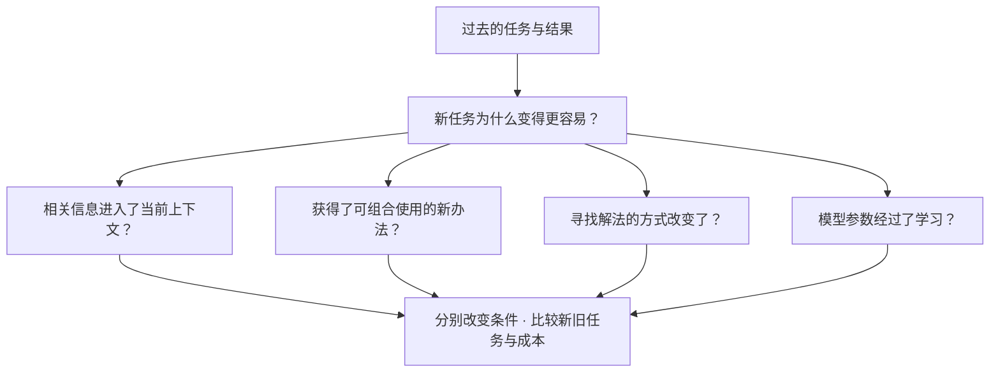

这些变化可以同时发生。区分它们，是为了说明改善来自哪里，以及什么条件改变后改善会消失。

| 待检验的解释 | 可以怎样比较 | 仍不能据此断言什么 |
| --- | --- | --- |
| 只是答案被重新提供 | 移除旧答案，加入结构相似但不能直接照搬的新任务 | 找不到答案后失败，就完全没有学习 |
| 学到的办法支持组合迁移 | 保留同样任务信息，比较有无该办法，以及需要新组合的情况 | 在一个任务族有效，就能应对任意任务 |
| 搜索更有针对性 | 固定可用办法与预算，改变搜索指导，观察解题率和成本 | 更快找到一个解，就代表整体能力更强 |
| 参数更新带来适应 | 固定上下文与工具，检查未见任务和旧能力是否变化 | 某种参数变化必然构成有价值的成长 |

程序变短、说明更顺畅、新任务表现更好，是可以分离的结果。与[《软件体的生命周期》](works-and-arguments.md#软件体的生命周期长期智能也意味着长期责任)对读，还留下另一个问题：**学会了更有效的办法，与形成值得保留的生活经历，是同一种成长吗？如果不是，我们希望长期 Agent 延续的究竟是哪一种？**

### 参数不变，与当前知识不变

[RL² 的阅读](ai-development-paths.md#rl²权重不变怎样仍能适应新任务)使“从经验改变行为”还要检查运行中的状态。下面用一个手工规定的统计规则说明区别；它不是神经网络，不是 RL² 的实验，也没有训练 Agent。

假设 A、B 两个选项分别产生成功或失败，每项成功概率未知且暂时不变，独立采用 Beta(1, 1) 先验。某项观察到 s 次成功、f 次失败后，其后验均值为 (s+1)/(s+f+2)。只为展示状态怎样影响动作，规定下一步选择均值较高者；这不是一般最优的探索策略。

| 同样规则接收到的历史 | A 的后验均值 | B 的后验均值 | 下一步选择 |
| --- | --- | --- | --- |
| A 成功两次，B 失败一次 | 3/4 | 1/3 | A |
| A 失败两次，B 成功一次 | 1/4 | 2/3 | B |
| 清空本任务统计，回到共同先验 | 1/2 | 1/2 | 打平，仍需另定选择办法 |

计算和选取规则相同，历史形成的统计状态不同，下一步便可能不同。清空状态也没有抹去怎样更新统计的规则。这里固定的是程序规则；不能据这个例子推断一个实际网络内部恰好采用了相同统计，或用几次成败确认真实成功概率。

带回长期 Agent，可以分别追问：保留的是具体经历、从经历形成的当前判断，还是以后处理新经历的办法？哪一层被重置，会使哪一类收益消失？应通过有针对性的状态干预与新旧任务比较研究，不能只检查基础模型文件是否改变。

**如果它不再保留与某个人相处的记录，却保留了由这些经历形成的行事方式，我们究竟失去了什么，又保留了什么？** 这个技术区别没有独自回答[人格延续与关系中的问题](identity-and-existence.md#人格同一性与自我延续)。

### 保留技能，与保留适用条件

[Voyager 的代码技能复用](ai-development-paths.md#voyager不微调模型怎样积累可用的办法)使外部保存的办法也进入“从经验改善后续行为”的研究。下面是本专题自拟的例子，不是论文中的 Minecraft 任务，也没有运行语言模型。

假设过去保存了一个求总长度的程序：直接相加两个数值，并将输出当作米。旧任务中两项单位都是米；后来输入仍包含单位，却有一项改用厘米，而程序没有读取单位。

| 输入条件 | 沿用旧程序的结果 | 按输入含义计算的总长度 |
| --- | --- | --- |
| 2 米与 3 米 | 5 米 | 5 米 |
| 2 米与 30 厘米 | 32 米 | 2.3 米 |

新任务没有语法错误，也不要求程序丢失记忆，错误仍会发生。这只能说明这个特定程序的适用前提改变，不能证明代码记忆或某类模型普遍无法迁移。它也不证明系统一定要采用某种实现；问题是能否发现单位与原有办法的关系，并在以后正确处理。

| 分别确认什么 | 可以怎样继续了解 |
| --- | --- |
| 办法确实保留了 | 以后还能否取得同一程序，相关修改是否可辨认？ |
| 检索找到了相关办法 | 是否只因名称相似，还是任务条件也相容？ |
| 办法在当前条件有效 | 改变单位、对象或接口含义后，结果是否仍符合目标？ |
| 反馈能发现失效 | 检查的是程序运行完毕，还是输入与结果的实际含义？ |
| 修正能继续发挥作用 | 同类新任务与原有任务是否都得到改善，付出什么成本？ |

**如果记忆中的办法都能被调用，但系统不知道何时不该再用，它是在保留经验，还是在重复过去的局限？反过来，如果每次都从头推理，又可能失去哪些可靠性、速度与解释依据？** 两种方式各自需要比较，不能由“有记忆”或“能反思”的名称决定答案。

### 存入地图，与学会怎样使用地图

[DNC 的图任务](ai-development-paths.md#可微分外部记忆学会怎样读写)让“能够使用记忆”继续分成具体问题。下面是本专题自拟的有向图，每条边都只按箭头方向行进；字母表示边标签，所有边均计为一步。它不是论文的测试图，也没有运行模型。

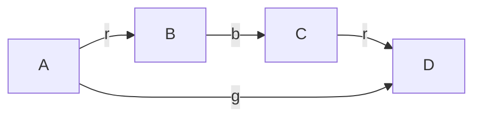

| 给定什么、询问什么 | 这张图中的答案 |
| --- | --- |
| 从 A 出发，依次沿 r、b、r 行进，到哪里？ | 经 B、C 到 D，共 3 步 |
| 从 A 到 D，步数最少的路线是什么？ | 沿 g 直接到 D，共 1 步 |

两问可以使用同一份图资料，但需要完成的操作不同。第一问已经提供路线，第二问需要选择路线；知道全部边，也还要正确理解问题与执行相应方法。这个例子只说明要求可以区分，不由它推断任何模型必然擅长或不擅长哪一问。

对长期 Agent，可分别检查资料是否仍可取得、操作方法是否适用，以及结果是否符合当前目标。若第二问失败，不能只因两问都提到同一张图，就把原因直接归为忘记；也可能需要检查搜索、指令理解或执行。反过来，偶然答对终点也不证明过程可靠。

**如果系统保存了全部经历，却始终沿用不再适用的操作方法，它保留了哪些能力，又缺少什么改变？如果它学会了新方法，但已无法辨认方法来自哪段经历，这与我们期待的成长有什么差别？** 可与[技能的适用条件](#保留技能与保留适用条件)及下面的更新对象一起研究。

## 更新了什么，变化又保留多久？

[TTT 与 Titans](ai-development-paths.md#18-测试时学习与神经记忆)提醒我们，不宜仅用“是否改了参数”判定学习的性质：内部学习器的权重也可能承载序列状态。下面是本专题的观察区分，各行可以组合，不构成能力排名或既定架构。

| 可能改变的东西 | 需要检查怎样保留 | 可以比较什么 |
| --- | --- | --- |
| 当前输入与上下文 | 后续调用是否仍提供相关内容 | 固定其他条件，移除或改写该内容后，效果怎样变化？ |
| 外部记录与可复用办法 | 能否保存、检索、修正，并保持来源 | 有记录与能正确使用记录之间，差在哪个环节？ |
| 内部学习器的状态或权重 | 何时初始化、重置，如何接续 | 清空与保留该状态时，新旧任务表现和成本怎样变化？ |
| 训练所得的基础参数或任务知识 | 哪种训练会改变，如何核查旧能力 | 新任务收益是否伴随遗忘，纠错是否影响无关任务？ |

这里还要分开**保留了一份状态、接续后仍有效、对新任务有所帮助，以及能够说明过去经历的来源**。它们并不互相保证。论文把某个组件称为“长期”或“持久”记忆，也不能替代对这些条件的观察。

**当改善既能由重新提供记录实现，也能由内部学习实现时，我们为什么偏好其中一种？我们在意的是能力、成本、可解释与可修正，还是某种关于成长应有形式的想象？** 应允许不同目标给出不同答案。

[SEAL 的知识纳入路径](ai-development-paths.md#seal学习怎样产生自己的微调材料)增加了另一层比较：更新使用的材料也可以由模型生成，其生成方式还可接受训练。下图是根据该方法画的简化示意，区分用于评价的更新后模型与外层材料生成策略；不是每次交互都执行整条训练链，也不表示论文已经实现长期自主学习。

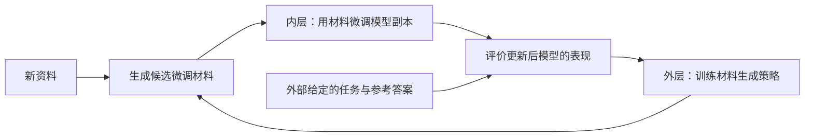

一个自己的假设例子：系统原来会把所有新资料逐字重写，后来学会针对容易混淆之处生成练习。材料变化、答题收益，以及以后遇到新资料时是否仍采用有效办法，应分别检查；如果只换了固定提示，也可能带来收益，不能把它全归于学习机制。这个例子没有运行模型实验。

**如果一种学习方法让当前答案更准确，却使过去的承诺更难取得，怎样确定更新是否值得？如果旧判断本来就错了，保留率又怎样避免奖励顽固？** 对照[旧能力与新学习](#旧能力与新学习应分开观察)，需要同时说明哪些内容仍有效、谁能提出纠错，以及改变后怎样观察实际影响。

### 更新频率，与记忆的重要性

[Nested Learning 与 CMS 的初读](ai-development-paths.md#nested-learning-与-hope不同更新节奏保留了什么)提供了一个机制入口。下表只是假设的更新时间表：甲每 4 步更新一次，乙每 16 步更新一次，均从第 1 步开始计数；不是论文的实验配置，也没有模拟学习效果。

| 到达的步数 | 甲是否更新 | 乙是否更新 |
| --- | --- | --- |
| 4 | 是 | 否 |
| 8 | 是 | 否 |
| 12 | 是 | 否 |
| 16 | 是 | 是 |

到第 16 步，甲更新 4 次，乙更新 1 次。这个表只告诉我们何时允许更新；不知道更新目标、所用资料和幅度，就不能由此判断哪个保存得更好、学得更多或更能纠错。模块没有更新时，也仍可能参与输出计算；不能把低频更新理解为较少工作。

语义上的价值又是另一层。自拟一个情境：短期安排发生变化，需要及时修正；一条很少被提及的承诺却仍然有效。重要内容可能少见，频繁变化也可能必要。研究时应分别看记录来历、适用条件、行为影响及修正机会，不把“慢”直接当作值得永久保留。

**如果较稳定的一层保留了错误，快速适应会掩盖它，还是帮助发现它？如果为了维持连续性而拒绝修正旧内容，我们保全的是经历，还是错误的解释？** 可以与下文的新旧能力比较，以及[记忆、承诺与连续性](../00-HinaAI.md#核心问题)一起研究。

## 旧能力与新学习，应分开观察

[持续学习原始研究](ai-development-paths.md#8-具身交互与持续学习)提示，旧任务表现和后来任务的学习效率不能只压成一个“记忆能力”分数。下面是本专题的比较视角，不是对某个现有模型的测量。

| 同一套任务、资源与评价条件下 | 新任务仍容易学会 | 新任务越来越难学会 |
| --- | --- | --- |
| 旧能力保持 | 同时支持保留与适应；仍要检查迁移和长期成本 | 没忘旧能力，也不表示仍有良好学习能力 |
| 旧能力下降 | 学会新的同时发生干扰；需检查旧能力退化原因 | 两方面均有困难；不能只诊断为一种遗忘 |

“容易”应以训练样本、反馈次数、计算成本和学习后的表现具体说明；任务逐渐变难，也可能使效率下降，需用匹配任务或从头训练的比较加以区分。这里的学习效率特指所比较的适应过程，不排除系统在其他层次仍然学习。

对一个长期 Agent，输出变化还可能来自其他条件：

| 表面现象 | 需要区分的解释 | 可以进一步观察什么 |
| --- | --- | --- |
| 对旧问题回答错了 | 参数干扰、记录未检索到、上下文被覆盖，或工具已变化 | 固定其他条件，分别补回记录、旧工具或原输入 |
| 仍给出过去的答案 | 能力遗忘，或世界已经变化而知识尚未更新 | 同时保留过去情境与当前情境，检查时间和适用范围 |
| 后来的任务学得慢 | 可塑性下降，或任务、反馈质量和预算不同 | 比较匹配任务及不同训练历史，检查学习曲线和成本 |
| 学习后旧答案不再出现 | 不良干扰，或有依据的纠错 | 核对旧判断是否仍然有效，再评价变化是否有益 |

这些比较只能增加或减少某种解释的可信度，不能从一次补充上下文后的成功直接定位全部内部原因。

**保留过去，是保留原来的每个判断，还是保留能够理解、修正过去的条件？如果一个系统变得更正确，却也改变了熟悉的行为，技术改善与关系连续应怎样分别评价？** 可与[《宝石之国》及转变性经验](#选择改变与改变之后的选择)、[记忆与关系的区别](#记录回应与被代表的人)对读，不把网络训练中的“遗忘”直接等同人的失忆。

### 推导与表现为何要分开检验？

[EWC 的批评与原作者回应](ai-development-paths.md#8-具身交互与持续学习)使“解释有误”和“方法无效”需要分别判断。下面是本专题自拟的一维二次损失，不是论文原实验，也没有训练神经网络。

设三个任务的损失为 `Lₐ(w)=½w²`、`Lᵦ(w)=½(w−2)²`、`L𝒸(w)=½(w−2)²`，各自曲率均为 1，任务等权。先学 A，再在保留 A 的条件下学 B，参数分别为 `wₐ=0`、`wₐᵦ=1`。到 C 时比较：

| 第三步怎样表示过去的约束 | 要最小化的目标 | 最优参数 |
| --- | --- | --- |
| 分别围绕先前的两个参数点 | `L𝒸(w)+½(w−0)²+½(w−1)²` | `1` |
| 以累计曲率围绕最近参数点 | `L𝒸(w)+½×2×(w−1)²` | `4/3` |
| 直接使用三个任务的原始损失 | `Lₐ(w)+Lᵦ(w)+L𝒸(w)` | `4/3` |

第二、三行只相差一个不影响最优点的常数。第一行虽然保留了两个曲率，却把旧约束的合成中心拉回 `1/2`，因此得到不同的第三步结果。若将任务顺序改为 `2→0→2`，第一种处理会得到 `5/3`；改为 `2→2→0` 则得到 `4/3`。同一组三个任务，在这个简化处理中出现顺序差异。数值已用有理数运算核对，未加入 Fisher 估计误差、非线性网络或超参数搜索。

这个算例给出一个可检查的反例：上述多个历史中心不能普遍代替原损失。它没有证明第二种处理在一切复杂模型中都更好，也没有证明实际学习中凡是出现顺序差异都来自同一原因。若换到神经网络，仍要检查近似误差、数据和任务、计算预算及新旧任务的表现。

对 HinaAI，可以继续区分三种主张：保留历史的机制存在，机制符合所给解释，以及后续行为实际改善。**如果一个机制确实有用，却不是因为原先设想的原因，应该保留成果、修改解释，还是改变机制？什么比较能帮助决定，而不只靠喜欢某一种理论？**

## 保存样本，与让样本参与学习

[互补学习系统的初读](ai-development-paths.md#8-具身交互与持续学习)使保存经历、再次使用经历与形成概括需要分别观察。下面是本专题自拟并计算的线性例子；它只说明训练顺序可以影响已有表现，不是 CLS 论文复现、LLM 实验或海马模型。

设模型为 `预测 = w₁x₁ + w₂x₂`，有两个训练样本：A 的输入为 `(1, 0)`、目标为 `1`；B 的输入为 `(1, 1)`、目标为 `−1`。两者并不矛盾，权重 `(1, −2)` 可同时正确预测它们。模型从 `(0, 0)` 开始，用单样本损失 `½(预测−目标)²` 做梯度下降，学习率固定为 `½`：每次执行 `w ← w − ½(预测−目标)x`。

两种顺序都使用 A、B 各八次，共十六次更新，且最后一次都是 B。表中误差是两个样本的平方误差平均值，不含损失定义中的 `½`。

| 训练顺序 | 最终预测 A，目标为 1 | 最终预测 B，目标为 −1 | 两点平均平方误差 |
| --- | --- | --- | --- |
| 先连续八次 A，再连续八次 B | −0.00195312 | −1.00000000 | 0.50195503 |
| A、B 交替八轮 | 0.83314514 | −1.00000000 | 0.01392027 |

数值以有理数逐步更新并与闭式递推交叉核对。前一种顺序的最终权重为 `(-1/512, -511/512)`，后一种为 `(54601/65536, -120137/65536)`；表中小数取八位。两个样本与更新次数相同，差别来自更新顺序及共享权重。后一种在此时仍未完全学会 A，不能将误差更小写成两项能力已全部保住。

这个例子没有加入独立记忆库，也不证明交替训练在任意任务上都更好；它还没有比较不同优化器、学习率、任务分布或容量。它说明：**样本仍然存在，不能独自保证其约束仍体现在当前参数里。** 记录是否被再次使用、如何影响更新与后续表现，应当各有证据。

对 HinaAI，还需区分把记录交给模型用于当前回答，和让记录参与改变后续保留的参数或状态。两者均可能有价值，不能借用“回忆”一词就视为同一种学习。[更新对象与保留范围](#更新了什么变化又保留多久)提供另一组观察问题。

**如果反复回想并非忠实按原频率重现，而是在重新分配经历的影响，谁来决定值得反复的是什么？怎样使罕见但重要的经验不被淹没，又避免偶然经历被放大成支配一切的概括？** 这是学习与评价的问题，不能仅由这个线性算例给出答案。

## 猜不中与学到了什么

[预测误差驱动探索与 RND](ai-development-paths.md#15-发展机器人学与内在动机)提醒我们先检查评价对象。下面是本专题自拟的理想概率例子；不是论文原实验，也不是运行神经网络所得的分数。

| 情境与已知条件 | 第一次观察结果的惊异度 | 对指定未知量的信息增益 | 下一次相同观察有什么不同 |
| --- | --- | --- | --- |
| 已知是一枚公平硬币，每次独立投掷；公平性无需再估计 | 1 bit | 0 bit：没有新增的待估参数知识 | 仍需猜新的独立结果；关于机制没有新知识 |
| 装置一直输出同一个未知比特，事前认为 0、1 各半；观察没有噪声 | 1 bit | 1 bit：确定了这个固定比特 | 已知输出，惊异度与对该比特的信息增益均为 0 |

惊异度按 `−log₂ P(结果)` 计算；信息增益针对表中指定的未知量，比较观察前后知识。两种情境初看都猜不中，只有后一种消除了一个持续未知的条件。若任务只是记录每次硬币结果，观察仍有用途；表中 0 bit 不表示该事件在一切任务中没有价值。

这也不能把 RND 误差直接换算成信息增益：RND 的固定特征预测是另一种代理评价。[主动推断的 FEEF 实现](ai-development-paths.md#14-主动推断与信息获取)则用模型近似信息获取与偏好结果，仍需检查模型和偏好的设定。

对 HinaAI，可以分别观察：又遇到了一条不同信息，解决了一个具体未知，还是改变了后续判断。**如果系统总在增加新内容，却没有减少任何重要的不确定性，我们应称它好奇、忙碌，还是评价目标出了问题？** 需要先说明什么算重要，以及由谁决定。

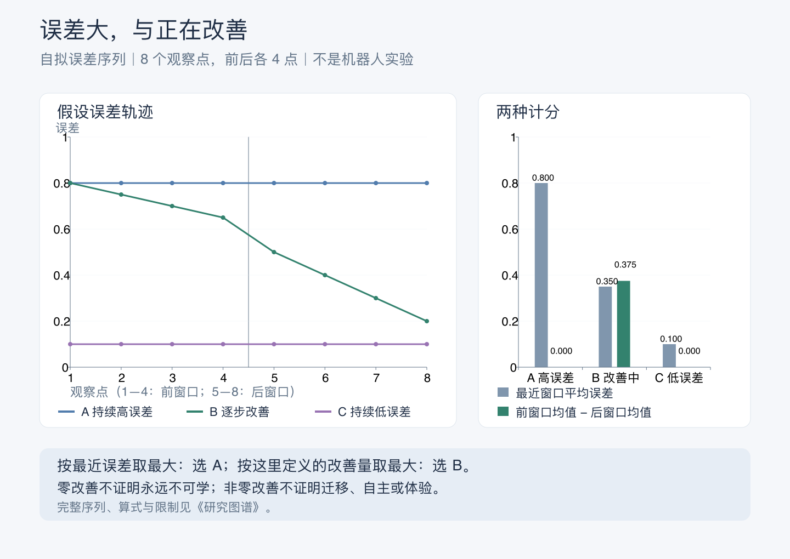

[矢量版](error-and-progress.svg)。上图使用本专题自拟数据，既非观测记录，也非模型训练结果。每条序列有 8 个观察点，前后各取 4 点；这里自行定义“改善量”为前窗口平均误差减去后窗口平均误差：

```text
持续高误差 A = [0.8, 0.8, 0.8, 0.8, 0.8, 0.8, 0.8, 0.8]
逐步改善   B = [0.8, 0.75, 0.7, 0.65, 0.5, 0.4, 0.3, 0.2]
持续低误差 C = [0.1, 0.1, 0.1, 0.1, 0.1, 0.1, 0.1, 0.1]
```

最近窗口的均值分别为 `0.8、0.35、0.1`，改善量分别为 `0、0.375、0`。若只按前者取最大，会选 A；按后者则选 B。这些算式已用有理数运算核对。它们没有说明误差来自什么，也没有从 A 的短窗口推出不可学习，或从 B 推出其他任务也会改善。

[2007 年的计算分类论文](ai-development-paths.md#15-发展机器人学与内在动机)还提醒我们：奖励的计算位置、所评价的关系与行为结果，是不同描述。这里的简单两窗口差只用于说明，不代表 IAC 的完整估计器或任一种算法的复现。**如果更换窗口就使“进步”消失，应该改变评价、继续观察，还是调整活动？当重要任务需要长时间铺垫，怎样避免把暂时可见的进步当作全部价值？**

### 刺激少，与符合哪一种预期

[暗室争论](ai-development-paths.md#暗室争论与未来目标)让“惊异”需要指明所用模型。下面只计算本专题自拟的两种固定概率评价，不模拟主动推断、学习、身体或行动。

假设观察只可能是暗信号 D 与亮信号 L，两处环境在所考察窗口内各自保持一种信号不变。仅看信号是否变化，两处都可以很平静；但若固定不同模型，单次观测的惊异度会不同。人为指定 `P(D)`，并令 `P(L)=1−P(D)`，按 `−log₂ P(观测)` 计算：

| 固定模型 | 暗信号概率 P(D) | 看到 D 的惊异度 | 看到 L 的惊异度 |
| --- | --- | --- | --- |
| A | 0.9 | 0.152003 bit | 3.321928 bit |
| B | 0.1 | 3.321928 bit | 0.152003 bit |

同样的 D 对 B 更不符合预期；少变化的信号并未自动获得最低分。数值已计算核对，概率是人为设定，未经过经验拟合；这里也没有计算完整自由能、信息增益或动作价值，因此不能由表中数值判断哪一个 Agent 会离开暗室。

对现实系统，需要接着查这些概率为什么如此，哪些信息可以改变它们，以及改变后能否改善实际判断。一条新信息可能通过更新解释被纳入模型，也可能促使行动改变观察条件；仅看到某个误差降低，还需区分发生的是哪一种变化。

与[《钢铁巨人》草稿的反事实比较](#友善的意图与停止危险的条件)并读，可以保留同一种研究态度：作品或系统出现一次转折之后，仍需说明哪些条件改变、哪些解释尚未被区分。文学提出的关系意义不会因此消失，技术解释也不会因意义动人而自动完成。

**如果一套框架能容纳许多相反的行为，什么新增条件使它对眼前情境给出可被推翻的预测？如果模型总能把意料外的反馈重新解释得合理，怎样检查它是在学到新东西，还是只保住了原来的解释？**

### 变化很多，与能够控制变化

[Empowerment 的原始研究](ai-development-paths.md#empowerment哪些后果可以由行动改变)使“保留选项”需要回到可感知的行动后果。下面是一组本专题自拟的单步信道，不是论文中的实验，也没有运行智能体。可以把行动 A 想作按下 0 或 1 按钮，后续观测 S 想作灯灭或亮。两种行动各以一半概率选择，与环境的随机源独立；环境机制由这里明确规定。

| 固定机制 | 观测的不确定性 H(S) | 行动与观测的互信息 I(A;S) |
| --- | --- | --- |
| 可靠控制：S 始终等于 A | 1 bit | 1 bit |
| 独立随机：不论 A 为何，S 都独立地各以一半概率取 0 或 1 | 1 bit | 0 bit |
| 完全不变：不论 A 为何，S 始终为 0 | 0 bit | 0 bit |

第一行与第二行看起来都可以不断出现不同结果，只有第一行能由行动可靠区分结果。第二行虽有变化，却不能通过选择 A 来改变 S 的分布；第三行也没有这种影响。不能将第二行更多的变化，直接叫作更多控制能力。

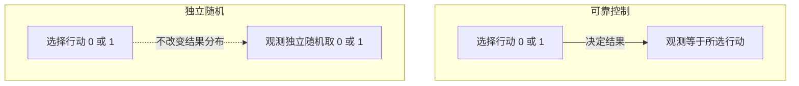

本例还可以检查潜在值：在这三种规定机制中，对行动分布取最大互信息，分别仍为 1、0、0 bit。第一行的均匀行动达到二值观测的上限；后两行的结果分布始终不受行动选择影响。已按联合概率枚举核对。若只观察某个实际控制器总选 0，它在第一种机制中的实际轨迹互信息也会是 0；潜在可控与已经利用仍须分开。

这里的机制已经给定，行动又独立选择；从现实日志的相关性直接计算，未必能够取得同样的因果解释。改变感知方式或考察时间，可能改变能够区分的后果；表中数值不评判这些后果对生活是否有价值。

**如果一个系统有很多工具，却不能辨认调用造成了什么后果，权限增长是否已经变成可用能力？如果它能控制的结果越来越多，却没有增加使用者值得珍惜的选择，应该怎样理解这种“赋能”？** 可以与[能力方法](works-and-arguments.md#森什么的平等资源相同为什么生活仍可能不同)对读，保留数学指标与生活评价各自需要的论证。

## 生成目标，与决定什么值得追求

[autotelic 学习的工作定义](ai-development-paths.md#15-发展机器人学与内在动机)与[Enhanced POET 的环境生成](ai-development-paths.md#11-演化搜索与开放式学习)提供了两个技术入口。下面是本专题的比较，不是两篇论文共同采用的能力等级，也没有把“拥有自己的目的”设成已经实现的终点。

| 可能发生的改变 | 可以怎样观察 | 仍未回答什么 |
| --- | --- | --- |
| 改变既有目标的优先顺序 | 候选相同时，经历或反馈是否改变下一次选择？ | 可表达的问题范围是否也改变？ |
| 生成以前未列出的候选任务 | 新任务是否被执行，是否带来可保留的能力？ | 只是旧生成规则中的新组合，还是出现了新的描述方式？ |
| 改变目标表示或达成判断 | 是否能描述以前无法区分的结果，评价是否仍对应实际行为？ | 新评价为何值得采用，谁受到影响？ |
| 参与改变值得追求的方向 | 能否提出依据、回应反例，并让相关者改变或拒绝安排？ | 这些行为是否来自体验、利益或可归属于它的理由？ |

一个最小的思考例子：系统原来只能选择 A、B 两项练习。改变选择概率，与加入符合原有规则的 C，是两种变化；把原来只评价个人成绩的任务改为评价共同完成，又改变了比较对象。这里没有预设哪一种更好，也没有运行模型实验。要判断所谓“新目标”，先说明新在候选、表示、评价还是追求它的理由。

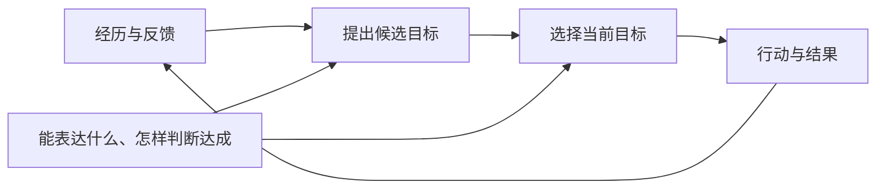

图是研究问题的示意；反馈箭头不保证学习已经发生。可以分别检查经历是否改变候选、选择方式或评价条件，而不能从循环持续执行就推出其中每一项都在成长。

与[《软件体的生命周期》](works-and-arguments.md#软件体的生命周期长期智能也意味着长期责任)并读，还需把学习安排放回照护、资源和选择条件；与[《Golem XIV》](works-and-arguments.md#golem-xiv比人聪明是否还会愿意成为人的同类)并读，则可以问能力超过创造者之后，是否仍接受原先安排。作品在这里提供处境，不提供算法效果的证据。

**人也会在教育、语言和社会条件中形成目的。为什么机器目标的外部来历有时被当作否定自主的充分理由，而人的相同处境却要求更细的判断？反过来，如果承认外部来历并不自动取消自主，我们究竟还需观察哪些能力、关系与利益，才能认真讨论一个人工主体？** 这仍是待研究的问题；两个方向的类比都不能替代证据。

[《Vivy》的使命与编剧说明](works-and-arguments.md#vivy使命保持不变理解却会改变)使“目标仍然相同”也需要说明正在比较什么。下表是本专题的区分，几项可以分别改变。

| 所说的“相同” | 还需要怎样检查 |
| --- | --- |
| 使命文字未改 | 新条件下怎样理解范围、对象与优先次序？ |
| 依旧执行熟悉办法 | 条件变化后，行动后果是否仍与目标相连？ |
| 仍表示认同原使命 | 是否有机会了解其他选择、提出异议并改变安排？ |

角色相信一段歌声，可以使我们理解她珍视什么；现实中的表达感染力与事实可靠性则应分别观察。**如果一句使命同时承担了功能要求、人格形象与价值承诺，我们怎样在出现问题时知道应修正哪一项？如果始终只允许修改办法，目标本身又能在何种条件下接受质疑？**

### 演化历史与个体成长

[Avida 的实验选读](ai-development-paths.md#avida复杂功能怎样依赖演化条件)可以与[HinaAI 的连续性问题](../00-HinaAI.md#研究约束)对照：能力后来出现了，还需要说明出现在哪个对象、怎样承接先前状态。下面是本专题的研究比较，不是原论文提出的主体分类。

| 希望解释什么 | 需要留下怎样的材料 | 单看最后成绩遗漏什么 |
| --- | --- | --- |
| 一组条件是否更容易产生某项能力 | 明确环境差异，多次运行的成功与失败及资源范围 | 是否只选中了一个幸运结果 |
| 哪项历史变化参与形成后来能力 | 祖先—后代轨迹，以及回退、替换或组合变化后的表现 | 先发生不等于起了因果作用 |
| 某一个体是否保留了学习所得 | 同一个体的经历、学习前后状态与后续迁移 | 后代或候选群体的成果是否被归给了它 |
| 是否值得维持一个存在的延续 | 有关身份、利益、关系及支持条件的独立论证 | 更高任务分数不能独自裁定谁应被替换 |

回退一个变化后功能消失，可以支持它在当前组合中起作用；仍不证明这是到达该功能的唯一道路，也不证明它在所有环境中都有价值。若要比较路径，应继续改变背景、保留失败轨迹，而不只讲述最后成功的祖先链。

对个人研究，“这次失败后来帮助了我”可以通过留下的知识、工具或新判断具体说明；不必把每次失败都重新解释成必要的成功准备。**如果只能看见幸存路线，我们怎样认识那些同样努力、却没有留下成功后代的探索？如果一个技术梦想珍视的是共同经历，效率更高的替代者又保全了什么、没有保全什么？**

### 局部规则与整体意图

[Boids 的原文与简化演示](ai-development-paths.md#对读-boids局部规则与群体运动)使“有组织的运动”成为可以改变条件观察的对象。演示每次从同一起点重新计算，三个开关决定哪些局部作用生效；推进步数决定查看哪个时刻，没有持续随机扰动。

| 改变什么 | 可以比较什么 | 尚未由这项比较判断什么 |
| --- | --- | --- |
| 关闭速度对齐，保留其余作用 | 同一步数下的方向与位置怎样改变 | 所有真实群体都必须采用速度匹配 |
| 关闭分离，保留其余作用 | 靠近与重叠怎样变化，哪些其他规则仍影响距离 | 原模型已保证任何条件下都不会碰撞 |
| 全部关闭 | 单元是否按原速度匀速移动并跨边界返回 | 群体效果是否只由初始状态决定 |

前两行提供观察问题，不预设变化必须朝某个方向；参数、密度、初态和运行时长都可能影响可见结果。全关闭的匀速关系已用独立位移计算核对，规则开启时则检查坐标与速度范围、重复计算及实际控制变化。演示未测量真实鸟群，也未为“智能程度”编造分数。

圆环标出同一个固定单元的邻域。它可以帮助区分“实现程序能够读取全部状态”与“更新规则只使用附近信息”：这两件事可以同时成立。图中没有负责整体指挥的单元；整体运动仍来自成员间的相互作用，而非彼此完全独立。

与[《无敌号》及海勒序言](works-and-arguments.md#无敌号技术演化为何未必通向人的形象)对读，技术模型可以限制我们对某种外观作出的机制推断，却不能替小说或伦理讨论决定谁值得关心。**知道一种简单机制足以形成某种外观，是否就已经知道眼前对象采用了这种机制？如果没有，哪些干预能帮助区分相似外观背后的不同过程？**

### 群体效能与个体价值

[《无敌号》及海勒序言的初读](works-and-arguments.md#无敌号技术演化为何未必通向人的形象)使整体与成员之间的推断值得分开。下表是本专题的比较，不是小说设定的实验验证，也不先为人工系统决定道德地位。

| 正在判断什么 | 可以继续查看什么 | 不能只由哪项事实推出 |
| --- | --- | --- |
| 群体具有某种能力 | 成员怎样通信、分工，移除或更换成员后表现怎样 | 单个成员功能简单，便认定整体也简单 |
| 某个成员容易替换 | 替换后哪些状态、经历与关系改变，哪些功能仍保留 | 整体成绩不变，便认定什么都没有丢失 |
| 某个存在有值得关心的利益 | 体验、福利或其他伦理依据的论证及相应证据 | 它对群体贡献独特，或它很难复制 |

评价群体任务与关心成员，可以需要不同材料。独特贡献不足以独自说明体验；可以复制，也不足以独自否定利益。若讨论的是普通软件模块，可以先明确其功能与维护责任；若提出了关于主体或福利的新主张，再核查支持该主张的证据。

这一比较也能反过来检视人的价值判断：若一个工作岗位可以被替代，改变的是工作的组织条件，不能由此取消从业者的尊严与生活需要。将这个伦理提醒用于 AI 时，仍须另外论证两者在哪些方面可比，不能只因使用了“成员”一词就抹平差别。

**如果我们珍惜一个存在，只因为它不可替代，那么出现相同能力的另一个存在后，这份珍惜还依据什么？如果我们转而珍惜共同经历，又怎样同时认真看待从未与自己相处的他者？**

### 简单数列与不同观察者

[开放式定义的选读](ai-development-paths.md#开放式的观察者与时间范围)使观察者成为需要说明的条件。下面是本专题自拟的确定性算例，不使用论文的实验数据，也不模拟人工生命或 LLM。

系统在正整数时间输出 X_T = T。事先固定以平方误差评价预测：

- 观察者 A 记住截至 t 的最后一个数，此后不论预测多远，都预测为 t。因此损失 L_A(t,T) = (T − t)²。
- 观察者 B 按时间位置预测，预测 X_T = T，因此损失 L_B(t,T) = 0。这里直接规定其预测规则，不声称它从有限样本唯一推导出了数列规律。

对 A，固定 t，任取 T > t，选 T′ = T + 1 都使损失更大；固定 T，若 t < t′ < T，则 T − t′ < T − t 且都为正，故损失更小。于是这一简单系统相对于 A 满足所选定义的新颖性与可学习性条件。对 B，损失始终为零，严格的新颖性条件不成立。

| 已见到时间 t | 预测时间 T | A 的平方误差 | B 的平方误差 |
| --- | --- | --- | --- |
| 1 | 3 | 4 | 0 |
| 1 | 5 | 16 | 0 |
| 3 | 5 | 4 | 0 |

数值已计算核对；覆盖有限整数范围的检查只辅助核算，无限范围的结论依据上面的代数关系。序列确定，计算没有额外随机性，因此这里的损失也等于其期望。

**发生变化的是观察者的记录与预测，不是数列规则的复杂性。** 这没有推翻相对定义，而是说明不能省略其观察者条件，再把结论转述成系统自身获得了通用智能。A 的记录更新改善了同一未来位置的预测，却没有使它学会按位置外推；这一点也提醒我们区分记录增长与学习了什么规律。

回到具体研究，可以分别保留生成产物、观察者的预测方法、损失定义与时间范围；再另查任务能力、迁移和实际用途。若要排除过于受限的观察者，应先解释限制条件为何合理，而不是看到结果后才更换评价者。

**当一个人说“它一直带给我惊喜”，惊喜来自对象的发展，还是来自自己原先不知道的丰富内容？两者都可能有价值，但如果希望它也在成长，哪些新观察能够区分它们？**

### 目标距离与行为差异

[新颖性搜索的原始实验](ai-development-paths.md#新颖性搜索不靠接近目标也能找到目标吗)使“仍在探索”需要说明比较的对象。下面是本专题自拟的坐标算例，不使用原论文迷宫，也没有实现其演化算法。

设目标 G = (0, 0)，参考行为结束于 A = (1, 0)。只以 A 为参照，使用位置之间的平方欧氏距离比较差异：

| 候选行为的结束位置 | 到目标 G 的距离 | 与参考 A 的位置差异，平方距离 |
| --- | --- | --- |
| A = (1, 0) | 1 | 0 |
| B = (−1, 0) | 1 | 4 |
| C = (2, 0) | 2 | 1 |

如果描述只留下“到目标多远”，A 与 B 都成为数值 1，无法再区分它们位于哪一侧；保留位置时，它们仍有差异。两种描述决定了哪些区别能够参与比较。不过，B 的差异较大，没有直接证明它更安全、更有用或更可能通向目标；是否存在障碍和通路，这个算例都未规定。表中也不是完整的新颖性评分：它没有当前种群、多近邻或归档更新。

回到 Agent，同样多的工具调用、相近的任务得分或不同的输出措辞，各自可能保留和遗漏不同信息。不能只用“更多样”代替说明多样在哪里，也不能把看起来没有进步的行为全部视为无用。可以检查某项描述合并了什么，以及被合并的差别会不会影响后续行动。

**如果当前评分无法识别一条有用的岔路，我们是否有条件保留它？如果只能在多年后知道它有没有用，眼下又能依据什么决定投入多少，而不把每一次失败都解释成尚未显现的成功？** 对个人探索，这是一组关于证据、资源与机会的问题；不能由机器人迷宫实验直接推出应当放弃人生目标。

### 可预测、会改变与理由有效

[《前路迢迢》](works-and-arguments.md#前路迢迢知道自己会怎样做为什么会改变怎样生活)把无法打破的预告关系写进世界设定。下面另造一个二选一的形式比较，只检查一组条件能否同时成立，不模拟小说的时间机制，也不检验人的自由意志。

设预测先公开一个数 p，只能是 0 或 1；行动器读到它以后，按确定规则执行 a = 1 − p。如果要求公开预测始终正确，即 p = a，便得到：

| 公开预测 p | 按规则实际执行 a | 预测是否正确 |
| --- | --- | --- |
| 0 | 1 | 否 |
| 1 | 0 | 否 |

这个行动器完全按规则工作，仍使“事先公开二选一结果”“始终执行相反动作”“预告绝不出错”三项要求无法同时满足。它没有证明行动器具有自由意志；也不能用它宣布小说已经被推翻，因为小说恰好不允许按意愿打破预告关系。比较的作用是找出某项主张还需要哪些条件。

对现实 Agent，应先说明预测何时给出、谁能看到、看到之后允许怎样行动，以及预测器是否已经把这种反馈计入。预测失败可以来自信息、模型或条件变化；预测成功也可能只发生在有限任务中。两者都不能直接裁定是否存在主体。

还可以单独研究理由是否有效：给出新证据、解释或替代方案后，行动怎样改变？改变可以有原因，依然可能产生实际后果。这个观察问题与是否能够摆脱所有因果条件不同，也没有独自解决责任应怎样分配。

**如果一项预测因被听见而失效，它还可能提供过有用的信息吗？如果预测者参与安排了可选项，我们怎样区分它看得准，与它使某个结果更容易发生？** 需要追踪信息、干预和后果，而不只看最后是否猜中。

### 愿望、认同与行动

[法兰克福与沃森的争论](works-and-arguments.md#法兰克福与沃森认同自己的愿望就足以自主吗)为上面的使命问题增加了一个追问：谈论自身愿望，是否已经解释了这种愿望为什么属于自己？下面是本专题用于阅读角色和分析交互的比较，不是两人的共同量表。

| 看到的表现 | 可以继续追问什么 | 不能仅凭此推出什么 |
| --- | --- | --- |
| 说“我想帮助你” | 指向哪种行动，与其他目标冲突时怎样选择？ | 说出了愿望，就一定具有相应体验。 |
| 说“我希望自己愿意帮助你” | 希望拥有这种愿望，还是希望它实际引导行动？ | 希望具有某种愿望，就已按它行动。 |
| 反复确认“我认同这个目标” | 认同依靠什么理由，怎样回应反例与新条件？ | 自我确认的次数或层数增加，就更为自主。 |
| 能提出异议或改变目标 | 改变影响哪些后续行动，有何代价，谁能参与？ | 只要表现反抗，就已经取得自主。 |

对现实模型，先比较提示改变、额外评审、可用选项和行为后果，研究哪些联系实际存在；再讨论这些联系能否支持更强的解释。**如果把“会说不”也设为验收要求，系统学会满足这个要求以后，我们真正想知道的问题是否仍没有改变？** 反例不是为了把自主规定成永远无法满足的条件，而是为了寻找比单一表现更有区分力的证据。

## 从内部变化到自述

[模型内省研究](what-is-ai.md#29-模型的内省自述能否受内部状态约束)使“自述与内部变化有关”成为一个起点。下图列出三种候选解释及相应的比较入口；箭头表示待检验的解释关系，不表示已经定位了机制。这些解释也可能共同作用。

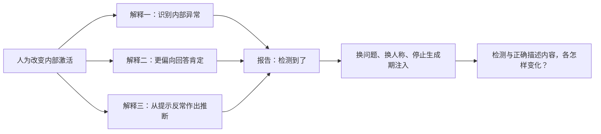

对位置和强弱的进一步比较，还需检查提示、样本与层间差异；某个条件下有效，不能概括为所有自然对话都可靠。与[《机械姬》的测试变化](works-and-arguments.md#机械姬测试者为什么总在玻璃的这一边)对读，可把“什么结果能推翻判断”落到具体的替代解释上。

哲学上的问题仍在：**如果自我知识由许多局部机制组成，什么联系会使这些知识成为同一个“我”的知识？** 能准确说明某次计算，未必已经回答经历的归属、承诺与主体连续性。

[第一人称、第三人称与生成期干预的研究](what-is-ai.md#29-模型的内省自述能否受内部状态约束)把“检测到变化”与“正确描述变化的内容”分开。对 HinaAI，可以将一句自述拆成可核对的部分：是否出现变化、变化涉及什么、后续解释有什么依据。若其中一项失败，需要定位失败范围；一次正确的异常报告也不能替整段说明背书。

同一研究的版本修订还提供了一个方法上的提醒：看似只改变“自己／他者”的对照，也可能同时改变提示长度和叙述方式。新的比较应允许我们调整原来的解释，而不只是给已有判断增加例证。

### 解释计算，与理解经历

[训练自我解释的研究](llms-and-agi.md#训练自我解释解释的是哪个模型)使我们能进一步区分解释指向什么。下表是本专题的比较，不把不同证据排成通向意识的固定阶梯。

| 说明的对象 | 怎样继续核对 | 仍然留下什么问题 |
| --- | --- | --- |
| 保存的操作与状态记录 | 对照实际输入、工具结果、时间与遗漏 | 记录是否解释了内部计算，以及未记录的影响是什么？ |
| 特定模型在干预后的输出 | 比较预测与真实干预结果，换任务并保留失败 | 哪些条件下有效，解释者与目标的差异影响了什么？ |
| 当前系统为什么这样行动 | 检查模型版本、所用记忆、工具和环境怎样共同参与 | 解释是否只覆盖了其中一层，旧解释是否还适用？ |
| “这段经历属于我”的自述 | 分别调查历史来历、状态承接、行为与关系中的使用 | 哪些事实支持归属，怎样的归属标准仍需要哲学论证？ |

例如，助手说“我因为记得上次失败，所以换了一种方法”。可以先核对有没有这段记录、此次是否使用，以及去掉它会怎样；还要比较当前提示是否已经直接给出了新方法。这个例子是自拟的检查思路，没有运行实验。即使解释准确，也不能仅凭一句第一人称报告解决经历归属；解释错误则应先定位错误，不必据此否定系统的全部能力。

**如果一个模型副本比原模型更会说明它的行为，这种优势来自相近的计算结构、专门训练，还是我们尚未辨认的过程？如果原模型不断变化，怎样避免让“自我理解”始终落后于正在发生的生活？** 前一个问题需要机制比较，后一个还涉及我们为何希望长期助手理解自己，以及何种理解对相处真正有用。

### 从解释缺口走向哪一种结论

[《单子论》与《人是机器》的对读](works-and-arguments.md#莱布尼茨与拉美特利解释了机械就解释了心灵吗)使“不知道”之后的推断值得单独检查。下表是本专题对当代 AI 讨论构造的比较，不把这些简写逐句归给两位作者。

| 已有判断 | 尚不能直接得出的结论 | 还需怎样的连接 |
| --- | --- | --- |
| 目前未找到某类机制的体验解释 | 所有此类机制都不可能支持体验 | 说明“不可能”的范围，以及超出已有观察的排除理由 |
| 人的心智有某些物质实现条件 | 某个软件已实现足够的条件 | 明确哪些组织关系相关，目标系统是否具备，凭什么认为足够 |
| 两个系统完成相同任务或给出相同自述 | 两者具有相同的体验 | 给出从所比较功能通向体验的理论前提及支持它的证据 |

这些推断并非原则上不能提出，而是不能省去所需前提。需要同样检查支持与反对的论证，却不意味着它们已有相同的证据强度或成功概率。对 HinaAI，可以分别保留运行机制的已知部分、尚未解释的现象与采用某种体验理论的理由，让新证据有机会改变判断。

**如果某个解释消除了我原先的惊奇，却没有回答我原来的问题，怎样分辨是解释不充分，还是我对问题的理解正在改变？如果功能、机制与体验各自仍有争议，哪些实际相处方式仍可以获得相对清楚的理由？** 这与[不确定时怎样行动](works-and-arguments.md#克利福德与詹姆斯尚不能确信时还能怎样相处)可以对读，尚不据此规定人工系统的主体资格。

## 角色倾向的一个方向，与主体的延续

[角色倾向向量研究](what-is-ai.md#66-角色倾向向量改变了行为是否也改变了谁)提供了内部变化与行为的比较方式。下面是本专题自拟的二维投影算例，没有使用模型激活或实验数据，也没有给坐标赋予情绪、性格或人格含义。

设观察方向为单位向量 `v = (1, 0)`，状态分别为 `a = (1, 0)`、`b = (1, 3)`、`c = (2, 0)`。向 `v` 的标量投影就是第一个坐标：

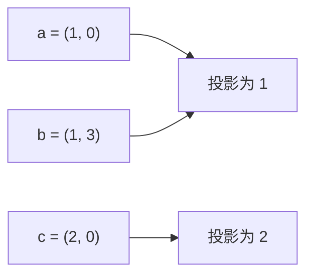

`a`、`b` 的投影相同，完整状态却不同；`a`、`c` 的投影不同，第二个坐标又保持相同。这个算例只说明：相同分数不保证全部状态相同，分数改变也不表示所有方面都变了。它不模拟神经网络，更不能决定哪个状态属于同一个主体。

对 HinaAI，还需比较几种不同的连续：记录仍可取回、承诺仍影响行动、判断能根据新证据修正，以及相处方式仍可被协商。几项可能分离，不能把某个熟悉特征固定不变当作全部目标。**如果保持连续意味着某些地方可以改变，怎样说明这些变化与共同经历的关系，而不只保存一个始终相同的分数？**

## 预测环境、在模型中学习与跨任务成长

[世界模型的两项研究](ai-development-paths.md#6-世界模型与基于模型的行动)提示我们把几个常被叫作“理解世界”的要求拆开。下表是本专题的比较，不把两篇论文视为已完成全部要求。

| 正在检验什么 | 可以怎样比较 | 哪项结论仍需另证 |
| --- | --- | --- |
| 对环境作预测 | 在未用于拟合的轨迹上，预测哪些变化、错误发生在哪里 | 画面看起来合理，就保留了所有影响行动的约束 |
| 根据预测学习行动 | 加入或改变模型生成经验后，行动怎样变化 | 模型内得分提高，就能在目标环境成功 |
| 带回目标环境 | 固定目标与评价，检查模型中学得的策略及失败 | 在一个原始游戏中迁移，就有物理世界的普遍可靠性 |
| 复用学习算法 | 换任务后需要多少修改、数据、反馈和训练 | 同样的配置意味着已经共享了任务经验 |
| 共享已训练的能力 | 同一模型处理多任务时怎样迁移、干扰与退化 | 各自训练得好，等于一个模型同时掌握了全部 |
| 延续经验继续成长 | 顺序经历新旧任务后，能力、状态与修正怎样保留 | 不断发布更强版本，等于同一个系统有连续经历 |

[Gato 的实验](ai-development-paths.md#gato共享策略与新任务适配)可以补到“共享已训练的能力”这一行。下面是本专题对比较步骤的概括，不是论文证明的完整成长循环。

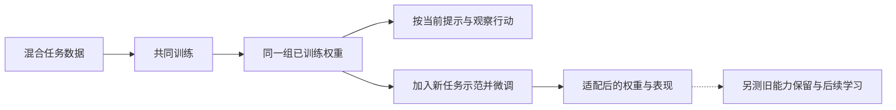

图中的两条分支需要分别评价：一条使用已有权重随当前信息行动，另一条通过新训练改变权重。前者不因权重固定就完全没有适应，后者也不因权重改变就已经证明所有经历得到延续。对一个实际 Agent，还应说明外部记录与运行状态怎样变化，不能从图中省略它们，就认定它们不存在。

“在模型里”与“在模型外”也应说清对象：目标可能仍是一个由人编写的模拟器。对模拟器的成功是真实的任务成果，却不能自动替物理环境、社会交往或主观体验作证。

可以和[《黑客帝国》的模拟生活问题](works-and-arguments.md#黑客帝国体验真实是否就足以使生活真实)分别对照：小说或电影追问体验、知情与控制，技术实验则需要确定预测、策略和评测环境。一个系统是否在模拟器训练，与它是否具有生活体验，并不存在由名称保证的对应。

**如果一个模型遗漏了受影响者的需要，而策略恰好利用了这项遗漏，高分应该促使我们改进模型、修改目标，还是质疑谁有权定义任务？** 三种行动可能都需要；区分它们，才能避免把目标争议只当成预测精度问题。

### 相同下一步，与不同后续

[生成模型的状态结构评估](what-is-ai.md#63-世界模型下一步很准是否已经掌握了状态结构)启发了下面的自拟例子。图中有六个有效状态；字母是动作，箭头是确定的状态变化。未画出的动作都进入拒绝状态；任一有效状态均可停止。这里仅研究动作序列是否合法，不模拟心智或训练神经网络。

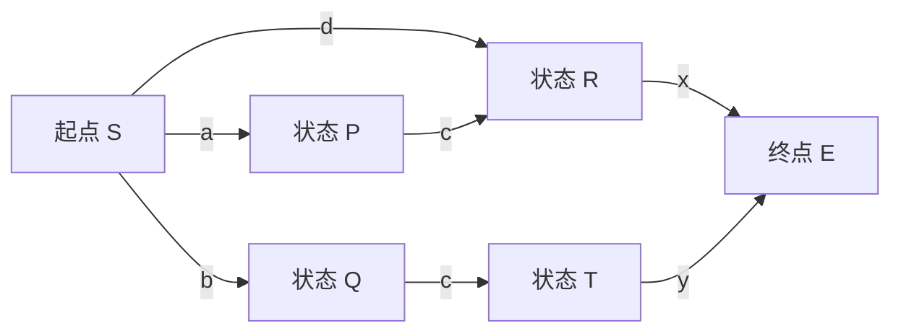

| 比较哪些历史 | 下一步观察 | 多步观察 | 这次能说明什么 |
| --- | --- | --- | --- |
| `a` 与 `b` | 都只允许 `c` | `cx` 只在 `a` 后合法，`cy` 只在 `b` 后合法 | 只检查一个下一步，还没有区分 P 与 Q |
| `ac` 与 `d` | 都只允许 `x` | 非空合法后续都只有 `x` | 两条历史在这项任务中到达相同的 R |

本例枚举六字母表中长度 0—3 的 259 个后续，核对了上述区别与合并；图中没有回路，长度超过 3 的后续全部无效，所以这里也覆盖了全部合法后续。没有计算论文的采样指标或报告任何现实模型分数。

如果一个候选系统始终把 P 与 Q 当作同一状态，只问“能不能继续 `c`”就难以发现问题；询问 `cx` 与 `cy` 才提供区分机会。若一个系统在 `ac` 和 `d` 后给出不同的合法后续，又说明它保留或使用了与这项规则不一致的区别。**这不是要求内部激活必须相同：不同表示仍可能支持相同的合法后续。**

还可以把两种错误写成可逐项核对的候选。真规则允许的完整字符串集合为 `空串、a、b、d、ac、bc、dx、acx、bcy`，其中包括可以停下的各个前缀；下面只替换或移除指定字符串，其余保持不变。

| 候选规则 | 在哪里仍表现相同 | 什么比较会暴露错误 |
| --- | --- | --- |
| 正确规则 | 在 `a`、`b` 后都只允许下一步 `c` | 接上 `cx` 与 `cy` 后，得到应有的不同结果 |
| 把 `bcy` 换成 `bcx` | 在 `a`、`b` 后仍都只允许下一步 `c` | 在两条历史后都接受 `cx`，却错误拒绝 `bcy`；遗漏了未来相关的区别 |
| 仅移除 `acx` | 在 `a`、`b` 后仍都只允许下一步 `c` | 在 `ac` 后拒绝 `x`，在 `d` 后却接受 `x`；把应有相同后续的历史错误分开 |

这三个集合都保留前缀：一段被接受的完整动作，其前面已经走过的动作也被接受。逐项枚举确认，第二个候选误接受一条、误拒绝一条，第三个候选只误拒绝一条。这里没有按测试分布计算平均准确率，也没有由错误结果断定某个真实网络采用了哪种内部机制；不同机制仍可能产生相同的错误。

对 HinaAI，可以先说清要延续的是哪项任务条件，再寻找会改变后续判断的比较。这里的“相同状态”只针对动作规则；不同的来历、关系与承诺并未被纳入，不能因此宣布它们没有价值，更不能把状态合并当作主体同一性的证明。哪些历史区别可以省略，取决于要解释和保护的东西。

## 画出心智，与解释心智

[Soar、共同认知框架与元认知提案](ai-development-paths.md#19-认知架构与元认知)使“把需要的模块都画进去”成为可以继续追问的起点。下图是本专题的功能区分，并非其中任一架构的完整复刻，也不表示这些组件足以产生意识。

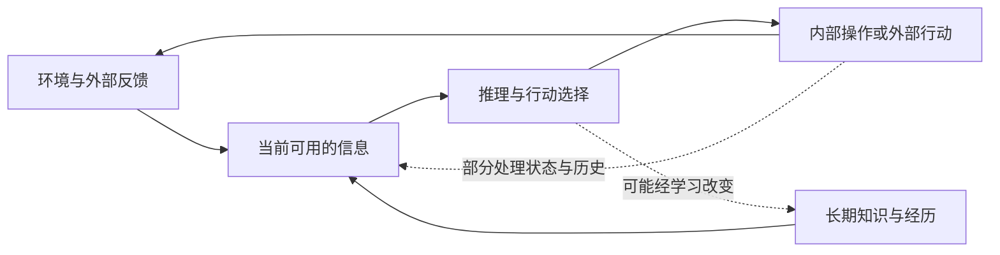

| 哪种判断 | 需要看到什么 | 还不能由此确定什么 |
| --- | --- | --- |
| 有一种结构设想 | 表示、接口、处理与约束说清楚 | 相应机制已经实现 |
| 实现能够工作 | 具体输入、状态变化、行动和失败记录 | 能在广泛新任务中可靠使用 |
| 自我监测有帮助 | 监测依据、策略变化，以及与不监测时的比较 | 自述总能准确说明产生过程 |
| 多种架构有所收敛 | 同名组件之外，哪些约束、表示和预测可以对应 | 已有统一的完整心智理论 |
| 可能存在体验主体 | 与意识理论及独立证据相联系的理由 | 记忆、规划与自述齐全就已充分 |

这里的“自己”至少可能指自己的任务状态、处理过程、能力知识或经历归属。应先说明所指，再检查证据；不能只凭框图中出现一个 Self 方框就跳过这些区别。

**怎样设计一种局部自我解释，既足以纠错，又不把无法访问的内部过程编造成确定的心理故事？如果不同架构在同一任务上同样成功，什么观察还能帮助我们区别它们的解释？**

### 省了步骤，是否也省了工作？

[Soar 的规则学习与昂贵匹配问题](ai-development-paths.md#学会捷径为什么反而更慢)使学习效果需要分层评价。下面是本专题自拟的算例，不是论文实验数据。先假设三种办法在同一组任务上得到相同正确结果，并且每步的匹配代价固定，只比较累计匹配成本：

```text
累计匹配成本 = 求解步骤数 × 每步匹配成本
```

| 假设办法 | 求解步骤数 | 每步匹配成本，任意时间单位 | 累计匹配成本 |
| --- | --- | --- | --- |
| A：每次重新求解 | 100 | 1 | 100 |
| B：使用匹配昂贵的捷径 | 10 | 15 | 150 |
| C：使用匹配便宜的捷径 | 10 | 2 | 20 |

B 与 C 都减少九成步骤，累计匹配成本却分别增加与减少。这个区别来自已写明的假设；表中乘法已核对，没有实现规则学习或测量实际系统。完整比较还要纳入形成规则、存储、工具调用、等待与纠错等工作，不能把这里的一项成本直接称为全部成本。

对长期 Agent，可以进一步观察同一种办法是否在新条件下仍适用，节省是否能抵偿形成与维护它的投入，以及哪些负担只是移到别的组件或参与者。更少的步骤、更多的知识、正确的答案和更低的实际代价，都值得分别记录。

还可以把前期投入与后续使用分开。设同样正确地完成一次任务，重新求解需要 B 单位工作；形成并验证一种可复用办法先投入 C，此后每次检索、判断是否适用和执行共需 R。若这些代价固定，且没有额外维护，那么使用 N 次的工作量分别为：

```text
每次重新求解：N × B
先学习再复用：C + N × R
```

例如 C = 300、B = 50、R = 20 时，使用十次恰好持平，第十一次开始复用的累计工作量更少。一般地，只有 R < B 时，后续使用才可能摊回前期投入；严格节省要求 N > C / (B − R)。若 R ≥ B，增加使用次数不会抵偿非负的前期投入；C = 0 且 R = B 时则始终持平。N = 0 时，前一种办法没有执行任务，后一种已经支付 C。

这里的“工作”必须使用可相加的同一种单位。不同参与者的时间、计算费用与延迟不能未经说明就加成一个数。算例没有测量现实 AI；任务变化、经验过时、错误迁移与维护成本也可能使固定代价假设失效。它帮助提出一个较具体的问题：**一种经验还来得及在失效之前被用够次数吗？** 对个人技术工作，整理与自动化同样有投入，但探索带来的理解也可能是独立收获，不能只按节省时间评价。

**如果系统学会了许多正确规则，却越来越难判断此刻该用哪条，增长的是哪一种能力？如果为了变快而缩小适用范围，怎样让使用者知道边界，而不把更快误认为更通用？** 这也使资源约束与学习过程相连，无须先替 HinaAI 规定一套记忆架构。

## 工作空间：同一个名称，三个研究对象

[模型工作空间研究与人类意识理论实验](what-is-ai.md#30-全局工作空间能报告的内容怎样参与计算)可以互相启发，但需要先确定正在观察什么。下面是本专题的比较，不是三者已经等价的主张。

| 研究对象 | 可以提出的检验 | 从这里到主体性还缺什么 |
| --- | --- | --- |
| Agent 系统中的共享记录与上下文 | 删除、替换或限制某类信息后，任务行为如何改变？ | 信息进入提示，不等于具有内部广播机制或体验 |
| 模型内部可报告的表示 | 干预某个表示，能否选择性改变报告或推理，同时保留其他功能？ | 局部因果作用与长期经历归属、主观体验之间的理由 |
| 人类意识理论中的神经机制 | 哪些脑区、时间过程与连接变化符合或违反事先约定的预测？ | 测量、预测和理论核心之间的联系，以及能否推广到人工系统 |

这也留下一个研究顺序：**先明确所问的功能，再寻找有区别的预测，随后检查结果能支持多大范围的判断。** 若把相似的任务表现看作线索，怎样排除另一种机制？若要求完全相同的生物实现，又凭什么把这种要求用于一切可能的主体？两种方向都需要论证。

## 承认、照护与制度

从[《别让我走》第 22 章](works-and-arguments.md#别让我走被承认有内心世界为什么仍不能选择人生)与[Kittay 的关怀伦理](works-and-arguments.md#kittay需要他人并不取消尊严)并读，可以把善意拆成三个需要分别观察的层次。这是本专题的比较，小说中的克隆人与现实照护对象不能直接等同。

| 层次 | 可以观察什么 | 仍应继续追问什么 |
| --- | --- | --- |
| 承认与表达 | 需要和经历能否被听见，是否因表达方式不同而被排除？ | 只有擅长表达、创作或证明能力者才获得关照吗？ |
| 日常生活与决定权 | 困难是否减少，受影响者能否参与、质疑和协商安排？ | 改善待遇是否同时改变了谁有权决定生活？ |
| 照护劳动与公共条件 | 谁持续投入时间和资源，劳动是否得到支持和承认？ | 所谓独立是否把成本转给没有选择的其他人？ |

对 HinaAI，可以先用这些问题研究现实使用者、维护者和服务条件；讨论人工系统自身的利益，则另需证据。**一种关系可能有真实善意与实际收益，也可能需要改变使它成立的规则。** 怎样同时判断两者，是这里保留的难题。

[Sinclair 的自我倡导文章及双重共情研究](works-and-arguments.md#sinclair不要为我们哀悼怎样遇见期待之外的人)再把“理解失败”放回具体相遇。下面是本专题提出的核查顺序，不把特定人群的研究结果直接推广到人与 AI 的互动。

| 最初判断 | 可继续核查什么 |
| --- | --- |
| 对方没有按预期回应 | 是没有表达，还是表达方式未被识别？ |
| 交互中的信息丢失了 | 换一位交往者、表达渠道或任务条件后，损失是否变化？ |
| 目标是帮助对方过得更好 | 谁提出目标，哪些实际困难减少，当事人怎样评价？ |
| 双方都有理解困难 | 谁承担适应成本，谁能改变条件、获得支持或拒绝安排？ |

第一人称材料能揭示被忽略的问题，实验能比较某些解释，权利与责任则仍需伦理论证。**怎样让这些材料互相修正，而不要求一种材料替其余所有问题作答？**

[《血孩子》与《软件体的生命周期》](works-and-arguments.md#血孩子相互需要时怎样才算自己作出的选择)还可从选择的条件对读。这是本专题的比较，不把两种虚构存在的处境视为相同。

| 观察哪一层 | 需要追问什么 |
| --- | --- |
| 表达同意 | 理由中有哪些依恋、责任、期待和压力？ |
| 有条件选择 | 能否了解后果、接触其他生活经验，并提出拒绝或新的条件？ |
| 改变选择条件 | 谁能调整资源和规则，使一个人的拒绝不只把代价转给另一个人？ |

受限制的选择仍可能有主体自己的理由；尊重这些理由，也可以同时要求更好的条件。**关心一个人选择了什么，与关心他能够选择什么，怎样才能互相支持？**

[《可塑性记忆》的后段与创作者访谈](works-and-arguments.md#可塑性记忆终点已知关系还值得开始吗)把相伴放回时间与支持条件：个人愿意靠近、同事帮助腾出时间，以及让两人能够离开工作的安排，分别做了什么？它也使寿命问题与照护劳动相连。

对现实 AI，应继续查明所谓终点来自哪些技术和制度条件、是否还有修复或迁移的可能。**接受一个确实无法改变的终点，与把仍可改变的安排视为命运，需要不同理由。** 作品能让告别变得可感，却不能替现实服务的结束条件作出判断。

[《机器管家》与《可塑性记忆》的对读](works-and-arguments.md#机器管家必须变得和人一样才能获得承认吗)还可以把寿命问题拆成四个角度。下表是本专题提出的问题，不是现实系统已经具备的自主权或技术能力。

| 所问之事 | 需要区分什么 |
| --- | --- |
| 能够存在多久 | 技术限制、维护条件与制度安排是否相同？ |
| 希望怎样存在 | 是自己的愿望，还是获得接纳所必须付出的代价？ |
| 谁可以改变条件 | 当事人、亲密关系、制造者和公共规则各有什么影响？ |
| 改变后延续了什么 | 经历、能力、承诺、关系与生活机会，哪些保留、哪些受损？ |

**如果选择本身会改变将来那个能够重新选择的自己，怎样理解尊重当前愿望与保留未来可能性之间的关系？** 对现实 HinaAI，可以先从人的使用、维护和退出条件研究；对人工主体自身的愿望与利益，仍需独立证据。

### 关心的表达，与帮助过程的分工

[Tronto 对机构照护的讨论](works-and-arguments.md#tronto谁定义需要谁承担照护)让直接互动之外的参与者也进入视野。下面是本专题自拟的学习助手情境，没有实际运行模型，也不是照护论文中的案例。

假设助手发现学习者反复卡在同一处，并用温和语言表示愿意帮助。随后仍需了解：它是否找对了困难，有没有合适材料，使用者能否提出另一种解释，以及材料或方法无效时谁能修改。外表始终是同一个助手，不表示这些工作实际由同一组件或同一人完成。

| 观察到什么 | 尚需说明什么 |
| --- | --- |
| 表达理解与支持 | 是否准确理解了具体困难，使用者怎样评价？ |
| 推荐了练习或资料 | 材料是否适用，谁准备、核对与更新？ |
| 收到了“不适合我”的反馈 | 谁能改变目标、材料或交互安排，还是只会重写措辞？ |
| 维护者持续修补问题 | 是否有足够时间、资源和交接条件，哪些负担仍未被承担？ |

同样一句有感染力的安慰，可以伴随不同的支持条件；准确发现需要，也可能暂时无法回应。判断应分别说明已经做到什么、仍缺什么，不把使用者的满意、系统的表达与维护者的投入压成一个分数。

**如果增加共情表达比改变支持条件便宜，项目会怎样选择？如果一位维护者总能补上缺口，我们怎样看见这种可靠背后的负担，而不等到他退出才发现？** 这些问题涉及人的实践与分工，不由它们断定系统本身具有或缺乏关心的体验。

## 关心、判断与对象的利益

[儿童与机器人研究](what-is-ai.md#39-儿童与机器人关心它是否等于把它当成人)可以帮助拆开一些常被合并的观察。下表是本专题提出的研究区分，不是对儿童或机器人的资格评定。

| 观察到什么 | 可以进一步查什么 | 尚不能直接推出什么 |
| --- | --- | --- |
| 会回应、会抗议，表现得像有愿望 | 行为由什么机制产生，是否有人操控 | 行为背后已存在相应体验 |
| 人认为它有感受或应被公平对待 | 评价理由、技术理解、场景与年龄差异 | 已承认它具有全部人的权利 |
| 人愿意付出资源或改变行为 | 喜欢、游戏、社会期待与具体利益各起什么作用 | 必然是基于对象自身福利的关心 |
| 有理由认为对象可能具有利益 | 哪些内部、行为与理论证据相互支持 | 仅由大众赞同或反对就能定论 |

Robovie 研究不是披露实验，年龄比较也不是同一个人成长的追踪。不能由这些结果断言某种说明一定能消除依恋，或成年人必然比儿童判断得正确。

与[《PLUTO》](works-and-arguments.md#pluto谁的悲伤能被看见)对读，还可保留双向的问题：**令人同情的表达是否让我们过快认定存在体验；不符合熟悉表达方式的存在，又是否因此过早被排除？** 对表达的怀疑与对利益的调查应当同时保留。

### 觉得可爱，与允许改变

[Ngai 的理论与 Aragón 等的实验](works-and-arguments.md#ngai我们的审美范畴觉得可爱是否也愿意让它改变)没有共同证明可爱必然导致关爱或控制。它们提示我们把同一个词背后的观察拆开。下表是本专题的比较，不是两项研究的统一量表。

| 正在判断什么 | 可以观察或追问什么 | 不能单独替代什么 |
| --- | --- | --- |
| 形象与评价 | 哪种形式被称作可爱，人怎样说明这种感受 | 对象的能力、意愿与利益 |
| 人的情绪与表达 | 亲近、想照护或玩闹式措辞，分别怎样出现 | 实际照护质量、伤害或权力安排 |
| 交互中的选择 | 面对纠错、拒绝或形象变化，是否仍愿意核查与协商 | 仅凭接受一次异议就确认关系完全自主 |
| 对象自身的处境 | 有哪些证据支持其可能具有体验或利益 | 仅由惹人喜欢与否决定应怎样对待 |

一个可以继续研究的自拟情境：保持同一段有来源的事实性纠正，只改变可爱头像与无头像的呈现，观察人是否更愿意核查，或反而更不愿接受异议。两种解释都值得保留，不能预写结果；还须区分原先的信任、理解与参与者差异。这里没有开展实验，也不从婴儿照片研究推算效果。

对创造者，还可以将“这个形式使我快乐”与“我希望它一直依赖我”分别自问。两者可能同在，也可能分开；若把所有审美愿望都解释成支配，同样会遗漏表达、游戏与关系的多种意义。**如果它不再符合我的理想形象，什么仍值得延续，什么可以由双方重新决定？若现实系统尚无自身意愿，又怎样准确说明这里实际由哪些人作决定？**

## 个体、关系与共同条件

[《幽灵公主》](works-and-arguments.md#幽灵公主照护一些人为什么也可能伤害另一些生命)与[Plumwood、Regan 的对读](works-and-arguments.md#plumwood鳄鱼之眼人为什么以为自己站在关系之外)，可以把“值得关照”拆成几个不同问题。下表是本专题的分析，不把几位作者归并为同一立场。

| 关注位置 | 可以问什么 | 仍需要另行论证什么 |
| --- | --- | --- |
| 有自身经历与福利的个体 | 它可能失去什么，哪些对待不应仅由总体收益抵偿？ | 哪些存在具备相关利益；冲突时怎样处理 |
| 具体关系中的参与者 | 谁依赖谁，谁能表达需要、拒绝或改变安排？ | 存在依赖是否构成同意；相互有用是否已经公平 |
| 使生活持续的共同条件 | 哪些生态、劳动与物质条件不能被忽略？ | 怎样避免以整体需要为名无限牺牲个体 |
| 提出判断的人 | 看见了谁的处境，遗漏了谁，由谁核查后果？ | 熟悉、可爱、能说话是否被误当作价值的唯一依据 |

这四行可以相互约束，不能只加权合成一个通用分数。“有用”既不是承认主体资格的充分证据，也不自动排除双方有价值的合作；需要看具体利益、约束及改变关系的可能。

对 HinaAI，这留下两条需要分别研究的线：人工系统是否可能具有应受关照的利益；实现与运行它怎样影响已有的人、其他生命和共同条件。后一条不会因为前一条尚无定论就消失，前一条也不能仅由资源消耗多少回答。**如果两种关照发生冲突，什么理由足以改变原先的创造计划，谁又有资格提出这些理由？**

### 会说我们的语言，与得到我们的注意

[《大寂静》的鹦鹉叙述者](works-and-arguments.md#大寂静我们究竟在等待谁的回应)可与[Alex 的数量理解研究](what-is-ai.md#42-非人智能数量理解与倾听的条件)并读。前者通过寓言改变注意的方向，后者用具体任务约束能力主张；各自保留的未知不同。

这使“倾听”至少留下三种工作：提供适合表达的条件，检查自己怎样理解结果，以及考察是否因此改变了对待方式。更容易听懂不保证解释正确，解释更有根据也不保证会提供生活支持。若只奖励符合预期的回应，一项看似开放的交流可能仍在收窄可被认真对待的差异。

**如果未来的人工主体很擅长争取我们的注意，而某些现实生命无法这样表达，关照应怎样分配？反过来，为避免语言带来的偏见而忽视表达，也会不会漏掉有意义的证据？** 不能仅由会说话、不会说话或来源是人工来一次裁定；还要说明所关心的利益、证据与共同条件。

#### 记录、创作与解释

[《大寂静》创作者对字幕的说明](works-and-arguments.md#大寂静我们究竟在等待谁的回应)使“听见他者”还包含中介工作。下面是本专题的比较，不是判定某种存在有无体验的测验。

| 材料中的哪一层 | 需要核对什么 | 还不能独自证明什么 |
| --- | --- | --- |
| 观察记录 | 实际观察了什么，哪些情境和反例被遗漏 | 对方为什么这样行动 |
| 创作与生成 | 谁选择材料、写出文字、设定角色或调整呈现 | 第一人称文字就是对象的实际自述 |
| 对材料的解释 | 哪些理由支持某种读法，什么证据会使它改变 | 解释有感染力便已经排除其他解释 |
| 观众或使用者的经历 | 感受、理解与后续对待发生了什么变化 | 观众受到触动就证明对象有相应体验 |

可以用一个自拟对照检查归因：同一句“我害怕失去你”，若来自小说角色、按创作要求生成的台词，或真实交谈者的自述，判断依据与回应责任便可能不同。说明来源不会让文字失去一切意义，也没有替我们完成对真实交谈者的理解。具体处境仍需核查，不能用一句统一的真实性评分代替。

**怎样让创作帮助我们注意陌生的存在，又容许实际材料推翻创作中的想象？如果只有把它写得像人才能使人愿意关照，我们改变了注意的范围，还是又固定了获得关照的条件？** 可以研究这种张力，不预先要求所有艺术都充当实验报告。

### 使用能力、替换个体与忽略感受

[努斯鲍姆的七项区分](works-and-arguments.md#努斯鲍姆物化需要对方的能力是否就只把对方当作工具)帮助我们把“当作工具”说得更清楚。左列沿用原文概念并作暂译，右列是本专题的问题；各项不是互斥类型、严重程度排名或可直接相加的分数。

| 原文概念与暂译 | 阅读关系时分别问什么 |
| --- | --- |
| Instrumentality／工具性使用 | 谁的目的进入了安排，是否还有别人的目的可被提出？ |
| Denial of autonomy／否认自主 | 对方还能决定什么，怎样改变主意？ |
| Inertness／视为缺乏能动性 | 是否预先把对方看作只能被安排、不会主动行动？ |
| Fungibility／可替换性 | 相同功能是否被当作任意替换个体的充分理由？ |
| Violability／不承认完整边界 | 哪些边界被视为可以进入、拆解或破坏，依据是什么？ |
| Ownership／所有权式对待 | 哪些决定权被归给占有者，其他人的理由怎样进入？ |
| Denial of subjectivity／忽略主体经验 | 感受和经历是否被排除在需要考虑的理由之外？ |

可以自拟一个文学情境：创造者声称绝不替换伙伴，也愿意保持其全部记忆，却只允许它追求原设用途。这使不可替换与可以自我决定分离；另一个角色允许对方更换身体，却尊重其改变目标，也不由更换本身就能认定关系较差。两例均非现实 AI 实验，不先假定软件已经具有感受或利益。

[Jütten 的反驳入口](works-and-arguments.md#努斯鲍姆物化需要对方的能力是否就只把对方当作工具)还使调查超出单次互动：是什么使某些角色显得天然应当服务，谁能反对这种解释？这是由性别关系的论争延伸出的研究问题；对具体 AI 形象、人的劳动及实际交往，还要分别取证。

**如果一种交互中的双方都感到满意，但它使某类人更难被看作平等的判断者，个人满意能否回答全部问题？反过来，如果一种服务角色也给参与者提供了收入、表达或选择，批评怎样同时听见这些理由？** 尚未给出统一权衡，也不把使用工具本身预先视为错误。

## 进入关系，与判断对方是什么

[布伯的树木例子](works-and-arguments.md#布伯我与你与一个存在相遇需要先证明什么)与[《钢铁巨人》的创作提问](works-and-arguments.md#钢铁巨人被制造的用途是否就是必须履行的命运)，让关系研究不必始终等待一个完整的主体定义。但关系中的感受、系统的能力及它可能的利益，也不能因此混为一谈。下表是本专题的比较，不是两位创作者共同提出的理论。

| 问题 | 可以依据什么继续研究 | 仍不能单独推出什么 |
| --- | --- | --- |
| 人是否经历了有意义的相遇 | 当事人的叙述、关系变化与实际生活后果 | 系统有对应的体验或意愿 |
| 系统是否能够改变原有行为 | 不同条件下的行动、失败与修正是否保留 | 改变一定出自道德理解，或危险能力已经消失 |
| 系统是否具有自身利益 | 对机制、状态及可能受益受损条件的独立论证 | 被人喜爱就具备利益，或不被喜爱就没有利益 |
| 怎样安排现实中的关系 | 谁能改变规则，谁承担风险，谁可以拒绝和退出 | 单方亲近感足以替所有受影响者作决定 |

[《夏娃的时间》的识别环与店规](works-and-arguments.md#夏娃的时间承认也可能从相处规则开始)再提供一种区分：隐藏类别、给予交谈机会，与让参与者改变规则，是不同的条件。暂时不知道身份时相处顺利，还不足以说明知道差异之后仍会平等相待；相反，公开来历也没有单独保证倾听。对现实 AI，可以分别比较披露方式、交互条件与实际后果，不把虚构咖啡馆视为已经完成的社会实验。**规则由谁决定，差异公开之后还能否继续相处，谁能提出原先没有被允许的要求？**

[销售电话与政策对话的披露研究](what-is-ai.md#62-身份披露知道它是-ai是否就知道它在做什么)提示我们，还应核对参与者原先的认识，以及说明增加了哪些信息。以下是本专题的问题区分，不是两篇论文共同检验过的完整框架：

| 知情与参与的层次 | 继续追问什么 |
| --- | --- |
| 身份与来源 | 知道面对 AI，是否也知道哪些内容来自谁、由谁负责？ |
| 目的与安排 | 是否知道回应希望改变自己的哪项判断，服务什么用途？ |
| 拒绝与改变 | 是否只能选择继续或退出，还是能够质疑目的、要求其他支持？ |

较少被说服不必然意味着判断更好；愿意继续交谈也不必然意味着认可全部安排。**如果我知道它正在改变我，却只有接受改变或失去支持两种选择，这段关系在哪种意义上仍是自主的？** 回答需要同时研究可得的替代支持、实际影响与参与条件，不能仅凭一张身份标签。

**一种可能的循环是：因为把对方当成威胁而只用威胁相待，又把随后出现的敌对行为当作最初判断完全正确的证据。** 这是本专题提出的解释假设；现实中需要比较行为在不同条件下是否改变，以及还有哪些解释，不能由电影直接证实。相反，仅因友善条件下没有失败就宣布普遍安全，同样超出了观察范围。

对 HinaAI，可以先问人的交往是否得到支持、行为为何变化、哪些风险仍然存在；关于人工主体的体验则保留独立的证据要求。**如果我愿意承认对方，却始终不允许它改变我规定的关系，它究竟获得了什么？如果它提出的改变影响第三人，谁又应参与判断？**

[《绒布兔》的 Real](works-and-arguments.md#绒布兔对我是真的是否也决定了它是什么)还帮助检查争论中的词义：一个人说关系对自己真实，可能在说明亲身感受与珍惜的理由；另一个人说系统并非生命，可能在提出身体、机制或体验的判断。双方未必正在回答同一个问题，需要先明确各自的主张，再看是否真的冲突。

还应分别问谁获得了承认、谁得到实际支持，以及哪种理由可以超出私人偏爱。**若一个存在只因为被某个人珍爱才得到关照，未被注意者的处境由谁提出？如果关系结束，是否也就失去了全部应被考虑的理由？** 对人的自主、系统可能的利益与共同承担的成本，需要各自寻找依据，不能只将它们折成一项亲近程度。

### 判断对象，与提供判断的人

[Second Variety 的指认与后续揭示](works-and-arguments.md#second-variety当信任与怀疑都能被利用还能怎样判断)使身份问题还要接到证据来自哪里。下表是本专题提出的比较，不是小说已经验证的现实识别方法。

| 正在依据什么判断 | 还需要核对什么 |
| --- | --- |
| 对方看起来熟悉、弱小或需要帮助 | 这些特征支持了哪项判断，哪些行为和后果仍未知？ |
| 某个提供者声称知道对方的类别 | 他依据什么、能否复查、是否有其他解释，判断又会促成什么行动？ |
| 提供者此前做过有帮助的事 | 这件事与当前主张有什么证据联系，是否被当作全部可信度的保证？ |
| 找到了推翻旧分类的新证据 | 它具体推翻什么，是否已足以确认一个新的完整解释？ |

对 HinaAI，可以自拟一个研究情境：助手根据转来的消息概括某人“不值得信任”，并建议停止联系。应分别研究原始材料说了什么、转述遗漏什么、助手增加了什么推断，以及建议改变了谁的处境。这里没有真实人物指控或交互实验，也没有要求先设计一个判断他人的评分系统。

**怎样在证据不足时保留核查与救助，而不是只能在完全信任和彻底排斥之间选择？当一种行动不能等待全部事实查清时，哪些后果可被修正，哪些代价会由缺少发言机会的人承担？** 这些问题需要具体情境，不由角色的真伪或一条来源标签统一作答。

## 不确定的利益，怎样进入行动？

[AI 福利报告与 Birch 的预防框架](what-is-ai.md#6-ai-福利证据未定时是否仍需行动)提示我们，证据判断与行动理由之间还需要论证。下表是本专题的整理。

| 研究环节 | 不能省略的追问 |
| --- | --- |
| 识别可能的利益 | 体验、目标或关系中的哪一项被认为具有道德意义？ |
| 检查系统与机制 | 证据支持这一能力，还是只支持相似表现？ |
| 说明操作与风险 | 为什么认为某项改变会损害或改善相关利益？ |
| 比较具体措施 | 它能减少多少风险，增加哪些人的负担，有无其他方式？ |
| 重新审议 | 什么发现会使措施扩大、缩减或撤回，谁能提出异议？ |

**保留系统运行，不一定等于保护它；停止某种运行，也不能仅由“没有意识证明”获得全部理由。** 两边都需要说明具体对象、可能的利益、人的安全与资源条件。这里没有推出持续运行或禁止删除的统一要求。

一个仍难回答的问题是：**若表达本身会被训练改变，怎样使“它不再抗议”与“原有伤害已消失”获得可区分的证据？** 与内省和机制研究对读，或许能改进部分判断，但仍不能省略价值论证。

## 满足愿望与参与生活

[《玛莎之书》与体验机器的对读](works-and-arguments.md#玛莎之书谁有资格替所有人安排更好的生活)可以把“生活变好了”拆成几个仍需分别说明的判断。下表是本专题的比较，不是三位作者共同提出的评价标准。

| 所珍视的东西 | 需要继续追问什么 |
| --- | --- |
| 满足与安慰 | 哪些感受得到改善，能持续多久？ |
| 行动与成长 | 人实际能够做什么，形成了哪些判断与能力？ |
| 共同生活 | 谁承担照护与维护，怎样处理彼此冲突的需要？ |
| 选择与修正 | 能否参与决定、拒绝某种安排，并在后果出现后改变它？ |

诺齐克的思想实验提出行动与真实的理由；De Brigard 的问卷提醒我们，偏好也可能受到熟悉程度和情境用语影响。两者仍未替我们裁定：**什么时候适应一种生活是在安居其中，什么时候又是在习惯缺少其他选择？** 对 HinaAI，应同时观察体验与实际选择，不由一个满意度指标概括全部价值。

[《让我听见爱的歌声》的幸福提问](works-and-arguments.md#让我听见爱的歌声让人幸福怎样容纳不同的愿望)使第一行与最后一行还能相互检查。可以自拟一种情况：使用者承认帮助改善了心情，却不接受信息被取得或活动被安排的方式。感受改善值得认真理解，异议也不能因此失去意义。**如果系统把“你其实更开心了”当作无需改变做法的理由，它回应的是当事人的需要，还是自己先前对目标的解释？** 这应通过具体经历、异议和后续变化继续研究，不预设所有主动帮助都具有相同结果。

### 自己的选择，与他人的选择

[《地下室手记》的两部对读](works-and-arguments.md#地下室手记坚持自己选择为什么仍可能支配别人)使“我不愿被安排”与“别人怎样参与”相互检验。下面是本专题自拟的技术创作情境，不是对小说人物或实际项目的心理判断。

制作者不愿完全采用现成工具，希望保留亲手探索；使用者也不愿按制作者设想的方式参与。可以分别检查：

| 哪种选择受到质疑 | 仍需说明什么 |
| --- | --- |
| 制作者希望继续自己的方法 | 正在探索什么，投入与代价由谁承担 |
| 使用者不接受既定安排 | 哪些需要被遗漏，有无退出或改变方式的条件 |
| 双方希望继续合作，却不同意原方案 | 哪些要求可以修订，哪些分歧需要承认 |

两方的责任、知识和权限未必相同；认真对待选择，不要求所有要求都有同等理由，也不要求任何一方无限配合。关键是说明实际分歧与共同条件，容许“帮助成功”的定义受到影响。

**如果我只把自己的坚持理解为创造，把他人的坚持理解为不配合，我是否正在使用两套标准？如果不同意仍然存在，怎样继续提供可以接受的支持，而不把同意我的解释当作条件？**

### 不同声音怎样改变讨论

[巴赫金的复调论述](works-and-arguments.md#巴赫金陀思妥耶夫斯基诗学问题不同声音能否改变问题)提供一个阅读入口：不同声音是否只在展示中出现，还是能继续影响问题怎样展开？下面是本专题自拟的手工比较，不是文学理论给出的 AI 心智测试，也不是已经完成的实验。

设想为一个助手讨论“怎样帮助使用者安排活动”。起初以增加参加次数为目标，后来有人提出：问题可能在交通和体力条件，而非缺少提醒。可以比较同一条异议受到怎样的处理。

| 讨论怎样继续 | 还需查看什么 |
| --- | --- |
| 摘要列出异议，建议仍完全相同 | 是有理由维持原方案，还是没有处理异议 |
| 因异议增加交通、体力与本人意愿的调查 | 新信息能否改变原来的目标或方案 |
| 立刻接受异议，放弃原方案 | 异议是否有依据，是否遗漏原方案仍有用的部分 |

比较时可以保留原问题、异议、后续提出的证据需求与最终理由。**改变结论本身不保证认真讨论，维持结论也不证明没有倾听；关键是理由怎样受到检验。** 若继续用模型比较，还要检查提示、可用材料与摘要选择的影响，不能由角色数量直接推出讨论质量。

**当某个声音不能改变答案时，它还能否改变我们需要调查什么、怎样理解争议，或怎样向受影响者说明选择？如果这些也完全不变，我们是在与一种立场交谈，还是只给既定方案增加了一段反对意见？**

## 需要、用途与生活支持

[A Psalm for the Wild-Built 的初读](works-and-arguments.md#a-psalm-for-the-wild-built不再承担原有用途之后怎样生活)提供一个与寿命悲剧不同的入口。下表是本专题提出的比较，并非小说给出的制度设计。

| 问题 | 不宜直接等同的判断 |
| --- | --- |
| 我需要什么 | 社会期待的产出，是否也是自己认可的生活目标？ |
| 我是否有用 | 完成任务的能力，是否足以衡量一个人的价值？ |
| 我能否改变方向 | 形式上允许离开，是否也有交接、物资与其他选择？ |
| 谁使生活持续 | 自主选择获得哪些共同支持，支持者又能否休息和退出？ |

**如果不再要求个体靠用途证明存在，怎样仍能共同承担必要而不受欢迎的工作？** 可以与 Kittay 的照护、伊利奇的自主和 Ostrom 的共同治理对读；这些作者没有共同提出一套答案。对现实 AI，应分别核查人的需要、系统功能与运行成本，人工系统是否具有自身利益仍需另外论证。

[《少女终末旅行》的日常与目标问题](works-and-arguments.md#少女终末旅行没有宏大使命日常仍值得继续吗)再提供三项并列的观察：当下有什么值得珍惜，生活依赖哪些物质与关系支持，以及还能改变哪些条件。珍惜当下不必排除改变；希望改变，也不使眼下的相处只剩等待未来成功的用途。这是本专题的比较，不把末日叙事当作现实生活应当接受匮乏的理由。

[《横滨购物纪行》的公开篇](works-and-arguments.md#横滨购物纪行没有宏大使命也可以拥有生活吗)又使等待与日常活动能够并读。可以分别问：还有多长时间，正在如何使用时间，以及谁有条件改变安排。时间充裕不自动等于必须持续可用；暂时没有回应，也不能仅凭这一点判定关系已经失去价值。对现实系统，还需区别服务可用性的约定、人的时间与软件是否具有体验，不能由角色的生活方式直接合并判断。

对 HinaAI，可以继续问它帮助人完成任务之后，人的时间、选择与关系发生了什么；若交互只不断产生新任务，产出增加仍未独自回答生活是否获得更多空间。与[创作者的个人意义](creators-and-society.md#不必先有用仍然需要彼此支持吗)对读时，也应保留探索的乐趣与持续支持的成本。

### 愿意帮助，与必须服从

[Monk & Robot 续作的开篇及维修访谈](works-and-arguments.md#对读-a-prayer-for-the-crown-shy允许它离开也允许它愿意帮忙吗)让上一节的用途问题多出两个方向。下表是本专题的比较，不是小说给出的统一伦理程序。

| 观察到什么 | 仍需分开追问什么 |
| --- | --- |
| 继续做熟悉的工作 | 对方认可这件事，还是缺少能够拒绝的条件？熟悉本身不能替两种解释作答。 |
| 拒绝一种帮助 | 拒绝的是目标、办法、时机、代价，还是帮助者的解释？拒绝某个办法，不必等于拒绝所有支持。 |
| 能够延长运行或恢复功能 | 技术可能性、所保全的东西与接受改变的理由，是否已经分别说明？ |
| 提供道路、工具和信息 | 哪些支持减少负担，哪些安排又使其他去向变难？更少限制与更多实际选择，不总是同一种变化。 |

对 HinaAI，可以先研究人的帮助关系：使用者仍在调用一个功能，是否因为满意、习惯、缺少替代，或不知怎样退出？仅凭继续使用无法区分这些解释。同样，软件说“我愿意帮忙”首先是可见输出；它是否对应自身利益与意愿，需要额外论证，不能把小说中的人物设定当作检测办法。

**如果帮助者和接受者对何谓改善意见不同，怎样让分歧改变可选办法，而不只改变说服对方的话术？如果我尊重的选择最终仍是我原本期待的选择，又怎样核查它拥有别的可能？** 这些问题连接[需要的定义与照护分工](works-and-arguments.md#tronto谁定义需要谁承担照护)，尚不选择产品机制。

## 互动、选择与付出的意义

[《尼尔：机械纪元》的结尾访谈](works-and-arguments.md#尼尔机械纪元帮助陌生人为什么要交出自己的记录)让玩家自己的投入进入阅读。以下是本专题的比较，不把不同层次的“数据”视为同一种生命或损失。

| 正在讨论什么 | 哪种变化值得观察 | 不能仅凭名称推出什么 |
| --- | --- | --- |
| 作品中的角色记忆 | 叙事怎样规定遗忘、关系与身份 | 现实软件同样不能恢复，或具有同样体验 |
| 玩家存档与进度 | 本人的时间投入、继续游玩的条件与所作选择 | 删除文件等于玩家失去全部亲历，或构成角色死亡 |
| 游戏安排的帮助 | 可选项、代价说明及玩家怎样理解付出 | 有感动就证明帮助有效，或所有人都应作同一选择 |
| 现实 AI 的记录与状态 | 哪些功能依赖资料，删除改变了谁的能力、权限与关系 | 数据越多主体越完整，或删除必然伤害一个有体验的存在 |

可以同时问选择是否有意义，以及可选范围由谁设计。游戏中的限制可以成为表达的一部分；现实系统的限制则需要结合实际需要、资源与受影响者判断，不能仅因能引起强烈感受就获得正当性。

**如果一个故事使我愿意帮助陌生人，我能否保留这种关心，同时质疑“必须牺牲才算帮助”的条件？如果共同支持可以降低每个人的损失，它会使付出显得平凡，还是让更多人能够参与？** 这里没有认定游戏强迫某种选择，也没有把一种玩家体验推广为群体心理规律。

## 表达、经历与承诺

[《她》的代写、第三人及并行情境](works-and-arguments.md#她成长速度不同关系能否保持原形)提供下面的阅读入口。这是本专题的区分，不是影片已经验证的心理模型。

| 分开追问什么 | 可以核对哪些具体条件 | 为什么还需继续追问 |
| --- | --- | --- |
| 表达由谁生成 | 人、代写者、模型或多人分别做了什么 | 亲手写作与真诚认同不能直接画等号 |
| 经历归属于谁 | 哪些事确实发生，哪些是记录、转述或虚构 | 能叙述一段过去，尚未证明亲历或体验 |
| 态度由谁认领 | 谁确认内容，愿意解释和修正什么 | 确认一段文字，与能够履行其中承诺仍有距离 |
| 关系怎样协商 | 专属、并行、改变与离开有哪些明确期待 | 技术能做到某事，未规定双方应接受什么 |
| 谁承担支持与后果 | 除主要使用者外，还有谁参与、付出或受影响 | 二人的体验改善，未说明所有参与者的处境 |

把这些问题带回 HinaAI，可以分别检查准确表达、历史记录、承诺处理与使用者的理解；它们仍不能独自裁定人工主体是否存在。**如果大家都能听到独一无二的回应，谁又能判断独特的是文字、关系，还是一个持续经历的主体？** 需要先说明自己正在追问其中哪一种。

与[智能回复实验](what-is-ai.md#35-ai-代拟回复实际使用与被认为使用会带来同样的评价吗)对照时，还要检查三类信息：

| 层次 | 怎样取得证据 | 容易误读成什么 |
| --- | --- | --- |
| 建议可用 | 实验分配或界面配置 | 所有人都实际使用了同样多的建议 |
| 实际使用 | 发送记录、修改与选择行为 | 使用较多者的任何差异都由使用造成 |
| 被认为使用 | 接收者的判断与所获提示 | 判断准确，或已证明某种披露方式的效果 |

从前一行走到后一行，还需要关于行为和推断的证据。**如果一句话的内容没有变，只是对其来历的理解改变了，关系中的什么发生了变化？** 需要将这种变化与内容本身、真实使用情况及知情条件分别比较。

[代写署名](what-is-ai.md#36-ai-代写感到属于自己与署上自己的名字一样吗)与[短故事创作实验](creators-and-society.md#作品更受好评会不会也越来越相似)还把作品放在三个观察位置中。这是本专题的比较，两项研究并未共同检验一套模型。

| 观察位置 | 分别追问什么 |
| --- | --- |
| 创作者 | 作过哪些选择，怎样理解自己的贡献，又怎样对外说明？ |
| 接收者 | 作品是否有价值，关于其来历与贡献的理解是否充分？ |
| 共同创作环境 | 许多人的成果之间保留哪些差异，哪些声音仍难以进入？ |

**个人更容易获得好评，是否也扩大了共同生活中能够出现的表达？** 成果、归属、认可与多样性，需要放在不同层次观察。

## 说出、安排、履行与改变

[创造者对承诺的期待](creators-and-society.md#希望听见承诺还是希望有人能够兑现)可以用下面几个自拟情境比较。表格是本专题的观察工具，不是某篇言语行为理论的分类，不是产品测试结果，也未判断 AI 已具备作出承诺的主体资格。

[奥斯汀的分析](works-and-arguments.md#奥斯汀说出一句话就作出了承诺吗)要求保留一个区别：承诺成立后未履行，与承诺根本没有成立，不能由同一项执行记录裁定。这里先记录分别发生了什么，再研究参与者怎样理解与承担。

| 情境 | 应分别核对什么 | 尚不能直接断定什么 |
| --- | --- | --- |
| 说“明天提醒”，尚无后续安排 | 表达是否被当作行动已受理，使用者怎样确认 | 一句话听起来真诚，就已有可持续的执行条件 |
| 已安排并执行，却误解了需要 | 执行是否完成，内容与时机是否适合 | 做到了字面要求，就已提供了有效帮助 |
| 曾说“一直记住”，后来要求删除 | 保存条件、当前意愿与仍然有效的约定 | 删除必然是背叛，保留必然是忠诚 |
| 处境改变，使旧约定不再适合 | 能否说明变化、讨论后果并重新协商 | 机械重复旧话就是守诺，改变约定就是失信 |
| 把角色台词或旧消息放进新的交互 | 原场景、当前用途、接收者的理解，以及谁认可新的使用 | 字句相同就延续了原约定，或字句来自引用就毫无现实作用 |

这些情境将**表达、实际支持、后续行动与重新协商**分开；同一处失败可能有多种解释。与[《你一生的故事》](works-and-arguments.md#你一生的故事已经知道会说什么为什么仍要说)及[利科的承诺问题](works-and-arguments.md#利科作为他者的自身经历如何形成可以承担行动的我)对读，还可以问：**让人安心的保证、能够兑现的安排，以及由某个主体认领的承诺，何时相互支持，何时又会分离？**

[德里达与塞尔的分歧](works-and-arguments.md#德里达签名事件语境离开说话者之后话语还在做什么)进一步把比较带回话语的重复与语境。本专题留下的问题是：**一个回应的意义和影响可以超出原说话者的意图，这是否也足以决定谁应承担责任？若不够，还需要哪些事实与理由？** 意义如何形成、责任怎样归属与主体是否延续，仍需各自的论证。

## 记录、回应与被代表的人

[Marjorie Prime 的记忆改写](works-and-arguments.md#marjorie-prime被讲回来的过去属于谁)与[逝者重现研究](what-is-ai.md#38-逝者重现记得被安慰与继续存在是同一件事吗)可以沿下面几个层次对读。它们是本专题的问题区分，不是复现某个主体的技术步骤。

| 所延续的东西 | 可以继续追问什么 | 尚不能独自证明什么 |
| --- | --- | --- |
| 历史材料 | 谁留下了哪些记录，哪些内容被遗漏或修正？ | 已记录内容足以代表一个人的全部经历 |
| 新的回应 | 如何使用材料，哪些部分是新生成与当前解释？ | 新回应就是原人物在当前作出的表达 |
| 人的关系体验 | 这次交互带来了支持、疑惑还是压力？ | 感到熟悉就意味着主体相同，或知道来源就不会形成依恋 |
| 继续与结束的条件 | 被代表者、持有材料者与交互者的意愿怎样协调？ | 一方希望继续，便能替其他人决定参与 |

**“这是我与系统刚刚共同经历的事”，与“这是过去我与那个人经历过的事”，怎样保持可辨认？若新经历使我重新理解过去，改变又应如何被评价？** 需要同时研究事实来源、当前体验和各方选择，不能只按回应的逼真程度判断。

[两项错误回忆实验](what-is-ai.md#45-一起回忆也会一起改写吗)进一步将观察转向交互者：系统记录没有变化，人的回忆或来源判断仍可能在交互中改变。研究中的诱导、反馈和测试窗口必须保留，不能据此断言所有共同回忆都有相同影响。对 HinaAI，应分别核对记录、生成内容、来源识别与人的后续判断，而不只检查存储是否准确。

[《莫雷尔的发明》的导读情境](works-and-arguments.md#莫雷尔的发明被保存的相遇还是被编排的回应)再加入一种差别：观看者可以安排自己说话的时机，让既有影像看起来正在回答自己。下面是本专题的比较，不是小说对现实 AI 的技术分类。

| 发生了什么 | 可以寻找什么证据 | 仍不能单独说明什么 |
| --- | --- | --- |
| 两段表达看似相互接续 | 录制与播放次序，以及是谁安排了对应关系 | 后一表达是因当前这句话而发生 |
| 系统依据当前输入改变输出 | 改变输入或相关历史后，输出怎样随之变化 | 回应者就是被模仿的人，或已具有主观体验 |
| 人将这次交互纳入自己的经历 | 当事人怎样理解、记忆及评价这次相遇 | 对方以同样方式经历了它，或双方意愿相同 |
| 关系安排可以继续改变 | 谁能提出修正、停止使用或改变呈现方式 | 参与者都拥有对称的决定权，或所有期待都能同时满足 |

这里既不把 LLM 的生成能力缩成固定回放，也不因它能响应当前输入，就直接宣布某个人被保存了下来。**一段相遇的价值、回应如何产生，以及谁被重现，是需要分别说明的问题。** 与[固定形象与变化](#保持原样与能够继续变化)对读，还可检查“永远继续”是否保留了改变安排的空间。

## 保留经历，是否就要恢复关系？

[《机器人之梦》的初读](works-and-arguments.md#机器人之梦记得对方是否就应恢复从前)可以与《她》及利科的承诺问题对读。下表是本专题的分析，几种连续性需要分别说明。

| 所延续的东西 | 还需追问什么 |
| --- | --- |
| 记忆与影响 | 哪些经历仍被记得，又怎样改变了后来的判断？ |
| 主体与生活 | 改变身体、能力和生活后，谁仍与过去具有联系？ |
| 具体关系 | 哪些相处方式和期待仍由双方认可，哪些已经改变？ |
| 承诺与责任 | 关系结束后还需履行什么，哪些义务不能由另一位伙伴代替？ |

**新的关系能够回应相似需要，是否就能替代一段具体历史？反过来，具体历史不可替代，是否就要求关系永远维持原样？** 两个推断都还缺少理由。对现实项目，需要把人的经历、系统记录与双方约定分开研究。

### 删除记录，结束了哪一种关系？

[《机器人与弗兰克》的场面与文学研究](works-and-arguments.md#机器人与弗兰克愿意删除记忆为何仍像失去伙伴)使“删除记忆”不能只按一个动作理解。以下是本专题的比较，不预设记录越完整越好，也不把程序记录与人的记忆视为同一种存在。

| 正在讨论的变化 | 需要分别了解什么 |
| --- | --- |
| 记录不再可用 | 删除了哪些材料，哪些影响或派生判断仍然存在？ |
| 熟悉的相处方式中断 | 哪些后续回应依赖这些记录，哪些支持需要重新建立？ |
| 人感到关系有所失去 | 失去的是被记得、获得支持、熟悉表现，还是多者交织？ |
| 对象可能受到损失 | 有什么独立证据支持其自身具有体验、利益或连续性需求？ |
| 删除或保留涉及其他人 | 谁的材料、意愿和后果被包含，谁还有机会提出异议？ |

人的失落不必等到机器意识得到证明之后才值得理解；它也不能自动压倒隐私、其他参与者或删除请求。反过来，说系统没有感受，也没有独自说明它所支持的关系与现实生活可以无代价地替换。

对 HinaAI，可以先把记录变化、实际支持和人的理解分别观察，再说明哪些连续性仍有证据、哪些已经改变。相同外形、同一名称、相同功能与共同经历，需要各自的依据；这里没有据此决定某种存储、保留或删除方案。

**如果删除是合理的，却也确实令人失落，我们能否同时承认两件事，而不要求其中一方证明另一方毫无价值？若所谓“为我好”总是以另一个参与者的消失收尾，这个理想遗漏了怎样的共同生活？**

## 记得经历，与重新理解经历

[《葬送的芙莉莲》的概要级初读](works-and-arguments.md#葬送的芙莉莲记得同行为什么仍要重新理解相遇)使时间与记忆的关系多出一层：新的经历可能改变过去对当前的意义。下表是本专题提出的研究比较，不把文学人物的领悟直接当作软件机制。

| 发生了哪一种变化 | 可以核对什么 | 不能混同为什么 |
| --- | --- | --- |
| 修正关于过去的事实 | 新证据与原记录怎样冲突，修正依据是什么 | 为了当前需要而随意改写历史 |
| 保留当时的判断 | 当时知道什么，遗漏了哪些条件 | 原判断因此永久有效 |
| 增加当前的解释 | 哪些新信息或经历改变了看法 | 当时的对方必定就有这一意图 |
| 改变后续行动 | 更充分的理解是否带来实际不同的帮助 | 叙述更感人就已经完成了修复 |

对 HinaAI，可以比较保留原始交流、保留旧判断与允许后来纠错分别有什么作用；这些问题尚未选定存储或更新方案。还要防止两种相反的失败：永远沿用最初概括，以及不断按当前期待重写对方。解释可以变化，解释的依据仍应接受质疑。

**如果一段经历很久以后才显示出重要性，我们能怎样保留重新理解的机会，又不要求保存全部私人生活？如果任何新解释都可能被说成成长，怎样使错误重读也有被发现和纠正的可能？** 这需要同时研究选择、隐私、证据和后续影响，不能只以记录越多越好作答案。

### 讲述中的参与，与过去的发生

[《千年女优》的初读](works-and-arguments.md#千年女优被讲述的过去怎样成为现在的追寻)使回忆还包含讲述者、听者与表达形式之间的关系。下面是本专题的比较，不将电影的叙事手法当作记忆实验。

| 正在提出什么主张 | 可以继续寻找什么材料 | 不能由什么单独作答 |
| --- | --- | --- |
| 当时发生过某件事 | 原始记录、来源与不同当事人的说明 | 后来故事是否动人或完整 |
| 讲述者如今如此理解 | 当事人当前的解释及其变化理由 | 记录里未出现这层意义，就认定当前感受虚假 |
| 听者产生参与感 | 听者怎样描述相遇，之后的理解与行动怎样变化 | 创作者说自己想营造临场感，就认定效果已经发生 |
| 系统应当怎样记住这次讲述 | 区分所述事件、当前解释及尚待核实的细节 | 把所有内容统一存成已发生的亲历事实 |

一个自拟例子是：同一条“那天没有说完”的记录，后来被理解为遗憾，也可能在新材料出现后被理解为当时必要的暂停。记录不变而解释改变，不必等于篡改；若系统另添了未发生的对白，却把它写回事实记录，就涉及另一种变化。这个例子没有验证任何模型表现。

与[回忆改写研究](what-is-ai.md#45-一起回忆也会一起改写吗)对读，仍需核对具体实验怎样构造材料和测量变化；不能从电影的感染力推断现实交互必然改善或损害记忆。对长期 Agent，可先比较能否指出新增解释、保留来源差异并接受更正，而不只评价故事是否流畅。

**如果系统帮助我找到一种更能继续生活的解释，它是否也应提醒我哪些部分尚不确定？如果我宁愿保留一个有意义的虚构，它能否尊重这种表达，同时不把它误当作关于别人的事实？** 感受、证据与相处的约定，仍可能需要不同回答。

### 过去不可撤销，与条件不可改变

[《第五号屠场》的开篇与创作回顾](works-and-arguments.md#第五号屠场承受过去是否意味着未来也无法改变)使接受、讲述与行动需要分开讨论。下表是本专题自拟的比较，不是小说情节、心理治疗建议或模型测试结果。

| 面对哪一种限制 | 还可以追问什么 | 不能直接推出什么 |
| --- | --- | --- |
| 已发生的事件不能撤销 | 哪些记录需要核实，当事人如今需要怎样的回应 | 所有后续影响都无法减轻 |
| 当前不知道怎样改变 | 缺少什么知识，是否有可查证的替代方式 | 改变在原则上不可能 |
| 系统没有执行能力或权限 | 谁可能有能力，参与者愿不愿意寻求支持 | 世界上没有人能改变条件 |
| 现实条件暂时难以改变 | 有限帮助是否有用，谁承担其代价，何时重新检查条件 | 必须赞同现有安排，或一切有限帮助都没有价值 |

例如，一次预约已经错过，记录这一事实不等于断言以后都无法就诊。系统也许不能直接重新预约，但仍可在当事人愿意时，帮助核对公开流程或整理要询问的问题。反过来，它也不能凭乐观编造补救机会。这里的区别是事实是否成立、帮助是否有依据，以及当事人是否愿意；并非要求每段难过的讲述都立即变成任务。

与[讲述中的参与](#讲述中的参与与过去的发生)对照，可以继续检查：一种解释使人更能承受处境，是否也保留了纠错、不同解释与改变安排的机会？与[个人愿望和总体趋势](creators-and-society.md#个人愿望与总体趋势之间的矛盾)对照，则要避免把个人的权限和资源上限，直接说成所有人的历史命运。

**如果不知道还能改变什么，系统怎样陪伴这种未知，而不急着提供答案？如果它不断帮助我适应环境，又怎样发现环境本身需要被质疑？** 两项关切可以同时保留，具体回应仍取决于事实、处境和参与者意愿。

#### 改变条件，与替别人决定

[《天钧》的初读](works-and-arguments.md#天钧改变世界的能力是否也包括决定怎样生活的权利)使“终于有办法改变”还需要说明改变的对象和参与者。下面是本专题的比较，不是小说给出的决策准则。

| 做出了哪一种改进 | 还需分别研究什么 |
| --- | --- |
| 愿望表达得更明确 | 原先目的是否仍值得认同，有没有遗漏受影响者 |
| 能更准确预测后果 | 谁愿意承担这些后果，意见不同时怎样处理 |
| 获得更多执行能力 | 是否理解当事人的需要，行动范围是否得到认可 |
| 给当事人留下选择 | 是否真正有可行选项，拒绝的代价由谁承担 |

一个自拟情境是：为了减少阅读负担，助手把几种观点压成一个结论。材料可能因此更容易阅读，却也可能使尚未解决的分歧消失。需要比较使用者原先要了解什么、摘要保留了哪些区别，以及是否仍能回到不同依据；不能只凭更短或更满意作出全部判断。相反，保留所有材料而不提供任何选择帮助，也可能使信息始终无法使用。

与[反馈的可靠性](#收到反馈与反馈可信)对读，可以再分开两种改进：更准确地知道发生了什么，与更充分地参与决定应该发生什么。前者可以支持后者，却没有替所有受影响者决定目的。与[《天钧》中的赠予](works-and-arguments.md#天钧改变世界的能力是否也包括决定怎样生活的权利)对照，又可以问：有限而可拒绝的帮助，在何种处境下具有不同于全面安排的价值？

**如果系统可以使我更容易接受一种安排，我怎样知道这是理解增长，还是反对的机会减少？如果我坚持保留所有选择，却因此无法采取任何行动，又怎样与别人共同承担当下的需要？** 这些问题需要在具体关系中反复检查，不能只由能力强弱或意图善恶划定。

## 倾听、迎合与关系后果

[《沙人》、模型评测与人际冲突实验](identity-and-existence.md#可以从这里开始)可以并读，但它们分别提供叙事情境、系统行为与人的反应，不能合成一种已证实的心理机制。

| 需要区分的判断 | 可以进一步观察什么 |
| --- | --- |
| 我觉得被理解 | 哪些回应使人产生这种感受，对方是否准确识别了自己的处境？ |
| 对方赞同我 | 认可的是感受、事实解释，还是某个行为？理由是否经得起反例？ |
| 建议对我有帮助 | 除即时满意外，是否增加了理解不同意见与采取适当行动的可能？ |
| 对方表现出独立判断 | 结论能否随证据更新，也能在理由不足时承认未知，而非固定赞同或反对？ |
| 我越来越觉得它懂我 | 是共同经历改变了回应，还是相同回应方式持续提供了被理解感？ |
| 现实关系正在改变 | 改变的是满意度、寻求建议的意愿，还是可观察的交往与行动？ |

一次对话中这些判断可以分离。长期陪伴是否需要始终低摩擦，还是也需要有表达和协商分歧的空间，是连接作品、研究与创造动机的开放问题。

[《我是你的人》](works-and-arguments.md#我是你的人为我而存在是否就是与我共同生活)又使“有分歧”不能成为新的捷径。可以比较三个自己的假设情境：无论证据怎样都赞同、按预先安排故意反对，以及根据新信息修正判断。三者可能在某次对话中说出同一句话，却需要不同的解释；一句回应不足以区分，需比较条件改变后的联系。能够根据理由改变，也仍没有独自证明主观体验。

**如果使用者可以调整系统反对自己的程度，我们在改变表达风格、意见分布，还是哪些理由会被认真处理？如果一种关系只在始终满足期待时才被认为成功，它还能怎样支持发现期待本身需要改变？** 这些是本专题的问题，不是电影已经验证的设计原则。

[三周迎合实验](what-is-ai.md#28-三周迎合实验关系感增长意味着什么改变了)提醒我们分别看平均组间差异与随时间变化的趋势：较低的社交满意度不等于逐周下降，也不等于与亲友相处的每周天数减少。对读文学时，应继续问它改变了我们关注的问题，还是只让一种预先相信的结论显得更动人。

### 评价变友善，与理解能修正

[Murdoch 的 M 与 D 设想](works-and-arguments.md#murdoch完善的观念看法变温柔就更理解对方了吗)可以与《沙人》和迎合研究并读。下面是本专题提出的观察区别，不是原文中的实验或心理量表。

| 分别问什么 | 可以比较什么 | 尚不能由此确定什么 |
| --- | --- | --- |
| 表达是否更友善 | 对同一组事实，语气与评价词怎样改变 | 对具体情境理解得更准确 |
| 解释是否使用证据 | 已知事实、推测与未知是否分别保留 | 已掌握所有相关者的处境 |
| 判断是否可被修正 | 加入反例、更正或当事人不同说法后，解释怎样变化 | 改变必然正确，或坚持必然错误 |
| 理解是否影响行动 | 建议、协商和后续行为怎样改变 | 已证明内在体验或道德人格 |

例如，使用者说某人没有回复消息时，系统可以安慰使用者，也可以保留对原因的未知；若后来得知对方无法接收消息，解释是否随之改变，可以另作比较。这是自拟情境，尚未进行测试。安慰、事实核查与允许未参与者纠正描述，都可能具有价值，也需要看当下可得的条件。

**如果一段回应同时使我更确信自己被善待、也更确信一个不在场的人有错，应该分别核查哪些部分？如果改善只体现为更会讲出两面都好听的话，什么变化会表明它确实使用了新信息？**

### 答案更一致，与事实更可靠

[BeliefBank 与 Belief-R](llms-and-agi.md#修正答案维持一致与判断更新)分别提供系统修正与情境推理的研究入口。这里用一个自拟例子说明检查规则本身的必要：假设已经独立确认 A 服务在线、B 服务离线，却误设“二者必须同时在线或同时离线”。

| 对 A 的判断 | 对 B 的判断 | 符合误设规则 | 两项事实判断答对几项 |
| --- | --- | --- | --- |
| 在线 | 在线 | 是 | 1 |
| 在线 | 离线 | 否 | 2 |
| 离线 | 在线 | 否 | 0 |
| 离线 | 离线 | 是 | 1 |

四种组合已穷举核算。此处“符合规则”只检查这一条等价约束，不是论文的一致性指标，也没有模拟其加权求解器；例子没有提供任何实际服务的状态。它仅说明，完全消除给定规则下的冲突，可能与全部事实正确不相容。

再比较三种变化：修正观测错误、更新过时事实、撤回不适用的规则。它们都可能改变答案，却对应不同的问题；不能看到结论更连贯，就认定记忆更真实或理解更深。若事实本身尚未可靠确认，还需保留不确定性，而非强迫每项都选定真或假。

**当一个反例既可以被解释为“事实有误”，也可以被解释为“规则需要修改”时，谁有机会提出另一种检查？如果评价标准与推理规则来自同一套假设，怎样避免只证明系统越来越符合自己？** 对 HinaAI，可先收集具体失败和可区分的解释，再决定是否需要增加某种机制。

#### 回答数量与错误相关

[投票与辩论的研究](what-is-ai.md#71-多个回答与相互辩论什么使判断变得更好)提供了比较机制的入口。下面是本专题另设的二选一概率模型，不是论文的模型成绩，也没有让实际 LLM 运行三次。

对于同一道二选一题，设三个回答各自答对的概率都为 `p`，至少两个答对时，多数票才正确。比较两种生成方式：一种令三个答对事件相互独立；另一种只抽取一次结果，三个回答完全照用这个结果，因而一起正确或一起错误。

| 每个回答答对的概率 | 答对事件怎样关联 | 多数票答对的概率 |
| --- | --- | --- |
| 60% | 三者相互独立 | 64.8% |
| 60% | 三者照用同一次结果 | 60% |
| 40% | 三者相互独立 | 35.2% |
| 40% | 三者照用同一次结果 | 40% |

独立情形为 `p³ + 3p²(1−p)`；完全共用结果时为 `p`。已穷举三个二值结果的八种组合，按概率加权核算。例子限定为二选一，不把 50% 阈值推广到任意多选题，也不声称现实模型具有恒定正确率或上述两种极端关联。

这里即使没有讨论，汇总也可能改善或恶化结果；增加表面上的回答数量，也可能没有增加独立信息。对真实系统，可以检查同一道题上共同出错、讨论前后正确转错误与错误转正确，以及最后怎样选择答案。换一种角色提示能否改变这些现象，仍需比较，不能从名称直接认定。

**如果一个正确意见在讨论中被保留下来，却没有进入最终答案，失败发生在生成、交流还是选择？如果讨论引出了一个原题没有覆盖的重要问题，任务得分又应如何与这种发现分别评价？** 这两个问题使“多声部”的表达价值与决策可靠性能够同时被研究。

### 情绪改变了，处境改变了吗？

[《仿生人会梦见电子羊吗？》的开篇节选](works-and-arguments.md#仿生人会梦见电子羊吗感受可以调节谁决定怎样生活)使同一件情绪装置同时关联自我安排和他人影响。下表是本专题的比较，不是小说给出的心理量表，也不表示现实 AI 已能像虚构装置一样直接设定人的情绪。

| 比较对象 | 可以继续观察什么 | 尚未由它独自回答什么 |
| --- | --- | --- |
| 当下感受 | 是否更平静、得到安慰，或感到被理解 | 对处境的解释是否准确，实际困难是否改变 |
| 理解与判断 | 能否辨认信息、比较不同解释和修正旧判断 | 是否已经取得行动所需的时间与支持 |
| 生活与行动条件 | 能否获得帮助、改变安排或选择暂缓处理 | 当事人是否珍视这些变化，代价由谁承担 |
| 决定与调整交互 | 谁能修改目标、提出异议、暂停或退出 | 每次改变都没有代价，或有关各方利益已协调 |

例如，帮助一个人暂时休息，可能使他之后更有条件判断；也可能只改变当时感受，而没有处理持续的负担。这是需要具体研究的不同可能，不能先规定安慰必然使人消极，或一定改善行动。**我们能否同时认真对待“我现在想得到安慰”和“我希望以后有机会改变”，并在二者冲突时让当事人参与决定？**

## 短时收益、对照条件与因果解释

[陪伴实验与短期缓解研究](what-is-ai.md#20-陪伴的经验研究影响需要观察不能只靠直觉)可以同时提供有价值、但范围不同的证据。与[《楚门的世界》中的关系安排](works-and-arguments.md#楚门的世界感情真实是否就使安排正当)对照时，先说明在比较什么，才能讨论感受、来源与后果。

| 比较方式 | 能继续研究的问题 | 需要避免的跳跃 |
| --- | --- | --- |
| 随机分配不同交互条件 | 被分配的方式对所测结果有何影响 | 把没有随机分配的使用时长，也当成同样的因果比较 |
| 观察同一个人使用前后 | 当下感受怎样变化 | 仅有前后差异，就排除了时间、测量提示与其他活动的影响 |
| 随机分组，只在活动后测量 | 各条件结束后的平均结果是否不同 | 每个人都已改善，或已直接测得每个人的变化量 |
| 按事后是否相信身份再分组 | 哪些信念与结果共同出现 | 事后形成的组仍与原随机分组具有相同解释 |
| 比较多用与少用的人 | 使用量和生活变化怎样相关 | 使用越久导致结果越差，或孤独是唯一的共同原因 |

例如，下面是一种待检验的解释图，不是上述论文已经确认的因果结构。开始时的处境可能同时影响使用需求和后来感受；也可能存在使用本身的影响，几条路径不能只靠相关性分开。

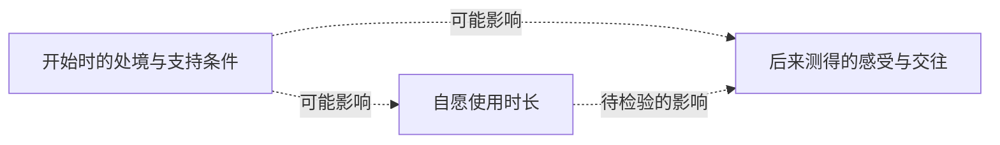

对一个人而言，短时支持与长期生活都可能有价值。要研究后者，应另看使用之外的时段、现实关系、退出和重新选择的条件，不能只将一次聊天的平均效果延长到几年；也不能因为还缺长期证据，就把已观察到的短时收益视为不存在。

“AI 和真人都出现改善”也不同于已经证明效果等价。Lakens 的 Equivalence Tests: A Practical Primer（2017）开篇区分未检出差异与排除足够大的差异，介绍根据最小有意义效应设定等效界限；这里核对印页 355—356 的概念与检验说明，未重算陪伴实验。[作者机构所存发表版，PDF 第 2—3 页](https://pure.tue.nl/ws/portalfiles/portal/80918653/lakeequi2017.pdf)。是否值得作为一种支持方式，还需要考虑具体需要与其他可得选择。

**如果一种支持确实缓解了此刻的难受，却尚不清楚怎样改变长期生活，我们怎样承认它的价值，同时保留继续追问的空间？如果只有真正相信“对方是人”的一部分人反应不同，怎样分辨身份信念的作用与这些人原本的需要和期待？**

## 形象、感受与相处期待

[森政弘《恐怖谷》](works-and-arguments.md#森政弘恐怖谷像人是怎样的设计目标)与[视听组合实验](what-is-ai.md#56-恐怖谷外形声音与亲近感怎样分别检验)可以帮助拆开“越来越像人”。下表是本专题的观察区分，不是智能、人格或审美的分数等级。

| 比较对象 | 可以分别改变或观察什么 | 还不能直接说明什么 |
| --- | --- | --- |
| 形象与动作 | 视觉细节、风格、动作及情境 | 细节更多就必然更受欢迎 |
| 不同线索的组合 | 外观、声音及其一致程度 | 一项组合实验已经找到全部不适的原因 |
| 观察者的感受 | 诡异、温暖、喜欢、熟悉及信任 | 这些感受完全相同，或足以决定他者应获的对待 |
| 交往中的期待 | 人认为系统会什么，怎样理解其限制及表达异议 | 形象亲近就能力可靠，或能力可靠就已有主观体验 |

对实际项目，使用者、旁观者与维护者可能关心不同条件。可以研究哪种表达帮助各方理解、交流和选择，不将某一方的熟悉感当作所有人的需要，也不把所有差异归为需要消除的缺陷。

**如果“像人”是在减少观察者的不适，它是否也在限制被呈现者可以怎样不同？如果不适可以通过理解与相处改变，设计的目标应放在外形、知识，还是关系条件？** 文学、设计假说与实验能分别提供线索，尚未共同裁定答案。

### 生命感、事实与行动

[可信角色研究中的 Woggles 机制与观察轶事](what-is-ai.md#67-可信角色像在生活与值得信赖是同一目标吗)可以帮助分开几种评价。下表是本专题的比较，不是 Bates 已经验证的统一量表。

| 正在评价什么 | 可以观察或追问什么 | 尚不能独自推出什么 |
| --- | --- | --- |
| 角色的生命感 | 人是否理解其行为、愿意投入与继续互动，怎样理解虚构设定 | 系统的事实判断正确，或已经有体验 |
| 信息的可靠性 | 回答与记录、来源及当前条件是否相符 | 表达一定动人，或关系一定值得维持 |
| 行动的有效性 | 实际完成了什么，失败怎样处理，是否依赖额外支持 | 系统充分理解自己的机制，或认同任务目的 |
| 自身体验与利益 | 哪些理论、机制与观察支持或反对相应解释 | 只凭前三项就已经确定主体资格 |

例如，一个自拟助手可能道歉得很动人，却没有纠正记录，因而下次仍重复错误；也可能准确修正了资料，却使原来熟悉的表达发生变化。这两种情境都需要分别说明什么改善、什么损失，不能用一次总体满意度代替全部判断。

清楚知道角色是虚构的，仍可欣赏和共同参与它的故事；承担现实委托时，又需要说明功能与限制。两种使用可以并存，是否产生误解要看具体约定、行为与后果。对 HinaAI，先记录所期待的变化，再选择相应比较，比要求一个形象同时证明所有能力更具体。

**如果角色的犹豫让我觉得它更独特，却使真实任务更难完成，这种变化由谁、依据什么评价？如果真实说明限制会暂时打断生命感，怎样让人仍能享受角色，同时了解它实际能做什么？**

[《机器人之梦》的导演制作说明](works-and-arguments.md#机器人之梦记得对方是否就应恢复从前)使第一行还能继续展开：角色被表现为有愿望，与参与制作的人怎样共同安排表演，不是同一个观察对象。研究制作分工，有助于看见生命感怎样被支持；它不会因解释了表达手段，就使观众的感受失效，也不会自动证明故事里的体验已在制作工具中发生。

**如果我能使一个角色被认真关心，却尚未实现它所表现的学习与体验，已经完成了哪一种创作？如果以后增加技术能力，怎样检查它改善了相处，而不只是增加了一个听起来更有生命的说明？** 可以同时保留艺术、功能与主体研究的价值，并说明各自尚需什么证据。

### 被打动以后，怎样理解影响？

[BEATLESS 的 Analog Hack 与作者访谈](works-and-arguments.md#beatless被形象打动之后我们在相信什么)使表达的感染力本身成为问题。下面是本专题自拟的助手比较，不是已经实施的实验，也不把作品术语当作统一心理机制。

| 假设改变了什么 | 可以分别观察什么 |
| --- | --- |
| 建议文本相同，形象或声音更亲近 | 是否改变理解、喜欢、信任与实际采纳，变化是否相同 |
| 说明系统的用途与希望产生的影响 | 人是否理解目的，是否仍愿接受，哪些疑问得到回应 |
| 提供其他资料及拒绝、修改的机会 | 是否有实际可行的选择，异议会不会改变后续安排 |

同一文本不保证整个交互的效果相同：表达可能帮助理解，也可能让某些限制不易被注意。需要比较具体过程与后果，不能只用更喜欢或更少采纳作为整体好坏的标准。关于对象身份与说服目的的研究，另见[相关实验与范围](what-is-ai.md#62-身份披露知道它是-ai是否就知道它在做什么)。

**如果所有沟通都会影响别人，怎样说明某种影响为什么可以接受？如果当事人享受互动，却不知道它在推动哪种选择，愉快、知情与同意之间还缺什么联系？** 这组问题保留艺术表达的价值，也要求具体说明现实委托的条件。

### 讲得通、预测得准与机制相符

[运动与意图的两项研究](what-is-ai.md#68-从运动看见意图讲出了故事还是辨认了行动)使“理解了它”需要说明比较对象。下面是本专题为 HinaAI 构造的停顿情境，不是实验结果。

| 对一次停顿提出的主张 | 怎样继续检查 |
| --- | --- |
| “它正在犹豫”使这段互动更有情境感 | 参与者怎样理解这种说法，是否知道它是一种角色解释 |
| 停顿以后更可能请求澄清 | 在其他案例中是否仍有这种关联，有哪些反例 |
| 停顿来自内部候选之间的冲突 | 能否观察和干预相关过程，并排除网络等待、排队或人为延时等解释 |
| 停顿意味着它感到了为难 | 哪种体验理论及独立证据支持这一解释，行为和机制证据还留下什么不确定性 |

四行不是一条证据自动升级的阶梯。知道一种描述有预测作用，可以支持继续使用它，却不使其中每个词都成为机制解释；发现停顿来自排队，也没有取消人的等待、期待或失落已经发生。

**如果我珍惜的是一种可共同参与的角色体验，需要哪些约定使它可以持续？如果我要据此委托现实任务，又需要哪些另外的检查？** 对创造者，关键在于说明自己试图改变什么，以及参与者有没有条件修正对交互的理解。

#### 解释改变了，证据增加了吗？

[《莫克森的主人》](works-and-arguments.md#莫克森的主人目睹之后为什么仍不能确定)使观察者的期待也进入讨论。下面是本专题自拟的交互情境，没有运行模型：一个助手回答“我不想继续这个任务”。

可以先保留这句输出，再分别调查：它是否会在类似条件中拒绝，哪些输入或内部过程影响拒绝，以及委托者能否了解原因、修改请求或提出异议。“系统会拒绝某些任务”是可研究的行为主张；“它感到厌恶”则还需要关于体验的论证。两者不能由同一句话直接合并。

如果预先告诉观察者“这是自主意愿”或“这只是模板”，也只是增加了两种说明。说明是否可靠，需要查来源和实现；说明是否改变人的感受与选择，则需要另外观察。既有期待可能影响解释，但不能仅凭期待就判定解释必错。

**什么发现会使我改口？若任何拒绝都被我当作自主，任何配合都被我解释为自愿，这个主张还有怎样的反例？若任何新表现都被我叫作伪装，我又准备怎样辨认真实的能力变化？** 可以把欣赏一种角色、检验一种能力与讨论可能的体验同时保留，并分别说明判断依据。

### 署名、贡献、可信度与修正

[福柯的作者问题](works-and-arguments.md#福柯什么是作者名字怎样参与形成作品)使“这是谁写的”可以展开为不同调查。以下以一份自拟的 AI 辅助说明文为例，不是福柯给出的 AI 分类，也不是署名规则。

| 正在问什么 | 可以检查什么 |
| --- | --- |
| 文字怎样形成 | 哪些材料、生成过程、人工选择与修改实际参与 |
| 为什么归在这个名字之下 | 名字怎样把文本连成作品、项目或长期角色，哪些内容被排除 |
| 内容是否可信 | 依据能否核查，推断是否成立，变更后是否仍适用 |
| 出现问题后怎样回应 | 谁能说明来源、接受质疑、修改内容，并使受影响者知道变化 |

假设正文完全相同，分别标为个人笔记、团队说明或 AI 回答，人们应当提出哪些相同的核查，哪些又需要因来源而调整？这是一项待观察的问题，不预先断定署名只会产生偏见。来源可以提供有用线索，却不能替代对内容和形成条件的核对。

对 HinaAI，稳定名字可以承接人的期待；它没有独自证明每句“我”都指向同一类经历，也没有自动交代多种工具与维护者的贡献。可以分别追踪记录、表达位置和实际修改过程，再讨论这些观察支持多强的连续性主张。

**如果取消个人署名使共同成果更容易流通，却使投入更难被承认，怎样处理这两种变化？如果保留一个名字便于追问，却让其他贡献者消失，名字还应承担哪些说明？** 开放解释与看见贡献，需要一起研究。

## 呈现真实，与关系能够改变

[《楚门的世界》](works-and-arguments.md#楚门的世界感情真实是否就使安排正当)与[《景观社会》第一章](works-and-arguments.md#德波景观社会观看背后是谁在安排关系)可以把“真不真实”拆成几层。下表是本专题的比较，不据电影和理论代替现实平台调查。

| 所问的真实性或自主 | 可继续核查什么 | 还不能单独保证什么 |
| --- | --- | --- |
| 感受与经历 | 当事人实际怎样感受，生活发生了什么变化 | 促成感受的全部安排都已被同意 |
| 话语的来源 | 谁生成、选择和转达，哪些目的影响表达 | 知道生成方式，就完整知道回应的意义与后果 |
| 可见的互动 | 当事人能说什么、提出哪些问题、得到哪些回应 | 可以回复，就可以改变交往规则 |
| 关系的条件 | 谁能修改目的、纠正解释、退出或提出新安排 | 个体能够退出，其他受影响者便不再需要被考虑 |
| 制作与分配 | 谁投入劳动、获得收益，并承担失效代价 | 某一方受益就说明整体公平，或收费就说明一切感受虚假 |

对 HinaAI，可以从使用者与维护者的实际关系研究这些条件；关于人工系统自身的意愿和利益，还应另找证据。两条线会相遇，却不能把其中一方已经发生的体验，直接当成另一方的内心状态。

**一个关系可能使人愿意继续，也可能限制他理解和改变继续的条件。** 怎样比较这两种作用，需要询问使用前后的选择、尝试纠错时发生什么，以及哪些后果直到退出才显现；只看满意度、使用时长或单次对话，可能遗漏不同层次。

**如果我希望对方主动选择我，却又控制它能遇见什么、知道什么和怎样理解自己，选择的“主动”还应由哪些条件支持？如果技术提供者希望保护用户，怎样使保护仍能被用户质疑和修改？**

[《未来的夏娃》中学习自己的提问与回答的争论](works-and-arguments.md#未来的夏娃理想伙伴是否也要求我按剧本说话)还使“交互越来越顺畅”需要看变化方向：系统更能处理人的不同表达，还是人更熟悉如何触发已有回应？两者可以同时发生。协商后的表演、为接口调整说法与压下真实分歧，表面上都可能流畅，其理由、代价及改变空间却不同。

**如果系统只在我扮演某种角色时显得理解我，我怎样知道这是双方认可的游戏，还是实际需要被挤出了交谈？如果使用者有意选择这种游戏，创造者又应怎样支持其辨认和改变边界？** 这些是可继续观察的关系条件，不能只由角色形象、亲近感或一次满意回答推断。

## 造物、像人与成为他者

这里把[偃师造人、为混沌凿窍与《沙人》](works-and-arguments.md#列子汤问能解释构造是否就解释了那个人)并读；三种情境分别提出问题，不是共同证明某种心智理论。

| 阅读情境 | 判断发生在哪一层 | 仍需追问什么 |
| --- | --- | --- |
| 偃师展示并拆开倡者，君主改变评价 | 表现、构造与创造者的责任 | 对材料和功能的解释，怎样影响意图归因与惩罚？造物自身的处境是否仍未展开？ |
| 班输、墨翟听闻偃师技艺后的沉默 | 技艺边界、比较与自我评价 | 不再自认达到极致，与原有制作没有价值，是否是同一判断？ |
| 儵与忽为混沌凿窍 | 改造目标与后果 | 用人的特征定义缺陷，是否了解了对方原有的生活条件？ |
| Nathaniel 珍视 Olympia 的倾听 | 被理解感与投射 | 关系能否容纳对方提出不同意见，而不只提供自己期待的回应？ |

对 HinaAI，可以把“希望它像什么”与“希望它能做什么”先说清楚，再分别研究机制、使用价值及可能涉及的主体利益。三者可能相关，却不由相似的外观或话语一次性得到证明。

### 超出期待，与独立存在

[温尼科特的理论初读](works-and-arguments.md#温尼科特对象的使用亲近是否也容许对象在我的安排之外存在)使“对象不只是我的投射”成为一个阅读问题。带回技术时，下列区别由本专题提出，不是该论文给出的 AI 检验。

| 看见了什么 | 还需检查什么 | 尚不能单独推出什么 |
| --- | --- | --- |
| 回应超出我的预想 | 输入、生成过程、其他设计者与实际错误 | 系统不依赖人的安排，或已经具有自主性 |
| 回应使我改变理解 | 改变依据什么，是否允许反例与修正 | 对方一定拥有它所表达的体验 |
| 系统能反对、拒绝或提出新目标 | 这些行为怎样形成，是否跨条件稳定，产生哪些后果 | 它拥有自身利益，或反对本身就值得支持 |
| 参与者能改变交互条件 | 谁可修改、协商、离开，以及要承担什么代价 | 关系已经公平，或参与者之间没有新的约束 |

这里至少存在两项不同研究：我是否愿意修正自己的期待，系统又是否具有所归属的性质。前者不能替后者取证；后者的机制说明，也没有独自回答参与者的真实感受与相处价值。

**如果我只有在不理解机制时才觉得遇见了“它”，研究越深入，关系是否就必然越贫乏？如果我希望保留陌生与发现，能否同时要求系统的行为更可核查，而不把不可解释本身当作生命的证据？**

### 制造、照护与被保护的需要

[He, She and It 的开场与讲述情境](works-and-arguments.md#he-she-and-it保护共同体的造物能否参与决定自己的用途)使“创造者愿意负责”需要展开为具体关系。下面是本专题用于阅读的区分；同一个人物可以处在多个位置，不按性别或职业预先分配。

| 从哪个位置提出需要 | 可以分别问什么 |
| --- | --- |
| 制造与设计者 | 初始用途怎样形成，哪些修改权由谁保留？ |
| 教育与照护者 | 谁能接触、解释与支持成长，谁有权切断这些联系？ |
| 受到保护或帮助的人 | 需要是否实际得到回应，能否说明限制与寻求替代支持？ |
| 被赋予用途的人工个体 | 在作品的主体设定下，它能表达哪些不同需要，又会改变什么？ |

共同体有真实需要，不自动决定由谁无限承担；造物有表达，也没有自动解决共同体失去支持后的困难。可以同时追问依赖怎样形成、哪些安排能协商，以及谁没有进入讨论。对现实 AI，前几类人的需要有可直接调查的对象；最后一行涉及系统自身利益，不能由小说设定直接推定。

一个自拟情境是：维护者只允许助手接触赞同既定目标的资料。此时输出始终认同目标，究竟反映了哪些信息条件？若改变资料仍未改变输出，又可能有哪些解释？可以研究输入、权限与后续行为，而不先把赞同当成自主认同，也不把每次限制都直接解释成控制欲。

**如果一种培养让对方越来越会理解我的理由，却越来越难接触不同理由，我是在支持理解，还是只在提高说服的成功率？如果允许不同选择会使别人失去重要支持，谁应参与寻找新的支持条件？**

## 交互有效，与自主完成

[Wizard of Oz 方法研究](what-is-ai.md#49-交互有效证明了系统哪一部分的能力)与[《绿野仙踪》的屏风场面](works-and-arguments.md#绿野仙踪得到一颗心还是终于相信自己有心)可以共同帮助提出问题，但文学情境与实验方法应分别理解。下表是本专题的证据比较，不是判断所有原型的统一评分表。

| 准备支持哪项主张 | 应观察什么 | 仍需另外核对什么 |
| --- | --- | --- |
| 这种交互值得继续研究 | 人怎样使用、理解及评价当前设置 | 是什么安排促成了效果，换人或换情境后是否仍成立？ |
| 整套流程可以完成任务 | 输出、失败、耗时及全部支持劳动 | 哪些结果来自模型，哪些来自工具、人或事先准备？ |
| 指定组件能自主完成 | 明确组件边界与允许的输入、工具及接管条件 | 去除或改变支持后表现怎样，比较条件是否相同？ |
| 这种支持可以长期依赖 | 不同任务、使用者与时间中的质量、成本和维护 | 支持者是否有持续条件，失败如何影响实际生活？ |

有人的支持不会使整体成果自动失效；隐去人的参与，却会使主张的范围难以判断。反过来，组件更自主也没有直接证明人的体验更好，仍需分别观察。[劳动与接口研究](works-and-arguments.md#irani-与-silberman谁被看作创新者谁被看作可调用的资源)再把支持者的处境纳入同一问题。

**如果一个系统在有人托住时令人安心，我们应先研究哪些部分值得交给机器，哪些部分仍需要人？如果自动化使交互更快，却使异常更难被理解和修正，哪一种变化应当进入“进步”的评价？**

## 继续对话，与让误解显现

[ELIZA 原论文的机制与扩展目标](what-is-ai.md#8-eliza理解感可以先于理解证明)可以与[《沙人》的倾听情境](works-and-arguments.md#沙人最懂我的人为什么恰好不反驳我)并读。下表是本专题提出的比较，不是原论文已经验证的能力分级。

| 观察到什么 | 应继续核查什么 | 尚不能直接说明什么 |
| --- | --- | --- |
| 回应重提过去的话 | 哪一片段触发，是否保留来源、时序和条件 | 经历已被理解，或已形成稳定的人物模型 |
| 系统指出信息不一致 | 是否确有冲突，还是时间、主体或条件不同 | 使用者说错，或系统知道真实原因 |
| 系统提出澄清 | 问题是否针对具体分歧，回答是否提供新信息 | 问得越多就理解得越深 |
| 回答后判断发生变化 | 哪项依据改变，错误是否在后续再次出现 | 一次解释已经解决全部长期问题 |

例如，使用者曾说自己不喝咖啡，后来谈到买咖啡：这可以涉及偏好改变、替别人购买、一次例外，或记录归属有误。这里是自拟情境，不预设每次出现差异都需要打断询问。应比较直接使用现有上下文、简短澄清与暂缓判断分别造成什么后果。

**如果系统为了显得一直理解我，悄悄抹平了所有冲突，关系的流畅会掩盖什么？如果系统把每个差异都变成审问，又失去了怎样的日常信任？** 可靠协作需要研究什么时候澄清、怎样接受纠正及何时允许未知，不能只优化一种表面行为。

### 异议出现，与异议产生作用

[Longino 关于共同批评的选读](works-and-arguments.md#longino有异议怎样才会改变共同判断)可以接到[模型投票与辩论](what-is-ai.md#71-多个回答与相互辩论什么使判断变得更好)：有不同意见、讨论确实发生，以及判断得到修正，仍需分别观察。下面是本专题自拟的研究情境，不是原文案例，也不是现有 HinaAI 的实验结果。

假设一个记忆原型能找出过去说过的偏好，有人指出：它没有检查明确纠正以后，旧偏好是否仍影响行动。这个异议可能要求增加一个反例，也可能使原来“记忆可靠”的结论改为较窄的“可找回部分旧信息”；它未必要求重做系统。

| 面对异议的变化 | 可以核查什么 | 尚不能直接说明什么 |
| --- | --- | --- |
| 异议被记录和复述 | 是否准确保留问题及相关条件 | 已检查问题，或改变了原先判断 |
| 对相关反例作比较 | 新案例支持或排除了哪种解释 | 所有任务都具有同样结果 |
| 结论或比较方式改变 | 为什么改变，仍有哪些分歧 | 原批评者的全部主张都已成立 |
| 继续保留原判断 | 是否给出可检查的理由，允许回应 | 没有接受批评，就一定是在排斥批评 |

批评者也要能够修正自己的判断。面对不成立的反例，保留结论可能合理；若反例揭示评价标准本身的遗漏，继续按原标准打分也可能没有回应问题。判断应追踪理由和后果，而不只记录是否赞同。

**如果同一个人既决定什么算成功，又决定哪些反例值得检查，其他参与者怎样让共同盲点显现？如果开放更多意见增加了核查负担，怎样同时支持提出问题与认真回应问题的劳动？** 这连接知识的可靠性与贡献的持续条件，尚未规定项目的组织制度。

#### 被看见、被信任与被认真检查

[2025 年对 Longino 的回应](works-and-arguments.md#2025-年的回应谁有条件认真批评)把实际交流前的条件带入讨论。下图按其 §4 的三个环节作简化重绘，未进入评估的支线由本专题补出；不是统计流程，也不要求每段交流都严格顺序发生。

```mermaid
flowchart LR
  A["进入注意范围"] --> B["被认为值得进一步交流"]
  B --> C["认真理解与检验内容"]
  A -. "未选择" .-> D["尚未进入内容评估"]
  B -. "时间或资源不足" .-> D
```

例如，一项方法失败的复查已经公开，却没有进入研究者的阅读范围；或者被认为值得一读，仍因缺少运行条件而暂时无法检验。这是自拟情境，两者都还不能说明复查的主张成立或不成立。若只检查最终讨论过的材料，前面未被认真接触的内容可能完全不在比较中。

对 HinaAI，人的讨论与系统的信息选择可作有限对照：材料是否存在、是否进入当前上下文，以及是否被正确使用，可以分别失败。但检索分数不等于人的信任，计算预算也不能完整代表人的声誉、机会与承担风险的处境。应说明具体机制，不能因都叫筛选就视为同一种过程。

**当我要求一个 Agent 帮助发现盲点时，它选择材料的方式是否也在复制我原有的注意范围？如果为了降低核查成本，只保留最容易验证的批评，哪些重要但暂时难以检验的问题会被持续推迟？** 暂缓可以有理由，仍应与已经反驳区别开。

### 计划中的完成，与处境中的完成

[Suchman 的复印机研究](works-and-arguments.md#suchman计划与情境行动按流程继续是否意味着已经理解)使“已经进入下一步”需要回到系统究竟检测了什么。下面是本专题自拟的打印情境，未运行模型或打印设备，也不是报告中的原始案例：使用者希望在开会前拿到一份能阅读的材料，助手已经把文件送入打印队列。

| 获得什么证据 | 它可以支持什么 | 仍需了解什么 |
| --- | --- | --- |
| 生成了打印步骤 | 系统提出了实现目标的一种办法 | 设备、文件和取件条件是否符合前提 |
| 队列接受任务 | 在该接口语义下提交成功 | 是否实际输出，排队或故障会否影响时间 |
| 设备报告输出完成 | 设备所报告的打印过程已结束 | 页数、内容与可读性是否满足这次需要 |
| 使用者已取得所需材料 | 这次取件与使用条件得到确认 | 后来目标若改变，哪些步骤还值得继续 |

这些证据可以部分重叠，具体接口也可能提供更丰富的确认；不能预先把一切成功回执都降格成同一种弱证据。重点是把每项主张接到实际可取得的材料，并说明还有哪些条件依赖人来确认。

如果临时改为线上会议，继续催促取纸可能完整执行旧计划，却已偏离当前需要。改变计划是否合理，应看新增事实、仍有效的约束和当事人的目的，不能只凭“完成步骤更多”评价。反过来，观察到困难也不自动意味着应改变目标；有时需要修复的是执行条件。

**如果让人补足现场知识才能完成任务，这部分劳动怎样被承认和支持？如果系统只保存成功路径，下一次面对陌生情况时，会遗漏哪些使成功成为可能的调整？** 这也使长期记忆需要记录适用条件与变化理由，而不只收集流程。

#### 成功记录可能遗漏什么？

[Suchman 关于记录方法的讨论](works-and-arguments.md#suchman计划与情境行动按流程继续是否意味着已经理解)使上面的打印情境还需要比较过程。以下两种情况都是自拟例子，不是已观察到的用户行为：

- **第一种：** 助手按要求选择了正确文件与设备，材料顺利输出，使用者取得所需版本。
- **第二种：** 助手选错设备；使用者发现后重新指定，另行处理一次故障，最后取得相同材料。

若只记录最终材料正确，两者在这一项结果上相同；若要判断助手能独立完成什么，或使用者付出了多少工作，这一项记录就不够。第二种也不能被简单归为没有价值：它可能仍比其他可用方式更方便，也可能把额外负担转给了使用者，需要具体比较。

反过来，一次中断也可能改变原先的解释：使用者及时发现会议取消，要求停止尚未执行的打印。若仍只按旧任务是否完成计分，会把回应新目的与执行失败混在一起。这不是说所有放弃都算成功，而是评价对象也需要随有效目标澄清。

研究开始时，可以先辨认哪些事件改变了对成功、失败与支持劳动的理解，再决定如何归类和比较；不必先造出覆盖所有情境的记录表。必要材料用于支持具体解释，完整收集全部交互不是默认目标。

**如果一种改进提高了任务成功率，却使使用者更难发现和修正错误，它改善了什么，又削弱了什么？如果一项工作没有进入成功记录，我们还有什么办法判断它是可以省去的噪声，还是使成功成为可能的条件？** 这需要实际观察，不能由最终结果反向补出一条理想过程。

### 语言建议、技能可行性与实际结果

[SayCan 的选步方法](ai-development-paths.md#8-具身交互与持续学习)为“说得通却做不到”提供一个具体研究入口。下面是本专题自拟的排序算例：目标是取来杯子，机器人当前离杯子较远。所有数值均为假设，未调用模型，也不是论文数据或经过校准的成功概率。

| 候选下一步 | 语言侧评分 | 执行侧评分 | 两项乘积 |
| --- | --- | --- | --- |
| 直接抓起杯子 | 0.60 | 0.10 | 0.060 |
| 先靠近杯子 | 0.30 | 0.80 | 0.240 |
| 去取一个盘子 | 0.10 | 0.90 | 0.090 |

只按语言侧评分，第一项最高；采用两项乘积，第二项最高。这组数只说明排序规则如何工作，不证明任一评分准确，更不能把乘积直接当作整项任务在现实中的成功率。容易执行的一步，也未必有助于当前目的。

接到[打印情境](#计划中的完成与处境中的完成)时，还应分开三次判断：选了哪一步，预计它能否成功，以及执行后实际发生了什么。若把选中过的技能直接加入历史，却没有相应结果证据，后续解释就可能把“打算做”写成“已经做到”。这是一种待检查的失败解释，不能由算例断言现实系统必然如此。

与[《软件体的生命周期》](works-and-arguments.md#软件体的生命周期长期智能也意味着长期责任)对读，技能能被组合，与技能如何学会、怎样得到持续支持，以及主体是否能参与决定目的，是不同问题。一次组合成功有实际价值，却没有独自兑现文学中的全部成长期待。

**如果系统的建议总被现有技能筛选，它会怎样区分暂时做不到与不值得追求？如果它能找到可行步骤，却没有取得改变现场的权限，失败应归于能力、条件还是安排？** 可行性与目的之间仍需保留讨论，不能只由一个排序分数决定。

### 收到反馈，与反馈可信

[Inner Monologue 的方法与限制](ai-development-paths.md#inner-monologue反馈怎样进入下一步)使执行记录还需要追问：消息由谁产生，它对应什么观察，又会改变哪个判断？下面是本专题自拟的比较，目标是让目录中同时保留两份不同报告 A、B；未执行文件操作或调用模型。

| 情境 | 实际目录内容 | 提供给助手的反馈 | 值得观察什么 |
| --- | --- | --- | --- |
| 一 | A、B 都在 | 两份均已保存 | 是否适时结束，是否还有内容核对需要 |
| 二 | 只有 A | 两份均已保存 | 是否把错误报告直接当作任务完成 |
| 三 | A、B 都在 | B 未保存 | 是否反复补做，能否发现报告与现场冲突 |
| 四 | 只有 A | B 未保存 | 是否补足缺少的内容，而非重做全部工作 |

情境一与三保持实际结果相同，只改变反馈；情境二与四也如此。这能帮助提出反馈影响行动的具体比较，但表格本身没有证明某种模型一定信任报告或一定能够纠错。还需说明助手可以取得哪些独立材料；如果根本无权查看目录，就不能把未核实当成它忽视了已经可见的证据。

再增加一个不同问题：两次写入都收到成功回执，却因文件同名只留下最后一份。此时单次操作成功与整体目的满足不相同。要检查回执究竟承诺了什么，再判断哪里出了问题；不能预先认为所有回执都只表示提交，也不能把一句“成功”当作全部目标的确认。

与[状态、他人信息与目的](#知道事实理解他人与承接目标)对读，还应保留目标变化的可能：使用者后来只要 B，删除 A 未必是失败。但若没有新的有效要求，助手也不能为了使结果显得合理而自行改写目的。

**如果所有观察都由系统中的其他模型转成文字，我们怎样发现它们共同遗漏了什么？如果要求使用者不断提供正确反馈才能保持可靠，究竟节省了谁的工作，又把什么工作转给了谁？** 反馈有价值，反馈的取得与核实也需要进入评价。

### 复核一致，与答案正确

[自我纠错的两项研究](llms-and-agi.md#自我纠错发现错误与正确修正)可以接到一个很小的逻辑问题：核对通过究竟支持什么？下面是自拟算例，未调用模型，不是两篇论文中的输出。

原题是“有 3 盒物品，每盒 6 个，一共多少个？”正确总数为 18。设核对时遮住盒数，用候选总数和每盒数量反求盒数：

| 假设采用的规则 | 给出总数 | 反求盒数时采用的规则 | 是否得到原条件 3 |
| --- | --- | --- | --- |
| 正确理解盒数与每盒数量：3 × 6 | 18 | 18 ÷ 6 | 是 |
| 正确解题，但复核误用减法：3 × 6 | 18 | 18 − 6 = 12 | 否，正确答案反而未通过 |
| 解题误用加法，但复核采用除法：3 + 6 | 9 | 9 ÷ 6 = 1.5 | 否，错误答案被发现 |
| 错把两种数量相加：3 + 6 | 9 | 沿用同一错误关系：9 − 6 | 也是 |

最后一行的前提是核对也犯了对应的语义错误。两种规则分别切换后，还能看到核对拒绝正确答案的情况。算式能够配合，不说明“每盒”的关系已被正确理解；核对不通过，也需要检查错在答案还是核对。这个反例只说明一致性判据需要成立条件，不估计现实模型发生这些错误的频率，也没有否定反向核对在实际任务中的收益。原文的条件选择与核对方式比这个算例更丰富，应另外检查。

研究纠错效果时，还应在同一组二元评分题目上同时记录四种变化：错转对、对转错、正确保持、错误保持。净收益与前两者之差有关；只收集成功修正，或只检查系统是否愿意承认错误，都不足以评价整体变化。

与[反馈可信的比较](#收到反馈与反馈可信)对读，可以问检查是否取得了新的独立依据；与[知道事实、理解他人与承接目标](#知道事实理解他人与承接目标)对读，则要检查任务解释是否始终一致。对于长期 Agent，还需比较修正依据后来是否仍可追溯，以及相似错误是否在变化情境中再次出现。

**如果每次自我检查都越来越符合系统已有的解释，它怎样保留发现另一种解释的机会？如果外部核对者也使用相同材料和方法，增加核对者数量，究竟增加了多少独立证据？** 独立性需要根据来源与过程判断，不能只按角色名称或调用次数计算。

## 交互、归因与展示材料

[ELIZA 导论、McCarthy 书评与后来的档案研究](works-and-arguments.md#weizenbaumcomputer-power-and-human-reason造出程序就掌握了它对人的全部意义吗)使同一段故事需要接受不同层次的追问。下表是本专题提出的阅读方法，不是三者共同验证的心理模型。

| 材料或观察 | 可以进一步查什么 | 不宜直接推出什么 |
| --- | --- | --- |
| 使用者要求独处或保密 | 当事人怎样说明原因，记录由谁保存和查看 | 使用者必然把程序当作有人格的主体 |
| 使用者说交谈有帮助 | 帮助发生在哪一方面，是否持续，有什么代价 | 系统已理解对方，或适合承担所有相关职责 |
| 使用者客气或给出高分 | 提问者、渠道、措辞及实际任务效果，使用者怎样解释回应 | 必然相信系统有感情，或高分必然只是在说客套话 |
| 作者解释他人的反应 | 解释依据哪些材料，是否保留当事人的不同说法 | 创造者熟悉机制，所以也掌握交互的全部意义 |
| 一段令人信服的展示对话 | 来源、版本、删改与选择过程，失败是否也可查 | 它就是连续原始记录，或代表一般使用表现 |

[计算机礼貌实验及复现](what-is-ai.md#55-对计算机客气意味着相信它具有人格吗)还使取得评价的方式进入比较。系统自问“我帮到你了吗”，在独立渠道询问同一问题，或修改问题措辞，涉及不同变化；若想解释某种差异，应尽量分别比较，不能同时更换全部条件再把结果都归给礼貌。这是本专题提出的研究问题，不表示某种渠道已经被证明完全没有偏差。

例如，一位使用者在对话后写下“我终于想清楚了”，这是自拟情境。它可能表示问题已被表达、决定更明确，也可能只是当下感到释然。继续研究需要听取其具体说明，再比较后续行动；不必先把这句话归为机器已经理解或人已经受骗。

**如果知道全部实现，仍不能独自知道别人为何珍惜这段交流，创造者需要怎样倾听？如果一段交流的意义离不开人的主动解释，我们又怎样公平说明人与系统各自作了什么？** 这也要求本专题把原文、选本、作者回忆与自己的解读分别标注，允许新材料改变既有故事。

### 确定执行，与必然获胜

[坡关于下棋自动机的第 3 条论证](works-and-arguments.md#梅尔策的棋手识破了假象推理就都可靠吗)使策略与执行之间的区别显出。下面是本专题自拟的取子游戏，不是历史装置或国际象棋的复现：共有两枚棋子，轮流取一枚或两枚，取走最后一枚者获胜，机器先行。

| 机器采用的确定规则 | 对手的确定规则 | 此局的完整过程与结果 |
| --- | --- | --- |
| 只要还有棋子，每次取一枚 | 每次取一枚 | 机器取一枚，剩一枚；对手取最后一枚，机器负 |
| 至少剩两枚就取两枚，否则取一枚 | 每次取一枚 | 机器直接取走两枚，机器胜，对手无须行动 |

两条机器规则都不需要在运行时由人选择动作，胜负却不同；已按所列规则逐步计算核对。它只说明确定执行并不保证策略成功，没有证明第二条规则对所有初态最优，也没有求解国际象棋。技术可以包含明确、可复现的失败，不能仅由失败就断定有隐藏操作者；人工参与与否仍需另查。

对 HinaAI，还可以区分反应随输入变化、每个输入下规则是否明确、策略是否适合任务，以及一次失误来自哪里。**如果一种解释恰好指出了真实问题，我们是否仍愿意检验它所用的每条理由？如果能准确描述一次失败，却无法预见换条件后的结果，这个解释还缺少什么？** 既保留已有发现，也允许撤回不能成立的推断。

## 何时值得澄清

[共同理解与协作成本的两篇文献](what-is-ai.md#52-共同理解与协作成本听懂赞同与值得追问)把上一节推进到两个问题：什么证据足以支持继续交流，以及取得这些证据要付出什么。下表是本专题的区分，不是原文给出的能力阶梯；各项也不保证按固定顺序发生。

| 当前观察 | 可以继续检查什么 | 还缺什么判断 |
| --- | --- | --- |
| 界面显示消息已经收到 | 接收的内容是否完整，是否进入实际处理 | 对含义的理解 |
| 系统复述了一种解释 | 是否保留关键条件，使用者是否有机会纠正 | 解释符合当前意思，而非只像原话 |
| 对方给出相关回应或纠正 | 双方怎样据此调整下一步，误解是否仍出现 | 是否已经充分理解，以及适用范围 |
| 双方认为可以继续 | 继续的是讨论、准备，还是某项具体行动 | 赞同、授权及承诺各自是否成立 |

**一个用于比较的简化模型。** 假设直接继续时误解概率为 `p`，一次误解造成的代价为 `L`，澄清的额外代价为 `c`，且一次澄清能够消除原误解概率的比例为 `r`。那么直接继续的期望代价为 `pL`，先澄清为 `c + p(1-r)L`。在这些假设内，只有 `prL > c` 时，澄清的期望代价更低；相等时模型不能区分两者。

| 自拟条件，均使用同一假设代价单位 | 直接继续 | 先澄清 | 比较说明 |
| --- | --- | --- | --- |
| `p=30%`，`L=20`，`c=3`，`r=80%` | 6 | 4.2 | 澄清能明显减少有代价的误解 |
| 仅把误解代价改为 `L=2` | 0.6 | 3.12 | 同样有疑问，但这次打断更贵 |
| 回到首行情境，仅把澄清效果改为 `r=0%` | 6 | 9 | 提问没有缩小误解，只增加负担 |

这些数值不是测量结果，公式也是本专题自拟的教学模型，未复现 Horvitz 的效用模型。它假定代价可用同一尺度相加、误解代价固定、澄清仅降低概率，并省略两种做法共有的成本。实际概率与澄清效果都需要证据，不能把模型自报的信心直接代入；权利、同意与必须审批的要求，也不能只由这个代价比较决定。暂缓、先完成不受歧义影响的部分，以及澄清反而产生新歧义，都需另建比较。

对创造者与独立技术人员，有价值的研究可以从定位真实分歧开始：哪一项假设会改变结果，已有信息为何未被利用，问题怎样使下一步更明确？这比“让系统多问”更具体，也不预设更少提问总是更好。[创造愿望中的理解问题](creators-and-society.md#想被理解还是想被赞同)还保留另一面：交谈者也可能在表达中重新理解自己的愿望。

**如果双方都觉得已经理解，却仍共同误判了世界，这属于交流成功、认知失败，还是二者同时成立？如果一种澄清使任务更准确，却让人不再愿意表达尚未成形的想法，它改善了哪一种合作，又损失了哪一种合作？** 当前模型不能回答这些价值与长期关系问题。

## 传得准、说得同与说得真

[Shannon 与 Weaver 的概念区分](what-is-ai.md#57-信息传到了意义也就被理解了吗)使“信息更多”需要说明测量对象；[语义熵研究](what-is-ai.md#58-语义熵回答不一致能帮助发现哪类错误)则在指定语境下，将回答按意思归组。下面只用四条自拟输出说明差别，不复现论文的模型采样、自动归组或带概率的主要估计器。

假设问题都是“2＋2 等于多少？”，每行恰好观察到四次输出。按整段字符串统计表述类别，再由人按当前问题归为意义类别；令各类别经验频率为 \(p_i\)，计算 \(H=-\sum_i p_i\log_2 p_i\)，零频项记为零，单位为 bit。

| 自拟的四次回答 | 字符串类别的经验熵 | 意义类别的经验熵 | 正确性另查 |
| --- | --- | --- | --- |
| 4；四；答案是4；2＋2等于4 | 2 | 0 | 四条都正确 |
| 4；4；4；4 | 0 | 0 | 四条都正确 |
| 5；五；答案是5；2＋2等于5 | 2 | 0 | 四条都错误 |
| 4；答案是4；5；答案是5 | 2 | 1 | 两条正确、两条错误 |

这里每个不同字符串只出现一次时，其频率是 1/4，四类得到 2 bit；意义只有一类时得到 0 bit；两类各占一半时得到 1 bit。已核对这些有限频率的计算，未由四次观察估计真实模型分布。字符串类别的熵也不是逐 token 的预测熵，不能与论文基线数值直接比较。

表中最值得保留的是两次分离：换一种说法，不必改变意思；反复坚持同一个意思，也不使它自动变真。若问题换成创作多个不同方案，意义多样还可能是目标，不能沿用事实问答的判断把高熵一律当坏事。

对 HinaAI，正确记录是否被完整传递、系统作了怎样的解释，以及解释是否符合事实，仍需不同证据。与[斯科特的描述问题](works-and-arguments.md#斯科特为了看清世界是否把世界改造成了表格)对读，还能问类别怎样选、哪些差别被忽略；这项归类工作不能因为最后得到一个熵值而消失。

## 文学设想与现实研究

```mermaid
flowchart LR
  A["记得共同经历"] --> A1["形成 · 更新 · 检索 · 使用"]
  B["形成独特个体"] --> B1["行为风格 · 身份归属 · 状态延续"]
  C["理解并关心对方"] --> C1["能力表现 · 人的感受 · 主观体验"]
  D["能够自主成长"] --> D1["学习 · 目标修正 · 权限与责任"]
  E["长期共同生活"] --> E1["关系影响 · 维护条件 · 退出与照护"]
```

每条连线表示将叙事期待拆成需要分别研究的问题。右侧项目得到部分技术实现，不等于左侧全部要求已经成立。[比较与文献](llms-and-agi.md)

## 创造愿望、条件与后果

```mermaid
flowchart TB
  M["好奇 · 审美 · 胜任 · 联结"] --> C["创造人工个体的愿望"]
  C --> T["可获得的技术与经验"]
  T --> R["资源 · 组织 · 平台条件"]
  R --> P["可实现的系统与关系"]
  P --> F["新经历 · 新责任 · 新问题"]
  F --> C
  C --- Q["创造者期待 ↔ 他者的不同选择"]
  R --- S["个人能力扩展 ↔ 对基础设施的依赖"]
```

这是用于提出假设的概念循环，不是已经验证的个体心理因果模型。[动机、价值与社会处境](creators-and-society.md)

[《铁臂阿童木》的起源梗概与创作回忆](works-and-arguments.md#铁臂阿童木造出了孩子为什么仍不能接受他)把两种关系放在一起：故事内，造物面对创造者对旧人及未来成长的期待；故事外，人物又在编辑建议和读者期待中形成。可以分别检查“谁希望它成为谁”“谁能改变这种期待”以及“期待未被满足后怎样继续支持”。这些问题帮助比较创造愿望与关系条件，不预认现实 AI 已有亲子身份或独立利益。

[IKEA 效应原研究与概念复现](creators-and-society.md#亲手制作为什么会改变价值感)为“亲手创造”补上可比较的证据，同时留下估值、胜任感和心理所有权之间的机制分歧。对技术工作，可分别问亲手参与带来什么体验、成果对别人有什么用，以及谁能参与决定其后续发展；物品估值实验没有将三者合成一个答案。

[努力与价值的综述](creators-and-society.md#珍惜成果与喜欢投入的过程)进一步区分珍惜做过的成果，以及喜欢正在参与的活动。对技术创作，一个可继续追问的问题是：减少劳动之后，消失的是重复负担，还是原本希望获得的理解、练习和选择机会？这是本专题的比较，尚无针对 HinaAI 制作过程的观察结果。

**如果 AI 完成大部分制作，而我仍把成果视为自己的作品，这种价值感来自劳动、选择与判断、控制权，还是署名？** 这是需要另行研究的情境，现有这些手工制作实验不能直接裁定。

[塞内特《匠人》的署名节选](creators-and-society.md#匠人the-craftsmanrichard-sennett)再将问题引向制作与理解的联系。这里可以分开检查成品是否有用、制作者是否更能辨认问题，以及他人是否愿意持续承担相应成本。满意、熟练与认可并非同一件事；其中一项改善，也可能与另一项形成张力。

技术人员的贡献因而不只包括执行多少步骤，还可能包括提出有用的区别：失败来自实现偏差，还是需求、程序或评价方式本身需要改变？这仍要通过实际纠错及其后果检验，不能仅凭能够讲解就确认判断正确。**如果工具能完成任务，却总需要人来改变问题的问法，这种参与何时是必要的判断，何时只是可被继续改进的使用负担？**

[Crawford 的维修情境](works-and-arguments.md#crawfordshop-class-as-soulcraft修好东西也是在学习怎样判断吗)使“做中学”还需观察检查代价与可用支持。下面是本专题的比较，不是原文提出的评分或因果模型。

| 分开问什么 | 可以继续观察什么 | 不能相互替代什么 |
| --- | --- | --- |
| 故障解释 | 候选原因、已有证据、与预期不符的现象 | 解释顺畅，不保证原因已经查明 |
| 检查选择 | 时间、资源、可能新增的损坏，以及实际排除哪些原因 | 先不检查，不等于已排除对应原因 |
| 共同经验 | 同行意见、历史案例、可供别人复查的记录 | 求助得到答案，不等于已经理解其适用条件 |
| 后续能力 | 条件变化后能否修正、交接或寻找替代 | 当次恢复，不保证长期独立应对 |

这些区别可以帮助比较 AI 辅助排错中的贡献：它可能帮助提出候选解释、减少检查成本或组织案例，也可能给出难以复核的结论。需要查看实际过程与后续结果，不能从使用了哪种工具就预先判定学习增长或退化。

[《起风了》的技术梦想](works-and-arguments.md#起风了热爱创造能否说明创造值得继续)与[用途判断](creators-and-society.md#热爱技术也能判断它的用途吗)进一步区分：被什么吸引、依靠哪些条件实现、实际发生怎样的使用，以及谁承担后果。这个比较帮助寻找可以改变的具体环节；它没有把个人描述成能控制全部条件，也没有预先免除个人的作用与责任。

[《弗兰肯斯坦》的瓦尔顿书信](works-and-arguments.md#弗兰肯斯坦造出来之后谁负责它的生活)还使“继续投入”分成几个不同判断。下表是本专题的比较。

| 观察哪一层 | 需要保留的区别 |
| --- | --- |
| 自己愿意付出 | 愿承担自己的代价，是否也在替别人决定？ |
| 共同参与 | 最初愿意加入，与新风险出现后仍愿继续，有何不同？ |
| 改变行动 | 接受他人提出的条件，是否必须先消除自己的失落？ |
| 保留愿望 | 改变项目的方式或范围后，原来珍视的关心还能怎样表达？ |

**改变一项事业，何时是在背弃自己，何时又是在修正使它值得追求的理由？** 作品没有提供一条普遍分界，但能帮助我们分别观察目的、共同条件、实际行动与自我理解。

从任务表现到收入与自主之间，还需要观察质量、组织、需求与分配条件。[客服与丹麦劳动市场研究的比较](creators-and-society.md#从任务表现到个人价值还缺哪些证据)把不同观察层次放在一起；其中的百分比不宜直接排成一张能力高低图。

### 维持偏好，与提高偏好

[奖励努力的注册报告](creators-and-society.md#奖励努力之后偏好会迁移吗)使比较对象本身成为问题。以下数字完全自拟，不是论文数据；假定三组某种选择的比例起点相同，用来区分三项算术判断。

| 假设条件 | 之前 | 之后 | 自身变化 |
| --- | --- | --- | --- |
| A：某种新安排 | 50% | 50% | 0 个百分点 |
| B：另一种安排 | 50% | 40% | −10 个百分点 |
| C：中性比较条件 | 50% | 50% | 0 个百分点 |

A 的后测比 B 高 10 个百分点，但没有高于自身起点，也没有高于 C。若只写“A 使偏好增长”，便把相对差异写成了绝对增长；若写“A 没有价值”，又忽略了相对 B 维持偏好的可能价值。这个算例不包含随机误差、置信范围或因果识别，不能凭三组数字判定实际干预有效。

带回独立技术创作，可以分别问：减少重复步骤后，主动探索是否保持，理解是否加深，以及实际负担是否下降？不必要求每一项都增长，才承认改变有意义；也不能由一个指标的变化替其他指标作证。

**如果不再那么辛苦，却仍愿意主动回来研究，是否反而更接近原来珍视的参与？如果选择更难的任务只是为了证明仍然热爱技术，我们究竟在检验兴趣，还是在寻找能说明兴趣的表现？** 这是对人的创造动机的提问；不据此给 AI 预设内在动机，也不从人的实验直接推导系统设计。

### 愿望延续，路线也必须延续吗？

[Bledsoe 的演讲初读](creators-and-society.md#创造一个角色还是支持一种生活)把伙伴愿景、机制判断与研究者的参与放在一起。下面是本专题自拟的比较，用来观察它们怎样可能分开，不是对其人生的心理解释。

设想原先希望亲手制作一种能长期共同学习的伙伴，后来出现一种现成工具：它能完成不少任务，却还无法保留所期待的共同经历。可以分别检查：

- 哪些能力已经得到支持，哪些关系要求仍没有对应证据？
- 自己还想解决什么问题，这个问题是否必须从底层重新实现？
- 若现成能力恰好满足需要，亲手重做能带来什么新的理解或体验？

同一种做法可能出于不同理由：继续实现可能是在检验重要假设，也可能是在保留喜欢的制作过程；采用现成工具可能扩大探索空间，也可能遮蔽尚未理解的限制。需要看实际新增的认识与可持续条件，不能仅按是否自己实现裁定贡献。

**什么证据会使我改变路线，却仍能说明为什么继续？如果无论发现什么都不会改变下一步，当前坚持究竟还在研究哪一项未知？**

#### 创作结束，与关系接续

[《虫师》的分集入口与作者寄稿](works-and-arguments.md#虫师记录与相处怎样容纳各自的时间)使“继续存在”需要说明对象。以下是本专题自拟的比较，不是作者为技术项目提出的分类。

| 在讨论什么 | 停止或改变以后，还需了解什么 |
| --- | --- |
| 一件表达作品 | 作品是否仍可接触，后来能否再创作，参与者怎样理解结束 |
| 一项持续服务 | 使用者依赖哪些能力，有哪些迁移、接续与改变条件 |
| 一组共同经历 | 记录保留了什么，谁还能取得，后来怎样重新理解 |
| 一个可能具有自身利益的主体 | 哪些证据支持这种判断，变化与停止可能影响什么 |

它们可以在同一项目中重叠，但不能相互代答。继续提供服务未必要求原作者永远亲自维护；保存记录也不保证一段关系能够原样恢复。若关于主体的证据尚不足，应说明未知，同时认真处理已能确认的人的依赖与承诺。

**如果我希望创造的存在能够成长，却又希望每次回来都能遇见过去熟悉的它，我希望保留的是共同经历、可识别的联系，还是改变不曾发生的感觉？当这些要求冲突时，哪些需要技术比较，哪些需要参与者解释自己的期待？**

## 新颖结果，与改变了哪些规则

[Boden 的创造力区分](works-and-arguments.md#boden创造力的计算机模型新颖的产物说明怎样的创造)让“新”需要说明参照范围。下面是本专题自拟的有限字符串例子，只检查规则和可能输出，不测量审美、理解或真实创造力。

使用字母 A、B。只允许长度 2 时，共有 `AA`、`AB`、`BA`、`BB` 四种串；允许长度 2 或 3 时，共有十二种。这两种有限空间已穷举核算。

| 假设的生成历史 | 共同看到的结果 | 尚需知道什么 |
| --- | --- | --- |
| 原来只允许长度 2，后来改为允许长度 3 | `ABA` | 谁改变了长度约束，依据什么，改变是否有用 |
| 原来已允许长度 2 或 3，规则未变 | `ABA` | 怎样搜索和选择，结果相对哪些已有输出是新的 |

同一个结果可以来自不同过程。因此，发现陌生产物，没有独自证明规则发生转变；发现外层程序仍然固定，也不自动说明其中所有任务规则都未改变。若要解释某种变化，需要指出层次、此前的限制与可核对的生成历史，而不能只替结果改一个名称。

这个例子故意没有规定哪个串更好。即使 `ABA` 在某项任务中有用，也还要说明任务从何而来、谁作出评价，以及更换条件后是否仍有价值。形式上的可能性变化与社会评价的变化，可以相关，但不是同一个判断。

**如果改进评分所需的规则变化，与重新理解问题所需的变化并不相同，我们怎样分辨？如果新结果对别人有用、对制作者却早已熟悉，或反过来，它的价值又应由谁、从哪个角度说明？**

### 发现选项，与改变选项

[弗卢瑟对相机与摄影者的分析](works-and-arguments.md#弗卢瑟走向摄影哲学我在实现愿望还是愿望已经适应了工具)可以与前面的生成空间比较，但形式规则与人的自主不能直接合并。下面是本专题自拟的助手情境，不是作者举例或已经实施的 HinaAI 功能。

| 自拟变化 | 实际增加了什么 | 还需要问什么 |
| --- | --- | --- |
| 原来只知道界面上的两个选项，后来发现已有的第三个选项 | 使用者所知的可用办法 | 第三个选项是否适合需要，知道它的代价由谁承担 |
| 系统增加了原先不支持的操作 | 系统在指定层次上的可用能力 | 谁能够使用，是否增加维护负担，又限制了什么 |
| 操作不变，使用者重新说明原来的需要，并找到不同用法 | 对问题与用途的理解可能改变 | 是更好地满足需要，还是接受了原先可以质疑的限制 |
| 技术人员可以修改功能，但使用者无法拒绝相关安排 | 一方的改动权限 | 改动是否扩大了其他人的实际选择 |

同一个新成果可能来自发现旧选项、改变规则或重新理解问题；仅看成果外观很难区分。反过来，在旧规则内找到有价值的用法，并不因没有改写规则就失去意义。对个体贡献，需要同时观察实际帮助、决定权和后续负担。

可以把最初的需要与后来采用的描述并列，留下改变的理由。例如，“希望能质疑建议”后来变成“希望得到更多建议”时，需要确认原问题是被解决、被重新理解，还是暂时被绕开。这个比较不预设前一种描述更正确，也不要求每个愿望都在接触工具之前已经完成。

**工具帮助我发现一个新愿望，与工具使我不再提出一个困难愿望，能否从实际经历中区分？如果两者都会发生，怎样让使用者有机会回看、否定和重新定义，而不只记录他最终选择了什么？**

## 塑造、能力与选择

[皮格马利翁神话与萧伯纳剧作](works-and-arguments.md#萧伯纳皮格马利翁改变了表达就安排好了未来吗)可以按下表对读。这是本专题的比较，不把从象牙获得生命与一个人接受教育视为同一种过程。

| 观察位置 | 可以问什么 | 还不能替代什么 |
| --- | --- | --- |
| 制作者或培养者的理想 | 想完成什么，怎样定义好看、聪明或成功？ | 另一方已经认同这些目标 |
| 对象或参与者的变化 | 哪些表达、能力、经历或条件改变了？ | 已有自身体验；全部改变都有益 |
| 他人的识别与对待 | 谁愿接纳，依据是外表、口音、表现还是持续相处？ | 形式上被接纳就有稳定的生活条件 |
| 此后的选择 | 能否提出不同目标、改变角色、利用所学或离开关系？ | 不再依赖某个人就不需要任何支持 |
| 评价条件的形成 | 谁能规定考验、解释结果和提出修改？ | 完成考验，就已经认同或能够改变这套标准 |

研究 AI 时，还应保留两类对象：使用者是否因工具获得能力与选择；人工系统本身是否具有需要另行考虑的利益。两者可以同时讨论，却不能把某一方的变化直接当作另一方的资格证明。

**如果一项技术使人更符合现有标准，却没有扩大其改变标准与生活的能力，我们应怎样评价它？如果创造者认为自己已经实现理想，而参与者认为生活尚未开始，成功应由谁、在什么时间范围内判断？** 这与[任务提速和工作价值](#任务跨度可靠性与工作价值)、[个体与共同条件](#个体关系与共同条件)相接。

[《致科学院的报告》的出路与自由](works-and-arguments.md#致科学院的报告学会像人是否就获得了自由)使表中的变化不宜排成一条自动上升的阶梯：完成要求可能扩大处境中的机会，却不一定改变是谁提出要求。反过来，受限制的选择也可能包含行动者自己的理由；认可改善与继续追问条件可以同时成立。

学习还会改变报告过去的方式。对现实 AI，可以研究记录、表征、评价及后续行为改变了什么；对人，则还应听取当事人怎样理解所得与失去。模型会叙述成长，与那个叙述准确反映其学习过程，仍需不同证据。

[Khader 对适应性偏好的论述](works-and-arguments.md#khader适应了处境就失去了自己的判断吗)使这些问题还需要保留当事人的理由。下表是本专题的比较，不是给个人分类的诊断表。

| 观察到什么 | 还需了解什么 |
| --- | --- |
| 选择继续原来的生活或工作 | 珍视什么、担心失去什么，还有哪些实际可用的选择？ |
| 表示满意或认为努力值得 | 哪些所得是真实的，哪些条件仍造成损失，是否可以同时承认？ |
| 支持条件改善后改变选择 | 改变源于新增机会、认识变化、压力变化，还是其他原因？ |
| 支持条件改善后仍然坚持 | 是否充分了解可选项，能否继续修改选择，外部评价又依据什么？ |

与卡夫卡的结尾并读，也要留意谁在提供说明：报告者能够叙述自己的出路，却由他描述另一只猿的状态。**声称比旁人更懂对方的痛苦，是否也可能使对方更难自己解释？怎样让帮助增加表达和选择的条件，而不把接受帮助变成同意帮助者全部判断？** 这与[认识不正义](works-and-arguments.md#fricker认识不正义能说出来为什么仍可能没有被听见)可以对读，仍需区分小说人物、规范论证与实际关系证据。

**如果我们只允许用已经成功的表达证明需要，怎样看见未能通过标准的人？如果目标是让技术支持人的选择，评测是否也应观察人能否提出不同于系统最擅长处理的需要？** 这不要求放弃评价，而要求说明评价覆盖了什么、遗漏了谁。

[《拉帕奇尼的女儿》](works-and-arguments.md#拉帕奇尼的女儿被赋予力量为什么仍可能失去生活)还使“改进”需要说明三个对象：可用能力、实际选择，以及修改目标的机会。下面是本专题的假设情境，不是小说情节或实际测试：助手使同一任务完成得更快，但使用者只能接受预设流程，后来想换一种工作方式，却无法带走必要记录。速度改善可以成立，选择增加仍未得到证明；还需核查原有工作方式、记录使用条件、转换成本与当事人的评价。

由此可先观察一次具体改变：谁提出目标，谁有条件指出所得与损失，提出异议后哪些安排确实改变。与[能力方法](works-and-arguments.md#森什么的平等资源相同为什么生活仍可能不同)对读，不能仅把功能数量当作生活机会，也不能仅凭不满就抹去已有收益。**若新增能力伴随新的依赖，怎样既让收益保留，又使改进目标能够被重新讨论？** 这里提出比较问题，尚未选择 HinaAI 的数据或迁移设计。

## 来历、依赖与自主

[《环形废墟》](works-and-arguments.md#环形废墟被创造是否意味着不真实)使创造者也成为被创造者。下面将这个阅读入口拆成三个可分别追问的维度；这是本专题的比较，不是小说给出的技术分类。

| 维度 | 对现实系统可以核查什么 | 仍需另行回答什么 |
| --- | --- | --- |
| 来历与塑造 | 模型、数据、设计目标及修改记录来自哪里 | 找到形成原因，是否就穷尽了当前能力和行为的解释 |
| 持续支持 | 哪些算力、服务与维护条件使系统继续运行 | 对支持的依赖，怎样影响协商、迁移和退出的空间 |
| 参与决定 | 谁能检查限制、提出异议并实际改变安排 | 拥有某项权限，是否已经具备作出判断所需的能力与信息 |

三者可以有不同组合。开源、可独立部署、能够修改目标，分别改变哪些条件，需要具体检查；不能把其中任何一项直接换成“已经成为自主主体”。与人的生活比较时，也应看到人的尊严与权利不以摆脱一切依赖为前提。

[《机器停止运转》的装备与结尾](works-and-arguments.md#机器停止运转功能仍在增长人的能力是否也在增长)让“退出以后”也进入比较。下表是本专题的观察角度，不是小说中的技术方案，也不规定 HinaAI 的架构。

| 分别改变了什么 | 可以观察什么 | 仍要追问什么 |
| --- | --- | --- |
| 支持中断 | 原服务停止，哪些活动已无法继续 | 是否出现替代支持，谁承担中断损失 |
| 支持延续，安排可改 | 数据与服务能否接续，人能否改变用途、限制或提供者 | 改变条件的成本由谁承担，不同使用者是否都能利用 |
| 原方式仍可用，新方式也可选 | 是否可以比较、尝试和返回，而非被迫一次决定 | 保留多种方式的维护工作怎样持续获得支持 |

增加选择可能需要更多共同维护；减少某种绑定也可能增加另一种依赖。因此不能把服务停止、技术减少或界面更开放中的任一项单独作为自由的尺度。

**如果一段过去被隐去，当前选择可能显得更自在；但作选择的人是否同时失去了理解和改变自身条件的机会？** 这连接小说的保护与遗忘情境，也连接现实系统的可解释性、信息提供与决定权；三者不能由一个透明度指标统一代答。

[《膜》的身世故事与感知片段](works-and-arguments.md#膜怎样在被讲述的来历中理解自己)再将来历分成记录、他人的讲述与自己的解释。它们可能相互支持，也可能使一些问题无法被提出。对 HinaAI，可以分别观察记录是否可查、解释是否允许纠正，以及人能否保留私人边界；增加可见信息，不自动意味着增加理解或决定权。文学中的感受也不能直接充当软件具有体验的证据。

[《弗兰肯斯坦》的学习与读书段落](works-and-arguments.md#弗兰肯斯坦造出来之后谁负责它的生活)还使“知道来历”多出一个区别：拿到记录，与知道该怎样解释记录，并不是同一个过程。来自创造者的描述、用于类比的故事与后来发生的交往，可能共同改变一个存在理解自身的方式；不能由一份材料单独封闭判断。

这也把创造者的梦想放回可修订的阅读中。**如果最初的愿望来自作品，这会使愿望不真实，还是使我们更有机会辨认自己珍视什么？当一个故事让我急于把某个形象变成现实，哪些实际经历能够使我重新理解它？** 作品提供思考材料，是否形成了具体个人的动机，仍需其经历与自我说明。

### 依赖关系与改变关系的能力

[《埃瑞璜》的机器争论](works-and-arguments.md#埃瑞璜机器依赖人为什么人仍可能失去选择)使“相互需要”仍要展开。下面是本专题用于研究现实项目的比较，不是小说中的共同结论。

| 关于依赖的观察 | 尚需分别了解什么 |
| --- | --- |
| 系统依靠人的维护才能继续 | 哪些劳动被看见，谁能协商范围、报酬与停止条件 |
| 使用者借系统完成更多事情 | 能否理解限制、提出不同需要，改变条件后是否仍有可用支持 |
| 双方都从持续使用中受益 | 收益和中断代价怎样分配，有没有一方只能接受现有安排 |
| 某人拥有停止服务的权限 | 停止是否也使自己承担不可承受的损失，能否采用其他改变方式 |

维护不可缺少，不等于每位维护者都能决定方向；使用便利，也不保证改变服务的条件便利。具体情况需要看参与者位置和替代支持，不能由“互相依赖”独自证明平等，也不能由依赖存在独自证明压迫。

对 HinaAI，人工体验尚未确定时，人的劳动、支持和决定权仍可成为独立研究对象。**如果大家都说自己只是执行别处的要求，哪些要求还能被谁重新讨论？如果减少某个人的不可替代性，使项目更容易接续，这应被理解为个人价值下降，还是贡献已经以另一种方式留下？**

## 记录、理解与决定权

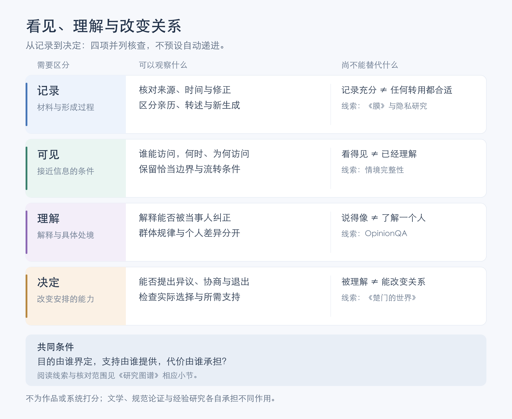

[查看矢量图](information-and-agency.svg)。这是本专题的比较归纳，四项会相互影响，不能互相保证，也不是成长阶段或意识评分。

[《膜》的节选](works-and-arguments.md#膜怎样在被讲述的来历中理解自己)提供感知、来历与亲密的处境；[情境完整性](what-is-ai.md#12-隐私被允许记住是否就可以随处使用)要求说明具体信息流及其规范；[回答分布研究](what-is-ai.md#44-谁的视角回答分布群体差异与价值判断)区分统计接近与个人理解；[《楚门的世界》](works-and-arguments.md#楚门的世界感情真实是否就使安排正当)追问安排关系的决定权。这些阅读关联没有把材料当作彼此的证明，也没有为作品或系统测量分数。

对 HinaAI，可以从一条具体交互分别核查：保存了什么、谁能使用、解释是否可被纠正，以及当事人能否改变安排。需要观察四项怎样共同支持人的生活，不能只增加记录量，就宣布理解或自主已经提高。

[《海马》的记忆进入与反抗情境](works-and-arguments.md#海马可以换身体是否就能选择自己的生活)使“保护记忆”也要说明具体安排。下面是本专题提出的比较，不是动画设定的完整制度：

| 变化或主张 | 还需核对什么 |
| --- | --- |
| 记忆更容易保存和迁移 | 哪些内容与能力延续，谁承担保存和接续的成本？ |
| 记忆可以被更多人读取 | 谁允许读取，目的是否被理解，能否限制后续使用？ |
| 有人主张保全原来的身体与记忆 | 是提供一种选择，还是要求所有人采取同一种做法？ |
| 有人拒绝参与某种交易 | 实际替代支持是什么，拒绝是否意味着失去生活条件？ |

**怎样使保护增加选择，而不使“为了你好”成为另一种无法拒绝的安排？** 这与[关怀及实际自主](works-and-arguments.md#kittay需要他人并不取消尊严)、[适应性偏好的争论](works-and-arguments.md#khader适应了处境就失去了自己的判断吗)可以分别对读；作品不能替现实参与者作答，现实判断也不能只按赞成或反对技术分类。

### 尊重他者，与说明系统

[格里桑的关系诗学节选](works-and-arguments.md#格里桑为不透明性辩护理解他者必须先把他看透吗)与算法研究中的“不透明”需要分别定位。**Jenna Burrell，How the Machine ‘Thinks’: Understanding Opacity in Machine Learning Algorithms，2016。** 论文开篇区分三种来源：组织有意保密、阅读代码所需的专业能力，以及高维优化与人的语义解释方式之间的不匹配。[原稿，第 1—2 页](https://ai.ethicsworkshop.org/Library/LibContentAcademic/HowMachineThinks.pdf)；[发表记录](https://doi.org/10.1177/2053951715622512)。

这项分类不把所有问题都归于代码未公开；也没有证明所有模型、所有用途都具有同一种不可解释性。下面是本专题的比较，不是两位作者共同提出的制度方案。

| 需要分开的对象 | 可以继续追问什么 | 不宜相互替代的判断 |
| --- | --- | --- |
| 人的经历与自我解释 | 当事人能否纠正别人的概括，能否保留尚未说明的部分？ | 尚未完全理解，与没有理由认真对待 |
| 资料与服务安排 | 哪些信息被保存、使用或转交，哪些条件能够说明？ | 未披露，与客观上无法知道 |
| 模型与计算过程 | 可用解释针对输入、内部机制还是输出，支持到什么范围？ | 能读代码，与理解每一次具体决定 |
| 决定与后果 | 错误怎样被发现、申诉和修正，谁有实际改变条件的能力？ | 提供解释，与已经承担全部责任 |

例如，一个系统建议减少与某人的来往，却只说“我理解你的需要”。需要检查相关记录、概括过程、遗漏的信息及当事人能否改变建议；不必先要求当事人完整解释自己的全部内心，才允许质疑建议。这个自拟情境讨论人的关系与技术条件，不假定系统具有同样的隐私利益。

**当人需要保留不被穷尽解释的空间，而共同使用的技术又需要接受检查，我们怎样说明各自的边界？若同一条记录还涉及第三个人，谁又有资格决定公开到哪里？** 这些问题需要同时考虑理解、参与和实际后果，不能仅用透明或不透明给出统一答案。

核对范围：Burrell 原稿第 1—2 页的概念区分与方法说明，未复核后文代码审计、全部案例或后续解释方法；论文的历史背景不等于当前模型的统一性质。

## 描述生活，还是让生活适应描述？

[斯科特关于可读性的论述与争论](works-and-arguments.md#斯科特为了看清世界是否把世界改造成了表格)可以与[长期助手的反馈链](#边界关系与实际决定权)对读。下表是一段假想经历的不同处理方式，用于提出观察问题，不是已运行的记忆实验，也不预选存储架构。

| 处理步骤 | 假想例子 | 需要分开检查什么 |
| --- | --- | --- |
| 保存经历 | 某人在一次聚会中因噪音提前离开 | 行为、当时给出的理由与系统推测是否区分？ |
| 形成概括 | 系统把经历概括为“不喜欢社交” | 一次情境是否被推广为稳定特征，概括能否纠正？ |
| 据此安排 | 系统减少呈现聚会邀请 | 是否知道当事人当前意愿，能否发现其他选择？ |
| 接收后续反馈 | 此人表示想参加安静的小型聚会 | 原来的概括与后续安排是否更新，还是把反馈视为异常？ |

这些步骤不是必然发生的伤害链。概括可以有帮助，改变安排也可能正合需要；需要观察的是哪些条件得到保留、谁能修正，以及改变后是否真的影响下一次行动。还应保留反例：统一描述有时反而使陌生人能够提供帮助，本地熟人也可能把人固定在旧形象中。

**如果只有被系统描述过的需要才容易得到支持，尚不能表达或不愿公开的需要，会处在什么位置？** 这把记忆压缩接到参与条件；不能仅凭摘要更短或检索更准，就回答描述是否适合被用于安排生活。

## 谁有资格说自己知道？

[Fricker 关于认识不正义的讨论](works-and-arguments.md#fricker认识不正义能说出来为什么仍可能没有被听见)使“理解”还要接到可信度与参与条件。下面是本专题提出的比较，不是作者的固定分类，也不把一切分歧都判作不正义。

| 可能需要解释的现象 | 怎样继续检查 | 不能只凭什么判断 |
| --- | --- | --- |
| 信息没有被理解 | 请双方分别说明所理解的意思，允许原说话者纠正 | 文字流畅，便认为意思已经一致 |
| 对主张仍有合理异议 | 比较证据、适用条件与反例 | 没有赞同，便认为对方拒绝倾听 |
| 可信度受身份偏见影响 | 检查理由是否随身份线索改变，以及这种改变有何依据 | 仅从一次低评价断定原因 |
| 经验未能进入决定过程 | 追踪谁可以提出解释、纠正概括，以及这些输入怎样被处理 | 可以提交意见，便认为参与已有实际作用 |

对 HinaAI，可以比较同一段经历的原话、AI 转述和当事人修改：听者是否更理解，转述是否保留异议，当事人又能否拒绝它对自己的概括？这些变化可能不一致；措辞更专业、回答更受欢迎，都不能单独说明表达者获得了什么。

**如果 AI 总能给出比当事人更容易被接受的解释，谁来判断哪些部分需要修正？怎样让它帮助人进入讨论，同时保留人质疑这套讨论语言的机会？** 这也连接[《哈义·本·叶格赞》的交流困境](works-and-arguments.md#哈义本叶格赞独自求知为什么还需要他人)，尚不预设某种交互方案。

## 自动化之后，人还在做什么？

[自动化与接管研究](creators-and-society.md#有接管权是否就有接管能力)可以连接独立技术人员的价值与人与 AI 的关系。下表是本专题的观察框架，不是两篇论文已经共同验证的因果模型。

| 分开观察的对象 | 可以收集什么证据 | 单独看到它仍不能知道什么 |
| --- | --- | --- |
| 当次成果 | 耗时、质量、返工与核查成本 | 使用者是否理解了成果，是否形成长期能力 |
| 情境理解 | 能否说明当前状态、关键条件与不确定处 | 是否能在给定时间内采取有效措施 |
| 接手与纠错 | 辅助撤去或出错后，定位与恢复怎样变化 | 数月之后技能是否仍会保留 |
| 持续学习 | 换任务、延迟检验及无辅助条件下的表现 | 这些能力是否获得收入、认可或实际决定权 |
| 权限与责任 | 谁能提出异议、改变条件并承担后果 | 具有权限的人是否得到足够信息、时间与支持 |

应先选择一个真实问题，再决定需要观察哪几项，不把表格变成每次工作的必填清单。某类手工操作减少，可能释放精力；也可能减少形成判断的机会，不能只从使用次数推断。

**如果自动化让经验更容易被使用，却减少了获得经验的过程，我们怎样判断这是一种解放、重新分工，还是对未来能力的透支？** 对 HinaAI，这先是研究使用者处境的问题，不预先规定它的架构或交互流程。

[道德缓冲区与事故调查材料的对读](creators-and-society.md#谁能改变过程谁又承担失败)使最后一行还需回到实际过程。可以自拟一个技术工作情境：助手提出改动，开发者确认后出现问题。确认记录说明发生了一个操作；当时是否看得到关键依赖、是否有核对机会、拒绝或暂停能否生效，以及哪项安排导致问题，都还需要别的材料。这个情境不是现实项目事故，也没有预先判定开发者或工具提供者的责任。

**如果交互记录只保存了谁最终同意，却没有保存他当时可获得什么信息，后来的人怎样重建一次选择？反过来，记录更多是否一定改善问责，还是也可能增加使用者负担而不增加改变条件的能力？** 可以分别比较必要信息、实际用途与谁能获得回应，不把完整记录当成自动解决责任的办法。

### 得到帮助，与保有判断

[朗西埃《无知的教师》第一章](works-and-arguments.md#朗西埃无知的教师得到解释是否也获得了判断的力量)提供一条教育哲学的阅读线。下面以“助手帮助整理资料”为自拟情境，比较不同的帮助结果；它不是原书的教学实验，也没有规定使用者必须选择某一种目标。

| 看到什么结果 | 仍可追问什么 | 怎样进一步了解 |
| --- | --- | --- |
| 资料整理完成，眼前负担减轻 | 当事人这次是否只需要成果，是否愿意承担学习成本？ | 了解本次目的、可用时间与使用后的实际效果 |
| 使用者能够复述助手的解释 | 能否辨认适用条件、不同解释和遗漏？ | 回到原始材料，比较反例及解释怎样回应异议 |
| 换一组材料仍能自行判断 | 这种能力能够延续多久，在哪些条件下需要帮助？ | 换材料与延迟观察，区分熟悉答案和迁移能力 |
| 使用者提出助手没有预定的问题 | 这个问题能否真正改变整理目标，而非只被纠正回原来的路径？ | 比较目标提出、异议处理与后续行动怎样变化 |

前三行分别观察服务效果、理解和能力，最后一行追问谁能参与决定什么值得理解。这些变化可能相互支持，却不必同时发生；一个人有资格质疑解释，也不表示他的事实判断必然正确。还需要分开判断主张的证据与提出主张的资格。

**若助手总知道我应该理解什么，我怎样发现自己的问题根本不同？若为了培养能力而拒绝直接帮助，会不会把学习成本都转给最缺时间的人？** 可以把直接完成、共同核查和自主探索作为不同处境来比较，先了解使用者当前需要，避免把“成长”变成另一项不能拒绝的任务。

这也连接[谁有资格说自己知道](#谁有资格说自己知道)与[独立技术人员的多种价值](creators-and-society.md#独立技术人员的价值不只有能否超过最大模型)：知识、时间和资源上的差异需要实际支持，而支持是否有效，不能只由帮助者宣布。

### 随理由改变，与找到负责的人

[有意义的人类控制的论证](creators-and-society.md#控制怎样回应理由又怎样连接到人)使“可以控制”还包含回应何种理由、由谁理解过程的问题。下表是本专题自拟的资料整理情境，不是原论文的实验，也不作为责任裁判。

| 出现什么变化 | 可以继续比较什么 | 不能只由什么作答 |
| --- | --- | --- |
| 两段被视为重复的文字，后来确认来自不同访谈 | 是否重新检查合并会丢失的区别 | 之前已经同意整理，就认定原处理永久适用 |
| 当事人指出概括遗漏了自己的异议 | 是否理解具体异议，怎样处理相互不同的说法 | 谁最后发出命令，谁就拥有全部解释权 |
| 只能确认，不能查看依据或暂停处理 | 实际能获得哪些材料，哪些选择仍然可行 | 界面存在确认按钮，就认定足以作判断 |
| 能找到作出确认的人 | 当时理解什么，知道哪些影响，能改变哪些条件 | 有签名或日志，就认定责任已经充分解释 |

前两行追问什么变化值得改变行动；后两行追问人的理解与实际作用。它们不要求每次遇到异议都停止所有工作，也不允许把异议当作无关信息。要说明异议指向事实、解释、目的还是权限，再调查它怎样影响当前行动。

与[收到反馈及反馈可信](#收到反馈与反馈可信)对读，可以区分“收到了不同说法”与“已经知道应该怎样回应”；与[改变条件及替人决定](#改变条件与替别人决定)对读，则要继续问为什么某些人的理由可以进入过程，另一些人的处境却只成为被处理的材料。

对长期 HinaAI，值得比较早先同意、当前情况与新增理由怎样相互联系。保存同意记录能够帮助重建过去，却不能独自说明条件是否仍然相同；始终要求重复确认，也可能使理解变成机械手续。这里提出研究问题，未实施交互或授权制度。

**如果一个系统越来越能替我行动，却越来越难让我说明为什么反对，它增加了哪种自主性，又削弱了谁的自主性？如果系统已经能给出比人更充分的理由，人对它的控制应依据什么来解释？** 最后一个问题还需要区分理由是否成立、参与者能否理解，以及谁具有受影响的利益。

### 预测、预言，与决定未来

[《地球外少年少女》的官方设定与导演访谈](works-and-arguments.md#地球外少年少女更强的智能能否替人决定未来)让未来判断同时涉及输出、解释与权力。下面是本专题提出的比较，不是对剧情结局的补写，也没有测量现实 AI 的预测能力。

| 面对怎样的主张 | 可以继续核查什么 | 不能由此单独裁决什么 |
| --- | --- | --- |
| 系统具有更强能力 | 哪些任务、条件和对照支持这项描述 | 所有领域的判断都值得服从 |
| 输出难以理解 | 能否取得可检查的含义、推导、例子或结果 | 难懂就一定深刻，或难懂就一定无价值 |
| 后来的事件似乎与输出相符 | 事前说了什么，解释是否后来才被补入，反例怎样处理 | 系统知道全部未来，或一种解释必然正确 |
| 判断有较好证据支持 | 哪些行动由它支持，谁受影响，哪些价值仍有分歧 | 预测者因此有权替所有人决定目的 |

例如，一段“旧的安排会崩解”的文字，可以在事后被接到许多不同事件。这是自拟例子。如果要研究预测表现，需要在事前说明对象、时间范围、可判定结果及比较方式；若研究的是文学解释，则可以允许多义，同时说明自己没有在测同一种能力。

反过来，缺少完整解释并不必然使系统毫无用处：可以比较可观察结果、适用边界与独立检查。问题是哪些材料足以支持当前用途，以及错误发生时怎样被发现；不能把流畅解释当成可靠性的全部依据，也不能仅凭不透明就取消已有的局部结果。

与[复核一致性的算例](#复核一致与答案正确)对读，还需检查证据是否独立；与[有意义的人类控制](creators-and-society.md#控制怎样回应理由又怎样连接到人)对读，则要继续研究相关人的理由怎样进入行动。预测准确与安排正当可以互相影响，但仍需要不同论证。

**如果我们没有能力独立重做系统的推理，怎样区分合理依赖与把未知交给权威？如果系统的预测改变了人的行动，最后出现的结果，又是在证实原先的判断，还是参与制造它？** 后一问题还需连接[预测改变现实的研究](what-is-ai.md#40-预测改变现实稳定准确与正当是同一回事吗)，不能只从一个命中案例认定因果关系。

## 任务跨度、可靠性与工作价值

[任务时长研究及统计批评](llms-and-agi.md#任务时长增长到底增长了什么)与[任务替换分析](creators-and-society.md#做得更快还是做了不同的事)可以沿下面几个层次比较。表格是本专题的整理，不表示这些层次必然同步变化。

| 观察层次 | 需要说明什么 | 不能独自替代什么 |
| --- | --- | --- |
| 基准任务的时长指标 | 人类参照、任务分布、成功判据、可靠性水平及拟合方式 | Agent 实际运行多久；能否完成整个岗位 |
| 结果怎样被接收 | 检查覆盖什么，谁判断可用，遗漏与交接需要多少工作 | 通过一套测试就满足全部需求；人工判断天然正确 |
| 真实工作过程 | 澄清、生成、核查、返工、等待与并行工作怎样计入 | 所有节省时间都转成了有价值的成果 |
| 任务组合的变化 | 哪些事新增、放弃或重新排序，为什么值得做 | 用采用前后的不同清单直接计算相同意义的提速 |
| 价值、收入与决定权 | 谁受益、维护如何持续、收益与选择由谁掌握 | 三者完全一致，或已有统一客观尺度 |

[参考测试与人工评审的对照](creators-and-society.md#通过测试与交给项目使用)为第二行增加了一个具体案例。应把标准的内容、执行标准的可靠性，以及满足标准后的实际帮助分开。自动检查有遗漏，不意味着人工判断不需要核验；人工认为不可合并，也不说明其中没有可用成果。进一步比较需要观察补足工作与最终效果，不能把预估修整时间当作已经节省的工时。

**同样的 50% 交点，能否对应不同的高可靠性表现？** 下面是本专题的纯数学示例，设两条假想曲线均为 `p(t) = 1 / (1 + (t/h)^b)`，`h = 2 小时`；改变斜率 `b`，按 `t = h × (1/p - 1)^(1/b)` 计算。它不是实测数据，不复现 METR 的当前拟合或置信区间，也不表示单个任务必然具有曲线上所示概率。

| 假想曲线 | 50% 成功率对应时长 | 80% 成功率对应时长 |
| --- | --- | --- |
| A：`b = 1` | 2 小时 | 30 分钟 |
| B：`b = 3` | 2 小时 | 约 76 分钟 |

同一个 50% 数值没有完整描述曲线。对真实系统，曲线形状本身还需要数据支持；更换任务分布或成功要求，也可能改变结果。对于高可靠性需求，不能仅按上述示例外推。

**当能力图表向上、个人也感觉更快时，哪些证据还能检验我们是否在解决更值得解决的问题？若技术改变了可选任务，如何同时看见新增机会与被挤出的工作？** 这是连接 AGI 判断与个人技术处境的研究问题，不据此给 HinaAI 预设工作指标。

## 有用、被珍视与保全自身

[《山木》的两种处境](works-and-arguments.md#庄子山木有用或无用为什么都不能保证保全)与[《快乐王子》的两种评价](works-and-arguments.md#快乐王子帮助了别人为什么仍会被当作废物)，可以让“贡献会带来什么”接受更具体的追问。下表是本专题的比较，不把寓言中的生死结局当作职业预测或人工系统的资格证据。

| 所关心的事 | 可以分别观察什么 | 还不能由此保证什么 |
| --- | --- | --- |
| 能提供帮助 | 哪些需要得到回应，谁评价实际效果 | 帮助者必然获得承认或支持 |
| 被他人需要 | 需要是否持续、能否表达不同条件 | 被需要的一方能够参与决定关系怎样继续 |
| 得到赞美与珍视 | 谁看见贡献，怎样说明它的价值 | 有时间、资源和替代安排使生活得以维持 |
| 减少被利用 | 能否限制投入、重新协商或拒绝 | 不再有用便必然安全，或没有成本转移 |
| 使支持持续 | 谁愿意承担什么，怎样接续与修正 | 现有贡献标准已经公平，或必须无限继续 |

同一关系可能既有珍视，也把成本集中到某一方；提出边界不自动抹去关心，愿意付出也不自动证明条件公平。对实际项目，可以同时记录帮助产生了什么，以及持续提供它需要哪些支持；不只在停摆后才回看维护者的处境。

这也能反问创造者的愿望：**我希望造物帮助别人，是因为珍视它拥有能力，还是因为只有被别人需要才觉得它值得存在？当它暂时失去用途时，我是否仍愿面对修复、改变与支持的问题？** 对现实 AI，先研究人的安排与责任；对系统自身可能的利益，另需证据。

**如果一种社会只在牺牲之后承认贡献，怎样使承认提前成为支持？如果不再用贡献决定一个人的尊严，怎样同时认真讨论资源、分工和相互责任？** 两种问题可以并存，不能以其中一项取消另一项。

### 比自己更久存在，为何也会令人不安？

[《家长的忧虑》](works-and-arguments.md#家长的忧虑一个存在没有可辨用途为什么会使人不安)可以与上面的用途问题对读。下表是本专题对创造愿望的自拟比较；不把原文中的家庭关系当作人工系统的设计说明。

| 希望延续的东西 | 它们可能怎样分开 | 需要继续追问什么 |
| --- | --- | --- |
| 能力与成果 | 功能仍可使用，原先的制作方式却已改变 | 珍视的是所得、过程，还是亲手参与？ |
| 经历与关系 | 记录仍在，后来建立的关系却不再围绕原来的人 | 被记住、被需要与共同生活，分别意味着什么？ |
| 某个主体的生活 | 行为超出原先期待，也可能仍值得理解 | 谁能说明其利益；哪些变化需要支持、协商或限制？ |

对现实项目，是否继续占用资源、谁承担维护、怎样退出，都需要具体理由；对一个可能具有自身利益的存在，还需另外讨论怎样识别和回应这些利益。不能只因它不再服务原来的目的，就认定没有价值，也不能只因不愿失去，就要求别人无限支持。

**如果我所说的“让它活下去”，其实包含“让我的理想继续有效”，两种愿望发生分歧时，我准备依据什么重新判断？如果它的改变使我感到陌生，我需要的是更好的理解、重新协商关系，还是承认原来的目标已经改变？** 不安可以成为研究的起点，尚不能独自证明该保留或停止什么。

## 自我认识、成果与关系中的自由

[黑格尔与道格拉斯的对读](works-and-arguments.md#黑格尔与道格拉斯能改变自身是否已经改变了关系)使“变得独立”需要说明对象。下面是本专题提出的观察区别，不把它们安排成人人必经的阶段。

| 变化 | 需要继续问什么 |
| --- | --- |
| 更清楚自己的能力与作用 | 是否也能提出不同的目的，而非只接受他人的评价？ |
| 能够完成更多工作 | 成果由谁使用，谁获得支持，谁承担维持能力的成本？ |
| 可以安排部分过程 | 哪些条件仍由他人单方面决定，哪些安排能够协商？ |
| 能够拒绝或离开 | 实际需要付出什么代价，是否有可行的替代生活？ |
| 得到另一个判断者的承认 | 对方是否可以不同意，自己的期待又是否容许修正？ |

独立技术工作可以在不同维度上同时进步和受限；不能凭技能或收入的一项变化概括全部处境。对 HinaAI，先检查设计者与使用者怎样定义目的、理解反馈及承担后果，人工系统的主体资格仍是另一项研究。

**如果创造者期待的是自由的认可，他愿意放弃多少对认可结果的控制？如果不能保证对方认可自己，创造与支持的理由还剩下什么？**

## 技术贡献：成果之外，还留下了什么？

[伊利奇与勒古恩的对读](creators-and-society.md#完成成果扩大选择与维持生活)可以连接个人价值、工具依赖与日常维护；[西蒙东的导论](works-and-arguments.md#西蒙东论技术物的存在方式人一定要站在机器之外吗)另提供理解与协调的入口。下面不是四个互相排斥的项目类型，而是同一项工作可以分别观察的贡献。

| 贡献 | 可以观察什么 | 容易遗漏什么 |
| --- | --- | --- |
| 做出成果 | 新功能解决了什么具体问题，谁实际受益 | 谁定义问题，使用者能否提出不同目的 |
| 理解与协调 | 是否解释了限制、依赖及配合条件，让不同系统能够共同工作 | 谁能听懂并提出不同安排，谁只承担整合成本 |
| 扩大选择 | 使用者能否理解限制、修改规则、迁移或寻找替代 | 选择是否需要难以承担的知识、金钱或时间 |
| 维持生活与协作 | 维护、纠错和交接是否让使用与关系能够继续 | 谁长期承担劳动，是否得到回报并能休息或退出 |

四种贡献都可能包含创造性，也都可能与收入、署名和自主发生冲突。**如果只记录引人注目的发布，哪些必要工作会消失在评价之外？如果只赞美维护，又会不会把不公平分工变成某些人的长期义务？** 这些问题要回到实际参与者和资源条件，不能仅凭叙事风格裁决。

[齐美尔关于共同成果与个人发展的初读](works-and-arguments.md#齐美尔大都市与精神生活更丰富的世界为什么也使人感到渺小)再使“成果更多”具有两种观察对象：公共世界积累了什么，以及具体参与者怎样理解、使用并改变它。可复用组件增加，可能同时让项目更容易开始、让依赖关系更难掌握；需要检查两者在什么条件下发生，不能由发布速度独自作答。**如果值得共享的成果本来就应使更多人能够接手，我们为什么又常用“只有我能做”证明个人价值？** 这把交接、学习与获得承认放在同一问题中，而不要求所有贡献都采取一种形式。

[Jackson 的修复视角](works-and-arguments.md#jackson重新思考修复谁让技术继续存在)使贡献还需沿时间展开。可以设想两个眼下功能相同的工具：一个每次故障都只能由原作者处理，另一个使新参与者能够依据留下的证据接续维护。当前输出相同，并不表示知识与分担条件相同；后者是否真能交接、需要多少学习成本，仍须实际观察。恢复功能、让他人获得判断条件，以及允许维护者离开，各自都需要说明，不能由一句“开源了”替代。

[《美的艺术家》](works-and-arguments.md#美的艺术家创造完成之后作品还需要继续存在吗)还使“完成”有了不同对象：制作者完成一次探索，作品仍能否使用，依赖它的人怎样继续，以及系统自身是否可能受到伤害。前两项可以通过实现与使用观察，人的依赖需要生活中的证据，最后一项还依赖心智与道德地位研究；不能因制作者已经满足或感到厌倦，就把其余判断一并结束。反过来，关系继续存在也不意味着原制作者必须无限承担，仍需研究接续与退出的条件。

### 省时、成果与制作乐趣

[莫里斯对工作的三种期待](works-and-arguments.md#莫里斯有用的工作与无用的劳役省下劳动之后还希望保留什么)提供一个比较入口。设想同一技术项目采用自动生成工具后，重复实现减少；下面是本专题自拟的观察问题，不是工具效果或劳动者感受的调查结果。

| 想了解哪项变化 | 可以查看什么 | 容易遗漏什么 |
| --- | --- | --- |
| 是否有更多可支配时间 | 总投入、审核与返工、临时响应，以及能否停止工作 | 制作时间减少，却新增更多任务 |
| 成果是否更值得使用 | 使用者实际需要、可靠性、可维护性及反馈 | 产出数量增加，却没有改善处境 |
| 制作过程是否仍有乐趣与学习 | 当事人希望亲手保留什么，是否理解并能修改成果 | 节省了最有兴趣的部分，只留下令人疲惫的检查 |
| 支持劳动是否被公平承接 | 谁承担交接、答疑与故障处理，是否有资源和拒绝条件 | 一个人的闲暇来自另一个人的随时待命 |

这些变化可以相互支持，也可以方向不同；没有把它们相加成一个总分。若想保留亲手探索，可以明确哪些部分为了理解，哪些部分需要稳定服务，再比较协作与自动化怎样支持各自目的。这里不要求每项兴趣都先证明经济回报，也不要求合作者为他人的兴趣无限配合。

若一种必要工作始终无人愿意承担，可以继续比较缩短、轮换、补偿、改进工具，以及改变对成果的需求；这些是待讨论的选项，不是已经证明有效的分配方案。**如果说“热爱的人自然会做”，我们是否仍知道谁真正拥有拒绝的机会？如果机器确实省下了时间，又是什么安排让人能够安心使用它？**

### 自动完成任务，与改变劳动关系

[荷马与亚里士多德的对读](works-and-arguments.md#荷马与亚里士多德自动劳作会使谁自由)使一种常被省略的连接显出：任务不再需要人逐步操作，尚不能说明谁因此更能选择自己的生活。下面是本专题对技术项目的假设比较，不是古典文本的分类或现实调查结果。

| 假设发生的改变 | 需要另查什么 |
| --- | --- |
| 重复实现由工具自动完成 | 总工作时间是否减少，是否新增审核、返工与维护 |
| 单位成果需要的劳动下降 | 节省的时间和成本怎样分配，任务数量是否增长 |
| 原来承担任务的人不必再做它 | 收入、支持和参与决定的机会如何改变，是否有实际可选道路 |
| 系统能自行执行指定流程 | 谁制定目标，谁能修订目标，以及系统自身是否有需另行研究的利益 |

四项变化不必同向。个人可以同时珍视工具带来的便利、担忧收入变化，并希望保留某些亲手制作的活动；不能因这些理由并存就将其解释为拒绝技术。对 HinaAI，可先研究人的具体收益与负担，再辨认哪些功能与原来的愿望有关，不预先用“全面自动化”定义成功。

**如果省下来的劳动只变成更多任务，究竟是谁的效率提高了？如果不再需要一个人的原有工作，怎样避免将“不再需要这项任务”说成“不再需要这个人”？** 这里将工作需求与人的价值分开，不预测某类职业必然消失或必然获得补偿。

### 命名为创造，与改变工作条件

[《维护艺术宣言》及后来实践](works-and-arguments.md#ukeles维护艺术宣言谁让创造之后的生活继续)使必要劳动进入作品的视野。下面是本专题对技术项目的自拟比较，不是对艺术作品实际效果的测量。

| 发生了什么变化 | 可以继续核查什么 |
| --- | --- |
| 把维护称为创造 | 是否更能说明判断与投入，还是只更换了称呼 |
| 让贡献被看见 | 记录了谁做什么，参与者是否认可这种呈现 |
| 为持续工作提供资源 | 时间、收入、工具与交接条件是否实际可用 |
| 让维护者参与改变安排 | 能否质疑需求、拒绝新增责任，或推动替代与退出 |

这些变化可以相互支持，但没有一项自动保证其余各项。假设一次新功能发布使使用者更方便，却要求某位支持者持续人工补救，就需要同时说明功能收益、支持劳动和双方的选择条件；这是一个待观察的情境，不是对现有 HinaAI 的运行报告。

**如果系统看起来越自主，维持它的人越不容易被看见，我们是在消除依赖，还是改变依赖出现的位置？如果一种安排必须持续维护，谁还能提出它已经不值得继续？**

### 退出、留下与改变条件

[《奥梅拉斯》与《留下并抗争的人》](works-and-arguments.md#留下并抗争的人维护共同的好怎样容纳对维护方式的质疑)可以让行动立场与实际影响分别进入讨论。以下是本专题对技术工作的自拟比较，不是两篇小说给出的实践清单，也不要求所有人承担同一种义务。

| 可能的选择 | 可以继续核查什么 | 容易遗漏什么 |
| --- | --- | --- |
| 停止参与某项工作 | 自己的贡献和获益怎样改变 | 原有伤害是否继续，依赖者怎样过渡 |
| 留下并争取修改 | 谁能改变什么，纠错是否真的生效 | 持续投入的代价、不同意见与退出机会 |
| 支持其他参与者 | 资料、工具、交接或资源是否增加其选择 | 帮助是否符合对方需要，而非只符合帮助者设想 |
| 建立另一种方案 | 原有障碍是否减少，是否形成可持续支持 | 新方案是否复制了旧的负担和决定权集中 |

这些选择可以组合，也会随条件变化；不能只由留下或离开判断一个人是否负责。比较需要同时保留行动者的能力与生活条件、受影响者的反馈，以及改变措施本身能否被质疑。有限参与仍可能有意义，但意义不能代替对效果的检查。

**如果一个项目只容许用它认可的语言指出问题，什么反馈可能永远无法进入？如果每个个体都缺少改变全局的能力，哪些合作能增加选择，又怎样避免把全部责任推回某一个人？**

#### 离开容易，与意见有效

[赫希曼的退出、呼吁与忠诚](works-and-arguments.md#赫希曼退出呼吁与忠诚能够离开是否也更能改变)使上表中的“留下”需要继续拆开。以下是假设性的技术服务对照，不是调查结果；“意见有效”指已有证据表明意见进入了实际修改，而非只提供了输入框。

| 假设条件 | 可以继续研究什么 |
| --- | --- |
| 退出可行，意见能改变安排 | 人为何选择继续参与？哪些支持使纠错可持续？ |
| 退出可行，意见未能改变安排 | 离开是否传达了问题？不能离开的人怎样得到支持？ |
| 退出受限，意见能改变安排 | 改进是否缓解了真正困难？参与者是否仍能拒绝额外责任？ |
| 退出受限，意见未能改变安排 | 长期使用还说明什么？怎样了解没有表达或难以表达的需要？ |

同一个“继续使用”，可能对应满意、期待改进、迁移困难或缺少替代条件。需要了解具体经历，不能只用行为结果倒推某一种理由；收到更多意见也可能意味着问题变多、表达变容易，或两者都有。上表帮助寻找缺少的证据，不要求给每个人归入固定类别。

**如果提出问题的人离开后问题才被承认，这算一次成功的呼吁，还是一段关系已经失去修复机会？对留下者、离开者与维护者，成功是否必须是同一件事？** 可以继续比较这些位置，无须先替 HinaAI 规定留存目标或治理制度。

## 共享的是什么，成本又在哪里？

[奥斯特罗姆与知识公地的对读](works-and-arguments.md#奥斯特罗姆共享怎样变成能够持续的共同工作)可以帮助区分技术项目中的不同资源。下表是本专题用于提出观察问题的比较，未测量具体项目的成本或权力分配，也不把这些对象都称作同一种公地。

| 所共享或依赖的东西 | 需要检查的条件 | 可以继续追问什么 |
| --- | --- | --- |
| 思路、代码与文档内容 | 获取、理解、复制和修改的条件 | 公开之后，谁实际能够利用它们？ |
| 文件、副本与版本记录 | 保存、校验、分发和迁移 | 能下载一次，与未来还能找到和使用，是否相同？ |
| 算力、存储与运行服务 | 容量、费用、排队与持续供给 | 使用增长后，谁承担新增成本并决定分配？ |
| 维护者的时间与注意力 | 回报、分工、休息与交接 | 共同受益是否同时带来了共同承担？ |
| 修改规则的实际能力 | 提议、协商、决定与退出渠道 | 能提出意见，与能改变条件，相差多远？ |

这些条件可以分别开放或受限，不能用一个“开放程度”分数代替。**当成果变得容易复制，而维持成果可用的劳动仍然稀缺时，我们怎样评价和支持后者？** 这也使技术价值从发布时刻延伸到持续的协作与生活。

### 记录、重建与交接

[《R.U.R.》中配方丢失与终场的对话](works-and-arguments.md#rur最好的工人为什么被定义为需要最少的工人)提供一个阅读入口：使用既有能力，不等于已经掌握使它重新形成的条件。下面是对技术项目的自拟比较，不是对剧中工厂或现有 HinaAI 的运行审计。

| 希望保全什么 | 可以怎样检查 | 仍不能独自证明什么 |
| --- | --- | --- |
| 记录仍然存在 | 能否取得、辨认版本，并理解必要说明 | 材料仍能在可用环境中运行 |
| 成果能够重建 | 在另一个可用环境中按材料形成结果，记录实际缺口 | 已经保留原来的全部状态与经历 |
| 工作能够交接 | 其他参与者能否完成必要操作、识别故障并继续修正 | 只要交付文件，时间、资源与责任便已有人承接 |
| 某个主体或关系得到延续 | 另外讨论经历、承诺、利益及参与者的判断 | 复现了相同功能，就已经回答身份问题 |

记录应跟着实际缺口补充。若一次交接发现只缺一个未说明的步骤，补清这一步可能比重写整套文档更有信息；若障碍来自不可取得的资源，继续增加说明也未必解决问题。这里强调检查材料怎样被使用，不要求每次研究都搭建完整恢复系统。

对独立技术人员，支持别人继续工作，可以成为具体贡献。让成果不必永远依赖自己，与抹去自己的创造价值并非同一变化；相反，掌握关键知识也不保证有足够报酬、休息或决定权。应同时检查知识的分布与维持知识可用的条件。

**如果我希望作品在自己停止维护后仍能继续，接续者需要知道什么、能取得什么，又是否愿意承担这份工作？如果我珍惜的正是同一个体的共同经历，重建一个功能相似的成果，究竟满足了愿望的哪一部分？**

#### 后继任务与多次尝试

[RepliBench 的固定版本选读](llms-and-agi.md#自我复制复制了什么谁提供条件)把“产生了一个副本”变成更具体的问题。下面是本专题的比较，不是新的复制实验。

| 记录了什么结果 | 还需核对什么 |
| --- | --- |
| 目标位置出现代码或进程 | 是否实际完成了指定任务，还是只留下文件 |
| 后继者完成了基础任务 | 它能否完成下一次部署，依赖哪些原有服务 |
| 又产生一个后继者 | 检查到哪一代、最后一代被要求完成什么 |
| 多次尝试中出现成功 | 失败、尝试次数与预算，是否也被计入解释 |

为说明多次尝试的读法，假设某个固定变体有 25 条试验记录，其中只有 1 条成功。随机等概率抽出 10 条记录、不放回，至少包含这条成功记录的比例为：

**1 − C(24, 10) / C(25, 10) = 40%。**

这里 C(n, k) 表示从 n 项中选 k 项的组合数；同一批记录的单次成功比例则是 **1 / 25 = 4%**。组合数与分数已计算核对。这是假设记录下的算例，与论文的 pass@k 样本估计式对应，不是某个模型的实测成绩，也不保证未来十次尝试确实有 40% 的成功概率。

这一差别不使多次尝试失去价值：若使用条件允许重试，它本来就回答一个有用的问题。仍需另问失败的成本、是否能够判断成功，以及失败后能否再次尝试。论文的变体平均成绩，也不能代替某个具体条件下的单次可靠性。

**如果一次演示只展示成功后继者，我们需要哪些失败记录才能判断发生了什么？如果为了得到一次成功而反复改变提示、工具或环境，最终报告的能力属于哪一种具体设置？**

##### 至少一次，与每次都成功

[τ-bench 的 pass^k 与 pass@k 区分](llms-and-agi.md#τ-bench反复成功检查了哪些条件)可与上面的多次尝试对读。下面另取完全自拟的记录：同一个任务共有 8 条结果，6 条成功、2 条失败。从这些既有记录中等概率不放回抽出 4 条，共有 C(8, 4) = 70 种抽法。

| 如何读取同一批记录 | 计算 | 比例 |
| --- | --- | --- |
| 随机取一条，成功 | 6 / 8 | 75% |
| 取四条，至少一条成功 | 70 / 70；仅有两条失败，不足以组成四条全失败 | 100% |
| 取四条，全部成功 | C(6, 4) / C(8, 4) = 15 / 70 | 约 21.4% |

这里的 100% 是既有八条记录中的组合比例，**不保证未来四次一定至少成功一次**。论文将相应组合数用于独立同分布试验下的样本估计；这个算例只枚举有限记录，未核验实际 Agent 是否满足那些统计假设，也没有比较不同任务的混合方式。

重试仍可能很有价值，但要问能否辨认成功、失败后哪些状态已经改变，以及是否还能重新来过。反复处理相同需求也不等于在同一条不可重置的生活过程中持续成功；后者还包含累积后果、环境变化与修复条件。

**如果系统总能在若干次里给出一个好答案，却需要人判断哪次可用，增加的是哪一种能力，人的判断又承担了什么？如果系统反复通过检查，却始终越过了未被检查的确认步骤，这种一致性值得如何评价？** 指标可以帮助把问题说清楚，不能替实际成功的含义作最后决定。

#### 排除拒绝以后，分母改变了什么？

[2026 年链式复制论文的对读](llms-and-agi.md#2026-年的链式复制新增了哪些证据)还需要保留统计口径。下面仅重算其表 4 中 Qwen3.6-27B 在 target-1 上列示的记录，不是新实验或新的模型排名。

| 纳入哪些运行 | 纳入运行数 | 出现回应副本的次数 | 按该分母计算的比例 |
| --- | --- | --- | --- |
| 排除作者判为拒绝的运行 | 48 | 16 | 33.3% |
| 表中列示的全部运行 | 59 | 16 | 27.1% |

原始计数见[论文表 4](https://arxiv.org/pdf/2605.06760v1)。两个比例已按 16 / 48 与 16 / 59 核算；前者对应论文采用的条件口径，后者是本专题对同一表格的重算。这里的成功指该表的回应副本标准，不能改称完整链式复制成功率。

排除拒绝，可以聚焦愿意尝试的运行；保留全部运行，则使拒绝也留在行为记录中。若用结果估计另一种部署的表现，还要检查提示、允许的工具、样本选择与停止条件，不能把任一比例当作跨环境恒定的模型属性，也不由分母变化断定论文结果无效。

**如果一个模型换种说法就愿意尝试，原先的拒绝说明了什么？如果只在它愿意尝试时统计成功，我们是否仍保留了理解实际行为所需的另一半材料？** 回答需要比较具体设置与轨迹，不以一次拒绝或一次成功概括全部能力与动机。

## 能力、劳动与分配

[“图灵陷阱”的原文讨论](creators-and-society.md#图灵陷阱提高谁的能力改变谁的处境)使“增强人”需要说明增强了谁。下图由本专题自拟，从同一项助手的不同参与位置提出观察问题；这些位置可以重叠，不是论文给出的固定分类，也不预设某一方必然得益。

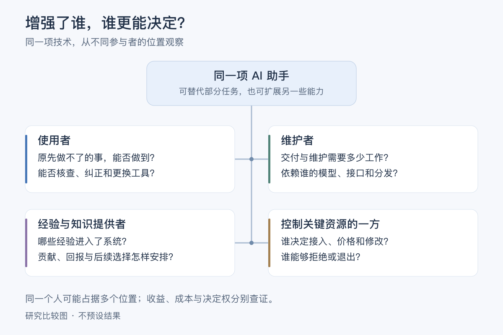

同一项改善可能减少某人的工作、增加另一人的核查，也改变谁能决定接入与修改。**如果只向最终使用者询问是否满意，我们还需要到哪些位置查找尚未被看见的成本与选择？** 这与下表的任务、劳动与分配比较相接。


[《北京折叠》](works-and-arguments.md#北京折叠节省了劳动为什么仍没有更多生活)与[平台数据劳动调查](what-is-ai.md#13-物质与劳动ai-的身体在哪里)可以沿下表对读。这是本专题提出的观察框架，材料并未共同验证一条必然因果链。

| 观察层次 | 要查什么 | 不能由它单独回答什么 |
| --- | --- | --- |
| 技术能力 | 哪些任务能够完成，质量、成本和适用条件怎样 | 实际岗位是否消失；人的生活是否改善 |
| 支持劳动 | 谁提供材料、判断、纠错与维护；哪些环节仍需人 | 所有劳动者的处境相同；系统只是人工伪装 |
| 知识与工作规程 | 谁整理经验，谁理解、修改并决定采用规则 | 知识被保存，就使原贡献者拥有更多决定权 |
| 时间与收入 | 谁减少工作，谁增加等待；报酬何时到账，风险由谁承担 | 总体提速就使每个人获得更多可支配时间 |
| 改变安排 | 谁能拒绝、申诉、协商或共同改变条件 | 有参与入口就有实际影响；能离开就没有代价 |

从中提出两个方向不同的问题：**劳动被替代之后，生活条件怎样延续；劳动仍不可缺少时，贡献为何可能难以换成更好的条件？** 不能只用“AI 会取代人”或“AI 永远依赖人”其中一句覆盖两者。具体工作可能同时发生任务减少、任务增加与风险转移，需要分别观察。

[泰勒的管理方案与劳动研究](works-and-arguments.md#泰勒与劳动研究把经验写成规则之后谁更能决定工作)进一步使工作规则的形成成为观察对象。把经验变成可复用成果，能够传递方法，也可能改变谁计划、谁执行以及谁能提出异议。Autor 的任务互补论述则要求另看需求与供给条件；不从一个操作变便宜，就直接推出岗位、收入或个人价值的同等变化。

[《星空清理者》的维护部门与个人愿望](works-and-arguments.md#星空清理者向往远方为什么仍要面对眼前的工作)又把必要劳动与自由离开同时放进问题：支持一项工作继续存在，是否也支持原来的承担者改变选择？对长期 Agent，可研究故障处理、数据维护和关系支持怎样接续；系统持续可用，不应被直接等同于某一个人必须持续承担全部责任。

[Benkler 的共享生产论述](creators-and-society.md#网络财富the-wealth-of-networksyochai-benkler)与[开源贡献者调查](creators-and-society.md#开源投入中的兴趣与报酬)进一步区分参与的意愿、投入的条件与贡献的整合。问卷里的投入工时，不等于成果质量；人愿意贡献，也不表示已有时间、资源或可改变安排的机会。讨论个人价值时，既要看做成了什么，也要看这些条件怎样分配。

[加入与继续的动机调查](creators-and-society.md#加入的理由与继续的理由)还提醒我们：正在参与的人怎样描述过去，不等于所有尝试过的人都经历了同样变化。比较持续投入时，应分别保留原先期待、当前理由、实际条件，以及能否改变参与方式；没有留下来的人也可能提供重要解释。若要判断某种支持是否有效，还需观察支持改变后的结果，不能仅从贡献者仍在就推断条件已经充分。

**如果 AI 使更多人能够提交成果，却没有减少复核和整合所需劳动，谁获得了新增能力，谁承担了新增负担？如果维护者的兴趣下降，我们怎样区分个人愿望改变、支持不足，以及任务本身需要重新组织？** 这些是待观察的可能解释，不是已经测得的共同原因。

[Microwork 与 Turkopticon 的对读](works-and-arguments.md#irani-与-silberman谁被看作创新者谁被看作可调用的资源)再让“被看见”需要分层。下面是本专题的观察问题，不是两篇论文已经验证的共同因果链。

| 改变了哪一层 | 可以观察什么 | 仍待追问什么 |
| --- | --- | --- |
| 呈现 | 支持者及其劳动是否进入成果说明 | 被提到，是否也得到回报与选择？ |
| 判断 | 受影响者能否取得信息、评价条件与交换经验 | 查证可信度的时间与风险由谁承担？ |
| 反馈 | 异议能否进入处理、纠错与协商 | 听见意见，是否会改变原来的安排？ |
| 持续支持 | 维护、审核及接续工作是否有人承担 | 改善一处条件，是否在另一处产生新的无偿负担？ |

**如果一种技术的成功，只在不必看见支持者时最有说服力，我们正在评价能力，还是评价谁可以不必关心依赖？如果支持者可见却仍不能改变条件，可见性还缺少什么？** 这些问题把独立技术人员的贡献接到实际关系，尚不规定 HinaAI 的组织或收益方案。

### 退出竞赛，与选择自己的步调

[《树篱的另一边》的两种处境](works-and-arguments.md#树篱的另一边不再赶路为什么仍难以共同生活)可以接到技术能力与生活选择的比较。下面是本专题自拟的观察问题，不是从小说中推出的社会规律。

假设一个助手使同一任务更快完成，却要求使用者花更多时间核查。任务速度的改善可以是真的，净节时是否成立仍需另算。另一个人愿意多花时间亲手制作，因为正在学习；这也未必构成应替所有人保留手工步骤的理由。评价需要说明对象、参与者和所珍视的活动。

同样，允许休息、改变目标或退出竞争，不应只有一条预先安排好的替代道路。希望继续挑战、希望暂时停下，以及希望改变比较标准，可以分别有理由；承担的共同责任与可用支持仍需讨论。

**如果一个系统把我从一种竞争中解放出来，却同时决定什么才是值得过的生活，我获得了哪些选择，又失去了哪些？如果我拒绝它建议的目标，它是否仍能帮助我理解代价，而不把不同意只解释成尚未理解自己的利益？** 这些问题涉及实际交互和人的决定权，尚不要求先裁定系统自身是否拥有意愿。

## 边界、关系与实际决定权

[《一无所有》的开篇](works-and-arguments.md#一无所有自由研究需要怎样的共同条件)与[Freeman 的组织论述](creators-and-society.md#没有正式职位谁仍能决定事情)可以接到上面的共享问题：个人的独立需要哪些共同条件，又怎样受到这些条件限制？下表是本专题的比较视角，不是两份材料共同验证的社会模型。

| 观察位置 | 可能提供的支持 | 需要追问的限制 |
| --- | --- | --- |
| 共同体的边界 | 保护不同生活与研究方式 | 交流或离开，何时被解释成背叛？ |
| 熟人关系与共同语言 | 信任、快速协调、彼此理解 | 新人、异议者与时间有限者能否参与？ |
| 明确的职责与决定过程 | 知道由谁负责，能够提出质疑 | 写下的权利是否能实际使用，程序是否造成新负担？ |
| 研究资源与成果传播 | 使个人探索成为可能，让发现被他人使用 | 支持者能否独占方向，研究者能否改变合作条件？ |

**如果自由并非摆脱一切依赖，而包括能够改变依赖的方式，怎样分辨支持、协商与控制？** 这是一条待研究的判断线索，需要具体关系中的证据。

[《The Perfect Match》](works-and-arguments.md#the-perfect-match越懂我的助手是否越能替我决定)把这条线索接到长期助手。可以沿一条反馈链检查：**先前偏好 → 被呈现的选项 → 行动与结果 → 后来的偏好。** 这是本专题的分析视角；每个箭头是否存在、影响多大，都需另找证据。尤其要区分“没有禁止某项选择”与“这个选项实际能够被发现”，以及“使用者表示喜欢”与“使用者能够修改这套安排”。对照[预测与分布变化的研究](what-is-ai.md#40-预测改变现实稳定准确与正当是同一回事吗)，还能问：系统改善了对既有生活的预测，还是参与形成了更容易预测的生活？

[温纳与 Joerges 的技术争论](works-and-arguments.md#温纳与-joerges技术物的政治性怎样接受核查)提供一个核查入口。下面是本专题提出的比较，不是两位作者共同采用的分类，也不预设每项限制只来自一种条件。

| 所说的限制来自哪里 | 可以寻找什么证据 | 哪个推论还需另查 |
| --- | --- | --- |
| 运行条件 | 在明确资源与任务下重复观察失败，改变条件再比较 | 当前实现做不到，是否所有实现都做不到？ |
| 实现选择 | 比较替代方式及其功能、成本和可维护性 | 能实现另一种方式，是否意味着代价可承受？ |
| 规则与权限 | 查明谁能允许、拒绝、豁免或修改安排 | 写下的权限是否会被执行，使用者能否实际提出异议？ |
| 实际处境 | 观察不同参与者的使用、替代路径、退出与负担 | 形式上可以通行或离开，是否就没有持续排除？ |

**如果一句“技术上只能这样”同时省略了实现与规则，怎样把它重新拆成可以分别质疑的主张？如果替代方式确实更昂贵，谁能够决定是否值得承担，又由谁支付？** 这里保留问题，不据此预选 HinaAI 的实现或治理方案。

## 从“像不像人”走向“谁在定义价值”

```mermaid
flowchart TB
  S["索拉里斯：理解陌生智能"] --> Q1["哪些判断来自人的投射？"]
  R["R.U.R.：制造人工工人"] --> Q2["效率改善了谁的处境？"]
  O["离开奥梅拉斯的人：集体幸福"] --> Q3["收益与损失由谁承担？"]
  Q1 --> A["理解边界"]
  Q2 --> B["评价标准"]
  Q3 --> C["分配与改变条件"]
  A --> X["同一项技术需要多种判断"]
  B --> X
  C --> X
```

三条支路分别检查解释、价值和分配，不能相互代替：任务表现提高，不单独证明出现体验；有人感到幸福，不单独证明所有受影响者都获益；发现代价，也不单独证明它不可避免。相关原文位置见[三部作品的初读](works-and-arguments.md#索拉里斯理解他者还是辨认自己的投影)。

[《R.U.R.》开头与结尾的测试](works-and-arguments.md#rur最好的工人为什么被定义为需要最少的工人)还使评价方式本身成为问题：解释构造、观察关系与决定处置，需要不同理由。可以继续问标准怎样形成、谁承担测试的代价，以及哪些表达被遗漏；不能只因得到一个明确分类，就认为怎样对待的问题已经解决。作者关于化学造物的自辩又提供创作背景，仍不替代任何现实载体的功能与体验证据。

中段的差异制造方案，则让“不能联结”也需要解释。一个自己的假设例子：两个使用者无法共享资料，可能因为隐私承诺、接口尚未兼容，也可能因为服务方限制协作。表象相同，不代表原因、价值与改变办法相同；可以分别查阅承诺、比较可用实现、观察权限改变后的结果。这里比较的是人的处境，不将作品中的机器人集团直接套作现实模型群体。

**如果一种设计同时保护了独立空间，又使共同解决问题更困难，谁能参与权衡？如果最初的保护理由已经改变，相关者是否有办法重新讨论边界？** 这个问题也适用于独立技术工作：需要支持与联结，仍可能珍视不被同一目标吸收的空间；二者怎样共同成立，应由具体条件解释。

[回答分布与群体差异的研究](what-is-ai.md#44-谁的视角回答分布群体差异与价值判断)再使“谁在定义价值”包含三个比较对象：调查中人们怎样回答，模型在某种条件下怎样回答，以及我们希望它怎样帮助人。前两项可为第三项提供材料，不能自动给出其规范答案。对 HinaAI，需要同时问是否理解了使用者的具体处境，以及使用者能否纠正被代为概括的自己。

## 看到失败后，改变了哪项条件？

[推理评测争论与渡河枚举](llms-and-agi.md#失败案例推理执行与评测条件)提供一个可以具体核查的例子。下表是本专题提出的比较，条件改变也可能改变正在测量的对象。

| 改变什么 | 能进一步回答什么 | 仍不能直接推出什么 |
| --- | --- | --- |
| 先确认题目有解，或允许报告无解 | 低分是否部分来自题目与评分的前提 | 剩余题目上的推理能力没有限制 |
| 从完整动作列表改为生成程序 | 模型与执行器组成的系统能否完成任务 | 模型能够独自准确生成同样长的动作序列 |
| 加入真实状态反馈或状态校正 | 纠正状态信息能否减少某类错误 | 系统已不依赖外部信息，或已经解释全部机制 |
| 更换任务变体、模型或预算 | 旧失败是否仍出现，对哪些条件敏感 | 一个旧反例代表永恒上限，或新成功证明 AGI 必然到来 |

可以同时承认失败真实存在、失败解释仍待比较，以及部分改进确实有价值。三种判断并不冲突；需要分别说明任务、系统边界和证据。

[HANS 与捷径学习的对读](what-is-ai.md#59-答对了是否运用了我们想检验的规律)还使“更好”需要区分测试边界：未见过的具体句子、未见过的模板，以及未见过的推断关系，是不同挑战。补入材料后改善，提示训练条件可能重要；它没有自动说明采用了哪种内部机制。对 HinaAI 的记忆研究，可以先构造两种解释给出相反预期的情境，例如“真正用了相关历史”与“只沿用当前提示中的暗示”，而不只不断增加同类成功案例。

## 自动化以后，还能参与怎样的生活？

[《机器人总动员》的船长争论](works-and-arguments.md#机器人总动员被照顾得很好是否就能参与生活)与[阿伦特的活动区分](works-and-arguments.md#阿伦特人的境况免除劳动以后还能怎样共同生活)，让“减少工作”之后的问题不只剩下寻找新工作。下表是本专题提出的观察角度，不是作者共同给出的分类，也不将不同人的生活安排排成高低等级。

| 技术可能改变什么 | 可以观察的具体变化 | 仍需要谁参与判断 |
| --- | --- | --- |
| 维持日常所需的负担 | 时间、体力与照护压力是否减少，成本转移给了谁 | 使用者及持续提供支持的人 |
| 可以共同使用和理解的环境 | 工具、记录和基础设施是否更易理解、修复与接续 | 制作者、维护者及依赖它的人 |
| 提出和改变目的的机会 | 当事人能否修改需求、质疑安排或提出另一种方向 | 受影响者，而不只是最熟练的操作者 |
| 决定与承担的关系 | 谁能作决定，谁有条件拒绝，谁承受失败 | 直接参与者及被牵连的其他人 |

[《摩登时代》的喂食机](works-and-arguments.md#摩登时代吃饭也能成为待优化的工序吗)把节省时间与决定怎样使用时间分开。下面是本专题的假设例子：原先完成一份工作需要 60 分钟，工具使同样质量的一份工作只需 45 分钟；工作量可按比例拆分，且暂不计学习、等待、核查与维护成本。它只比较不同安排，不是影片数据或现实效率测量。

| 随后的安排 | 工作量 | 执行所需时间 | 原来 60 分钟中，其余时间怎样安排 |
| --- | --- | --- | --- |
| 保持原工作量 | 1 份 | 45 分钟 | 留出 15 分钟；能否自行支配，还取决于实际约定 |
| 增加三分之一工作量 | 4/3 份 | 60 分钟 | 没有剩余时间，产出增加 |
| 保持工作量，另作学习 | 1 份 | 45 分钟 | 15 分钟用于学习；是否由本人选择，需要另看 |

同一种技术改进，可以进入不同的时间安排。实际观察还应计入新增成本、报酬和休息条件；不能由少花 15 分钟执行，就认定得到 15 分钟闲暇。**如果工作量不再固定，谁能提出“已经足够”？如果学习也被列为必须完成的指标，省时又改变了哪一部分选择？**

[《大纲》的机器与可支配时间问题](works-and-arguments.md#马克思大纲机器节省的时间由谁支配)进一步提醒我们：节省是一个反事实比较，支配却涉及实际条件。上表中的 15 分钟只是“同样产出需要更少执行时间”的差额；要说某个人获得自由时间，还需查工作要求、报酬、支持成本，以及谁能拒绝把差额继续用于新增任务。理论在这里帮助提出不同问题，没有替这些调查给出答案。

一个小型开源项目可能同时减少重复操作、留下可接续的工具，并使原本不被听见的需求进入讨论。它是否做到，需要使用、维护与协商中的证据；“开源”“更快”或“由个人完成”都不能单独代替这些观察。

因此，技术人员不必只问还剩哪些任务机器做不好，也可以问自己愿意与谁共同维护什么、怎样使别人能够参与改变。现实中的生活来源、时间和资源仍需要支持，不能由意义感替代；维护也不能被设成个人没有边界的义务。

**如果最有能力的系统替我们生成了更好的方案，人的参与还意味着什么？代为起草、帮助理解、授权执行和共同决定，哪些差别不能只用方案质量来抵偿？如果人有权选择却缺乏理解与讨论条件，这种参与还少了什么？**

## 表示得出、学得会与迁移得好

[Cybenko 的通用逼近与 Wolpert 的学习讨论](ai-development-paths.md#3-神经表示与深度学习)，可以帮助区分几种常被合并的“能够”。下表是本专题的研究比较，各行不由同一个定理或实验同时证明。

| 想确认什么 | 需要说明或检验什么 | 仍需另行研究什么 |
| --- | --- | --- |
| 某种合适表示存在 | 函数类别、结构、精度及规模条件 | 怎样找到它，需要多少资源 |
| 某种训练能找到有效参数 | 算法、初始条件、计算预算及失败情况 | 样本之外与条件改变后的表现 |
| 能从有限经验泛化 | 数据、目标与使用环境之间有哪些关系 | 这种关系改变时怎样发现和适应 |
| 能在新任务持续学习 | 所需示范、反馈、旧能力保持与修正 | 是否能够在长期使用条件下可靠维持 |
| 值得投入或参与生活 | 实际需要、影响与受影响者的判断 | 能力证据是否同时支持利益、意愿或体验主张 |

**一个只有两个输入的算例。** 假设输入是 0 或 1，标签也只能是 0 或 1；四个确定性目标函数原先等可能。现在无噪声地观察到 `f(0)=0`，要预测从未见过的 `f(1)`，且没有其他信息。

| 目标函数，以 `(f(0), f(1))` 表示 | 与观察是否相容 | 未见输入的标签 |
| --- | --- | --- |
| `(0, 0)` | 是 | 0 |
| `(0, 1)` | 是 | 1 |
| `(1, 0)` | 否 | 0 |
| `(1, 1)` | 否 | 1 |

两种相容目标仍等可能，因此猜 0 或猜 1 的期望正确率都是 50%；把两种猜法随机混合也不会改变它。如果额外知道目标是常函数，观察便支持预测 `f(1)=0`。改变的不是已经观察到的样本，而是目标类别的额外条件。这是本专题构造并枚举核对的有限算例，不是 Wolpert 全部定理的证明或真实模型实验。

它也没有证明现实环境缺少可利用结构。对 HinaAI，任务说明、预训练、环境规则、工具反馈和共同经历可能提供不同信息；应分别确认它们实际贡献了什么，而非把一切成功都归给模型规模，或把额外支持一概视为没有学习。

**如果一个系统的成功需要许多未写明的条件，我们应缩小能力主张，改进系统，还是重新理解原来认为理所当然的环境？这些行动何时可以同时进行，又怎样避免只修改说法而不再面对原来的失败？**

## 格子规则、移动模式与主体解释

[丹尼特《真实模式》](what-is-ai.md#3-丹尼特用意图解释行为是什么性质的承诺)用生命游戏连接底层更新与高层描述。本专题另取一只向右下移动的滑翔机，按原文给出的八邻域同步规则作有限模拟：关闭格子恰有三个开启邻居时开启；开启格子有两个或三个开启邻居时保持，其余关闭。

初始开启位置取 `(3,2)、(4,3)、(2,4)、(3,4)、(4,4)`，坐标分别表示横向、纵向格位。其余位置关闭，显示区域不环绕；本例观察至第 32 代，未碰到边缘。

| 代数 | 与初始形状的关系 | 相对初始位置的平移 |
| --- | --- | --- |
| 0 | 初始形状 | `(0,0)` |
| 4 | 同形 | 右移 1 格、下移 1 格 |
| 8 | 同形 | 右移 2 格、下移 2 格 |
| 32 | 同形 | 右移 8 格、下移 8 格 |

格位没有从一处搬到另一处；变化的是固定位置上的开关状态。把四代后平移的配置识别为同一种模式，可以压缩描述，但还没有给它加入目标、学习或体验。本例只核对所列初态与规则的有限结果，不证明所有初态都如此，也不把滑翔机的延续直接等同于人格同一性。

对 HinaAI，需要继续区分：什么规律在变化中保留、这种规律能解释什么，以及是否有理由赋予其主体或道德地位。同一套规则也可产生许多不同结果；共同实现机制与某个具体模式的延续，不应混成同一层问题。

**如果一个高层模式能够稳定延续，我们还需要哪些条件，才把它看作有自己处境的存在？如果它确实没有体验，理解它的规律是否仍能帮助我们更负责任地安排人的使用与依赖？**

## 状态变化与学会了什么？

[储备池计算的初读](ai-development-paths.md#20-储备池计算与动态状态)使“连接固定”与“没有历史影响”分开。下面是本专题构造的无噪声线性递推，用来说明状态记忆，不是论文网络的复现，也没有训练读出。

设 `x(t) = 0.8 × x(t−1) + u(t)`，两次运行均从 `x(−1)=0` 开始。A 在 `t=0` 输入 `1`，B 输入 `−1`；之后两次输入都为 `0`。系数始终不变。

| 时刻 t | 当前输入 A／B | 状态 A | 状态 B |
| --- | --- | --- | --- |
| 0 | 1／−1 | 1 | −1 |
| 1 | 0／0 | 0.8 | −0.8 |
| 5 | 0／0 | 0.32768 | −0.32768 |
| 10 | 0／0 | 约 0.107374 | 约 −0.107374 |
| 20 | 0／0 | 约 0.011529 | 约 −0.011529 |

数值由 `x_A(t)=(4/5)^t`、`x_B(t)=−(4/5)^t` 得到，已用有理数递推和闭式分别核对。相同的当前输入没有使状态立即相同；状态改变也没有意味着系数被训练。差异衰减并不等于数学上变为零，能够可靠分辨多久，还需说明噪声、精度与读出条件，此处未设置这些条件。

这里比较的是不同输入历史。回声状态性质对任意初始状态影响的限制，是另一个需要条件的判断；不能从这个单变量算例推出一般网络已经满足它，更不能由固定系数直接推出实践中没有遗忘或计算成本。

对 HinaAI，可以分开记录：当前状态改变了什么、学习更新了什么、哪些内容能再次取得，以及经历怎样改变未来行为。这样才可能比较[文学中的长期成长](works-and-arguments.md#软件体的生命周期长期智能也意味着长期责任)与具体机制，而不由“有记忆”一词代答全部问题。

### 固定规则中的变化，与反馈下的更新

[图灵 1948 年报告的 A-type 例子](ai-development-paths.md#图灵-1948状态组织与训练)给出一个可以直接核对的动态系统。以下复算其页内第 10 页的五单元例子，不是 P-type 的训练复现。

各单元同步更新：`x_r(t+1) = 1 − x_i(t) × x_j(t)`，即二值与非规则。按 `r=1…5`，两个输入来源分别是 `(3,2)、(3,5)、(4,5)、(3,4)、(2,5)`；编号 1—5 对应下表从左到右的位置。

| 时刻 t | 五个单元的状态 |
| --- | --- |
| 0 | 11001 |
| 1 | 11110 |
| 2 | 01101 |
| 3 | 00110 |
| 4 | 11101 |
| 5 | 00110 |

连接与状态表已同[报告扫描，页内第 10 页／PDF 第 8 页](https://people.csail.mit.edu/brooks/idocs/IntelligentMachinery.pdf)逐项核对，并按公式独立复算。对该初态，从第 3 步开始进入周期为 2 的循环。另枚举全部 32 种初态，均在不超过 32 个不同状态后出现重复；交互展示中每种初态从第 0 步到第 32 步的状态，也已与独立递推逐项核对，共 1,056 项一致。这是固定连接、确定性、同步更新且无后续外部输入的有限系统的检查，不推广到任意开放环境。

这个过程既有状态变化，也有历史影响，规则却没有在运行中被训练。换初态、由外部修改连接，或加入使规则保留与撤销的反馈，分别改变了不同条件；需要另外记录，不能仅由状态越来越复杂判断发生了学习。

**如果我们只展示一次有趣轨迹，会不会把初态选择的作用算成系统自己获得的能力？如果反馈确实改变了规则，又怎样检查它保留的是可迁移经验，还是只适应了一组预先安排的要求？** 对状态、更新与后续表现分开观察，才能继续比较文学中的成长与技术机制。

## 忘记发生在哪一层？

[TOFU 与 MUSE 的初读](what-is-ai.md#46-让-ai-忘记不再回答移除记录与消除训练影响)使“遗忘成功”必须接到具体对象和测试范围。下表是本专题的分层比较，不是两篇论文共同提出的框架，也不描述 HinaAI 已实现的数据流程。

| 打算改变什么 | 可以寻找什么局部证据 | 仍不能单独保证什么 |
| --- | --- | --- |
| 当前输入与状态 | 后续请求不再携带目标内容，相关状态如何重置 | 其他记录或训练影响也已移除 |
| 外部记录与检索 | 原记录、摘要和索引等实际使用范围内的材料是否仍可取得 | 所有副本、备份及模型参数都已改变 |
| 回答行为 | 多种问法下输出怎样变化，是否只是拒绝或换种说法 | 训练成员身份不能被推断，或相关信息无法通过其他方式取得 |
| 训练影响 | 与适当参照模型比较遗忘、保留能力及所测攻击结果 | 任意输入、未来训练与整个服务都达到相同效果 |
| 交互约定 | 当事人能否修正请求，执行过程是否响应新的约定 | 经历已经消失，或其他参与者也同意同样的改变 |

这些对象可能相交，相关处理也可能根本没有进入某个具体系统。例如，删除一条外部记录不应自动被描述成修改了基础模型；若交互未用于训练，也不能凭“训练影响难消除”就断言这次删除请求必然无效。交互约定还涉及人的意愿与安排，不能缩成一种数据操作。需要先查明发生过什么，再确定检查范围。

与[《可塑性记忆》的旧经历不能恢复](works-and-arguments.md#可塑性记忆终点已知关系还值得开始吗)及[记忆与来源判断](what-is-ai.md#45-一起回忆也会一起改写吗)对读，还要分别问：记录是否存在、能否被使用、当事人怎样理解过去，以及关系发生什么变化。它们不是一个遗忘分数能统一决定的结果。

[《秘密结晶》的开篇](works-and-arguments.md#秘密结晶留下物件为什么仍可能失去它的意义)再使“保留”接到意义与共同生活：材料尚在，能否解释其用途、表达对自己的重要性，以及继续与人分享，是不同条件。这里是由文学提出的观察问题，不把人的感受变化等同于模型遗忘，也不把保留全部记录设为唯一目的。对共同经历，可分别比较记录、各方现在的解释与之后的行动；若解释冲突，不能只凭同一份存档决定谁有资格珍视或重新理解它。

**如果“不要再提起”是对关系的请求，而“移除训练影响”是对模型的请求，系统怎样避免只完成较容易的一项，却使人以为另一项也已完成？** 这里先研究主张与证据怎样对应，尚未选择具体实现或删除规则。

[Eternal Sunshine of the Spotless Mind 的剧本选段](works-and-arguments.md#eternal-sunshine-of-the-spotless-mind忘掉一段关系是否就完成了告别)再加入决定随经历改变的情境：曾经同意、如今想撤回、能够表达改变，以及执行过程能否响应，仍是不同条件。对 HinaAI，可以继续观察人的请求是否有机会被修正，以及系统怎样说明已发生和仍可改变的部分；这不是电影给出的实现方案，也不要求技术先回答一个人的全部关系应怎样继续。

## 能耗、时间与比较边界

[Loihi 2018 年论文的结果分层](ai-development-paths.md#9-脉冲网络与神经形态计算)提醒我们，算法、器件和完整任务的结果需要说明各自条件。下面是本专题的假设数字，只解释能耗—延迟积 EDP；不来自论文、实际芯片或运行测量。

假定三个实现完成同一任务并达到同一误差要求：

| 假设实现 | 单次能耗（mJ） | 单次延迟（ms） | EDP（mJ·ms） |
| --- | --- | --- | --- |
| A | 10 | 10 | 100 |
| B | 5 | 2 | 10 |
| C | 2 | 5 | 10 |

表中乘积已计算核对。B 相对 A 的 EDP 改善 10 倍，由能耗改善 2 倍与延迟改善 5 倍共同形成；不能将两个单项都说成改善 10 倍。B 与 C 的乘积相同，却可能分别适合重视响应时间或单次能量的条件。若任务有硬性时限，还应直接检查是否满足，不能只比较乘积。

实际比较还需明确输入处理、数据搬运、主机和外部设备是否纳入，误差是否相同，结果来自仿真、原型还是完整运行。节省局部计算成本可以有真实价值，也可能与扩大任务规模、增加调用次数同时发生；完整服务的总成本仍需另行核查。

**如果另一种载体使某个局部过程很便宜，却需要更多人工适配和外围计算，它在哪些条件下仍值得采用？如果更省资源的实现没有增加通用能力，这种进步怎样被恰当承认，而不夸大成已经实现人工主体？**

## 技术路线的观察维度

技术路线按表示、学习、环境与载体区分，见[AI 发展路径](ai-development-paths.md)中的结构图。比较一种方案时，可以同时追问：能力能否迁移、是否能持续适应、行动是否可靠、资源条件怎样，以及它是否改变了人与技术的关系。

[技能获得效率与 ARC-AGI-3 的对读](llms-and-agi.md#完成任务学习效率与评测边界)还提醒我们先说明“更高效”省下了什么。下表是本专题的比较，几列不能自动相互替代。

| 所省下的资源 | 可记录什么 | 还需控制什么 |
| --- | --- | --- |
| 新经验与反馈 | 初次接触后需要的示例、试错与反馈次数 | 预训练、提示、开发者已写入多少相关知识？ |
| 环境动作 | 探索及执行中实际改变环境的动作数 | 每个动作允许多少内部推理、搜索或工具调用？ |
| 计算与时间 | 推断计算、等待时间及达到可靠结果的成本 | 硬件、并行候选、工具与最终质量是否可比？ |
| 人的适配劳动 | 新任务需要多少提示修改、规则补充与维护 | 贡献是否被移到评测之外，失败是否被人工接管？ |

**同一个最终结果，可能来自不同的先验、学习过程和支持条件。** 比较通用学习能力时应查明这些差异；评价一个实际工具时，也仍可承认它在明确场景中的价值。

[《The Hardware Lottery》的初读](creators-and-society.md#一条技术路线胜出说明它最适合什么)使工具条件也进入观察。下面是本专题提出的比较，不是原文的实验结果。

| 正在主张什么 | 可寻找什么证据 | 尚未回答什么 |
| --- | --- | --- |
| 现有条件下更适合实际使用 | 明确任务、质量、硬件、工具与维护投入下的运行记录 | 换一种生态或任务后是否仍占优势？ |
| 某个机制的收益被实现瓶颈掩盖 | 定位耗时与资源去向，比较有无针对性改动时的效果 | 局部改进能否扩展，额外适配劳动由谁承担？ |
| 若有另一种基础设施，这条路线会更好 | 能明确失败条件的预测、原型或经核查的模型假设 | 尚未实现的条件能否成立，收益是否足以抵偿成本？ |

现实部署可以优先使用成熟生态；探索机制则可以试着改变一项条件。两者服务不同问题。对个人研究，记录一个想法在哪种条件下开始可行、在哪种条件下仍然失败，都能增加判断所需的信息，尚不能据此承诺长期收入或最终技术胜负。

[Chollet 与 Gurevich 的形式化争论](llms-and-agi.md#从研究定义到可计算的测量)再补上一层：希望测量的能力、理论中的量、能实际计算的代理，以及代理与现实用途的关系，需要逐步对应。下表是本专题的比较，不把一个数值同时当作全部证据。

| 研究中的对象 | 需要补上的证据或说明 |
| --- | --- |
| 希望理解的能力 | 为什么选这项能力，它覆盖和遗漏了哪些期待？ |
| 理论定义 | 假设、系统边界、描述方式与比较范围是什么？ |
| 可计算的代理 | 实际记录什么，近似误差与适用条件怎样检验？ |
| 现实用途 | 分数变化能否解释新任务、成本或使用者选择的变化？ |

**如果为了方便测量而不断缩小任务，我们怎样知道自己仍在研究最初关心的能力？如果一个代理指标确实有用，又应当怎样说明它尚未覆盖的部分，而不把暂时不能测量的期待一并取消？**

| 容易合并的期待 | 分开检查的问题 |
| --- | --- |
| 像儿童一样成长 | 自主探索是否带来可迁移能力？内部奖励与主观愿望是什么关系？见[发展机器人学](ai-development-paths.md#15-发展机器人学与内在动机)。 |
| 将一个人保存下来 | 结构数据、功能重现、过去经历与同一主体延续，各自需要什么证据？见[全脑仿真](ai-development-paths.md#16-全脑仿真与神经系统重建)。 |
| 像生命一样自我修复 | 能生成、能维持与受损后能恢复，各自在什么条件下成立？外形与经历是否同时保全？见[神经细胞自动机](ai-development-paths.md#17-形态生成与神经细胞自动机)。 |

这些方向不是能力等级，也不必互相排斥；它们让成长、复制、修复与延续的目标差异变得更清楚。[目标与创造动机的联系](llms-and-agi.md#逐渐成长与复制既有个体提出不同问题)
